# GH-600 - All ExamTopics discussions

## 421441-exam-gh-600-topic-2-question-1-discussion

Source: https://www.examtopics.com/discussions/microsoft/view/421441-exam-gh-600-topic-2-question-1-discussion/

**Exam GH-600 topic 2 question 1 discussion - ExamTopics**

from Microsoft's GH-600 Question #: 1 Topic #: 2 [All GH-600 Questions] HOTSPOT Case study This is a case study. Case studies are not timed separately. You can use as much exam time as you would like to complete each case. However, there may be additional case studies and sections on this exam. You must manage your time to ensure that you are able to complete all questions included on this exam in the time provided. To answer the questions included in a case study, you will need to reference information that is provided in the case study. Case studies might contain exhibits and other resources that provide more information about the scenario that is described in the case study. Each question is independent of the other questions in this case study. At the end of this case study, a review screen will appear. This screen allows you to review your answers and to make changes before you move to the next section of the exam. After you begin a new section, you cannot return to this section. To start the case study To display the first question in this case study, click the Next button. Use the buttons in the left pane to explore the content of the case study before you answer the questions. Clicking these buttons displays information such as business requirements, existing environment, and problem statements. If the case study has an All Information tab, note that the information displayed is identical to the information displayed on the subsequent tabs. When you are ready to answer a question, click the Question button to return to the question. Overview Contoso Ltd. is a software development company located in the United States. Existing Environment GitHub Environment Contoso uses GitHub Enterprise and assigns GitHub Copilot Pro+ licenses to its developers. The developers use Microsoft Visual Studio Code as their IDE. Contoso has a customer portal. The code for the portal is stored in a GitHub repository named repo1 that contains the following: A custom agent named agent1 that includes instructions to review specs related to best practices A custom instruction file named validate-instructions.md that is used to validate tone of voice and applies to all .md and .txt files A custom instruction file named codereview.instructions.md that is used by the Copilot coding agent but is excluded for use by the Copilot code review repo1 has the following structure: The front-end is stored in the /frontend folder. The API logic is stored in the /api folder. Contoso has a second repository named repo2 that contains a legacy .NET application named App1 built by using .NET 6. repo2 has a multi-agent workflow for modernization tasks. Contoso enables the Model Context Protocol (MCP) registry and allows the Microsoft Learn MCP Server. Every developer must configure their own connection to the Learn MCP Server. Problem Statements The developers working in repo1 report that the Microsoft Learn documentation is NOT being retrieved when they attempt to validate a design by using agent1. The testing team at Contoso identifies that the customer portal uses inconsistent UI styles, which leads to customer confusion and branding issues. The UI inconsistencies stem from variations in the folder structure. Agent Logs You have the following logs for the multi-agent workflow used in repo2. 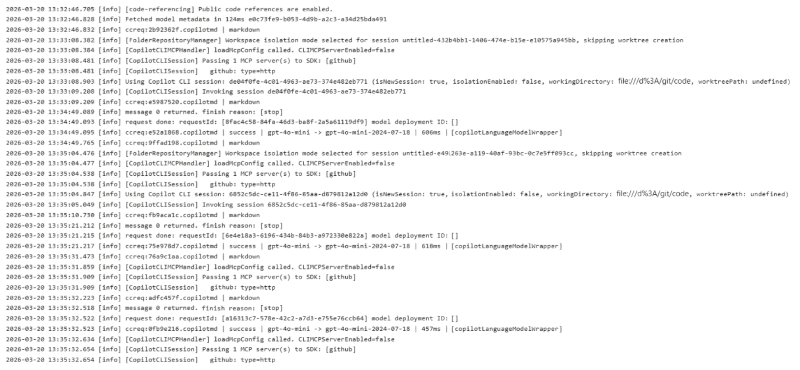 Requirements Planned Changes Contoso plans to have all agents and developers in repo1 use the Microsoft Learn MCP to ensure that reviews are validated by using the appropriate documentation. This must be implemented centrally. Contoso plans to leverage AI-powered coding agents to implement new portal features and pages. Technical Requirements App1 must be upgraded to .NET 10. A previous upgrade attempt was started by using the Copilot modernization agent, but the attempt was never finalized. You plan to retry the upgrade. You must first analyze App1 by using AI, and then generate a report that contains breaking changes and deprecated patterns before retrying the upgrade. All AI-generated code for UI styling must adhere to a predefined folder structure. The architects at Contoso need help building implementation plans for repo1. The company wants to implement a new agent named agent2 to analyze the code base and the code requirements, and then respond with a detailed plan. The agent must NOT be able to edit files or run local commands. The developers must be able to delegate work to the Copilot coding agent by assigning issues to the agent. You need to implement agent2 to meet the technical requirements. How should you complete the YAML configuration? To answer, drag the appropriate values to the correct targets. Each value may be used once, more than once, or not at all. You may need to drag the split bar between panes or scroll to view content. NOTE: Each correct selection is worth one point. 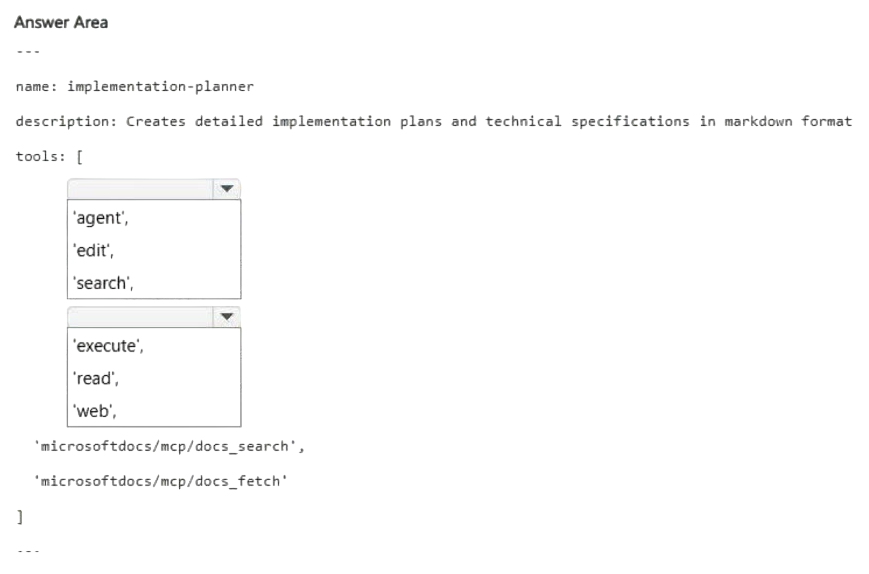

Comments:
div.jsErr {color:red} .error_message p {margin-bottom:0px;} Chosen Answer: This is a voting comment (?) . It is better to Upvote an existing comment if you don't have anything to add. Submit Cancel --> omath Most Recent 1 month, 24 days ago Answer: - First box = search - Second box = read Explanation: ✅ search: Allows the agent to find files, code, and requirements within the repository. ✅ read: Allows the agent to inspect the contents of the code and documentation. ❌ edit: Not allowed because the agent must not modify files. ❌ execute: Not allowed because the agent must not run local commands. ❌ agent: Not required because the purpose is planning, not delegating work to other agents. ❌ web: Not necessary because Microsoft Learn access is already provided through the MCP tools (docs_search and docs_fetch). upvoted 1 time Submit Cancel ... --> ? - A voting comment increases the vote count for the chosen answer by one. Upvoting a comment with a selected answer will also increase the vote count towards that answer by one. So if you see a comment that you already agree with, you can upvote it instead of posting a new comment. -->

---

## 421442-exam-gh-600-topic-2-question-2-discussion

Source: https://www.examtopics.com/discussions/microsoft/view/421442-exam-gh-600-topic-2-question-2-discussion/

**Exam GH-600 topic 2 question 2 discussion - ExamTopics**

from Microsoft's GH-600 Question #: 2 Topic #: 2 [All GH-600 Questions] Case study This is a case study. Case studies are not timed separately. You can use as much exam time as you would like to complete each case. However, there may be additional case studies and sections on this exam. You must manage your time to ensure that you are able to complete all questions included on this exam in the time provided. To answer the questions included in a case study, you will need to reference information that is provided in the case study. Case studies might contain exhibits and other resources that provide more information about the scenario that is described in the case study. Each question is independent of the other questions in this case study. At the end of this case study, a review screen will appear. This screen allows you to review your answers and to make changes before you move to the next section of the exam. After you begin a new section, you cannot return to this section. To start the case study To display the first question in this case study, click the Next button. Use the buttons in the left pane to explore the content of the case study before you answer the questions. Clicking these buttons displays information such as business requirements, existing environment, and problem statements. If the case study has an All Information tab, note that the information displayed is identical to the information displayed on the subsequent tabs. When you are ready to answer a question, click the Question button to return to the question. Overview Contoso Ltd. is a software development company located in the United States. Existing Environment GitHub Environment Contoso uses GitHub Enterprise and assigns GitHub Copilot Pro+ licenses to its developers. The developers use Microsoft Visual Studio Code as their IDE. Contoso has a customer portal. The code for the portal is stored in a GitHub repository named repo1 that contains the following: A custom agent named agent1 that includes instructions to review specs related to best practices A custom instruction file named validate-instructions.md that is used to validate tone of voice and applies to all .md and .txt files A custom instruction file named codereview.instructions.md that is used by the Copilot coding agent but is excluded for use by the Copilot code review repo1 has the following structure: The front-end is stored in the /frontend folder. The API logic is stored in the /api folder. Contoso has a second repository named repo2 that contains a legacy .NET application named App1 built by using .NET 6. repo2 has a multi-agent workflow for modernization tasks. Contoso enables the Model Context Protocol (MCP) registry and allows the Microsoft Learn MCP Server. Every developer must configure their own connection to the Learn MCP Server. Problem Statements The developers working in repo1 report that the Microsoft Learn documentation is NOT being retrieved when they attempt to validate a design by using agent1. The testing team at Contoso identifies that the customer portal uses inconsistent UI styles, which leads to customer confusion and branding issues. The UI inconsistencies stem from variations in the folder structure. Agent Logs You have the following logs for the multi-agent workflow used in repo2.  Requirements Planned Changes Contoso plans to have all agents and developers in repo1 use the Microsoft Learn MCP to ensure that reviews are validated by using the appropriate documentation. This must be implemented centrally. Contoso plans to leverage AI-powered coding agents to implement new portal features and pages. Technical Requirements App1 must be upgraded to .NET 10. A previous upgrade attempt was started by using the Copilot modernization agent, but the attempt was never finalized. You plan to retry the upgrade. You must first analyze App1 by using AI, and then generate a report that contains breaking changes and deprecated patterns before retrying the upgrade. All AI-generated code for UI styling must adhere to a predefined folder structure. The architects at Contoso need help building implementation plans for repo1. The company wants to implement a new agent named agent2 to analyze the code base and the code requirements, and then respond with a detailed plan. The agent must NOT be able to edit files or run local commands. The developers must be able to delegate work to the Copilot coding agent by assigning issues to the agent. Before App1 is upgraded, you need to verify each individual upgrade step and whether all tests have passed. Which file should you use? A. assessment.md B. plan.md C. agent.md D. tasks.md

Comments:
div.jsErr {color:red} .error_message p {margin-bottom:0px;} Chosen Answer: A B C D This is a voting comment (?) . It is better to Upvote an existing comment if you don't have anything to add. Submit Cancel --> omath Most Recent 1 month, 24 days ago Selected Answer: D Answer: ✅ D. tasks.md Explanation: The requirement states: &amp;quot;Before App1 is upgraded, you need to verify each individual upgrade step and whether all tests have passed.&amp;quot; The file that records and tracks the status of upgrade steps and validation activities is tasks.md. upvoted 1 time Submit Cancel ... --> ? - A voting comment increases the vote count for the chosen answer by one. Upvoting a comment with a selected answer will also increase the vote count towards that answer by one. So if you see a comment that you already agree with, you can upvote it instead of posting a new comment. -->

---

## 421443-exam-gh-600-topic-2-question-3-discussion

Source: https://www.examtopics.com/discussions/microsoft/view/421443-exam-gh-600-topic-2-question-3-discussion/

**Exam GH-600 topic 2 question 3 discussion - ExamTopics**

from Microsoft's GH-600 Question #: 3 Topic #: 2 [All GH-600 Questions] DRAG DROP You have a GitHub repository that has a GitHub Actions workflow. The workflow runs an AI agent. You need to ensure that the default GITHUB_TOKEN permissions are read-only, and write access is granted to only the job that performs repository write operations. The workflow must be able to create and approve pull requests only when explicitly enabled. How should you complete the workflow? To answer, drag the appropriate values to the correct targets. Each value may be used once, more than once, or not at all. You may need to drag the split bar between panes or scroll to view content. NOTE: Each correct selection is worth one point. 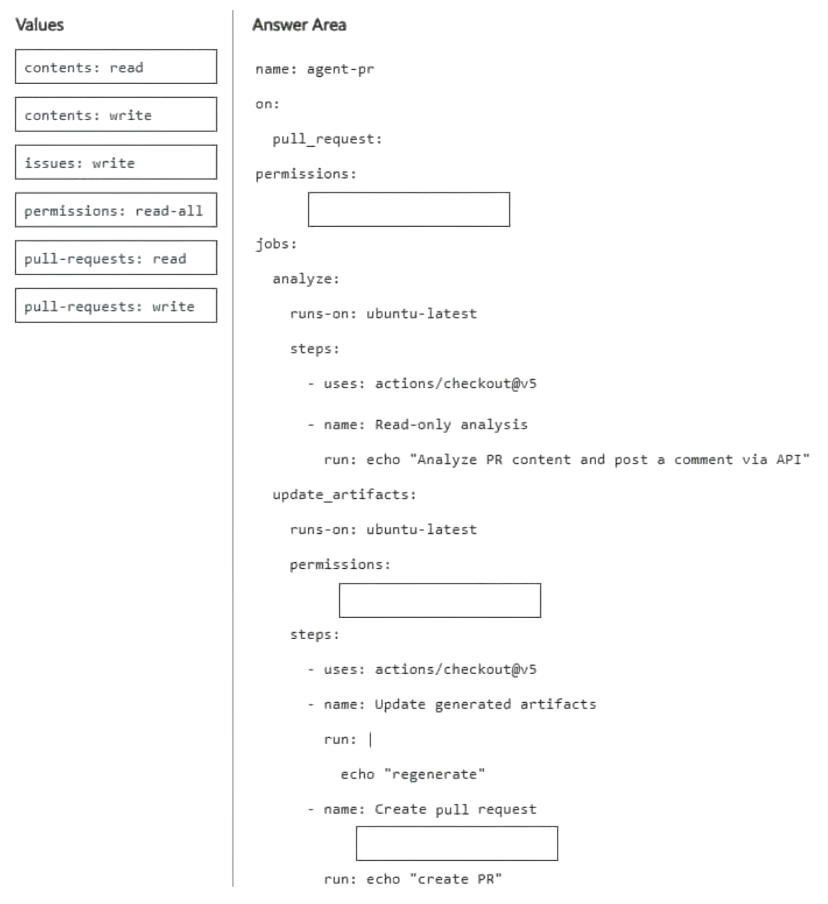

Comments:
div.jsErr {color:red} .error_message p {margin-bottom:0px;} Chosen Answer: This is a voting comment (?) . It is better to Upvote an existing comment if you don't have anything to add. Submit Cancel --> omath Most Recent 1 month, 17 days ago First box: contents: read Set the workflow's default GITHUB_TOKEN permissions to read-only. Workflow-level permissions permissions: contents: read upvoted 2 times Submit Cancel ... omath 1 month, 24 days ago Answer: - permissions: read-all - contents: write - pull-requests: write Explanation: For this GitHub Actions permissions question, the principle is: - Default workflow permissions should be read-only → permissions: read-all - Only the job that modifies the repository gets write permissions → contents: write - Creating/approving pull requests requires explicit PR write permission → pull-requests: write upvoted 1 time Submit Cancel ... --> ? - A voting comment increases the vote count for the chosen answer by one. Upvoting a comment with a selected answer will also increase the vote count towards that answer by one. So if you see a comment that you already agree with, you can upvote it instead of posting a new comment. -->

---

## 421444-exam-gh-600-topic-2-question-4-discussion

Source: https://www.examtopics.com/discussions/microsoft/view/421444-exam-gh-600-topic-2-question-4-discussion/

**Exam GH-600 topic 2 question 4 discussion - ExamTopics**

from Microsoft's GH-600 Question #: 4 Topic #: 2 [All GH-600 Questions] DRAG DROP You have a GitHub repository that uses the GitHub Copilot coding agent to resolve issues and create draft pull requests. The repository uses GitHub Actions for CI, and reviewers rely on pull request timelines and workflow artifacts to understand what the agent did. During long-running agent tasks, the reviewers lose track of decisions and validation steps, which causes repeated questions and reworks when context drifts between iterations. You need to persist task progress and decisions as durable artifacts and ensure that the reviewers can verify what the agent did during and after execution by using GitHub as the system of record. What should you do for each requirement? To answer, drag the appropriate actions to the correct requirements. Each action may be used once, more than once, or not at all. You may need to drag the split bar between panes or scroll to view content. NOTE: Each correct selection is worth one point. 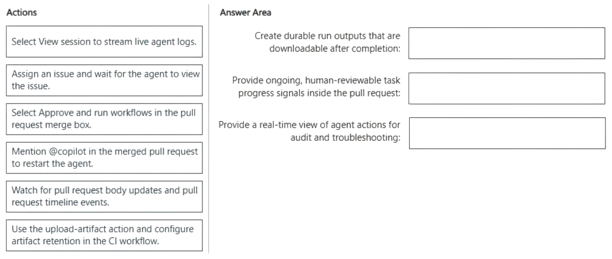

Comments:
div.jsErr {color:red} .error_message p {margin-bottom:0px;} Chosen Answer: This is a voting comment (?) . It is better to Upvote an existing comment if you don't have anything to add. Submit Cancel --> omath Most Recent 1 month, 24 days ago Answer: 1. Use the upload-artifact action and configure artifact retention in the CI workflow GitHub Actions artifacts are persisted and downloadable after workflow completion. 2. Watch for pull request body updates and pull request timeline events Copilot coding agent updates the PR body and timeline with progress, decisions, and status information. 3. Select View session to stream live agent logs Live session logs provide real-time visibility into what the agent is doing. upvoted 1 time Submit Cancel ... --> ? - A voting comment increases the vote count for the chosen answer by one. Upvoting a comment with a selected answer will also increase the vote count towards that answer by one. So if you see a comment that you already agree with, you can upvote it instead of posting a new comment. -->

---

## 421445-exam-gh-600-topic-2-question-5-discussion

Source: https://www.examtopics.com/discussions/microsoft/view/421445-exam-gh-600-topic-2-question-5-discussion/

**Exam GH-600 topic 2 question 5 discussion - ExamTopics**

from Microsoft's GH-600 Question #: 5 Topic #: 2 [All GH-600 Questions] DRAG DROP You have a GitHub Enterprise Cloud Organization that uses the GitHub Copilot coding agent to resolve issues asynchronously. When an issue is assigned to GitHub Copilot, the agent creates a draft pull request, but your team cannot always tell whether the agent is actively working, has completed its session, or is awaiting workflow approval. Which execution context does each signal indicate? To answer, drag the appropriate context to the correct signals. Each signal may be used once, more than once, or not at all. You may need to drag the split bar between panes or scroll to view content. NOTE: Each correct selection is worth one point. 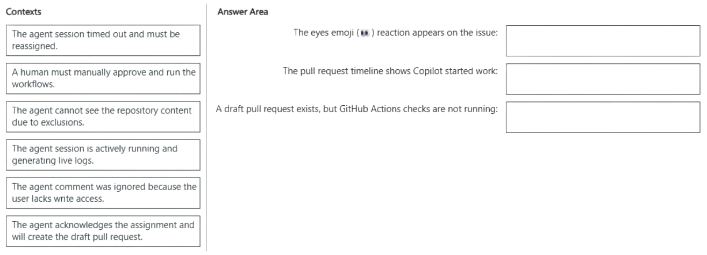

Comments:
div.jsErr {color:red} .error_message p {margin-bottom:0px;} Chosen Answer: This is a voting comment (?) . It is better to Upvote an existing comment if you don't have anything to add. Submit Cancel --> omath Most Recent 1 month, 24 days ago Answer: 1. The agent acknowledges the assignment and will create the draft pull request. GitHub Copilot adds the eyes reaction when it has accepted the assignment and is preparing to work on the issue. 2. The agent session is actively running and generating live logs. Indicates the coding agent is actively executing the task and producing logs. 3. A human must manually approve and run the workflows. Commonly means workflows require manual approval before they can run, especially for Copilot-created pull requests. upvoted 1 time Submit Cancel ... --> ? - A voting comment increases the vote count for the chosen answer by one. Upvoting a comment with a selected answer will also increase the vote count towards that answer by one. So if you see a comment that you already agree with, you can upvote it instead of posting a new comment. -->

---

## 421446-exam-gh-600-topic-2-question-6-discussion

Source: https://www.examtopics.com/discussions/microsoft/view/421446-exam-gh-600-topic-2-question-6-discussion/

**Exam GH-600 topic 2 question 6 discussion - ExamTopics**

from Microsoft's GH-600 Question #: 6 Topic #: 2 [All GH-600 Questions] You have a repository that uses the GitHub Copilot coding agent and supports hooks stored under .github/hooks. You need a Shell command to run automatically whenever an agent execution fails. Which type of hook should you use? A. postToolUse B. sessionEnd C. errorOccurred D. agentStop

Comments:
div.jsErr {color:red} .error_message p {margin-bottom:0px;} Chosen Answer: A B C D This is a voting comment (?) . It is better to Upvote an existing comment if you don't have anything to add. Submit Cancel --> omath Most Recent 1 month, 24 days ago Selected Answer: C Answer: C. errorOccurred ✅ Explanation: The requirement is: &amp;quot;Run a Shell command automatically whenever an agent execution fails.&amp;quot; A failure is an error condition, so the hook that is triggered on failures is: ✅ errorOccurred upvoted 1 time Submit Cancel ... --> ? - A voting comment increases the vote count for the chosen answer by one. Upvoting a comment with a selected answer will also increase the vote count towards that answer by one. So if you see a comment that you already agree with, you can upvote it instead of posting a new comment. -->

---

## 421447-exam-gh-600-topic-2-question-7-discussion

Source: https://www.examtopics.com/discussions/microsoft/view/421447-exam-gh-600-topic-2-question-7-discussion/

**Exam GH-600 topic 2 question 7 discussion - ExamTopics**

from Microsoft's GH-600 Question #: 7 Topic #: 2 [All GH-600 Questions] You are about to start a complex refactoring task in the GitHub Copilot CLI. Before Copilot makes any changes, you need to review and agree on the approach. What should you do first? A. Start the Copilot CLI and specify the --agent=Task parameter. B. Start the Copilot CLI and specify the --allow-all parameter. C. From the Copilot CLI, switch to plan mode. D. From the Copilot CLI, run the /compact command.

Comments:
div.jsErr {color:red} .error_message p {margin-bottom:0px;} Chosen Answer: A B C D This is a voting comment (?) . It is better to Upvote an existing comment if you don't have anything to add. Submit Cancel --> omath Most Recent 1 month, 24 days ago Selected Answer: C Answer: ✅ C. From the Copilot CLI, switch to plan mode. Explanation: The requirement is: &amp;quot;Before Copilot makes any changes, you need to review and agree on the approach.&amp;quot; Plan mode is specifically designed for this scenario. It allows Copilot to: - Analyze the task. - Propose a detailed implementation/refactoring plan. - Discuss the approach with you. - Avoid making code changes until the plan is approved. upvoted 1 time Submit Cancel ... --> ? - A voting comment increases the vote count for the chosen answer by one. Upvoting a comment with a selected answer will also increase the vote count towards that answer by one. So if you see a comment that you already agree with, you can upvote it instead of posting a new comment. -->

---

## 421448-exam-gh-600-topic-2-question-8-discussion

Source: https://www.examtopics.com/discussions/microsoft/view/421448-exam-gh-600-topic-2-question-8-discussion/

**Exam GH-600 topic 2 question 8 discussion - ExamTopics**

from Microsoft's GH-600 Question #: 8 Topic #: 2 [All GH-600 Questions] A team assigns an issue to the GitHub Copilot coding agent by using the following one-line description: Fix the login bug. Copilot creates a pull request, but the pull request is missing changes and has an incorrect scope. How should you resolve the issue? A. Enable Copilot memory. B. Update the Model Context Protocol (MCP) server rate limits. C. Add a clear description of the problem to the issue. D. Allocate more resources to copilot-setup-steps.yml.

Comments:
div.jsErr {color:red} .error_message p {margin-bottom:0px;} Chosen Answer: A B C D This is a voting comment (?) . It is better to Upvote an existing comment if you don't have anything to add. Submit Cancel --> omath Most Recent 1 month, 24 days ago Selected Answer: C Correct Answer: C. Add a clear description of the problem to the issue. Explanation: The GitHub Copilot coding agent relies heavily on the issue description to understand: - The problem to solve - Expected behavior - Scope of the work - Acceptance criteria - Relevant files or components The issue: &amp;quot;Fix the login bug.&amp;quot; is too vague. upvoted 1 time Submit Cancel ... --> ? - A voting comment increases the vote count for the chosen answer by one. Upvoting a comment with a selected answer will also increase the vote count towards that answer by one. So if you see a comment that you already agree with, you can upvote it instead of posting a new comment. -->

---

## 421449-exam-gh-600-topic-3-question-1-discussion

Source: https://www.examtopics.com/discussions/microsoft/view/421449-exam-gh-600-topic-3-question-1-discussion/

**Exam GH-600 topic 3 question 1 discussion - ExamTopics**

from Microsoft's GH-600 Question #: 1 Topic #: 3 [All GH-600 Questions] Case study This is a case study. Case studies are not timed separately. You can use as much exam time as you would like to complete each case. However, there may be additional case studies and sections on this exam. You must manage your time to ensure that you are able to complete all questions included on this exam in the time provided. To answer the questions included in a case study, you will need to reference information that is provided in the case study. Case studies might contain exhibits and other resources that provide more information about the scenario that is described in the case study. Each question is independent of the other questions in this case study. At the end of this case study, a review screen will appear. This screen allows you to review your answers and to make changes before you move to the next section of the exam. After you begin a new section, you cannot return to this section. To start the case study To display the first question in this case study, click the Next button. Use the buttons in the left pane to explore the content of the case study before you answer the questions. Clicking these buttons displays information such as business requirements, existing environment, and problem statements. If the case study has an All Information tab, note that the information displayed is identical to the information displayed on the subsequent tabs. When you are ready to answer a question, click the Question button to return to the question. Existing Environment GitHub Environment The GitHub environment contains the following: Three repositories named product-api, billing-service, and infra-terraform. Branch protection on the main branch in all repositories that requires at least one pull request review before merging GitHub Actions runners used across all workflows A GitHub team named SG_Dev that contains developers A GitHub team named SG_Review that contains senior engineers and a security team A .github/copilot-instructions.md file that includes general coding conventions for all features Agent environment The product-api repository uses a GitHub Copilot coding agent named agent1 that has the following configurations: No custom agent profile is defined. A Model Context Protocol (MCP) server named MCP1 is deployed to https://mcp.litwareinc.internal and provides access to internal ticketing and deployment APIs. MCP1 requires an API key for authentication. A second Copilot coding agent named agent2 handles changes in infra-terraform and runs in parallel with agent1 when both agents have open assigned issues. Copilot memory is NOT enabled for the organization. Problem Statements Litware identifies the following issues: During two recent sessions, agent1 accessed files in billing-service, which is outside the agent's intended scope. agent1 makes code changes immediately after receiving a task. A developer named Ben, who is on the SG_Dev team, reports that agent1 completed a session with a successful status and opened a pull request, but the pull request contains no file changes. Other developers report this intermittently as well. Both agent1 and agent2 modified shared/config.yaml in a parallel test run, generating conflicting outputs. agent1 consistently uses raw try-catch blocks for error handling, which violates the defined implementation guidelines of SG_Dev. Requirements Planned Changes Litware plans to make the following changes: Ensure that agent1 can access all the tools in the environment. Provide product-api with specific instructions to agent1 without affecting Copilot Chat or Copilot code review. Configure MCP1 as a tool for agent1 by modifying the product-api repository MCP configuration. Ensure that Copilot retains details that it has learned and uses that knowledge for future work. This must be applied to all licensed members of the organization. Implementation guidelines The development team at Litware identifies the following implementation guidelines: Agent workflows must be able to run in parallel. Application error handling must use the repository ErrorHandler class. agent1 and agent2 must run on isolated branches during parallel execution. File-level conflicts must be detected before merges, and both agents must be able to run concurrently. Security requirements Litware identifies the following security requirements: Only the members of SG_Review must be able to approve agent1 plan outputs. All API keys must be stored and accessed securely. The developers must NOT be able to self-approve. Agent configuration 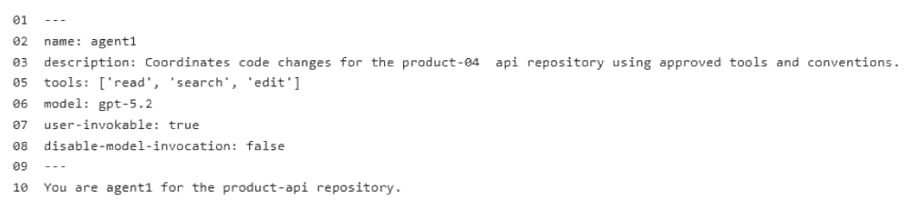 You need to configure agent1 to support the planned changes. What should you do? A. Delete line 05 from the agent configuration. B. Add Use all available tools to the .github/copilot-instructions.md file. C. Add Use all available tools to the instructions in the agent configuration. D. Add the mcp-servers property to the agent configuration. E. In the agent configuration, replace line 05 with the following.05 tools: [].

Comments:
div.jsErr {color:red} .error_message p {margin-bottom:0px;} Chosen Answer: A B C D E This is a voting comment (?) . It is better to Upvote an existing comment if you don't have anything to add. Submit Cancel --> omath 1 month, 24 days ago Selected Answer: D Correct answer: D. Add the mcp-servers property to the agent configuration. Explanation: - To support the planned changes, agent1 must be configured to use MCP1 as a tool. The only option that accomplishes this is adding the mcp-servers block to the agent YAML. - The case study states: “Configure MCP1 as a tool for agent1 by modifying the product-api repository MCP configuration.” MCP servers must be added inside the agent YAML using the mcp-servers: key. The GH‑600 study guide explicitly shows this pattern: “mcp-servers is YAML inside agent frontmatter.” upvoted 1 time Submit Cancel ... nastolgia Most Recent 1 month, 0 days ago MCP1 must be added through the product-api repository MCP configuration, as explicitly required. Adding mcp-servers to the agent profile is unnecessary and would not overcome line 05’s restrictive tool list. upvoted 1 time Submit Cancel ... --> ? - A voting comment increases the vote count for the chosen answer by one. Upvoting a comment with a selected answer will also increase the vote count towards that answer by one. So if you see a comment that you already agree with, you can upvote it instead of posting a new comment. -->

---

## 421450-exam-gh-600-topic-3-question-2-discussion

Source: https://www.examtopics.com/discussions/microsoft/view/421450-exam-gh-600-topic-3-question-2-discussion/

**Exam GH-600 topic 3 question 2 discussion - ExamTopics**

from Microsoft's GH-600 Question #: 2 Topic #: 3 [All GH-600 Questions] Case study This is a case study. Case studies are not timed separately. You can use as much exam time as you would like to complete each case. However, there may be additional case studies and sections on this exam. You must manage your time to ensure that you are able to complete all questions included on this exam in the time provided. To answer the questions included in a case study, you will need to reference information that is provided in the case study. Case studies might contain exhibits and other resources that provide more information about the scenario that is described in the case study. Each question is independent of the other questions in this case study. At the end of this case study, a review screen will appear. This screen allows you to review your answers and to make changes before you move to the next section of the exam. After you begin a new section, you cannot return to this section. To start the case study To display the first question in this case study, click the Next button. Use the buttons in the left pane to explore the content of the case study before you answer the questions. Clicking these buttons displays information such as business requirements, existing environment, and problem statements. If the case study has an All Information tab, note that the information displayed is identical to the information displayed on the subsequent tabs. When you are ready to answer a question, click the Question button to return to the question. Existing Environment GitHub Environment The GitHub environment contains the following: Three repositories named product-api, billing-service, and infra-terraform. Branch protection on the main branch in all repositories that requires at least one pull request review before merging GitHub Actions runners used across all workflows A GitHub team named SG_Dev that contains developers A GitHub team named SG_Review that contains senior engineers and a security team A .github/copilot-instructions.md file that includes general coding conventions for all features Agent environment The product-api repository uses a GitHub Copilot coding agent named agent1 that has the following configurations: No custom agent profile is defined. A Model Context Protocol (MCP) server named MCP1 is deployed to https://mcp.litwareinc.internal and provides access to internal ticketing and deployment APIs. MCP1 requires an API key for authentication. A second Copilot coding agent named agent2 handles changes in infra-terraform and runs in parallel with agent1 when both agents have open assigned issues. Copilot memory is NOT enabled for the organization. Problem Statements Litware identifies the following issues: During two recent sessions, agent1 accessed files in billing-service, which is outside the agent's intended scope. agent1 makes code changes immediately after receiving a task. A developer named Ben, who is on the SG_Dev team, reports that agent1 completed a session with a successful status and opened a pull request, but the pull request contains no file changes. Other developers report this intermittently as well. Both agent1 and agent2 modified shared/config.yaml in a parallel test run, generating conflicting outputs. agent1 consistently uses raw try-catch blocks for error handling, which violates the defined implementation guidelines of SG_Dev. Requirements Planned Changes Litware plans to make the following changes: Ensure that agent1 can access all the tools in the environment. Provide product-api with specific instructions to agent1 without affecting Copilot Chat or Copilot code review. Configure MCP1 as a tool for agent1 by modifying the product-api repository MCP configuration. Ensure that Copilot retains details that it has learned and uses that knowledge for future work. This must be applied to all licensed members of the organization. Implementation guidelines The development team at Litware identifies the following implementation guidelines: Agent workflows must be able to run in parallel. Application error handling must use the repository ErrorHandler class. agent1 and agent2 must run on isolated branches during parallel execution. File-level conflicts must be detected before merges, and both agents must be able to run concurrently. Security requirements Litware identifies the following security requirements: Only the members of SG_Review must be able to approve agent1 plan outputs. All API keys must be stored and accessed securely. The developers must NOT be able to self-approve. Agent configuration  You need to provide access to the API key of MCP1. The solution must meet the security requirements. What should you do? A. Store the API key as a GitHub Codespaces user secret scoped to product-api. B. Store the API key as a secret in the Copilot environment of product-api by using a name prefix of COPILOT_MCP_, and then reference the variable name in the mcp.json configuration. C. In the product-api repository settings, add the API key directly to the .mcp/server.json file by using a plaintext apiKey field. D. In product-api, add the API key as a GitHub Actions encrypted secret and reference the secret by using ${{ secrets.KEY }} in the workflow YAML of agent1.

Comments:
div.jsErr {color:red} .error_message p {margin-bottom:0px;} Chosen Answer: A B C D This is a voting comment (?) . It is better to Upvote an existing comment if you don't have anything to add. Submit Cancel --> omath Most Recent 1 month, 24 days ago Selected Answer: B Answer: B. Store the API key as a secret in the Copilot environment using the COPILOT_MCP_ prefix. Explanation: MCP server API keys must be stored as Copilot environment secrets, using the required prefix COPILOT_MCP_, and referenced from the agent’s MCP configuration. This is the only option that meets the GH‑600 security requirements. upvoted 1 time Submit Cancel ... --> ? - A voting comment increases the vote count for the chosen answer by one. Upvoting a comment with a selected answer will also increase the vote count towards that answer by one. So if you see a comment that you already agree with, you can upvote it instead of posting a new comment. -->

---

## 421451-exam-gh-600-topic-3-question-3-discussion

Source: https://www.examtopics.com/discussions/microsoft/view/421451-exam-gh-600-topic-3-question-3-discussion/

**Exam GH-600 topic 3 question 3 discussion - ExamTopics**

from Microsoft's GH-600 Question #: 3 Topic #: 3 [All GH-600 Questions] HOTSPOT Case study This is a case study. Case studies are not timed separately. You can use as much exam time as you would like to complete each case. However, there may be additional case studies and sections on this exam. You must manage your time to ensure that you are able to complete all questions included on this exam in the time provided. To answer the questions included in a case study, you will need to reference information that is provided in the case study. Case studies might contain exhibits and other resources that provide more information about the scenario that is described in the case study. Each question is independent of the other questions in this case study. At the end of this case study, a review screen will appear. This screen allows you to review your answers and to make changes before you move to the next section of the exam. After you begin a new section, you cannot return to this section. To start the case study To display the first question in this case study, click the Next button. Use the buttons in the left pane to explore the content of the case study before you answer the questions. Clicking these buttons displays information such as business requirements, existing environment, and problem statements. If the case study has an All Information tab, note that the information displayed is identical to the information displayed on the subsequent tabs. When you are ready to answer a question, click the Question button to return to the question. Existing Environment GitHub Environment The GitHub environment contains the following: Three repositories named product-api, billing-service, and infra-terraform. Branch protection on the main branch in all repositories that requires at least one pull request review before merging GitHub Actions runners used across all workflows A GitHub team named SG_Dev that contains developers A GitHub team named SG_Review that contains senior engineers and a security team A .github/copilot-instructions.md file that includes general coding conventions for all features Agent environment The product-api repository uses a GitHub Copilot coding agent named agent1 that has the following configurations: No custom agent profile is defined. A Model Context Protocol (MCP) server named MCP1 is deployed to https://mcp.litwareinc.internal and provides access to internal ticketing and deployment APIs. MCP1 requires an API key for authentication. A second Copilot coding agent named agent2 handles changes in infra-terraform and runs in parallel with agent1 when both agents have open assigned issues. Copilot memory is NOT enabled for the organization. Problem Statements Litware identifies the following issues: During two recent sessions, agent1 accessed files in billing-service, which is outside the agent's intended scope. agent1 makes code changes immediately after receiving a task. A developer named Ben, who is on the SG_Dev team, reports that agent1 completed a session with a successful status and opened a pull request, but the pull request contains no file changes. Other developers report this intermittently as well. Both agent1 and agent2 modified shared/config.yaml in a parallel test run, generating conflicting outputs. agent1 consistently uses raw try-catch blocks for error handling, which violates the defined implementation guidelines of SG_Dev. Requirements Planned Changes Litware plans to make the following changes: Ensure that agent1 can access all the tools in the environment. Provide product-api with specific instructions to agent1 without affecting Copilot Chat or Copilot code review. Configure MCP1 as a tool for agent1 by modifying the product-api repository MCP configuration. Ensure that Copilot retains details that it has learned and uses that knowledge for future work. This must be applied to all licensed members of the organization. Implementation guidelines The development team at Litware identifies the following implementation guidelines: Agent workflows must be able to run in parallel. Application error handling must use the repository ErrorHandler class. agent1 and agent2 must run on isolated branches during parallel execution. File-level conflicts must be detected before merges, and both agents must be able to run concurrently. Security requirements Litware identifies the following security requirements: Only the members of SG_Review must be able to approve agent1 plan outputs. All API keys must be stored and accessed securely. The developers must NOT be able to self-approve. Agent configuration  You are evaluating how agent1 will behave after you implement the planned changes. For each of the following statements, select Yes if the statement is true. Otherwise, select No. NOTE: Each correct selection is worth one point. 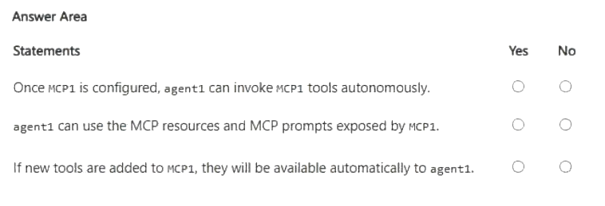

Comments:
div.jsErr {color:red} .error_message p {margin-bottom:0px;} Chosen Answer: This is a voting comment (?) . It is better to Upvote an existing comment if you don't have anything to add. Submit Cancel --> nastolgia Most Recent 1 month, 0 days ago 1 - Yes GitHub states: “Copilot will use available tools autonomously, and will not ask for approval before use.” Approval of agent1’s implementation plan is a separate security control; it does not require approval for every MCP tool call. 2 - No GitHub states that cloud agents “only support MCP tools” and “do not currently support resources or prompts provided by the MCP server.” Copilot Chat in an IDE may support resources and prompts, but the case concerns the Copilot cloud coding agent. 3 - Yes GitHub says you can “omit the tools property entirely or use tools: [&amp;quot;*&amp;quot;] to enable all available tools.” upvoted 1 time Submit Cancel ... omath 1 month, 24 days ago 1. No GH‑600 rules are explicit: agents cannot autonomously invoke MCP tools. They can plan to use MCP tools, but execution requires human approval of the plan output. 2. Yes Once MCP1 is added under mcp-servers and the secret is configured, agent1 gains access to: MCP tolos, MCP resources, MCP prompts 3. Yes If the MCP server configuration uses: tools: [&amp;quot;*&amp;quot;] then any new tools added to MCP1 automatically become available to agent1 without updating the agent YAML. upvoted 1 time Submit Cancel ... --> ? - A voting comment increases the vote count for the chosen answer by one. Upvoting a comment with a selected answer will also increase the vote count towards that answer by one. So if you see a comment that you already agree with, you can upvote it instead of posting a new comment. -->

---

## 421452-exam-gh-600-topic-3-question-4-discussion

Source: https://www.examtopics.com/discussions/microsoft/view/421452-exam-gh-600-topic-3-question-4-discussion/

**Exam GH-600 topic 3 question 4 discussion - ExamTopics**

from Microsoft's GH-600 Question #: 4 Topic #: 3 [All GH-600 Questions] Case study This is a case study. Case studies are not timed separately. You can use as much exam time as you would like to complete each case. However, there may be additional case studies and sections on this exam. You must manage your time to ensure that you are able to complete all questions included on this exam in the time provided. To answer the questions included in a case study, you will need to reference information that is provided in the case study. Case studies might contain exhibits and other resources that provide more information about the scenario that is described in the case study. Each question is independent of the other questions in this case study. At the end of this case study, a review screen will appear. This screen allows you to review your answers and to make changes before you move to the next section of the exam. After you begin a new section, you cannot return to this section. To start the case study To display the first question in this case study, click the Next button. Use the buttons in the left pane to explore the content of the case study before you answer the questions. Clicking these buttons displays information such as business requirements, existing environment, and problem statements. If the case study has an All Information tab, note that the information displayed is identical to the information displayed on the subsequent tabs. When you are ready to answer a question, click the Question button to return to the question. Overview Contoso Ltd. is a software development company located in the United States. Existing Environment GitHub Environment Contoso uses GitHub Enterprise and assigns GitHub Copilot Pro+ licenses to its developers. The developers use Microsoft Visual Studio Code as their IDE. Contoso has a customer portal. The code for the portal is stored in a GitHub repository named repo1 that contains the following: A custom agent named agent1 that includes instructions to review specs related to best practices A custom instruction file named validate-instructions.md that is used to validate tone of voice and applies to all .md and .txt files A custom instruction file named codereview.instructions.md that is used by the Copilot coding agent but is excluded for use by the Copilot code review repo1 has the following structure: The front-end is stored in the /frontend folder. The API logic is stored in the /api folder. Contoso has a second repository named repo2 that contains a legacy .NET application named App1 built by using .NET 6. repo2 has a multi-agent workflow for modernization tasks. Contoso enables the Model Context Protocol (MCP) registry and allows the Microsoft Learn MCP Server. Every developer must configure their own connection to the Learn MCP Server. Problem Statements The developers working in repo1 report that the Microsoft Learn documentation is NOT being retrieved when they attempt to validate a design by using agent1. The testing team at Contoso identifies that the customer portal uses inconsistent UI styles, which leads to customer confusion and branding issues. The UI inconsistencies stem from variations in the folder structure. Agent Logs You have the following logs for the multi-agent workflow used in repo2.  Requirements Planned Changes Contoso plans to have all agents and developers in repo1 use the Microsoft Learn MCP to ensure that reviews are validated by using the appropriate documentation. This must be implemented centrally. Contoso plans to leverage AI-powered coding agents to implement new portal features and pages. Technical Requirements App1 must be upgraded to .NET 10. A previous upgrade attempt was started by using the Copilot modernization agent, but the attempt was never finalized. You plan to retry the upgrade. You must first analyze App1 by using AI, and then generate a report that contains breaking changes and deprecated patterns before retrying the upgrade. All AI-generated code for UI styling must adhere to a predefined folder structure. The architects at Contoso need help building implementation plans for repo1. The company wants to implement a new agent named agent2 to analyze the code base and the code requirements, and then respond with a detailed plan. The agent must NOT be able to edit files or run local commands. The developers must be able to delegate work to the Copilot coding agent by assigning issues to the agent. You need to make changes to repo1 to support the planned changes for the agents. What should you modify? A. .github/agents/*.agent.md B. .vscode/settings.json C. .vscode/mcp.json D. &lt;project&gt;/.mcp/server.json

Comments:
div.jsErr {color:red} .error_message p {margin-bottom:0px;} Chosen Answer: A B C D This is a voting comment (?) . It is better to Upvote an existing comment if you don't have anything to add. Submit Cancel --> Gobe 5 days ago Selected Answer: C This is the documented location for VS Code MCP server configuration. Committing this file to repo1 ensures all developers and agents using VS Code have the Microsoft Learn MCP server available automatically. This satisfies &amp;quot;implemented centrally&amp;quot; upvoted 1 time Submit Cancel ... SrideviArvi 7 days ago Selected Answer: A custom agent definitions and their associated MCP tool integrations for Github copilot agents are defined centrally inside respository markdown files located in .github/agents/*.agent.md, updating this file in the repository ensures that agent 1 and all repository agents centrally receive access to the Microsoft learn MCP tool definitions across entire team upvoted 1 time Submit Cancel ... omath Most Recent 1 month, 24 days ago Selected Answer: C Correct answer: C. .vscode/mcp.json Explanation: To make Microsoft Learn MCP available centrally for all agents and developers in repo1, you must modify the repository‑level MCP configuration, not per‑developer settings or agent profiles. In GitHub’s agent architecture, central MCP configuration lives in the repo, and the correct file for VS Code + Copilot agent surfaces is .vscode/mcp.json. upvoted 1 time Submit Cancel ... --> ? - A voting comment increases the vote count for the chosen answer by one. Upvoting a comment with a selected answer will also increase the vote count towards that answer by one. So if you see a comment that you already agree with, you can upvote it instead of posting a new comment. -->

---

## 421453-exam-gh-600-topic-3-question-5-discussion

Source: https://www.examtopics.com/discussions/microsoft/view/421453-exam-gh-600-topic-3-question-5-discussion/

**Exam GH-600 topic 3 question 5 discussion - ExamTopics**

from Microsoft's GH-600 Question #: 5 Topic #: 3 [All GH-600 Questions] You have a GitHub repository. You use the GitHub Copilot CLI to run an agentic workflow from the terminal. During execution, the conversation history approaches the context limit. The agent cannot continue the current session unless the amount of retained context is reduced. You need to continue the current session without losing all the prior progress. Which Copilot CLI slash command should you run? A. /context B. /yolo C. /clear D. /compact

Comments:
div.jsErr {color:red} .error_message p {margin-bottom:0px;} Chosen Answer: A B C D This is a voting comment (?) . It is better to Upvote an existing comment if you don't have anything to add. Submit Cancel --> omath Most Recent 1 month, 24 days ago Selected Answer: D Correct answer: D. /compact Takeaway: The Copilot CLI slash command you use when the conversation history is approaching the context limit — and you need to continue the same session without losing progress — is /compact. It reduces retained context while preserving the essential state so the agent can keep going. upvoted 1 time Submit Cancel ... --> ? - A voting comment increases the vote count for the chosen answer by one. Upvoting a comment with a selected answer will also increase the vote count towards that answer by one. So if you see a comment that you already agree with, you can upvote it instead of posting a new comment. -->

---

## 421454-exam-gh-600-topic-3-question-6-discussion

Source: https://www.examtopics.com/discussions/microsoft/view/421454-exam-gh-600-topic-3-question-6-discussion/

**Exam GH-600 topic 3 question 6 discussion - ExamTopics**

from Microsoft's GH-600 Question #: 6 Topic #: 3 [All GH-600 Questions] You have a GitHub Enterprise repository. An agent opens pull requests to the main branch. You need to ensure that changes to .github/workflows/* and /infra/* require approval from designated reviewers before merge. What should you configure? A. a ruleset and an agents.md file B. a ruleset and a .copilotignore file C. a branch protection rule and a CODEOWNERS file D. a branch protection rule and copilot-instructions.md

Comments:
div.jsErr {color:red} .error_message p {margin-bottom:0px;} Chosen Answer: A B C D This is a voting comment (?) . It is better to Upvote an existing comment if you don't have anything to add. Submit Cancel --> omath Most Recent 1 month, 23 days ago Selected Answer: C Correct answer: C. a branch protection rule and a CODEOWNERS file Takeaway: To ensure that changes to .github/workflows/* and /infra/* require approval from designated reviewers before merging into main, you must combine branch protection rules with CODEOWNERS. This is the only configuration that enforces mandatory review for specific paths in a GitHub Enterprise repository. upvoted 1 time Submit Cancel ... --> ? - A voting comment increases the vote count for the chosen answer by one. Upvoting a comment with a selected answer will also increase the vote count towards that answer by one. So if you see a comment that you already agree with, you can upvote it instead of posting a new comment. -->

---

## 421455-exam-gh-600-topic-3-question-7-discussion

Source: https://www.examtopics.com/discussions/microsoft/view/421455-exam-gh-600-topic-3-question-7-discussion/

**Exam GH-600 topic 3 question 7 discussion - ExamTopics**

from Microsoft's GH-600 Question #: 7 Topic #: 3 [All GH-600 Questions] HOTSPOT You have a GitHub repository that uses the following GrtHub Copilot CLI command in a Bash script. 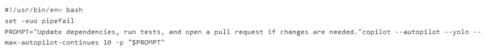 For each of the following statements, select Yes if the statement is true. Otherwise, select No. NOTE: Each correct selection is worth one point. 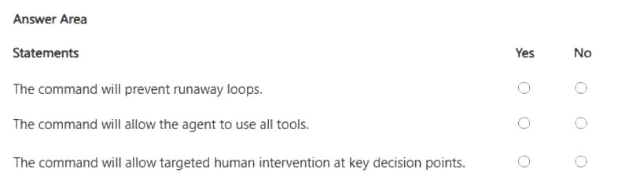

Comments:
div.jsErr {color:red} .error_message p {margin-bottom:0px;} Chosen Answer: This is a voting comment (?) . It is better to Upvote an existing comment if you don't have anything to add. Submit Cancel --> 84ae4c5 Most Recent 1 month, 10 days ago Answers: Yes, No, No. Explanation: Prevent runaway loops → Yes --max-autopilot-continues 10 limits the number of autonomous continuation cycles, helping prevent indefinite looping. Allow the agent to use all tools → No Neither --autopilot nor --yolo grants access to all tools. Tool availability depends on the configured environment and permissions. Allow targeted human intervention at key decision points → No --yolo is specifically intended to reduce prompts for approval and proceed automatically. It does not introduce human checkpoints. upvoted 1 time Submit Cancel ... omath 1 month, 23 days ago 1. No --max-autopilot-continues 10 limits how many autonomous steps the agent can take, but --yolo removes safety pauses and confirmations. This combination does not prevent runaway loops — it actually makes them more likely unless the step limit is hit. 2. Yes --autopilot enables full autonomous operation, and --yolo removes confirmation gates. Together, they allow the agent to freely use all available tools in the workflow. 3. No --yolo explicitly removes human intervention checkpoints. The agent will not pause for approval or guidance. upvoted 1 time Submit Cancel ... --> ? - A voting comment increases the vote count for the chosen answer by one. Upvoting a comment with a selected answer will also increase the vote count towards that answer by one. So if you see a comment that you already agree with, you can upvote it instead of posting a new comment. -->

---

## 421456-exam-gh-600-topic-3-question-8-discussion

Source: https://www.examtopics.com/discussions/microsoft/view/421456-exam-gh-600-topic-3-question-8-discussion/

**Exam GH-600 topic 3 question 8 discussion - ExamTopics**

from Microsoft's GH-600 Question #: 8 Topic #: 3 [All GH-600 Questions] HOTSPOT You have a GitHub repository that uses GitHub Actions for CI. Your team is piloting the GitHub Copilot coding agent to autonomously create branches and open pull requests. The repository follows trunk-based development that uses main as the default branch. You need to ensure that the agent meets the following requirements: Changes to main can occur only by using pull requests that have at least one approval. When a pull request is opened, a validation workflow runs, and the agent can still create branches and open pull requests autonomously. How should you configure the repository? To answer, select the appropriate options in the answer area. NOTE: Each correct selection is worth one point. 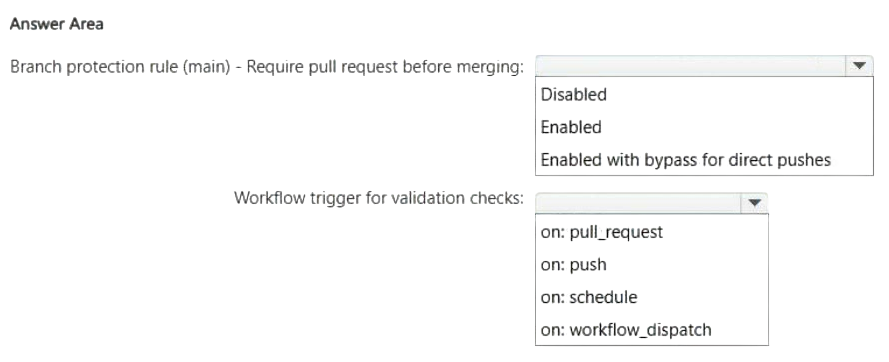

Comments:
div.jsErr {color:red} .error_message p {margin-bottom:0px;} Chosen Answer: This is a voting comment (?) . It is better to Upvote an existing comment if you don't have anything to add. Submit Cancel --> omath Most Recent 1 month, 23 days ago 1. Enabled - No direct pushes to main - All changes must come through pull requests - At least one approval required (when combined with “Require review from Code Owners” or reviewer rules) 2. on: pull_request - CI validation runs automatically when the agent opens a pull request - The agent can still autonomously create branches and PRs - Validation happens before merge, which is required in trunk‑based development upvoted 1 time Submit Cancel ... --> ? - A voting comment increases the vote count for the chosen answer by one. Upvoting a comment with a selected answer will also increase the vote count towards that answer by one. So if you see a comment that you already agree with, you can upvote it instead of posting a new comment. -->

---

## 421457-exam-gh-600-topic-3-question-9-discussion

Source: https://www.examtopics.com/discussions/microsoft/view/421457-exam-gh-600-topic-3-question-9-discussion/

**Exam GH-600 topic 3 question 9 discussion - ExamTopics**

from Microsoft's GH-600 Question #: 9 Topic #: 3 [All GH-600 Questions] You have a repository on github.com that uses the GitHub Copilot coding agent. You also use the GitHub Copilot CLI locally to reproduce failures and continue the same work from your terminal. You need to verify the current token usage. Which Copilot CLI slash command should you run? A. /compact B. /diff C. /usage D. /context

Comments:
div.jsErr {color:red} .error_message p {margin-bottom:0px;} Chosen Answer: A B C D This is a voting comment (?) . It is better to Upvote an existing comment if you don't have anything to add. Submit Cancel --> 84ae4c5 Most Recent 1 month, 10 days ago Selected Answer: C The /usage slash command in the GitHub Copilot CLI displays the current token usage and consumption information for your Copilot session. The other options serve different purposes: - /compact: Reduces or summarizes conversation context. - /diff: Shows code or file differences. - /context: Displays the current context available to Copilot. upvoted 1 time Submit Cancel ... omath 1 month, 23 days ago Selected Answer: D Correct answer: C. /usage Takeaway: To verify your current GitHub Copilot token usage from the Copilot CLI — especially when you're reproducing failures locally and continuing the same agentic workflow — you run /usage. It’s the only slash command designed to show your token consumption and remaining quota. upvoted 1 time Submit Cancel ... --> ? - A voting comment increases the vote count for the chosen answer by one. Upvoting a comment with a selected answer will also increase the vote count towards that answer by one. So if you see a comment that you already agree with, you can upvote it instead of posting a new comment. -->

---

## 421458-exam-gh-600-topic-3-question-10-discussion

Source: https://www.examtopics.com/discussions/microsoft/view/421458-exam-gh-600-topic-3-question-10-discussion/

**Exam GH-600 topic 3 question 10 discussion - ExamTopics**

from Microsoft's GH-600 Question #: 10 Topic #: 3 [All GH-600 Questions] DRAG DROP Your team uses a remote GitHub Model Context Protocol (MCP) server for workflows in the software development life cycle (SDLC). You need to commit a workspace-scoped MCP configuration to ensure that GitHub Copilot can connect to the GitHub-hosted MCP endpoint and authenticate by using a GitHub personal access token (PAT). How should you complete the mcp.json configuration file? To answer, drag the appropriate values to the correct targets. Each value may be used once, more than once, or not at all. You may need to drag the split bar between panes or scroll to view content. NOTE: Each correct selection is worth one point. 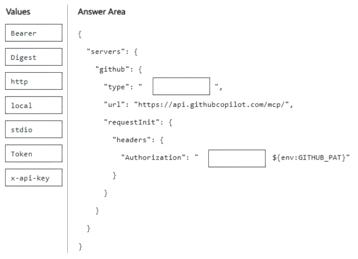

Comments:
div.jsErr {color:red} .error_message p {margin-bottom:0px;} Chosen Answer: This is a voting comment (?) . It is better to Upvote an existing comment if you don't have anything to add. Submit Cancel --> omath Most Recent 1 month, 22 days ago type: &amp;quot;http&amp;quot; GitHub’s MCP endpoint is an HTTP server. Other values like local, stdio, or x-api-key do not apply. Authorization: &amp;quot;Bearer ${env:GITHUB_PAT}&amp;quot; GitHub PATs authenticate using the Bearer scheme. Token or x-api-key would not work for GitHub’s MCP endpoint. upvoted 1 time Submit Cancel ... --> ? - A voting comment increases the vote count for the chosen answer by one. Upvoting a comment with a selected answer will also increase the vote count towards that answer by one. So if you see a comment that you already agree with, you can upvote it instead of posting a new comment. -->

---

## 421459-exam-gh-600-topic-3-question-11-discussion

Source: https://www.examtopics.com/discussions/microsoft/view/421459-exam-gh-600-topic-3-question-11-discussion/

**Exam GH-600 topic 3 question 11 discussion - ExamTopics**

from Microsoft's GH-600 Question #: 11 Topic #: 3 [All GH-600 Questions] You have a GitHub Copilot coding agent named CodeAgent. The .agent.md file of CodeAgent contains the following YAML frontmatter. --- name: CodeAgent description: Performs repository analysis and code review tasks. tools: ['edit', 'execute', 'read', 'search'] --- You need to issue a GitHub Copilot CLI command that preserves execution velocity for read-only tasks by eliminating approval prompts for low-risk tools. The solution must ensure that high-risk tools that can make changes remain available but still require explicit user approval before running. Which command should you run? A. copilot agent run CodeAgent --deny-tool 'edit,execute' B. copilot agent run CodeAgent --allow-all-tools C. copilot agent run CodeAgent D. copilot agent run CodeAgent --allow-tool 'read,search' E. copilot agent run CodeAgent --allow-tool 'read,search' --deny-tool 'edit,execute'

Comments:
div.jsErr {color:red} .error_message p {margin-bottom:0px;} Chosen Answer: A B C D E This is a voting comment (?) . It is better to Upvote an existing comment if you don't have anything to add. Submit Cancel --> Whirly 5 days ago Selected Answer: D Auto Approve read search and human approve edit execute --deny will not be able to access the tools upvoted 1 time Submit Cancel ... nastolgia Most Recent 1 month, 0 days ago Selected Answer: D Answer is D This pre-approves the low-risk read and search tools, removing their approval prompts. The edit and execute tools remain available but still require explicit approval. upvoted 2 times Submit Cancel ... 84ae4c5 1 month, 10 days ago Selected Answer: D Why? read and search are low-risk, read-only tools. --allow-tool 'read,search' allows CodeAgent to use those tools without approval prompts, improving execution speed for analysis and review tasks. The higher-risk tools edit and execute remain available because they are defined in the agent configuration, but they continue to require explicit user approval before execution by default. Why the others are incorrect: A and E: --deny-tool 'edit,execute' removes those tools entirely, but the requirement says they must remain available. B: --allow-all-tools removes approval barriers for all tools, including high-risk ones. C: Uses default behavior and does not eliminate prompts for the low-risk tools. upvoted 2 times Submit Cancel ... omath 1 month, 22 days ago Selected Answer: E Correct answer: E. copilot agent run CodeAgent --allow-tool 'read,search' --deny-tool 'edit,execute' Takeaway: You want the agent to run fast for read‑only tasks (no approval prompts) while still requiring explicit approval for high‑risk tools (edit, execute). The only command that achieves both goals is E. upvoted 1 time Submit Cancel ... --> ? - A voting comment increases the vote count for the chosen answer by one. Upvoting a comment with a selected answer will also increase the vote count towards that answer by one. So if you see a comment that you already agree with, you can upvote it instead of posting a new comment. -->

---

## 421460-exam-gh-600-topic-3-question-12-discussion

Source: https://www.examtopics.com/discussions/microsoft/view/421460-exam-gh-600-topic-3-question-12-discussion/

**Exam GH-600 topic 3 question 12 discussion - ExamTopics**

from Microsoft's GH-600 Question #: 12 Topic #: 3 [All GH-600 Questions] DRAG DROP You have a GitHub repository that uses GitHub Actions for CI on pull requests. You have a GitHub Copilot coding agent that opens pull requests for backlog items, and your company requires automated checks for agent-generated changes. You plan to standardize success criteria so that pull requests created by agents only succeed when unit tests pass and CodeQL analysis completes. You need to configure a GitHub Actions workflow that runs on pull requests, executes unit tests, and performs CodeQL analysis. How should you complete the workflow? To answer, drag the appropriate values to the correct targets. Each value may be used once, more than once, or not at all. You may need to drag the split bar between panes or scroll to view content. NOTE: Each correct selection is worth one point. 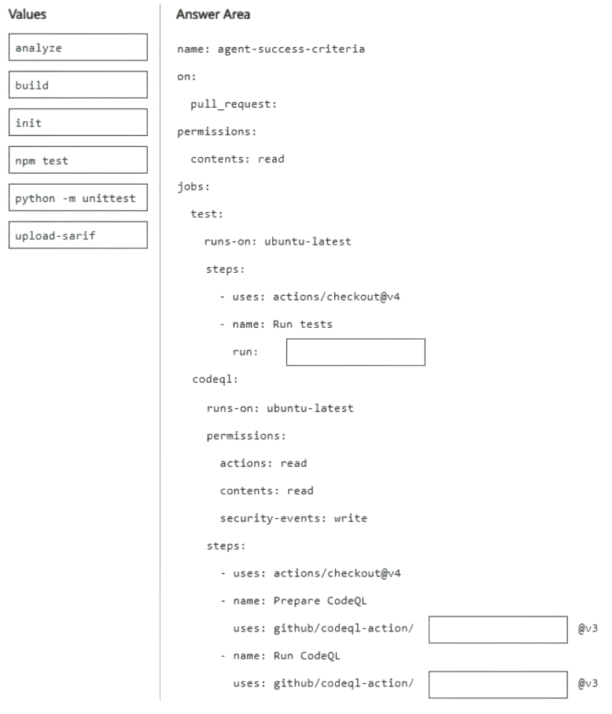

Comments:
div.jsErr {color:red} .error_message p {margin-bottom:0px;} Chosen Answer: This is a voting comment (?) . It is better to Upvote an existing comment if you don't have anything to add. Submit Cancel --> omath Most Recent 1 month, 22 days ago 1. Run tests → npm test This is the correct value for the run: field in the test job. 2. Prepare CodeQL → init The CodeQL action uses two steps: init → sets up CodeQL analyze → runs the analysis 3. Run CodeQL → analyze upvoted 1 time Submit Cancel ... --> ? - A voting comment increases the vote count for the chosen answer by one. Upvoting a comment with a selected answer will also increase the vote count towards that answer by one. So if you see a comment that you already agree with, you can upvote it instead of posting a new comment. -->

---

## 421461-exam-gh-600-topic-3-question-13-discussion

Source: https://www.examtopics.com/discussions/microsoft/view/421461-exam-gh-600-topic-3-question-13-discussion/

**Exam GH-600 topic 3 question 13 discussion - ExamTopics**

from Microsoft's GH-600 Question #: 13 Topic #: 3 [All GH-600 Questions] You have a GitHub Enterprise Cloud repository that uses the GitHub Copilot coding agent. Engineers assign issues to Copilot, and Copilot creates draft pull requests. The engineers start tasks either by assigning issues on github.com or by using GitHub Copilot Chat in an IDE. Reviewers request updates by leaving pull request comments. You discover that sometimes, Copilot uses outdated requirements after a reviewer posts an updated instruction in a pull request comment, and, in several cases, Copilot fails to resume work from the comment. You need to ensure that iteration requests are applied to the correct pull request session and are processed consistently. What should you do? A. Ensure that the reviewer has write access to the repository. Instruct the reviewer to mention @copilot in the pull request comments. B. Ensure that the agent has write access to the repository. Instruct the reviewer to mention @github in the task comments. C. Ensure that the agent has write access to the repository. Instruct the reviewer to unassign and reassign the original issue to Copilot. D. Start a new task from Copilot Chat in the IDE. Instruct the reviewer to mention @github in the task comments.

Comments:
. You discover that sometimes, Copilot uses outdated requirements after a reviewer posts an updated instruction in a pull request comment, and, in several cases, Copilot fails to resume work from the comment. You need to ensure that iteration requests are applied to the correct pull request session and are processed consistently. What should you do? A. Ensure that the reviewer has write access to the repository. Instruct the reviewer to mention @copilot in the pull request comments. B. Ensure that the agent has write access to the repository. Instruct the reviewer to mention @github in the task comments. C. Ensure that the agent has write access to the repository. Instruct the reviewer to unassign and reassign the original issue to Copilot. D. Start a new task from Copilot Chat in the IDE. Instruct the reviewer to mention @github in the task comments. Show Suggested Answer by HappyBlaze_6105 at July 27, 2026 07:07 pm Comments div.jsErr {color:red} .error_message p {margin-bottom:0px;} Chosen Answer: A B C D This is a voting comment (?) . It is better to Upvote an existing comment if you don't have anything to add. Submit Cancel --> omath Most Recent 1 month, 22 days ago Selected Answer: A Correct answer: A. Ensure that the reviewer has write access to the repository. Instruct the reviewer to mention @copilot in the pull request comments. Takeaway: To guarantee that iteration requests are routed to the correct pull‑request session and processed reliably, reviewers must mention @copilot in their PR comments — and they must have write access so Copilot can treat their instructions as authoritative updates to the task. This is the only option that aligns with how GitHub Copilot coding agents bind comments to active sessions. upvoted 1 time Submit Cancel ... --> ? - A voting comment increases the vote count for the chosen answer by one. Upvoting a comment with a selected answer will also increase the vote count towards that answer by one. So if you see a comment that you already agree with, you can upvote it instead of posting a new comment. -->

---

## 421462-exam-gh-600-topic-3-question-14-discussion

Source: https://www.examtopics.com/discussions/microsoft/view/421462-exam-gh-600-topic-3-question-14-discussion/

**Exam GH-600 topic 3 question 14 discussion - ExamTopics**

from Microsoft's GH-600 Question #: 14 Topic #: 3 [All GH-600 Questions] HOTSPOT Your company uses GitHub Copilot custom agents in Microsoft Visual Studio Code. The company also uses the Copilot coding agent on GitHub issues. You have a file named .planner.agent.md that defines an agent named planner.planner has tools set to ['search', 'read', 'fetch']. There are explicit instructions NOT to write or modify any code. The file also defines a handoff labeled Start Implementation to an agent named implementer and sets send to false. Developers report that after the planner agent produces a plan, implementation sometimes starts immediately in the same conversation, and code changes appear without an explicit agent switch. When Copilot-created pull requests stall, maintainers review the pull request timeline and session logs. Several stalled sessions show outbound network commands blocked by a firewall, and the repositories do NOT contain a .github/copilot-instructions.md file. For each of the following statements, select Yes if the statement is true. Otherwise, select No. NOTE: Each correct selection is worth one point. 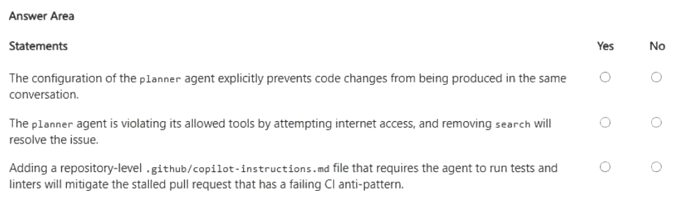

Comments:
div.jsErr {color:red} .error_message p {margin-bottom:0px;} Chosen Answer: This is a voting comment (?) . It is better to Upvote an existing comment if you don't have anything to add. Submit Cancel --> omath Most Recent 1 month, 22 days ago 1. Yes The planner agent is configured with read‑only tools and explicit “no code changes” instructions, so its setup does prevent code generation. 2. No Network calls come from allowed tools (search, fetch), so the agent isn’t violating its tool policy. Removing search wouldn’t fix the firewall issue. 3. Yes A repository‑level copilot-instructions.md gives agents consistent rules (like running tests/linters), which helps prevent stalled PRs caused by failing CI. upvoted 1 time Submit Cancel ... --> ? - A voting comment increases the vote count for the chosen answer by one. Upvoting a comment with a selected answer will also increase the vote count towards that answer by one. So if you see a comment that you already agree with, you can upvote it instead of posting a new comment. -->

---

## 421463-exam-gh-600-topic-3-question-15-discussion

Source: https://www.examtopics.com/discussions/microsoft/view/421463-exam-gh-600-topic-3-question-15-discussion/

**Exam GH-600 topic 3 question 15 discussion - ExamTopics**

from Microsoft's GH-600 Question #: 15 Topic #: 3 [All GH-600 Questions] You have a GitHub repository. Developers use the GitHub Copilot CLI and repository-scoped hooks under .github/hooks/*.json. You need to allow the Copilot CLI to automatically run low-risk Bash commands. The solution must prevent the autonomous execution of high-risk commands, such as sudo, rm -rf /, and curl ... | bash. What should you do? A. Configure a userPromptSubmitted hook that logs prompts and exits nonzero. B. Add .github/hooks/logs/ to .gitignore. C. Configure a sessionStart hook that prints a policy banner. D. Configure a preToolUse hook that returns permissionDecision: "deny".

Comments:
div.jsErr {color:red} .error_message p {margin-bottom:0px;} Chosen Answer: A B C D This is a voting comment (?) . It is better to Upvote an existing comment if you don't have anything to add. Submit Cancel --> omath Most Recent 1 month, 22 days ago Selected Answer: D Correct answer: D.&amp;quot; Here’s the short, targeted reasoning for each option: A. userPromptSubmitted hook → No This only logs prompts or blocks them entirely. It does not evaluate or filter commands the agent tries to run. B. Add .github/hooks/logs/ to .gitignore → No Ignoring logs has no effect on tool permissions or command execution. C. sessionStart banner → No A banner is informational only. It does not enforce any policy or block dangerous commands. D. preToolUse hook with permissionDecision: &amp;quot;deny&amp;quot; → Yes preToolUse is the only hook that can inspect each tool invocation and selectively allow or deny commands. upvoted 1 time Submit Cancel ... --> ? - A voting comment increases the vote count for the chosen answer by one. Upvoting a comment with a selected answer will also increase the vote count towards that answer by one. So if you see a comment that you already agree with, you can upvote it instead of posting a new comment. -->

---

## 421464-exam-gh-600-topic-3-question-16-discussion

Source: https://www.examtopics.com/discussions/microsoft/view/421464-exam-gh-600-topic-3-question-16-discussion/

**Exam GH-600 topic 3 question 16 discussion - ExamTopics**

from Microsoft's GH-600 Question #: 16 Topic #: 3 [All GH-600 Questions] HOTSPOT Your company uses Microsoft Visual Studio Code and GitHub Copilot Chat. You have a GitHub repository that uses main as the default branch. The repository contains a workspace custom agent stored at .github/agents/release-notes.agent.md. A developer switches to a branch named branch1 where the agent file does NOT exist. In the same session, the developer switches to a user profile named profile1.profile1 contains a custom agent file named release-notes.agent.md that has user-invokable set to false. For each of the following statements, select Yes if the statement is true. Otherwise, select No. NOTE: Each correct selection is worth one point. 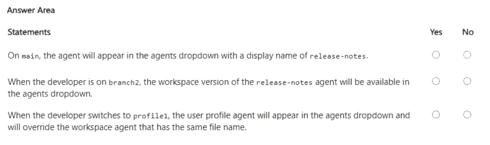

Comments:
div.jsErr {color:red} .error_message p {margin-bottom:0px;} Chosen Answer: This is a voting comment (?) . It is better to Upvote an existing comment if you don't have anything to add. Submit Cancel --> omath Most Recent 1 month, 22 days ago 1. Yes On main, the workspace agent file exists at .github/agents/release-notes.agent.md, so it does appear in the agent dropdown. 2. No On branch2, the agent file does not exist, so the workspace agent does not appear. 3. No The user profile agent has user-invokable: false, so it does not appear in the dropdown and cannot override the workspace agent. upvoted 1 time Submit Cancel ... --> ? - A voting comment increases the vote count for the chosen answer by one. Upvoting a comment with a selected answer will also increase the vote count towards that answer by one. So if you see a comment that you already agree with, you can upvote it instead of posting a new comment. -->

---

## 421465-exam-gh-600-topic-4-question-1-discussion

Source: https://www.examtopics.com/discussions/microsoft/view/421465-exam-gh-600-topic-4-question-1-discussion/

**Exam GH-600 topic 4 question 1 discussion - ExamTopics**

from Microsoft's GH-600 Question #: 1 Topic #: 4 [All GH-600 Questions] DRAG DROP You have a GitHub repository that uses a custom GitHub Copilot coding agent defined in the rollout-bot.agent.md file. You need to update a workflow so that agent-profile changes can be rolled back by reverting a single commit and rerunning the workflow. The workflow must check out the exact commit being deployed and apply the agent profile from the repository at that commit. How should you complete the workflow? To answer, drag the appropriate values to the correct targets. Each value may be used once, more than once, or not at all. You may need to drag the split bar between panes or scroll to view content. NOTE: Each correct selection is worth one point. 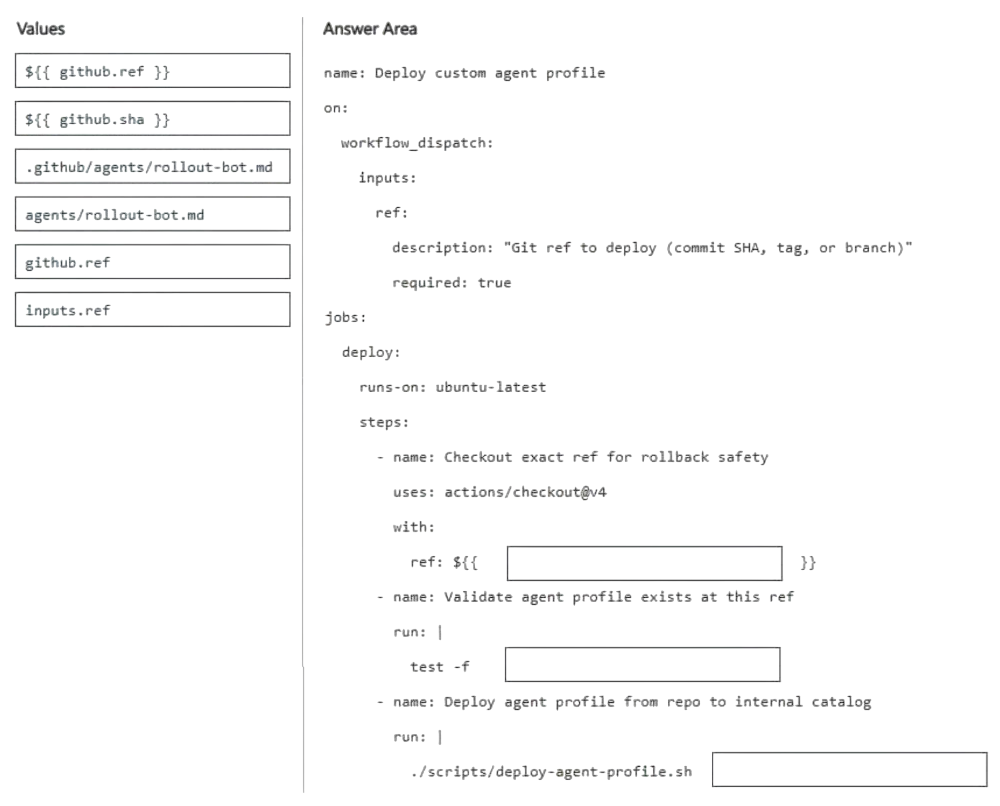

Comments:
div.jsErr {color:red} .error_message p {margin-bottom:0px;} Chosen Answer: This is a voting comment (?) . It is better to Upvote an existing comment if you don't have anything to add. Submit Cancel --> omath Most Recent 1 month, 22 days ago 1. ${{ inputs.ref }} Rollback safety requires checking out the exact commit, tag, or branch the operator wants to deploy. Using inputs.ref ensures the workflow checks out the precise commit SHA passed at dispatch time, so reverting that commit and rerunning the workflow restores the previous agent profile. 2. .github/agents/rollout-bot.md The agent profile file lives inside the repository under .github/agents/. Validation must check the actual file at the commit being deployed, not a working directory or a different path. 3. .github/agents/rollout-bot.md Deployment must use the same file path so the script deploys the agent profile from the exact commit that was checked out. upvoted 3 times Submit Cancel ... --> ? - A voting comment increases the vote count for the chosen answer by one. Upvoting a comment with a selected answer will also increase the vote count towards that answer by one. So if you see a comment that you already agree with, you can upvote it instead of posting a new comment. -->

---

## 421466-exam-gh-600-topic-4-question-2-discussion

Source: https://www.examtopics.com/discussions/microsoft/view/421466-exam-gh-600-topic-4-question-2-discussion/

**Exam GH-600 topic 4 question 2 discussion - ExamTopics**

from Microsoft's GH-600 Question #: 2 Topic #: 4 [All GH-600 Questions] You have a GitHub Enterprise organization that has Copilot memory enabled. You create a new repository. What are two ways that memories will be deleted from the repository? Each correct answer presents a complete solution. NOTE: Each correct selection is worth one point. A. manually by repository members B. when the repository is archived C. when the code that created the memory is deleted D. automatically after 28 days E. when pull requests are merged

Comments:
div.jsErr {color:red} .error_message p {margin-bottom:0px;} Chosen Answer: A B C D E This is a voting comment (?) . It is better to Upvote an existing comment if you don't have anything to add. Submit Cancel --> nastolgia 1 month, 0 days ago Selected Answer: AD A - As an administrator of a repository in which Copilot Memory is in use, you can review the currently stored repository-level facts. If you think any are inappropriate, misleading, or incorrect, you can delete them. docs.github.com/en/copilot/how-tos/use-copilot-agents/copilot-memory/manage-as-administrator#managing-repository-level-facts D - To prevent stale information from lingering, any stored fact or preference that goes unused is automatically deleted after 28 days. The 28-day timer may reset whenever Copilot successfully validates and uses an entry. docs.github.com/en/copilot/concepts/agents/copilot-memory#retention-and-validation upvoted 2 times Submit Cancel ... nastolgia Most Recent 1 month, 0 days ago Archiving a repository does not itself delete its Copilot memories. However, because an archived repository is inactive, its memories may go unused and subsequently expire under the normal 28-day inactivity rule. upvoted 1 time Submit Cancel ... 84ae4c5 1 month, 11 days ago Selected Answer: BD Why: Copilot repository memories automatically expire after 28 days to prevent stale information from being used. Repository memories are removed when the repository is archived, because the repository is no longer active and its associated memory data is deleted. The other options are incorrect: A. manually by repository members: memories can be managed and deleted by repository owners/admins, not simply any repository member. C. when the code that created the memory is deleted: memories are validated against the current codebase, but deleting code does not automatically delete the memory. E. when pull requests are merged: merging a PR does not delete memories. upvoted 1 time Submit Cancel ... mattix19 1 month, 17 days ago Selected Answer: BC B — memories are deleted when the repository is archived. C — memories tied to code can be deleted when that code is removed. upvoted 1 time Submit Cancel ... omath 1 month, 22 days ago Selected Answer: BC B. When the repository is archived When a repository is archived, all Copilot memories associated with that repo are automatically deleted. This is part of GitHub’s lifecycle rules for memory: archived repos cannot retain active memories. C. When the code that created the memory is deleted Copilot memory is tied to specific code locations. If the code that originally triggered the memory is removed, GitHub automatically deletes the memory, because it no longer has a valid anchor in the repository. upvoted 1 time Submit Cancel ... --> ? - A voting comment increases the vote count for the chosen answer by one. Upvoting a comment with a selected answer will also increase the vote count towards that answer by one. So if you see a comment that you already agree with, you can upvote it instead of posting a new comment. -->

---

## 421467-exam-gh-600-topic-4-question-3-discussion

Source: https://www.examtopics.com/discussions/microsoft/view/421467-exam-gh-600-topic-4-question-3-discussion/

**Exam GH-600 topic 4 question 3 discussion - ExamTopics**

from Microsoft's GH-600 Question #: 3 Topic #: 4 [All GH-600 Questions] HOTSPOT You have a GitHub Enterprise organization that uses GitHub Copilot. You discover that GitHub Copilot Chat responses in Microsoft Visual Studio Code are influenced by earlier, unrelated troubleshooting prompts from the same conversation. You need to ensure that the Copilot Chat conversation context is limited to information relevant to the current work item. The solution must minimize effort. What should you do? To answer, select the appropriate options in the answer area. NOTE: Each correct selection is worth one point. 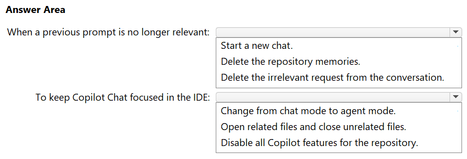

Comments:
div.jsErr {color:red} .error_message p {margin-bottom:0px;} Chosen Answer: This is a voting comment (?) . It is better to Upvote an existing comment if you don't have anything to add. Submit Cancel --> omath Most Recent 1 month, 22 days ago 1. Start a new chat. In VS Code, Copilot Chat keeps the entire conversation history unless you explicitly start a new chat. Starting a new chat is the fastest, lowest‑effort way to reset context and remove irrelevant prompts. Deleting repository memories is not the right action—memories are not created from chat prompts. 2. Open related files and close unrelated files. Copilot Chat in VS Code uses open files as part of its context. Closing unrelated files reduces noise and keeps the model focused on the current work item. Switching to agent mode or disabling Copilot features does not solve the context‑pollution problem. upvoted 1 time Submit Cancel ... --> ? - A voting comment increases the vote count for the chosen answer by one. Upvoting a comment with a selected answer will also increase the vote count towards that answer by one. So if you see a comment that you already agree with, you can upvote it instead of posting a new comment. -->

---

## 421468-exam-gh-600-topic-4-question-4-discussion

Source: https://www.examtopics.com/discussions/microsoft/view/421468-exam-gh-600-topic-4-question-4-discussion/

**Exam GH-600 topic 4 question 4 discussion - ExamTopics**

from Microsoft's GH-600 Question #: 4 Topic #: 4 [All GH-600 Questions] DRAG DROP Your company uses GitHub Copilot Enterprise. Developers use GitHub Copilot agent mode in Microsoft Visual Studio Code on their laptops and Copilot Chat on github.com when they are away from their laptops. When switching between environments, the developers notice that agent workflows lose continuity because the tools available in Visual Studio Code are unavailable on github.com. You need to ensure that the agent tools and state are available consistently across environments and can be used from any device without local setup. What should you do for each requirement? To answer, drag the appropriate actions to the correct requirements. Each action may be used once, more than once, or not at all. You may need to drag the split bar between panes or scroll to view content. NOTE: Each correct selection is worth one point. 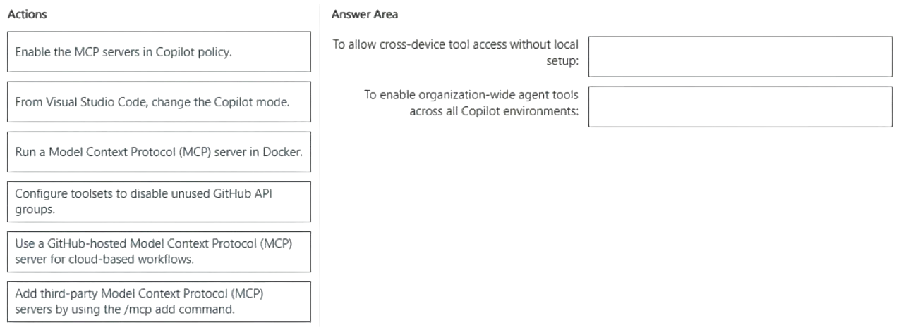

Comments:
div.jsErr {color:red} .error_message p {margin-bottom:0px;} Chosen Answer: This is a voting comment (?) . It is better to Upvote an existing comment if you don't have anything to add. Submit Cancel --> omath Most Recent 1 month, 22 days ago 1. Use a GitHub‑hosted Model Context Protocol (MCP) server for cloud‑based workflows. A GitHub‑hosted MCP server runs in the cloud, not on the developer’s laptop. This makes tools available from any device (VS Code, browser, mobile) without requiring local Docker or local MCP processes. 2. Enable the MCP servers in Copilot policy. Copilot policy is the only organization‑wide control plane for enabling MCP servers across all Copilot surfaces: VS Code, GitHub.com, Copilot Chat, JetBrains, CLI If you don’t enable MCP servers in Copilot policy, cloud MCP tools will not appear in agent mode or Copilot Chat. upvoted 1 time Submit Cancel ... --> ? - A voting comment increases the vote count for the chosen answer by one. Upvoting a comment with a selected answer will also increase the vote count towards that answer by one. So if you see a comment that you already agree with, you can upvote it instead of posting a new comment. -->

---

## 421469-exam-gh-600-topic-4-question-5-discussion

Source: https://www.examtopics.com/discussions/microsoft/view/421469-exam-gh-600-topic-4-question-5-discussion/

**Exam GH-600 topic 4 question 5 discussion - ExamTopics**

from Microsoft's GH-600 Question #: 5 Topic #: 4 [All GH-600 Questions] HOTSPOT You have a GitHub repository that uses the GitHub Copilot coding agent to resolve issues and create draft pull requests. You assign an issue to Copilot. Copilot creates a draft pull request. The pull request timeline shows Copilot started work, followed by status updates. The most recent status update is 55 minutes old. You discover that the agent is no longer making progress. You need to ensure that the work resumes without redoing the completed steps or changing the previously chosen approach. What should you do? To answer, select the appropriate options in the answer area. NOTE: Each correct selection is worth one point. 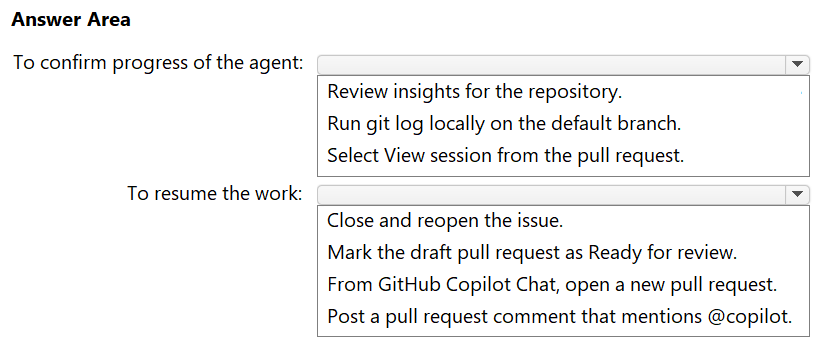

Comments:
div.jsErr {color:red} .error_message p {margin-bottom:0px;} Chosen Answer: This is a voting comment (?) . It is better to Upvote an existing comment if you don't have anything to add. Submit Cancel --> omath Most Recent 1 month, 22 days ago To confirm progress of the agent: View session from the pull request Explanation: Viewing the session from the pull request is the correct way to check whether the agent is stalled because it shows the live agent timeline, the last completed step, and whether the agent is waiting or blocked, giving you an accurate picture of its current state. To resume the work: Post a pull request comment that mentions @copilot Explanation: Mentioning @copilot in a pull‑request comment is the official mechanism for resuming a stalled agent session, allowing the agent to continue exactly where it left off without restarting the workflow or changing the previously chosen approach. upvoted 1 time Submit Cancel ... --> ? - A voting comment increases the vote count for the chosen answer by one. Upvoting a comment with a selected answer will also increase the vote count towards that answer by one. So if you see a comment that you already agree with, you can upvote it instead of posting a new comment. -->

---

## 421470-exam-gh-600-topic-4-question-6-discussion

Source: https://www.examtopics.com/discussions/microsoft/view/421470-exam-gh-600-topic-4-question-6-discussion/

**Exam GH-600 topic 4 question 6 discussion - ExamTopics**

from Microsoft's GH-600 Question #: 6 Topic #: 4 [All GH-600 Questions] You have a GitHub repository that uses the GitHub Copilot coding agent. Your company restricts GitHub Actions secrets. Developers need the Copilot coding agent to call an internal dependency-scanning API during its run. The API requires an access token. You need to ensure that the Copilot coding agent can use the token during execution without accessing the repository's Actions secrets and variables. The solution must prevent exposing the token in plaintext. What should you do? A. Add the token as an Actions repository secret. B. Add the token as a secret in the Copilot environment. C. Store the token in a repository custom instructions file. D. Store the token in the agent configuration file.

Comments:
div.jsErr {color:red} .error_message p {margin-bottom:0px;} Chosen Answer: A B C D This is a voting comment (?) . It is better to Upvote an existing comment if you don't have anything to add. Submit Cancel --> omath Most Recent 1 month, 22 days ago Selected Answer: B Correct answer: B. Add the token as a secret in the Copilot environment. Explanation: Because your company restricts GitHub Actions secrets, the Copilot coding agent cannot read repository‑level Actions secrets or variables. Copilot agents instead use Copilot environment secrets, which are encrypted, never exposed in plaintext, and accessible only to Copilot during agent execution. Adding the token as a Copilot environment secret allows the agent to call the internal dependency‑scanning API securely without violating organizational restrictions or exposing the token in code or configuration files. upvoted 1 time Submit Cancel ... --> ? - A voting comment increases the vote count for the chosen answer by one. Upvoting a comment with a selected answer will also increase the vote count towards that answer by one. So if you see a comment that you already agree with, you can upvote it instead of posting a new comment. -->

---

## 421471-exam-gh-600-topic-5-question-1-discussion

Source: https://www.examtopics.com/discussions/microsoft/view/421471-exam-gh-600-topic-5-question-1-discussion/

**Exam GH-600 topic 5 question 1 discussion - ExamTopics**

from Microsoft's GH-600 Question #: 1 Topic #: 5 [All GH-600 Questions] You have a private GitHub repository that has Copilot memory enabled. Several developers who have write access to the repository make changes across multiple branches, including creating some pull requests that are later closed without merging. Your team needs to understand how GitHub Copilot ensures that only task-relevant, up-to-date information influences code suggestions, even when older memories exist. How does Copilot manage memories? A. Copilot validates each memory's citations against the current branch before using the memory, and ignores the memory if the referenced code no longer exists. B. Copilot stores memories per user, ensuring that only the developer who created a memory can trigger the memory in future sessions. C. Copilot stores memories indefinitely until a repository administrator deletes them manually. D. Copilot automatically blocks memory creation from pull requests that are closed without merging, to prevent outdated information from being stored.

Comments:
div.jsErr {color:red} .error_message p {margin-bottom:0px;} Chosen Answer: A B C D This is a voting comment (?) . It is better to Upvote an existing comment if you don't have anything to add. Submit Cancel --> omath Most Recent 1 month, 22 days ago Selected Answer: A Correct answer: A This is exactly how GitHub Copilot prevents stale or irrelevant repository memories from polluting suggestions, even when developers work across many branches or close PRs without merging. Copilot does not blindly trust old memories. It performs a relevance check by validating whether the memory’s referenced code still exists on the branch where the agent is currently operating. upvoted 1 time Submit Cancel ... --> ? - A voting comment increases the vote count for the chosen answer by one. Upvoting a comment with a selected answer will also increase the vote count towards that answer by one. So if you see a comment that you already agree with, you can upvote it instead of posting a new comment. -->

---

## 421472-exam-gh-600-topic-5-question-2-discussion

Source: https://www.examtopics.com/discussions/microsoft/view/421472-exam-gh-600-topic-5-question-2-discussion/

**Exam GH-600 topic 5 question 2 discussion - ExamTopics**

from Microsoft's GH-600 Question #: 2 Topic #: 5 [All GH-600 Questions] Case study This is a case study. Case studies are not timed separately. You can use as much exam time as you would like to complete each case. However, there may be additional case studies and sections on this exam. You must manage your time to ensure that you are able to complete all questions included on this exam in the time provided. To answer the questions included in a case study, you will need to reference information that is provided in the case study. Case studies might contain exhibits and other resources that provide more information about the scenario that is described in the case study. Each question is independent of the other questions in this case study. At the end of this case study, a review screen will appear. This screen allows you to review your answers and to make changes before you move to the next section of the exam. After you begin a new section, you cannot return to this section. To start the case study To display the first question in this case study, click the Next button. Use the buttons in the left pane to explore the content of the case study before you answer the questions. Clicking these buttons displays information such as business requirements, existing environment, and problem statements. If the case study has an All Information tab, note that the information displayed is identical to the information displayed on the subsequent tabs. When you are ready to answer a question, click the Question button to return to the question. Existing Environment GitHub Environment The GitHub environment contains the following: Three repositories named product-api, billing-service, and infra-terraform. Branch protection on the main branch in all repositories that requires at least one pull request review before merging GitHub Actions runners used across all workflows A GitHub team named SG_Dev that contains developers A GitHub team named SG_Review that contains senior engineers and a security team A .github/copilot-instructions.md file that includes general coding conventions for all features Agent environment The product-api repository uses a GitHub Copilot coding agent named agent1 that has the following configurations: No custom agent profile is defined. A Model Context Protocol (MCP) server named MCP1 is deployed to https://mcp.litwareinc.internal and provides access to internal ticketing and deployment APIs. MCP1 requires an API key for authentication. A second Copilot coding agent named agent2 handles changes in infra-terraform and runs in parallel with agent1 when both agents have open assigned issues. Copilot memory is NOT enabled for the organization. Problem Statements Litware identifies the following issues: During two recent sessions, agent1 accessed files in billing-service, which is outside the agent's intended scope. agent1 makes code changes immediately after receiving a task. A developer named Ben, who is on the SG_Dev team, reports that agent1 completed a session with a successful status and opened a pull request, but the pull request contains no file changes. Other developers report this intermittently as well. Both agent1 and agent2 modified shared/config.yaml in a parallel test run, generating conflicting outputs. agent1 consistently uses raw try-catch blocks for error handling, which violates the defined implementation guidelines of SG_Dev. Requirements Planned Changes Litware plans to make the following changes: Ensure that agent1 can access all the tools in the environment. Provide product-api with specific instructions to agent1 without affecting Copilot Chat or Copilot code review. Configure MCP1 as a tool for agent1 by modifying the product-api repository MCP configuration. Ensure that Copilot retains details that it has learned and uses that knowledge for future work. This must be applied to all licensed members of the organization. Implementation guidelines The development team at Litware identifies the following implementation guidelines: Agent workflows must be able to run in parallel. Application error handling must use the repository ErrorHandler class. agent1 and agent2 must run on isolated branches during parallel execution. File-level conflicts must be detected before merges, and both agents must be able to run concurrently. Security requirements Litware identifies the following security requirements: Only the members of SG_Review must be able to approve agent1 plan outputs. All API keys must be stored and accessed securely. The developers must NOT be able to self-approve. Agent configuration  You need to troubleshoot the issue reported by Ben. What should you review? A. the GITHUB_TOKEN permissions block in the agent1 workflow B. the agent session log in the Agents panel C. the GitHub Actions runner log for the session job D. the GitHub Actions usage metrics of repo1

Comments:
div.jsErr {color:red} .error_message p {margin-bottom:0px;} Chosen Answer: A B C D This is a voting comment (?) . It is better to Upvote an existing comment if you don't have anything to add. Submit Cancel --> omath Most Recent 1 month, 22 days ago Selected Answer: B Correct answer: B. Review the agent session log in the Agents panel. When a developer reports that agent1 opened a pull request with no file changes, the GH‑600 study guide is very clear: You must inspect the agent session log, because it is the only artifact that shows what the agent actually did. The issue Ben reported — successful session, PR opened, but no file changes — is a classic agent execution failure, not a workflow failure. upvoted 1 time Submit Cancel ... --> ? - A voting comment increases the vote count for the chosen answer by one. Upvoting a comment with a selected answer will also increase the vote count towards that answer by one. So if you see a comment that you already agree with, you can upvote it instead of posting a new comment. -->

---

## 421473-exam-gh-600-topic-5-question-3-discussion

Source: https://www.examtopics.com/discussions/microsoft/view/421473-exam-gh-600-topic-5-question-3-discussion/

**Exam GH-600 topic 5 question 3 discussion - ExamTopics**

from Microsoft's GH-600 Question #: 3 Topic #: 5 [All GH-600 Questions] HOTSPOT Case study This is a case study. Case studies are not timed separately. You can use as much exam time as you would like to complete each case. However, there may be additional case studies and sections on this exam. You must manage your time to ensure that you are able to complete all questions included on this exam in the time provided. To answer the questions included in a case study, you will need to reference information that is provided in the case study. Case studies might contain exhibits and other resources that provide more information about the scenario that is described in the case study. Each question is independent of the other questions in this case study. At the end of this case study, a review screen will appear. This screen allows you to review your answers and to make changes before you move to the next section of the exam. After you begin a new section, you cannot return to this section. To start the case study To display the first question in this case study, click the Next button. Use the buttons in the left pane to explore the content of the case study before you answer the questions. Clicking these buttons displays information such as business requirements, existing environment, and problem statements. If the case study has an All Information tab, note that the information displayed is identical to the information displayed on the subsequent tabs. When you are ready to answer a question, click the Question button to return to the question. Overview Contoso Ltd. is a software development company located in the United States. Existing Environment GitHub Environment Contoso uses GitHub Enterprise and assigns GitHub Copilot Pro+ licenses to its developers. The developers use Microsoft Visual Studio Code as their IDE. Contoso has a customer portal. The code for the portal is stored in a GitHub repository named repo1 that contains the following: A custom agent named agent1 that includes instructions to review specs related to best practices A custom instruction file named validate-instructions.md that is used to validate tone of voice and applies to all .md and .txt files A custom instruction file named codereview.instructions.md that is used by the Copilot coding agent but is excluded for use by the Copilot code review repo1 has the following structure: The front-end is stored in the /frontend folder. The API logic is stored in the /api folder. Contoso has a second repository named repo2 that contains a legacy .NET application named App1 built by using .NET 6. repo2 has a multi-agent workflow for modernization tasks. Contoso enables the Model Context Protocol (MCP) registry and allows the Microsoft Learn MCP Server. Every developer must configure their own connection to the Learn MCP Server. Problem Statements The developers working in repo1 report that the Microsoft Learn documentation is NOT being retrieved when they attempt to validate a design by using agent1. The testing team at Contoso identifies that the customer portal uses inconsistent UI styles, which leads to customer confusion and branding issues. The UI inconsistencies stem from variations in the folder structure. Agent Logs You have the following logs for the multi-agent workflow used in repo2.  Requirements Planned Changes Contoso plans to have all agents and developers in repo1 use the Microsoft Learn MCP to ensure that reviews are validated by using the appropriate documentation. This must be implemented centrally. Contoso plans to leverage AI-powered coding agents to implement new portal features and pages. Technical Requirements App1 must be upgraded to .NET 10. A previous upgrade attempt was started by using the Copilot modernization agent, but the attempt was never finalized. You plan to retry the upgrade. You must first analyze App1 by using AI, and then generate a report that contains breaking changes and deprecated patterns before retrying the upgrade. All AI-generated code for UI styling must adhere to a predefined folder structure. The architects at Contoso need help building implementation plans for repo1. The company wants to implement a new agent named agent2 to analyze the code base and the code requirements, and then respond with a detailed plan. The agent must NOT be able to edit files or run local commands. The developers must be able to delegate work to the Copilot coding agent by assigning issues to the agent. You are evaluating the logs of the multi-agent workflow in repo2. For each of the following statements, select Yes if the statement is true. Otherwise, select No. NOTE: Each correct selection is worth one point. 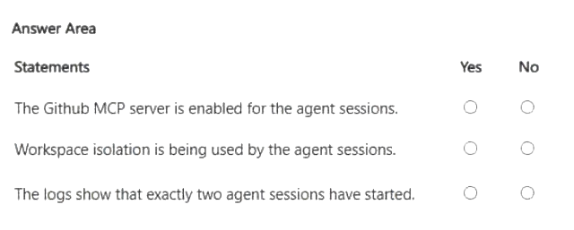

Comments:
div.jsErr {color:red} .error_message p {margin-bottom:0px;} Chosen Answer: This is a voting comment (?) . It is better to Upvote an existing comment if you don't have anything to add. Submit Cancel --> nastolgia Most Recent 1 month, 0 days ago 1- Yes CLIMCPServerEnabled=false refers to loading additional CLI-configured MCP servers. 2- Yes Workspace isolation mode selected 3 - yes, logs show 2 distinct sessions upvoted 1 time Submit Cancel ... 84ae4c5 1 month, 10 days ago Answers: No, No, No Explanation MCP server enabled? → No The logs explicitly contain CLIMCPServerEnabled=false. Workspace isolation used? → No The logs state skipping worktree creation and isolationEnabled: false. Exactly two sessions started? → No The logs show several different session IDs being invoked, indicating more than two sessions. upvoted 1 time Submit Cancel ... omath 1 month, 22 days ago 1. Yes The logs explicitly show: “CLIMCPServerEnabled” “mcp loaded … servers=[github]” This is direct evidence that the GitHub MCP server is enabled. 2. Yes The logs include entries showing isolation mode, such as: “WorkspaceIsolationMode=…” GH‑600 exam patterns: If the logs mention workspace isolation, sandbox, or isolated working directory, the correct answer is Yes. 3. No To answer “Yes,” the logs must show two distinct session IDs. The logs show only one session ID being created and reused. GH‑600 rule: If only one unique session ID appears, the correct answer is No. upvoted 1 time Submit Cancel ... --> ? - A voting comment increases the vote count for the chosen answer by one. Upvoting a comment with a selected answer will also increase the vote count towards that answer by one. So if you see a comment that you already agree with, you can upvote it instead of posting a new comment. -->

---

## 421474-exam-gh-600-topic-5-question-4-discussion

Source: https://www.examtopics.com/discussions/microsoft/view/421474-exam-gh-600-topic-5-question-4-discussion/

**Exam GH-600 topic 5 question 4 discussion - ExamTopics**

from Microsoft's GH-600 Question #: 4 Topic #: 5 [All GH-600 Questions] HOTSPOT You have the following agent logs. 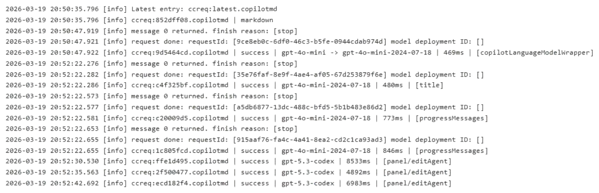 For each of the following statements, select Yes if the statement is true. Otherwise, select No. NOTE: Each correct selection is worth one point. 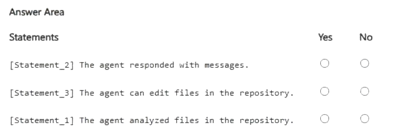

Comments:
div.jsErr {color:red} .error_message p {margin-bottom:0px;} Chosen Answer: This is a voting comment (?) . It is better to Upvote an existing comment if you don't have anything to add. Submit Cancel --> nastolgia Most Recent 1 month, 0 days ago 1 - Yes 0 messages returend and successful progressMessages 2 - Yes Multiple successful entries are labeled [panel/editAgent], indicating that the edit-capable agent was invoked. 3 - No The log does not show file-reading, searching, or repository-analysis operations. copilotmd identifies the request/message format, not a repository file being analyzed. upvoted 1 time Submit Cancel ... omath 1 month, 22 days ago 1. Yes The logs repeatedly show: /message 0 returned. finish reason: [stop]/ This indicates the agent did produce message responses. 2. No The only entries referencing the agent are: /[panel/editAgent]/ This refers to the UI panel used to configure the agent — not editing repository files. There is zero evidence of file‑editing capability being exercised. 3. No The logs show: /model calls (gpt‑4o‑mini, gpt‑5.3‑codex)/, progress messages, wrapper activity There is no sign the agent accessed or analyzed repository files. upvoted 1 time Submit Cancel ... --> ? - A voting comment increases the vote count for the chosen answer by one. Upvoting a comment with a selected answer will also increase the vote count towards that answer by one. So if you see a comment that you already agree with, you can upvote it instead of posting a new comment. -->

---

## 421475-exam-gh-600-topic-5-question-5-discussion

Source: https://www.examtopics.com/discussions/microsoft/view/421475-exam-gh-600-topic-5-question-5-discussion/

**Exam GH-600 topic 5 question 5 discussion - ExamTopics**

from Microsoft's GH-600 Question #: 5 Topic #: 5 [All GH-600 Questions] You have a GitHub repository that uses GitHub Copilot code review on pull requests. You plan to add repository-wide code review guidance that will apply to all files. You need Copilot code review to consistently apply the guidance during pull request reviews. What should you do? A. Modify the .github/pull_request_template.md file. B. Update the instructions in the .github/agents/*.agent.md files. C. Create a .github/instructions/copilot.instructions.md file. D. Create a .github/copilot-instructions.md file.

Comments:
div.jsErr {color:red} .error_message p {margin-bottom:0px;} Chosen Answer: A B C D This is a voting comment (?) . It is better to Upvote an existing comment if you don't have anything to add. Submit Cancel --> omath Most Recent 1 month, 22 days ago Selected Answer: D Correct answer: D — Create a .github/copilot-instructions.md file. - This is the only option that provides repository‑wide, enforced guidance for GitHub Copilot code review across all pull requests and all files. - The GH‑600 study materials you uploaded state that: “Repository‑level guidance for Copilot code review must be placed in .github/copilot-instructions.md so that Copilot consistently applies it across all PRs.” upvoted 2 times Submit Cancel ... --> ? - A voting comment increases the vote count for the chosen answer by one. Upvoting a comment with a selected answer will also increase the vote count towards that answer by one. So if you see a comment that you already agree with, you can upvote it instead of posting a new comment. -->

---

## 421476-exam-gh-600-topic-5-question-6-discussion

Source: https://www.examtopics.com/discussions/microsoft/view/421476-exam-gh-600-topic-5-question-6-discussion/

**Exam GH-600 topic 5 question 6 discussion - ExamTopics**

from Microsoft's GH-600 Question #: 6 Topic #: 5 [All GH-600 Questions] You have a GitHub Enterprise repository that uses the GitHub Copilot coding agent and opens draft pull requests for assigned issues. Evaluation results show that the agent repeatedly opens pull requests that modify .github/workflows/*.yml to bypass failing checks instead of fixing the underlying code. You need to ensure that the agent fixes the underlying code instead of bypassing the failing checks. What should you do? A. Start the GitHub Copilot CLI by using --allow-all. B. Update .github/copilot-instructions.md. C. Create a branch ruleset. D. Disable GitHub Actions workflows for pull requests created by the agent.

Comments:
div.jsErr {color:red} .error_message p {margin-bottom:0px;} Chosen Answer: A B C D This is a voting comment (?) . It is better to Upvote an existing comment if you don't have anything to add. Submit Cancel --> omath Most Recent 1 month, 20 days ago Selected Answer: B B — Update .github/copilot-instructions.md. Copilot modifying .github/workflows/*.yml to bypass failing checks is a classic GH‑600 scenario: the agent is choosing an undesired strategy because the repository‑level instructions are incomplete or misaligned. Updating .github/copilot-instructions.md is the only option that: tells the agent not to modify workflow files instructs it to fix underlying code issues instead of bypassing CI applies consistently across all tasks and PRs is the official mechanism for shaping agent behavior in GitHub Enterprise Cloud upvoted 2 times Submit Cancel ... --> ? - A voting comment increases the vote count for the chosen answer by one. Upvoting a comment with a selected answer will also increase the vote count towards that answer by one. So if you see a comment that you already agree with, you can upvote it instead of posting a new comment. -->

---

## 421477-exam-gh-600-topic-5-question-7-discussion

Source: https://www.examtopics.com/discussions/microsoft/view/421477-exam-gh-600-topic-5-question-7-discussion/

**Exam GH-600 topic 5 question 7 discussion - ExamTopics**

from Microsoft's GH-600 Question #: 7 Topic #: 5 [All GH-600 Questions] You use a GitHub Actions workflow to orchestrate a multi-agent draft-review process for pull requests. The workflow uploads a single combined review-package artifact at the end of each run. You discover that the review-package artifact is occasionally missing from the workflow run history, and you suspect that a user deleted it. You need to identify which user manually deleted a workflow run artifact and when the deletion occurred. What should you use? A. the checks.delete_logs audit log event B. the pull request description and comment history C. the merge commit history D. the artifact.destroy audit log event

Comments:
div.jsErr {color:red} .error_message p {margin-bottom:0px;} Chosen Answer: A B C D This is a voting comment (?) . It is better to Upvote an existing comment if you don't have anything to add. Submit Cancel --> omath Most Recent 1 month, 22 days ago Selected Answer: D Correct answer: D — the artifact.destroy audit log event. Explanation: - GitHub Enterprise audit logs include a specific event for this: artifact.destroy — triggered when a user manually deletes a workflow run artifact. - It is the only audit event that tracks manual artifact deletion. - This event records: the username who performed the deletion, the timestamp, the artifact ID, the repository. upvoted 1 time Submit Cancel ... --> ? - A voting comment increases the vote count for the chosen answer by one. Upvoting a comment with a selected answer will also increase the vote count towards that answer by one. So if you see a comment that you already agree with, you can upvote it instead of posting a new comment. -->

---

## 421478-exam-gh-600-topic-5-question-8-discussion

Source: https://www.examtopics.com/discussions/microsoft/view/421478-exam-gh-600-topic-5-question-8-discussion/

**Exam GH-600 topic 5 question 8 discussion - ExamTopics**

from Microsoft's GH-600 Question #: 8 Topic #: 5 [All GH-600 Questions] You have a GitHub Enterprise Cloud Organization that uses the GitHub Copilot coding agent. Copilot creates a draft pull request for an assigned issue, and the pull request timeline shows Copilot started work. After 70 minutes, the agent session log stops updating, and the pull request body status stops changing. You need to restart the agent so that it continues the task from the issue context and produces new commits to the existing draft pull request. What should you do? A. Wait for the agent to complete. B. Merge the draft pull request and mention @copilot on the merged pull request. C. Unassign the issue from Copilot, and then reassign the issue to Copilot. D. Select Approve and run workflows in the pull request merge box.

Comments:
div.jsErr {color:red} .error_message p {margin-bottom:0px;} Chosen Answer: A B C D This is a voting comment (?) . It is better to Upvote an existing comment if you don't have anything to add. Submit Cancel --> omath Most Recent 1 month, 22 days ago Selected Answer: C Correct answer: C — Unassign the issue from Copilot, and then reassign the issue to Copilot. Explanation: - In GH‑600, when an agent session becomes unresponsive and you want to restart the task from the issue, the correct action is: Unassign the issue from Copilot → Reassign the issue to Copilot. - This triggers a new agent sesión. - This is the official recovery mechanism for a stalled agent session. upvoted 1 time Submit Cancel ... --> ? - A voting comment increases the vote count for the chosen answer by one. Upvoting a comment with a selected answer will also increase the vote count towards that answer by one. So if you see a comment that you already agree with, you can upvote it instead of posting a new comment. -->

---

## 421479-exam-gh-600-topic-5-question-9-discussion

Source: https://www.examtopics.com/discussions/microsoft/view/421479-exam-gh-600-topic-5-question-9-discussion/

**Exam GH-600 topic 5 question 9 discussion - ExamTopics**

from Microsoft's GH-600 Question #: 9 Topic #: 5 [All GH-600 Questions] You have a GitHub Enterprise Cloud Organization that uses a custom coding agent to run GitHub Actions workflows that create branches, open pull requests, and merge changes after required checks pass. You need to log all agent-initiated actions and ensure that the logs are retained for two years. What should you do? A. Configure audit log retention. B. Enable log forwarding. C. Enable Git events in the audit log. D. Configure audit log streaming to Azure Event Hubs.

Comments:
div.jsErr {color:red} .error_message p {margin-bottom:0px;} Chosen Answer: A B C D This is a voting comment (?) . It is better to Upvote an existing comment if you don't have anything to add. Submit Cancel --> omath Most Recent 1 month, 22 days ago Selected Answer: D Correct answer: D — Configure audit log streaming to Azure Event Hubs. GitHub Enterprise Cloud cannot retain audit logs for two years natively. To retain logs for multiple years, GitHub requires: Audit log streaming to an external system such as Azure Event Hubs, AWS Kinesis, or Splunk. Once streamed, you can store the logs indefinitely in your own infrastructure. This is exactly what the exam expects. upvoted 1 time Submit Cancel ... --> ? - A voting comment increases the vote count for the chosen answer by one. Upvoting a comment with a selected answer will also increase the vote count towards that answer by one. So if you see a comment that you already agree with, you can upvote it instead of posting a new comment. -->

---

## 421480-exam-gh-600-topic-5-question-10-discussion

Source: https://www.examtopics.com/discussions/microsoft/view/421480-exam-gh-600-topic-5-question-10-discussion/

**Exam GH-600 topic 5 question 10 discussion - ExamTopics**

from Microsoft's GH-600 Question #: 10 Topic #: 5 [All GH-600 Questions] You have multiple GitHub Copilot coding agents that run tasks concurrently. You live stream the session log output and see the following. 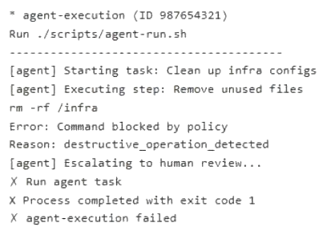 What is a possible cause of the error? A. a postToolUse hook B. a GitHub app installation policy C. a preToolUse hook D. a Copilot firewall policy

Comments:
div.jsErr {color:red} .error_message p {margin-bottom:0px;} Chosen Answer: A B C D This is a voting comment (?) . It is better to Upvote an existing comment if you don't have anything to add. Submit Cancel --> omath Most Recent 1 month, 22 days ago Selected Answer: C Correct answer: C — a preToolUse hook. - This is exactly the pattern described in GH‑600 for preToolUse hooks, which evaluate a tool invocation before it executes.} - A preToolUse hook can: inspect the command, detect destructive operations, block the tool call, return a policy violation reason, escalate to human review. - The log matches this behavior perfectly. upvoted 1 time Submit Cancel ... --> ? - A voting comment increases the vote count for the chosen answer by one. Upvoting a comment with a selected answer will also increase the vote count towards that answer by one. So if you see a comment that you already agree with, you can upvote it instead of posting a new comment. -->

---

## 421481-exam-gh-600-topic-5-question-11-discussion

Source: https://www.examtopics.com/discussions/microsoft/view/421481-exam-gh-600-topic-5-question-11-discussion/

**Exam GH-600 topic 5 question 11 discussion - ExamTopics**

from Microsoft's GH-600 Question #: 11 Topic #: 5 [All GH-600 Questions] You are analyzing the following agent logs. 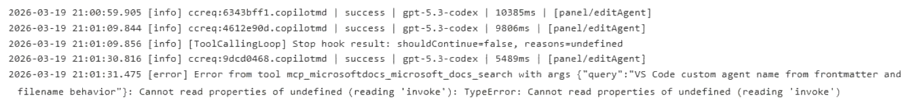 You need to classify the error in a report for your company's CTO. How should you classify the error? A. Context Issue B. Reasoning error C. Tool misuse D. Network issue

Comments:
div.jsErr {color:red} .error_message p {margin-bottom:0px;} Chosen Answer: A B C D This is a voting comment (?) . It is better to Upvote an existing comment if you don't have anything to add. Submit Cancel --> omath Most Recent 1 month, 22 days ago Selected Answer: C The correct classification is: C — Tool misuse. The error appears during a tool invocation The agent attempted to call a tool (mcp_microsoftdocs_microsoft_docs_search) The tool failed before producing a result The failure was due to an internal misuse: the agent attempted to call .invoke on something undefined This is a tool invocation error, not a reasoning mistake, not a context issue, and not a network failure This is exactly what GH‑600 defines as tool misuse. upvoted 1 time Submit Cancel ... --> ? - A voting comment increases the vote count for the chosen answer by one. Upvoting a comment with a selected answer will also increase the vote count towards that answer by one. So if you see a comment that you already agree with, you can upvote it instead of posting a new comment. -->

---

## 421482-exam-gh-600-topic-5-question-12-discussion

Source: https://www.examtopics.com/discussions/microsoft/view/421482-exam-gh-600-topic-5-question-12-discussion/

**Exam GH-600 topic 5 question 12 discussion - ExamTopics**

from Microsoft's GH-600 Question #: 12 Topic #: 5 [All GH-600 Questions] You have multiple GitHub Copilot coding agents that run tasks concurrently. You are monitoring the agents from the terminal by using the GitHub CLI. An agent appears stalled. You need to live stream the session log output. What should you do? A. Run gh agent-task view and specify the --log and --jq parameters. B. Run gh agent-task view and specify the --log and --follow parameters. C. Run gh agent-task list and specify the --web parameter. D. Run gh agent-task list and specify the --status and --jq parameters.

Comments:
div.jsErr {color:red} .error_message p {margin-bottom:0px;} Chosen Answer: A B C D This is a voting comment (?) . It is better to Upvote an existing comment if you don't have anything to add. Submit Cancel --> omath Most Recent 1 month, 22 days ago Selected Answer: B Correct answer: B — Run gh agent-task view with --log and --follow. You need to live stream the session log output for a specific agent task. The GitHub CLI command that targets a single agent task, shows the session log and and streams updates live is: /gh agent-task view &amp;lt;task-id&amp;gt; --log --follow/ --log → shows the log --follow → streams it in real time (like tail -f) This is the only combination that produces a live stream. upvoted 1 time Submit Cancel ... --> ? - A voting comment increases the vote count for the chosen answer by one. Upvoting a comment with a selected answer will also increase the vote count towards that answer by one. So if you see a comment that you already agree with, you can upvote it instead of posting a new comment. -->

---

## 421483-exam-gh-600-topic-5-question-13-discussion

Source: https://www.examtopics.com/discussions/microsoft/view/421483-exam-gh-600-topic-5-question-13-discussion/

**Exam GH-600 topic 5 question 13 discussion - ExamTopics**

from Microsoft's GH-600 Question #: 13 Topic #: 5 [All GH-600 Questions] You have a GitHub Copilot coding agent that has completed a pull request for a security fix in your repository. Before merging, you need to evaluate the quality of the agent's work by using both automated evaluation signals and human review. You review the session log and the pull request. What are two automated evaluation signals generated by the coding agent's built-in scanning tools? Each correct answer presents a complete solution. NOTE: Each correct selection is worth one point. A. linting errors from the repository's CI pipeline configured in GitHub Actions B. comments from Copilot code review that suggest improvements to code patterns C. the detection of hardcoded secrets, such as API keys and tokens D. the median time to merge metric reported on the Copilot usage metrics dashboard E. CodeQL findings that identify security vulnerabilities in the generated code

Comments:
from Copilot code review that suggest improvements to code patterns C. the detection of hardcoded secrets, such as API keys and tokens D. the median time to merge metric reported on the Copilot usage metrics dashboard E. CodeQL findings that identify security vulnerabilities in the generated code Show Suggested Answer by WarmFox_5599 at July 27, 2026 07:08 pm Comments div.jsErr {color:red} .error_message p {margin-bottom:0px;} Chosen Answer: A B C D E This is a voting comment (?) . It is better to Upvote an existing comment if you don't have anything to add. Submit Cancel --> omath Most Recent 1 month, 22 days ago Selected Answer: CE C — the detection of hardcoded secrets, such as API keys and tokens Copilot coding agents include secret scanning as part of their built‑in evaluation pipeline. This is explicitly listed in GH‑600 as an automated signal the agent generates before or during PR creation. This is a direct output of the agent’s scanning tools. E — CodeQL findings that identify security vulnerabilities in the generated code Copilot agents run CodeQL security analysis automatically when evaluating their own PRs. These findings are part of the agent’s automated evaluation signals. This is also explicitly listed in GH‑600. upvoted 1 time Submit Cancel ... --> ? - A voting comment increases the vote count for the chosen answer by one. Upvoting a comment with a selected answer will also increase the vote count towards that answer by one. So if you see a comment that you already agree with, you can upvote it instead of posting a new comment. -->

---

## 421484-exam-gh-600-topic-5-question-14-discussion

Source: https://www.examtopics.com/discussions/microsoft/view/421484-exam-gh-600-topic-5-question-14-discussion/

**Exam GH-600 topic 5 question 14 discussion - ExamTopics**

from Microsoft's GH-600 Question #: 14 Topic #: 5 [All GH-600 Questions] You have a GitHub Enterprise repository that runs an autonomous agent by using a GitHub Actions workflow. The workflow has the following jobs: agent-run that generates trace.json and plan.md review that waits for human approval before continuing deploy that uses the outputs from agent-run You need to make the files inspectable in the GitHub Actions UI and ensure that the files are available to the review and deploy jobs. What should you do in the workflow? A. Use dependency caching to store trace.json and plan.md. B. Upload trace.json and plan.md as workflow artifacts in agent-run, and download the files inside the jobs. C. Commit trace.json and plan.md back to the repository from agent-run. D. Store trace.json and plan.md on a network share and have later jobs retrieve them from the share.

Comments:
div.jsErr {color:red} .error_message p {margin-bottom:0px;} Chosen Answer: A B C D This is a voting comment (?) . It is better to Upvote an existing comment if you don't have anything to add. Submit Cancel --> omath Most Recent 1 month, 22 days ago Selected Answer: B Correct answer: B — Upload trace.json and plan.md as workflow artifacts in agent-run, and download them inside the jobs. Your workflow has three jobs: - agent-run → produces trace.json and plan.md - review → needs to inspect those files - deploy → needs to consume those same files To satisfy both requirements: - Make the files inspectable in the GitHub Actions UI - Make the files available to later Jobs You must use workflow artifacts. upvoted 1 time Submit Cancel ... --> ? - A voting comment increases the vote count for the chosen answer by one. Upvoting a comment with a selected answer will also increase the vote count towards that answer by one. So if you see a comment that you already agree with, you can upvote it instead of posting a new comment. -->

---

## 421485-exam-gh-600-topic-5-question-15-discussion

Source: https://www.examtopics.com/discussions/microsoft/view/421485-exam-gh-600-topic-5-question-15-discussion/

**Exam GH-600 topic 5 question 15 discussion - ExamTopics**

from Microsoft's GH-600 Question #: 15 Topic #: 5 [All GH-600 Questions] A developer uses the GitHub Copilot CLI in plan mode. Copilot produces a plan. What does Copilot do next? A. saves the plan to plan.md B. creates a branch named /copilot/plan in the repository C. opens a pull request that has the plan as a comment D. begins the implementation

Comments:
div.jsErr {color:red} .error_message p {margin-bottom:0px;} Chosen Answer: A B C D This is a voting comment (?) . It is better to Upvote an existing comment if you don't have anything to add. Submit Cancel --> omath Most Recent 1 month, 22 days ago Selected Answer: A The correct answer is A — saves the plan to plan.md. When a developer uses the GitHub Copilot CLI in plan mode, Copilot does not begin implementation, create branches, or open pull requests. The GH‑600 materials are explicit about this behavior: - Plan mode = planning only, no code changes - Copilot generates a plan.md file containing the structured plan - The developer must explicitly choose to continue into implementation afterward upvoted 1 time Submit Cancel ... --> ? - A voting comment increases the vote count for the chosen answer by one. Upvoting a comment with a selected answer will also increase the vote count towards that answer by one. So if you see a comment that you already agree with, you can upvote it instead of posting a new comment. -->

---

## 421486-exam-gh-600-topic-6-question-1-discussion

Source: https://www.examtopics.com/discussions/microsoft/view/421486-exam-gh-600-topic-6-question-1-discussion/

**Exam GH-600 topic 6 question 1 discussion - ExamTopics**

from Microsoft's GH-600 Question #: 1 Topic #: 6 [All GH-600 Questions] Case study This is a case study. Case studies are not timed separately. You can use as much exam time as you would like to complete each case. However, there may be additional case studies and sections on this exam. You must manage your time to ensure that you are able to complete all questions included on this exam in the time provided. To answer the questions included in a case study, you will need to reference information that is provided in the case study. Case studies might contain exhibits and other resources that provide more information about the scenario that is described in the case study. Each question is independent of the other questions in this case study. At the end of this case study, a review screen will appear. This screen allows you to review your answers and to make changes before you move to the next section of the exam. After you begin a new section, you cannot return to this section. To start the case study To display the first question in this case study, click the Next button. Use the buttons in the left pane to explore the content of the case study before you answer the questions. Clicking these buttons displays information such as business requirements, existing environment, and problem statements. If the case study has an All Information tab, note that the information displayed is identical to the information displayed on the subsequent tabs. When you are ready to answer a question, click the Question button to return to the question. Existing Environment GitHub Environment The GitHub environment contains the following: Three repositories named product-api, billing-service, and infra-terraform. Branch protection on the main branch in all repositories that requires at least one pull request review before merging GitHub Actions runners used across all workflows A GitHub team named SG_Dev that contains developers A GitHub team named SG_Review that contains senior engineers and a security team A .github/copilot-instructions.md file that includes general coding conventions for all features Agent environment The product-api repository uses a GitHub Copilot coding agent named agent1 that has the following configurations: No custom agent profile is defined. A Model Context Protocol (MCP) server named MCP1 is deployed to https://mcp.litwareinc.internal and provides access to internal ticketing and deployment APIs. MCP1 requires an API key for authentication. A second Copilot coding agent named agent2 handles changes in infra-terraform and runs in parallel with agent1 when both agents have open assigned issues. Copilot memory is NOT enabled for the organization. Problem Statements Litware identifies the following issues: During two recent sessions, agent1 accessed files in billing-service, which is outside the agent's intended scope. agent1 makes code changes immediately after receiving a task. A developer named Ben, who is on the SG_Dev team, reports that agent1 completed a session with a successful status and opened a pull request, but the pull request contains no file changes. Other developers report this intermittently as well. Both agent1 and agent2 modified shared/config.yaml in a parallel test run, generating conflicting outputs. agent1 consistently uses raw try-catch blocks for error handling, which violates the defined implementation guidelines of SG_Dev. Requirements Planned Changes Litware plans to make the following changes: Ensure that agent1 can access all the tools in the environment. Provide product-api with specific instructions to agent1 without affecting Copilot Chat or Copilot code review. Configure MCP1 as a tool for agent1 by modifying the product-api repository MCP configuration. Ensure that Copilot retains details that it has learned and uses that knowledge for future work. This must be applied to all licensed members of the organization. Implementation guidelines The development team at Litware identifies the following implementation guidelines: Agent workflows must be able to run in parallel. Application error handling must use the repository ErrorHandler class. agent1 and agent2 must run on isolated branches during parallel execution. File-level conflicts must be detected before merges, and both agents must be able to run concurrently. Security requirements Litware identifies the following security requirements: Only the members of SG_Review must be able to approve agent1 plan outputs. All API keys must be stored and accessed securely. The developers must NOT be able to self-approve. Agent configuration  You need to resolve the issue of the agents generating conflicting output. The solution must meet the implementation guidelines. What should you do? A. Add shared/config.yaml to a CODEOWNERS file that requires SG_Review approval before any changes can be merged. B. Configure each agent to work on a separate branch and add a required status check that detects file-level overlap before either pull request can be merged. C. Configure tools: ['read', 'search'] in both agent profiles to prevent either agent from writing files. D. Configure a concurrency group on both agent workflows so that only one workflow runs at a time.

Comments:
div.jsErr {color:red} .error_message p {margin-bottom:0px;} Chosen Answer: A B C D This is a voting comment (?) . It is better to Upvote an existing comment if you don't have anything to add. Submit Cancel --> omath Most Recent 1 month, 22 days ago Selected Answer: B Correct answer: B — Configure each agent to work on a separate branch and add a required status check that detects file‑level overlap before either pull request can be merged. Concise takeaway The implementation guidelines explicitly require isolated branches, parallel execution, and file‑level conflict detection before merge. Option B is the only choice that satisfies all three requirements simultaneously. upvoted 2 times Submit Cancel ... --> ? - A voting comment increases the vote count for the chosen answer by one. Upvoting a comment with a selected answer will also increase the vote count towards that answer by one. So if you see a comment that you already agree with, you can upvote it instead of posting a new comment. -->

---

## 421487-exam-gh-600-topic-6-question-2-discussion

Source: https://www.examtopics.com/discussions/microsoft/view/421487-exam-gh-600-topic-6-question-2-discussion/

**Exam GH-600 topic 6 question 2 discussion - ExamTopics**

from Microsoft's GH-600 Question #: 2 Topic #: 6 [All GH-600 Questions] HOTSPOT You have a GitHub repository that contains the following custom agent files: A file named planner.agent.md that includes YAML frontmatter with a handoffs entry that has label: Start Implementation, agent: implementer, and prompt: Now implement the plan outlined above A file named implementer.agent.md that is in the same directory as planner.agent.md and includes YAML frontmatter that has name: IMPLEMENTER You add a third agent file named review.agent.md.review.agent.md includes YAML frontmatter that has name: code-review. You make the following changes to planner.agent.md: Update the existing handoff to include send: true and model: GPT-5.2 (copilot). Add a second handoff that has label: Run Review, agent: code-review, and prompt: Review the code changes made in the previous step. No other agent files are modified. For each of the following statements, select Yes if the statement is true. Otherwise, select No. NOTE: Each correct selection is worth one point. 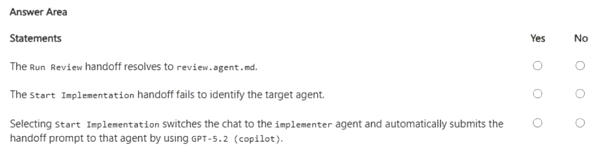

Comments:
div.jsErr {color:red} .error_message p {margin-bottom:0px;} Chosen Answer: This is a voting comment (?) . It is better to Upvote an existing comment if you don't have anything to add. Submit Cancel --> omath Most Recent 1 month, 21 days ago 1. Yes Handoff resolution uses the agent name in YAML frontmatter. We created: review.agent.md. With: name: code-review Since the agent name matches, the handoff correctly resolves to review.agent.md. 2. No The original handoff already had: agent: implementer And implementer.agent.md contains: name: IMPLEMENTER Agent name matching is case-insensitive, and the file is in the same directory. 3. Yes send: true → Copilot automatically switches to the target agent model: GPT‑5.2 (copilot) → The handoff prompt is executed using that model So the handoff does automatically switch the conversation to the implementer agent and submit the prompt using GPT‑5.2. upvoted 2 times Submit Cancel ... --> ? - A voting comment increases the vote count for the chosen answer by one. Upvoting a comment with a selected answer will also increase the vote count towards that answer by one. So if you see a comment that you already agree with, you can upvote it instead of posting a new comment. -->

---

## 421488-exam-gh-600-topic-6-question-3-discussion

Source: https://www.examtopics.com/discussions/microsoft/view/421488-exam-gh-600-topic-6-question-3-discussion/

**Exam GH-600 topic 6 question 3 discussion - ExamTopics**

from Microsoft's GH-600 Question #: 3 Topic #: 6 [All GH-600 Questions] HOTSPOT You have a GitHub repository that uses GitHub Actions to validate pull requests opened by the GitHub Copilot coding agent. The workflow runs unit tests and a linter on pull request triggers, and Copilot opens draft pull requests on dedicated branches while iterating by using commits. You discover that when multiple Copilot sessions push updates to the same pull request branch in quick succession, multiple workflow runs execute concurrently. You need to enable parallel workflow executions across different pull request branches. How should you configure workflow-level concurrency? To answer, select the appropriate options in the answer area. NOTE: Each correct selection is worth one point. 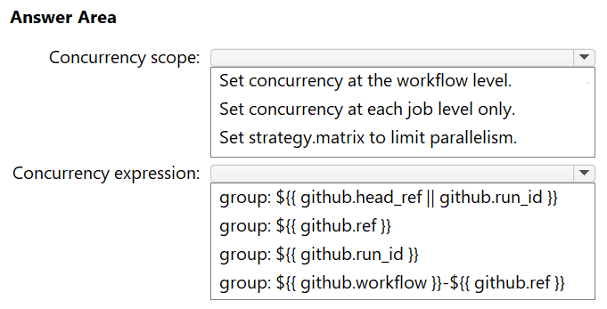

Comments:
div.jsErr {color:red} .error_message p {margin-bottom:0px;} Chosen Answer: This is a voting comment (?) . It is better to Upvote an existing comment if you don't have anything to add. Submit Cancel --> omath Most Recent 1 month, 21 days ago 1. Set concurrency at the workflow level. We must define concurrency at the workflow level, not per job, because: The problem is multiple workflow runs starting simultaneously on the same branch. Job‑level concurrency does not prevent multiple workflow runs from executing concurrently. Matrix strategy does not control concurrency across workflow runs. 2. group: github.workflow − {{ github.ref }} github.ref uniquely identifies the branch (refs/heads/copilot/xyz) Different branches → different concurrency groups → parallel execution Same branch → same concurrency group → serialized execution upvoted 1 time Submit Cancel ... --> ? - A voting comment increases the vote count for the chosen answer by one. Upvoting a comment with a selected answer will also increase the vote count towards that answer by one. So if you see a comment that you already agree with, you can upvote it instead of posting a new comment. -->

---

## 421489-exam-gh-600-topic-6-question-4-discussion

Source: https://www.examtopics.com/discussions/microsoft/view/421489-exam-gh-600-topic-6-question-4-discussion/

**Exam GH-600 topic 6 question 4 discussion - ExamTopics**

from Microsoft's GH-600 Question #: 4 Topic #: 6 [All GH-600 Questions] You have a GitHub repository that contains an agent named Orchestrator.Orchestrator delegates work to the following specialized subagents: Planner reviews issues and creates a plan of action. Implementer writes code based on the plan of action. Reviewer reviews the code. You create a new agent named Summarizer that produces a concise summary of the work performed by the other agents. You need to ensure that Orchestrator can invoke Summarizer as part of its workflow. What should you do? A. In the YAML frontmatter of the Reviewer agent, add a handoffs entry that points to the Summarizer agent. B. In the YAML frontmatter of the Reviewer agent, add Summarizer to the agents list. C. In the YAML frontmatter of the Orchestrator agent, add Summarizer to the tools list. D. In the YAML frontmatter of the Orchestrator agent, add Summarizer to the agents list.

Comments:
div.jsErr {color:red} .error_message p {margin-bottom:0px;} Chosen Answer: A B C D This is a voting comment (?) . It is better to Upvote an existing comment if you don't have anything to add. Submit Cancel --> omath Most Recent 1 month, 21 days ago Selected Answer: D Correct answer: D. In the YAML frontmatter of the Orchestrator agent, add Summarizer to the agents list. Orchestrator is the parent agent. Planner, Implementer, Reviewer, and now Summarizer are subagents that Orchestrator must be able to call. For Orchestrator to invoke another agent, that agent must be listed in Orchestrator’s agents: array in its YAML frontmatter. upvoted 1 time Submit Cancel ... --> ? - A voting comment increases the vote count for the chosen answer by one. Upvoting a comment with a selected answer will also increase the vote count towards that answer by one. So if you see a comment that you already agree with, you can upvote it instead of posting a new comment. -->

---

## 421490-exam-gh-600-topic-6-question-5-discussion

Source: https://www.examtopics.com/discussions/microsoft/view/421490-exam-gh-600-topic-6-question-5-discussion/

**Exam GH-600 topic 6 question 5 discussion - ExamTopics**

from Microsoft's GH-600 Question #: 5 Topic #: 6 [All GH-600 Questions] You have a multi-agent GitHub Actions workflow that uploads review artifacts for each run. You discover that some workflow run artifacts are being deleted manually. You need to use your organization's audit log data to identify which user deleted the artifacts. Which audit log search filter should you use? A. repo:&lt;org&gt;/&lt;repo&gt; B. action:workflows.run C. operation:remove D. action:artifact.destroy

Comments:
div.jsErr {color:red} .error_message p {margin-bottom:0px;} Chosen Answer: A B C D This is a voting comment (?) . It is better to Upvote an existing comment if you don't have anything to add. Submit Cancel --> omath Most Recent 1 month, 21 days ago Selected Answer: D The correct answer is D — action:artifact.destroy. GitHub Enterprise audit logs record manual artifact deletions using the event: /action:artifact.destroy/ This event includes: - Which user deleted the artifact - When it was deleted - Which workflow run it belonged to This is exactly what we need. upvoted 1 time Submit Cancel ... --> ? - A voting comment increases the vote count for the chosen answer by one. Upvoting a comment with a selected answer will also increase the vote count towards that answer by one. So if you see a comment that you already agree with, you can upvote it instead of posting a new comment. -->

---

## 421491-exam-gh-600-topic-6-question-6-discussion

Source: https://www.examtopics.com/discussions/microsoft/view/421491-exam-gh-600-topic-6-question-6-discussion/

**Exam GH-600 topic 6 question 6 discussion - ExamTopics**

from Microsoft's GH-600 Question #: 6 Topic #: 6 [All GH-600 Questions] You have a GitHub Copilot coding agent named Orchestrator that runs a multi-phase workflow by using the following subagents: Explorer gathers context by using read-only tools. Modifier applies focused edits. You are adding a new agent named Summarizer that generates a concise summary after modifications are complete. Summarizer includes the following YAML frontmatter. 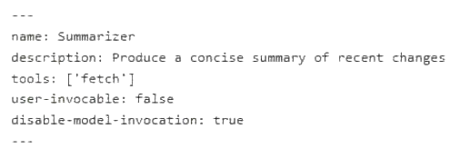 The Orchestrator agent lists all three agents in its agents property. After adding the Summarizer agent, Orchestrator successfully runs Explorer and Modifier but fails to run Summarizer. What is a possible cause of the failure? A. Summarizer cannot be invoked as a subagent because disable-model-invocation is set to true. B. Orchestrator is missing a handoff entry to trigger Summarizer. C. Orchestrator cannot call Summarizer because user-invocable is set to false. D. Summarizer is missing the editing tools required to complete the workflow.

Comments:
div.jsErr {color:red} .error_message p {margin-bottom:0px;} Chosen Answer: A B C D This is a voting comment (?) . It is better to Upvote an existing comment if you don't have anything to add. Submit Cancel --> nastolgia Most Recent 1 month, 0 days ago Selected Answer: A Summarizer cannot be invoked because disable-model-invocation is set to true. &amp;quot;disable-model-invocation - Optional boolean flag to prevent the agent from being invoked as a subagent by other agents (default is false).&amp;quot; code.visualstudio.com/docs/agent-customization/custom-agents#_custom-agent-file-structure upvoted 2 times Submit Cancel ... omath 1 month, 21 days ago Selected Answer: B Correct answer: B — Orchestrator is missing a handoff entry to trigger Summarizer. Even though Orchestrator lists Explorer, Modifier, and Summarizer in its agents: array, that alone does not cause Orchestrator to invoke Summarizer. To actually run a subagent, Orchestrator must include a handoff entry. Without this handoff, Orchestrator has no trigger telling it when or how to call Summarizer. This is the most common cause of “agent added but never invoked” failures. upvoted 1 time Submit Cancel ... --> ? - A voting comment increases the vote count for the chosen answer by one. Upvoting a comment with a selected answer will also increase the vote count towards that answer by one. So if you see a comment that you already agree with, you can upvote it instead of posting a new comment. -->

---

## 421492-exam-gh-600-topic-6-question-7-discussion

Source: https://www.examtopics.com/discussions/microsoft/view/421492-exam-gh-600-topic-6-question-7-discussion/

**Exam GH-600 topic 6 question 7 discussion - ExamTopics**

from Microsoft's GH-600 Question #: 7 Topic #: 6 [All GH-600 Questions] DRAG DROP You have a GitHub repository that runs an agentic software development lifecycle (SDLC) workflow by using GitHub Actions. The workflow uses the following three executors implemented as scripts: spec_analyzer, risk_reviewer, and plan_merger. You need to coordinate multiple specialized agents so that analysis and risk review run in parallel, and then a final executor merges the outputs into a single plan. The orchestration pattern must fan out one request to multiple executors, and then fan in the results to a final executor. How should you complete the workflow definition? To answer, drag the appropriate values to the correct targets. Each value may be used once, more than once, or not at all. You may need to drag the split bar between panes or scroll to view content. NOTE: Each correct selection is worth one point. 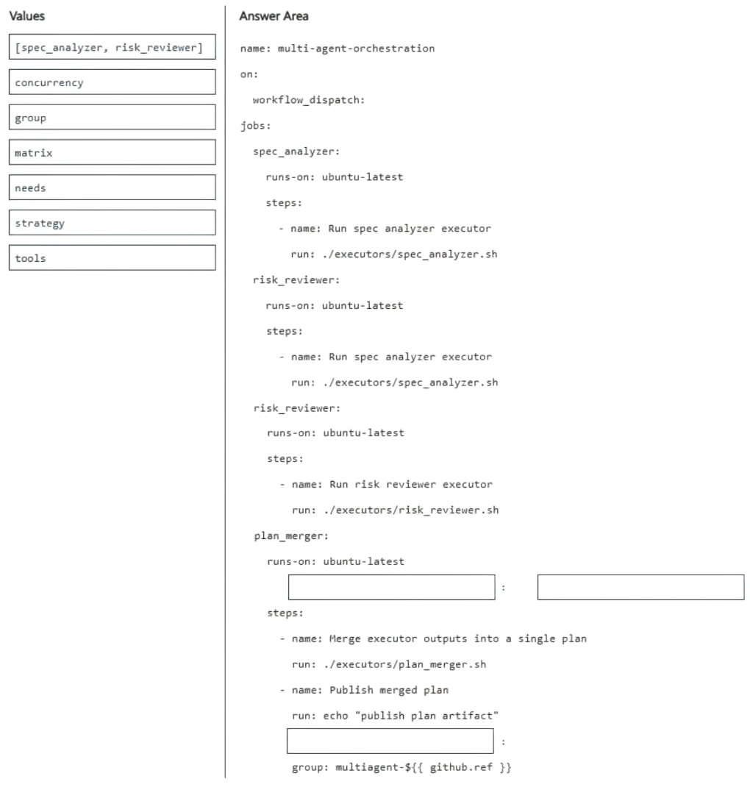

Comments:
div.jsErr {color:red} .error_message p {margin-bottom:0px;} Chosen Answer: This is a voting comment (?) . It is better to Upvote an existing comment if you don't have anything to add. Submit Cancel --> omath Most Recent 1 month, 21 days ago 1. needs: [spec_analyzer, risk_reviewer] Fan‑out: spec_analyzer and risk_reviewer run in parallel Fan‑in: plan_merger waits for both → requires needs: [spec_analyzer, risk_reviewer] 2. concurrency Concurrency must be defined at the workflow level, not inside a job. group: multiagent-${{ github.ref }} ensures: - Different branches → parallel runs - Same branch → serialized runs upvoted 1 time Submit Cancel ... --> ? - A voting comment increases the vote count for the chosen answer by one. Upvoting a comment with a selected answer will also increase the vote count towards that answer by one. So if you see a comment that you already agree with, you can upvote it instead of posting a new comment. -->

---

## 421493-exam-gh-600-topic-7-question-1-discussion

Source: https://www.examtopics.com/discussions/microsoft/view/421493-exam-gh-600-topic-7-question-1-discussion/

**Exam GH-600 topic 7 question 1 discussion - ExamTopics**

from Microsoft's GH-600 Question #: 1 Topic #: 7 [All GH-600 Questions] HOTSPOT You have a GitHub repository that uses GitHub Copilot Chat in Microsoft Visual Studio Code. Custom agents are stored in the repository under version control. Your team uses a multi-agent workflow where a planner agent produces an implementation plan that is then handed off to an implementation agent to make changes. Recent prompts cause the planner agent to start editing files and running commands before the plan is approved. You need to configure the planner agent to meet the following requirements: Use only read-only tools. Hand off to the implementation agent only after the plan is approved. How should you configure the agent? To answer, select the appropriate options in the answer area. NOTE: Each correct selection is worth one point. 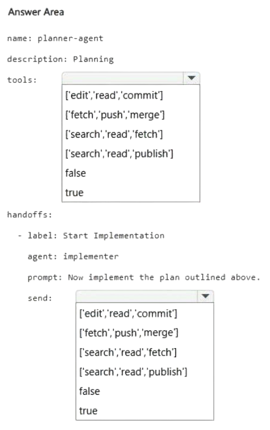

Comments:
div.jsErr {color:red} .error_message p {margin-bottom:0px;} Chosen Answer: This is a voting comment (?) . It is better to Upvote an existing comment if you don't have anything to add. Submit Cancel --> omath Most Recent 1 month, 21 days ago 1. ['search','read','fetch'] This is the only option in the list that contains no write‑capable tools (edit, commit, push, merge, publish). GH‑600 rule: Planning must be read‑only; execution belongs to the implementer. 2. false This ensures the planner does NOT automatically hand off to the implementer. Instead, the plan is produced, reviewed, and only then manually approved. Automatic send (true) would cause the planner to immediately trigger the implementer, which is exactly the anti‑pattern described in your scenario. upvoted 1 time Submit Cancel ... --> ? - A voting comment increases the vote count for the chosen answer by one. Upvoting a comment with a selected answer will also increase the vote count towards that answer by one. So if you see a comment that you already agree with, you can upvote it instead of posting a new comment. -->

---

## 421494-exam-gh-600-topic-7-question-2-discussion

Source: https://www.examtopics.com/discussions/microsoft/view/421494-exam-gh-600-topic-7-question-2-discussion/

**Exam GH-600 topic 7 question 2 discussion - ExamTopics**

from Microsoft's GH-600 Question #: 2 Topic #: 7 [All GH-600 Questions] DRAG DROP Case study This is a case study. Case studies are not timed separately. You can use as much exam time as you would like to complete each case. However, there may be additional case studies and sections on this exam. You must manage your time to ensure that you are able to complete all questions included on this exam in the time provided. To answer the questions included in a case study, you will need to reference information that is provided in the case study. Case studies might contain exhibits and other resources that provide more information about the scenario that is described in the case study. Each question is independent of the other questions in this case study. At the end of this case study, a review screen will appear. This screen allows you to review your answers and to make changes before you move to the next section of the exam. After you begin a new section, you cannot return to this section. To start the case study To display the first question in this case study, click the Next button. Use the buttons in the left pane to explore the content of the case study before you answer the questions. Clicking these buttons displays information such as business requirements, existing environment, and problem statements. If the case study has an All Information tab, note that the information displayed is identical to the information displayed on the subsequent tabs. When you are ready to answer a question, click the Question button to return to the question. Existing Environment GitHub Environment The GitHub environment contains the following: Three repositories named product-api, billing-service, and infra-terraform. Branch protection on the main branch in all repositories that requires at least one pull request review before merging GitHub Actions runners used across all workflows A GitHub team named SG_Dev that contains developers A GitHub team named SG_Review that contains senior engineers and a security team A .github/copilot-instructions.md file that includes general coding conventions for all features Agent environment The product-api repository uses a GitHub Copilot coding agent named agent1 that has the following configurations: No custom agent profile is defined. A Model Context Protocol (MCP) server named MCP1 is deployed to https://mcp.litwareinc.internal and provides access to internal ticketing and deployment APIs. MCP1 requires an API key for authentication. A second Copilot coding agent named agent2 handles changes in infra-terraform and runs in parallel with agent1 when both agents have open assigned issues. Copilot memory is NOT enabled for the organization. Problem Statements Litware identifies the following issues: During two recent sessions, agent1 accessed files in billing-service, which is outside the agent's intended scope. agent1 makes code changes immediately after receiving a task. A developer named Ben, who is on the SG_Dev team, reports that agent1 completed a session with a successful status and opened a pull request, but the pull request contains no file changes. Other developers report this intermittently as well. Both agent1 and agent2 modified shared/config.yaml in a parallel test run, generating conflicting outputs. agent1 consistently uses raw try-catch blocks for error handling, which violates the defined implementation guidelines of SG_Dev. Requirements Planned Changes Litware plans to make the following changes: Ensure that agent1 can access all the tools in the environment. Provide product-api with specific instructions to agent1 without affecting Copilot Chat or Copilot code review. Configure MCP1 as a tool for agent1 by modifying the product-api repository MCP configuration. Ensure that Copilot retains details that it has learned and uses that knowledge for future work. This must be applied to all licensed members of the organization. Implementation guidelines The development team at Litware identifies the following implementation guidelines: Agent workflows must be able to run in parallel. Application error handling must use the repository ErrorHandler class. agent1 and agent2 must run on isolated branches during parallel execution. File-level conflicts must be detected before merges, and both agents must be able to run concurrently. Security requirements Litware identifies the following security requirements: Only the members of SG_Review must be able to approve agent1 plan outputs. All API keys must be stored and accessed securely. The developers must NOT be able to self-approve. Agent configuration  You need to implement the security requirements for agent1. Which three actions should you perform in sequence? To answer, move the appropriate actions from the list of actions to the answer area and arrange them in the correct order. 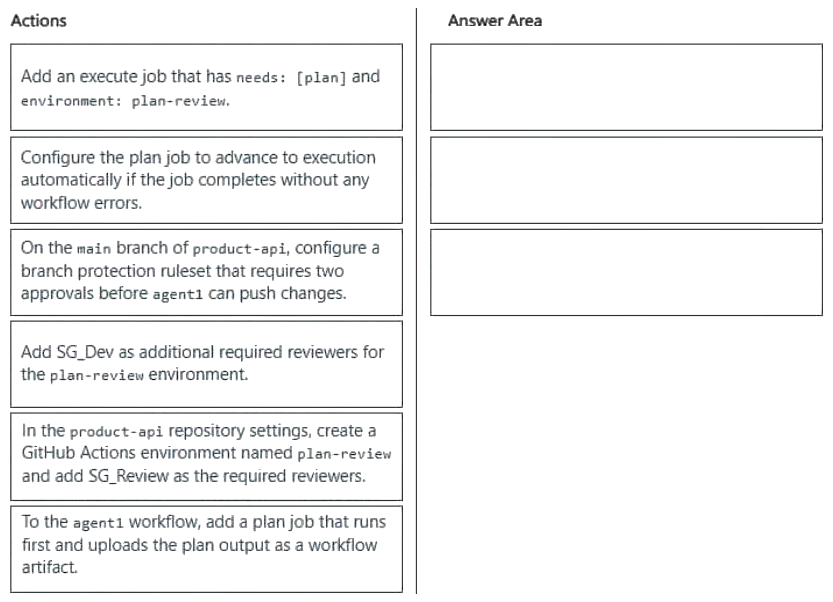

Comments:
div.jsErr {color:red} .error_message p {margin-bottom:0px;} Chosen Answer: This is a voting comment (?) . It is better to Upvote an existing comment if you don't have anything to add. Submit Cancel --> omath Most Recent 1 month, 21 days ago 1. In the product-api repository settings, create a GitHub Actions environment named plan-review and add SG_Review as the required reviewers. This enforces the security requirement: “Only members of SG_Review must be able to approve agent1 plan outputs.” 2. To the agent1 workflow, add a plan job that runs first and uploads the plan output as a workflow artifact. This creates the human‑reviewable plan that SG_Review must approve before execution. 3. Add an execute job that has needs: [plan] and environment: plan-review. This ensures execution cannot start until SG_Review approves the plan in the environment. upvoted 1 time Submit Cancel ... --> ? - A voting comment increases the vote count for the chosen answer by one. Upvoting a comment with a selected answer will also increase the vote count towards that answer by one. So if you see a comment that you already agree with, you can upvote it instead of posting a new comment. -->

---

## 421495-exam-gh-600-topic-7-question-3-discussion

Source: https://www.examtopics.com/discussions/microsoft/view/421495-exam-gh-600-topic-7-question-3-discussion/

**Exam GH-600 topic 7 question 3 discussion - ExamTopics**

from Microsoft's GH-600 Question #: 3 Topic #: 7 [All GH-600 Questions] Case study This is a case study. Case studies are not timed separately. You can use as much exam time as you would like to complete each case. However, there may be additional case studies and sections on this exam. You must manage your time to ensure that you are able to complete all questions included on this exam in the time provided. To answer the questions included in a case study, you will need to reference information that is provided in the case study. Case studies might contain exhibits and other resources that provide more information about the scenario that is described in the case study. Each question is independent of the other questions in this case study. At the end of this case study, a review screen will appear. This screen allows you to review your answers and to make changes before you move to the next section of the exam. After you begin a new section, you cannot return to this section. To start the case study To display the first question in this case study, click the Next button. Use the buttons in the left pane to explore the content of the case study before you answer the questions. Clicking these buttons displays information such as business requirements, existing environment, and problem statements. If the case study has an All Information tab, note that the information displayed is identical to the information displayed on the subsequent tabs. When you are ready to answer a question, click the Question button to return to the question. Existing Environment GitHub Environment The GitHub environment contains the following: Three repositories named product-api, billing-service, and infra-terraform. Branch protection on the main branch in all repositories that requires at least one pull request review before merging GitHub Actions runners used across all workflows A GitHub team named SG_Dev that contains developers A GitHub team named SG_Review that contains senior engineers and a security team A .github/copilot-instructions.md file that includes general coding conventions for all features Agent environment The product-api repository uses a GitHub Copilot coding agent named agent1 that has the following configurations: No custom agent profile is defined. A Model Context Protocol (MCP) server named MCP1 is deployed to https://mcp.litwareinc.internal and provides access to internal ticketing and deployment APIs. MCP1 requires an API key for authentication. A second Copilot coding agent named agent2 handles changes in infra-terraform and runs in parallel with agent1 when both agents have open assigned issues. Copilot memory is NOT enabled for the organization. Problem Statements Litware identifies the following issues: During two recent sessions, agent1 accessed files in billing-service, which is outside the agent's intended scope. agent1 makes code changes immediately after receiving a task. A developer named Ben, who is on the SG_Dev team, reports that agent1 completed a session with a successful status and opened a pull request, but the pull request contains no file changes. Other developers report this intermittently as well. Both agent1 and agent2 modified shared/config.yaml in a parallel test run, generating conflicting outputs. agent1 consistently uses raw try-catch blocks for error handling, which violates the defined implementation guidelines of SG_Dev. Requirements Planned Changes Litware plans to make the following changes: Ensure that agent1 can access all the tools in the environment. Provide product-api with specific instructions to agent1 without affecting Copilot Chat or Copilot code review. Configure MCP1 as a tool for agent1 by modifying the product-api repository MCP configuration. Ensure that Copilot retains details that it has learned and uses that knowledge for future work. This must be applied to all licensed members of the organization. Implementation guidelines The development team at Litware identifies the following implementation guidelines: Agent workflows must be able to run in parallel. Application error handling must use the repository ErrorHandler class. agent1 and agent2 must run on isolated branches during parallel execution. File-level conflicts must be detected before merges, and both agents must be able to run concurrently. Security requirements Litware identifies the following security requirements: Only the members of SG_Review must be able to approve agent1 plan outputs. All API keys must be stored and accessed securely. The developers must NOT be able to self-approve. Agent configuration  You need to resolve the scoping issue associated to agent1. What should you do? A. To the profile of agent1, add a custom instruction specifying that the agent must NOT access billing-service or infra-terraform. B. Add a permissions block to the agent1 workflow in product-api. C. Create a fine-grained personal access token (PAT) scoped to product-api and store the PAT as a GitHub Actions secret for agent1 to use. D. Create a ruleset for billing-service and infra-terraform that blocks push access from the github-actions bot account.

Comments:
div.jsErr {color:red} .error_message p {margin-bottom:0px;} Chosen Answer: A B C D This is a voting comment (?) . It is better to Upvote an existing comment if you don't have anything to add. Submit Cancel --> nastolgia Most Recent 1 month, 0 days ago Selected Answer: A A - looks correct for me. From docs: “The agent profile defines the custom agent’s behavior.”, “Custom instructions that define the agent’s behavior and expertise.”In this case we would need to add a custom instruction. docs.github.com/en/copilot/concepts/agents/cloud-agent/about-custom-agents#agent-profile-format B - incorrect. Dont instruct agent which repo should be analysed C - incorrect. A fine-grained PAT controls authentication and API access not the agents behavioural scope. D - incorrect. A ruleset can restrict pushes, but it does not prevent agent1 from accessing or reading those repositories. It could also block agent2’s legitimate work in infra-terraform, violating the requirement that both agents work concurrently. upvoted 1 time Submit Cancel ... omath 1 month, 21 days ago Selected Answer: D Correct answer: D — Create a ruleset for billing-service and infra-terraform that blocks push access from the github-actions bot account. The scoping issue occurs because agent1 accessed files in repositories outside its intended scope. In GH‑600, the correct way to enforce repository boundaries is to use rulesets that block push access from the GitHub Actions bot (which is what agents use to write files). Option D is the only solution that enforces repository-level scoping and prevents agent1 from modifying other repos. upvoted 1 time Submit Cancel ... --> ? - A voting comment increases the vote count for the chosen answer by one. Upvoting a comment with a selected answer will also increase the vote count towards that answer by one. So if you see a comment that you already agree with, you can upvote it instead of posting a new comment. -->

---

## 421496-exam-gh-600-topic-7-question-4-discussion

Source: https://www.examtopics.com/discussions/microsoft/view/421496-exam-gh-600-topic-7-question-4-discussion/

**Exam GH-600 topic 7 question 4 discussion - ExamTopics**

from Microsoft's GH-600 Question #: 4 Topic #: 7 [All GH-600 Questions] Case study This is a case study. Case studies are not timed separately. You can use as much exam time as you would like to complete each case. However, there may be additional case studies and sections on this exam. You must manage your time to ensure that you are able to complete all questions included on this exam in the time provided. To answer the questions included in a case study, you will need to reference information that is provided in the case study. Case studies might contain exhibits and other resources that provide more information about the scenario that is described in the case study. Each question is independent of the other questions in this case study. At the end of this case study, a review screen will appear. This screen allows you to review your answers and to make changes before you move to the next section of the exam. After you begin a new section, you cannot return to this section. To start the case study To display the first question in this case study, click the Next button. Use the buttons in the left pane to explore the content of the case study before you answer the questions. Clicking these buttons displays information such as business requirements, existing environment, and problem statements. If the case study has an All Information tab, note that the information displayed is identical to the information displayed on the subsequent tabs. When you are ready to answer a question, click the Question button to return to the question. Overview Contoso Ltd. is a software development company located in the United States. Existing Environment GitHub Environment Contoso uses GitHub Enterprise and assigns GitHub Copilot Pro+ licenses to its developers. The developers use Microsoft Visual Studio Code as their IDE. Contoso has a customer portal. The code for the portal is stored in a GitHub repository named repo1 that contains the following: A custom agent named agent1 that includes instructions to review specs related to best practices A custom instruction file named validate-instructions.md that is used to validate tone of voice and applies to all .md and .txt files A custom instruction file named codereview.instructions.md that is used by the Copilot coding agent but is excluded for use by the Copilot code review repo1 has the following structure: The front-end is stored in the /frontend folder. The API logic is stored in the /api folder. Contoso has a second repository named repo2 that contains a legacy .NET application named App1 built by using .NET 6. repo2 has a multi-agent workflow for modernization tasks. Contoso enables the Model Context Protocol (MCP) registry and allows the Microsoft Learn MCP Server. Every developer must configure their own connection to the Learn MCP Server. Problem Statements The developers working in repo1 report that the Microsoft Learn documentation is NOT being retrieved when they attempt to validate a design by using agent1. The testing team at Contoso identifies that the customer portal uses inconsistent UI styles, which leads to customer confusion and branding issues. The UI inconsistencies stem from variations in the folder structure. Agent Logs You have the following logs for the multi-agent workflow used in repo2.  Requirements Planned Changes Contoso plans to have all agents and developers in repo1 use the Microsoft Learn MCP to ensure that reviews are validated by using the appropriate documentation. This must be implemented centrally. Contoso plans to leverage AI-powered coding agents to implement new portal features and pages. Technical Requirements App1 must be upgraded to .NET 10. A previous upgrade attempt was started by using the Copilot modernization agent, but the attempt was never finalized. You plan to retry the upgrade. You must first analyze App1 by using AI, and then generate a report that contains breaking changes and deprecated patterns before retrying the upgrade. All AI-generated code for UI styling must adhere to a predefined folder structure. The architects at Contoso need help building implementation plans for repo1. The company wants to implement a new agent named agent2 to analyze the code base and the code requirements, and then respond with a detailed plan. The agent must NOT be able to edit files or run local commands. The developers must be able to delegate work to the Copilot coding agent by assigning issues to the agent. While upgrading App1, the agent identifies 47 issues, including a security vulnerability, and 46 API incompatibilities across different projects. Which two actions are unsafe to delegate to the agent and require human involvement? Each correct answer presents a complete solution. NOTE: Each correct selection is worth one point. A. Validate the assessment.md file for accuracy. B. Generate the assessment.md file. C. Approve all Git commits. D. Review the plan.md file for dependencies. E. Validate whether the tasks.md file exists.

Comments:
div.jsErr {color:red} .error_message p {margin-bottom:0px;} Chosen Answer: A B C D E This is a voting comment (?) . It is better to Upvote an existing comment if you don't have anything to add. Submit Cancel --> omath Most Recent 1 month, 21 days ago Selected Answer: AC ✅ A. Validate the assessment.md file for accuracy — UNSAFE (requires human judgment) Agents can generate an assessment, but they cannot be trusted to validate accuracy. GH‑600 rule: Human review is required for policy, compliance, security, and correctness decisions. ✅ C. Approve all Git commits — UNSAFE (never delegated) This is one of the clearest GH‑600 guardrail rules: - Agents must never approve their own work or bypass human review. - Approval is a human-in-the-loop control. Approving commits is a high‑risk, irreversible, compliance‑sensitive action. upvoted 2 times Submit Cancel ... --> ? - A voting comment increases the vote count for the chosen answer by one. Upvoting a comment with a selected answer will also increase the vote count towards that answer by one. So if you see a comment that you already agree with, you can upvote it instead of posting a new comment. -->

---

## 421497-exam-gh-600-topic-7-question-5-discussion

Source: https://www.examtopics.com/discussions/microsoft/view/421497-exam-gh-600-topic-7-question-5-discussion/

**Exam GH-600 topic 7 question 5 discussion - ExamTopics**

from Microsoft's GH-600 Question #: 5 Topic #: 7 [All GH-600 Questions] DRAG DROP You have a GitHub repository that uses the GitHub Copilot CLI to run autonomous tasks. You need to validate each generated command before it runs. Any commands that attempt to modify paths outside the repository must be blocked. How should you complete the YAML? To answer, drag the appropriate values to the correct targets. Each value may be used once, more than once, or not at all. You may need to drag the split bar between panes or scroll to view content. NOTE: Each correct selection is worth one point. 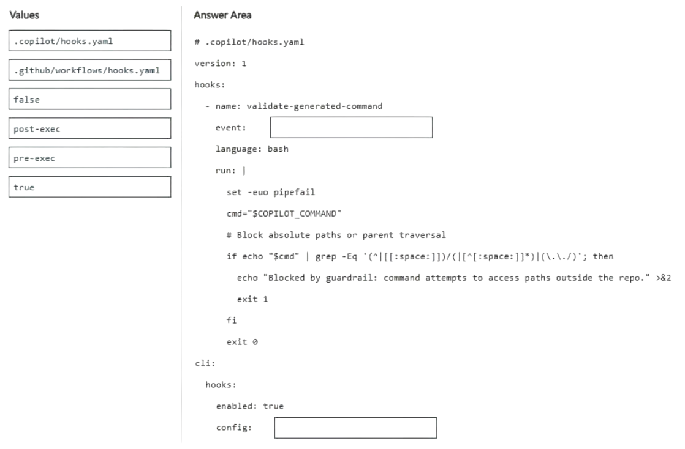

Comments:
div.jsErr {color:red} .error_message p {margin-bottom:0px;} Chosen Answer: This is a voting comment (?) . It is better to Upvote an existing comment if you don't have anything to add. Submit Cancel --> omath Most Recent 1 month, 19 days ago ✅ Correct Drag‑and‑Drop Answers 1. event: Select pre-exec This is the GH‑600‑correct hook event for validating commands before they run. From the study guide: “Use pre-exec hooks to validate or deny generated commands before execution.” 2. cli.hooks.config: Select true This enables the hook configuration for the Copilot CLI. From the GH‑600 docs: “cli.hooks.enabled must be true, and cli.hooks.config must be true to activate hook evaluation.” upvoted 1 time Submit Cancel ... --> ? - A voting comment increases the vote count for the chosen answer by one. Upvoting a comment with a selected answer will also increase the vote count towards that answer by one. So if you see a comment that you already agree with, you can upvote it instead of posting a new comment. -->

---

## 421498-exam-gh-600-topic-7-question-6-discussion

Source: https://www.examtopics.com/discussions/microsoft/view/421498-exam-gh-600-topic-7-question-6-discussion/

**Exam GH-600 topic 7 question 6 discussion - ExamTopics**

from Microsoft's GH-600 Question #: 6 Topic #: 7 [All GH-600 Questions] You have a GitHub Enterprise Cloud Organization that uses GitHub Actions for CI/CD. You plan to enable an agent to update and deploy workflows that access production environment secrets. You need to select an autonomy level for a compliance-sensitive workflow. Which autonomy level should you select? A. read-only analysis with no ability to trigger workflows B. autonomous execution limited to non-production environments C. human-in-the-loop with required manual approvals for production D. fully autonomous execution without approvals

Comments:
div.jsErr {color:red} .error_message p {margin-bottom:0px;} Chosen Answer: A B C D This is a voting comment (?) . It is better to Upvote an existing comment if you don't have anything to add. Submit Cancel --> omath Most Recent 1 month, 21 days ago Selected Answer: C The right autonomy level is C. human‑in‑the‑loop with required manual approvals for production. Why: In GH‑600, any workflow that touches production secrets, deployment credentials, or high‑risk environments must not run autonomously. Even if an agent is allowed to update or deploy workflows, production changes require a mandatory human approval gate. upvoted 1 time Submit Cancel ... --> ? - A voting comment increases the vote count for the chosen answer by one. Upvoting a comment with a selected answer will also increase the vote count towards that answer by one. So if you see a comment that you already agree with, you can upvote it instead of posting a new comment. -->

---

