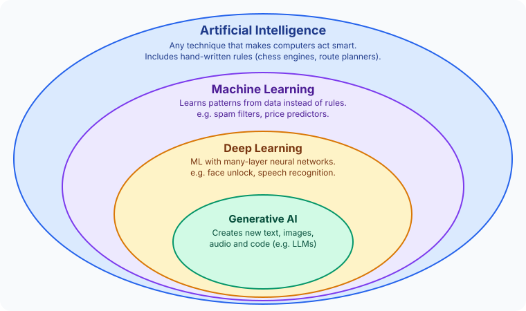

# Foundations: What AI Models Are

**Chapter 1 · Foundations**

Before looking inside an AI model, you need a clear map: what "AI", "machine learning", "deep learning" and "generative AI" mean, how a computer can learn from examples instead of rules, and what a "model" physically is.

## 1. AI, machine learning, deep learning and generative AI

These four terms are often used as if they mean the same thing. They do not — each one sits inside the one before it.

- **Artificial intelligence (AI)** is the broad goal: getting computers to do tasks that normally need human intelligence, such as understanding language, recognizing images, or making decisions. The term dates back to the 1956 Dartmouth workshop. AI includes old-fashioned approaches where humans write all the rules by hand.
- **Machine learning (ML)** is a subset of AI where the computer *learns the rules from data* instead of being told them. You give it examples; it finds the pattern.
- **Deep learning (DL)** is a subset of machine learning that uses *neural networks with many layers* ("deep" means many layers). It is what made modern speech recognition, image recognition and chatbots possible.
- **Generative AI** is the part of deep learning focused on *creating new content* — text, images, audio, video, code — rather than just labelling or predicting. Large language models (LLMs) such as GPT, Claude, Gemini and Llama are generative AI.



*Figure 1 — Each field is a subset of the one around it. Today's generative AI is built almost entirely with deep learning, but not all AI is generative.*

> **📘 In plain words:** AI is the whole kitchen. Machine learning is cooking by tasting and adjusting rather than following a fixed recipe. Deep learning is a particularly powerful oven. Generative AI is the set of dishes that oven is famous for.

Microsoft Learn's [Introduction to AI concepts](https://learn.microsoft.com/training/modules/get-started-ai-fundamentals/) and [Introduction to machine learning concepts](https://learn.microsoft.com/training/modules/fundamentals-machine-learning/) modules cover the same map if you want a second explanation.

## 2. Writing rules vs learning from data

### 2.1 The traditional way: a programmer writes the rules

Suppose you want to filter spam email. The classic approach is to write rules by hand:

```
IF subject contains "FREE MONEY"      THEN spam
IF sender is not in contacts
   AND body contains "click here"      THEN spam
OTHERWISE                              not spam
```

This works for a week. Then spammers write "FR3E M0NEY", and you add another rule. And another. Soon you have thousands of fragile rules, and legitimate emails ("Click here to see your receipt") get blocked.

### 2.2 The machine learning way: the computer finds the rules

Instead, you collect 100,000 emails that people have already marked as "spam" or "not spam", and give them to a learning algorithm. The algorithm discovers, on its own, which combinations of words, senders, links and formatting tend to indicate spam — including patterns no human would think to write down. When spammers change tactics, you retrain on fresh examples.

> **💡 Example:** Your email provider's spam folder is a machine learning model. Every time you click "Report spam" or "Not spam", you are creating a new labelled example that can help train the next version.

| | Rules-based programming | Machine learning |
|---|---|---|
| Who writes the logic | A programmer | The algorithm, from data |
| Input to build it | Rules | Examples (data) |
| Handles new tricks | Only if someone writes a new rule | Often, if the new tricks resemble the training examples |
| Explainability | Easy — read the rules | Harder — the logic is spread across many numbers |
| Best for | Clear, stable logic (tax calculation, sorting) | Fuzzy patterns (language, images, fraud) |

> **⚠️ Common misconception:** "Machine learning replaces normal programming." It does not. A real AI product is mostly ordinary code (user interface, databases, security) with a learned model inside for the fuzzy part.

## 3. Types of learning

Machine learning methods are usually grouped by *what kind of feedback* the model gets while learning. Google's [What is Machine Learning?](https://developers.google.com/machine-learning/intro-to-ml/what-is-ml) page introduces the first three, and its [Machine Learning Crash Course](https://developers.google.com/machine-learning/crash-course) goes deeper into supervised learning.

### 3.1 Supervised learning — learning with an answer key

Every training example comes with the correct answer, called a **label**. The model learns to map inputs to labels.

- Emails labelled spam / not spam → a spam filter.
- Photos labelled "cat" / "dog" → an image classifier.
- Houses with their sale prices → a price predictor.

*Everyday analogy:* practising with flashcards that have the answer on the back.

### 3.2 Unsupervised learning — finding structure with no answer key

The data has no labels. The model looks for groups or patterns by itself.

- A shop groups customers into segments ("weekend bargain hunters", "weekday premium buyers") from purchase history.
- A bank flags transactions that look unlike anything normal (anomaly detection).

*Everyday analogy:* sorting a box of mixed buttons into piles by colour and size without being told what the piles should be.

### 3.3 Reinforcement learning — learning by trial, error and reward

An *agent* takes actions in an environment and receives rewards or penalties. Over many attempts it learns which actions lead to the most reward.

- DeepMind's AlphaGo learned to play Go partly by playing against itself, and beat world champion Lee Sedol in 2016.
- Robots learning to walk.
- Chat assistants are refined with *reinforcement learning from human feedback (RLHF)*: people rate answers, and the model is nudged toward the highly rated ones (covered in [Training & Tuning](training.md)).

*Everyday analogy:* training a dog with treats.

### 3.4 Self-supervised learning — the data labels itself

The model creates its own "answer key" by hiding part of the data and predicting it. No human labelling is needed, so it scales to enormous datasets.

- Take the sentence "The cat sat on the mat." Hide the last word; the model must predict "mat". The correct answer was already in the text.
- This *next-word (next-token) prediction* is exactly how large language models are pre-trained on trillions of words.

> **📘 In plain words:** Supervised = a teacher gives answers. Unsupervised = no answers, find patterns. Reinforcement = rewards for good actions. Self-supervised = the data hides its own answers, like a fill-in-the-blank exercise you can make from any book.

| Type | Feedback | Everyday example | AI example |
|---|---|---|---|
| Supervised | Correct label for every example | Flashcards | Spam filter, medical image diagnosis |
| Unsupervised | None | Sorting buttons into piles | Customer segments, anomaly detection |
| Reinforcement | Rewards and penalties | Training a dog | Game-playing AI, RLHF for chatbots |
| Self-supervised | Hidden parts of the data itself | Fill-in-the-blank exercise | LLM pre-training (predict the next token) |

## 4. Data, features and labels

Machine learning starts with a table of examples. Here is a tiny dataset for predicting house prices:

| Size (m²) | Bedrooms | Age (years) | **Price (thousands)** |
|---|---|---|---|
| 50 | 1 | 30 | **150** |
| 80 | 2 | 10 | **240** |
| 120 | 3 | 5 | **350** |
| 100 | 3 | 40 | **260** |

- Each **row** is one *example* (one house).
- The input columns — size, bedrooms, age — are **features**: the facts the model is allowed to look at.
- The column we want to predict — price — is the **label** (also called the *target*).

For text models, the "features" are the tokens of the text so far, and the "label" is the next token. For image models, the features are pixel values.

> **💡 Example:** In a spam filter, features might be "number of links", "sender in contacts (yes/no)" and "contains the word *winner*". The label is "spam" or "not spam".

> **⚠️ Common misconception:** "More data always fixes everything." Quality matters as much as quantity. If the labels are wrong, or the data does not represent the real world (for example, only houses from one city), the model learns the wrong lesson. This is the root of many AI bias problems.

## 5. What a "model" actually is

A **model** is a *function with learned numbers*. A function is simply a rule that turns an input into an output.

Here is the simplest possible model for our house prices:

```
price = w × size + b
```

- `size` is the input (a feature).
- `w` and `b` are **parameters** — numbers the model learns. `w` is called a *weight*, `b` a *bias*.
- Before training, `w` and `b` are just guesses. Training finds values that make the predictions close to the real prices.

Suppose training finds `w = 2.8` and `b = 10`. Then for a 90 m² house:

```
price = 2.8 × 90 + 10 = 252 + 10 = 262   (thousand)
```

That is a complete, working (if simple) machine learning model: one formula and two learned numbers.

A large language model is the same idea at a vastly bigger scale. Instead of one formula with 2 numbers, it is a deep stack of formulas with *billions* of learned numbers, and instead of predicting a price, it predicts the next token. When you download an open model such as Llama or Mistral, the big file you get is mostly those numbers.

> **📘 In plain words:** A model is a recipe (the structure of the formula) plus a long list of learned ingredient amounts (the parameters). The recipe is written by engineers; the amounts are learned from data.

> **✅ Key takeaway:** "Training a model" means finding good values for its parameters. "Running a model" means plugging new inputs into the formula with those values fixed.

## 6. Training vs inference

Every model has two phases in its life.

- **Training** is the learning phase. The model sees many examples, compares its guesses to the right answers, and its parameters are adjusted again and again.
- **Inference** is the using phase. The parameters are frozen, and the model simply computes an output for each new input.

*Analogy:* Training is like a chef spending years in culinary school, tasting and adjusting thousands of dishes. Inference is the chef cooking your dinner tonight — fast, using skills already learned. The chef does not go back to school every time you order.

| | Training | Inference |
|---|---|---|
| What happens | Parameters are adjusted to reduce errors | Parameters are fixed; the model produces outputs |
| Who does it | The model builder (OpenAI, Anthropic, Google, Meta, Mistral AI, a company's data science team) | Anyone using the model — you, an app, a business |
| How often | Rarely — once per model version, plus occasional fine-tuning | Constantly — every question, every request |
| Cost | Very high for large models: thousands of GPUs for weeks or months; frontier models are reported to cost tens of millions of dollars or more | Low per request (fractions of a cent to a few cents), but adds up at scale |
| Hardware | Large clusters of data-centre GPUs or other AI accelerators | Anything from a data-centre GPU to a laptop or phone, depending on model size |
| Does the model change? | Yes | No — chatting does not retrain the model |

> **⚠️ Common misconception:** "The chatbot is learning from our conversation right now." During a conversation, the model's weights do not change. It only "remembers" what is in the current conversation text. Some providers may use conversations as training data for *future* model versions, depending on their policies and your settings — which is a privacy question, not live learning.

## 7. Generalization, overfitting and underfitting

The whole point of training is **generalization**: doing well on *new* data the model has never seen, not just the examples it trained on.

*Analogy:* Two students prepare for an exam using past papers.

- Student A **memorizes** the past answers word for word. She scores 100% on the past papers but fails the real exam, because the questions are different. This is **overfitting**: the model learned the noise and quirks of its training data instead of the real pattern.
- Student B barely studies and learns only "the answer is usually C". He does badly on both past papers and the real exam. This is **underfitting**: the model is too simple, or trained too little, to capture the pattern.
- Student C learns the underlying concepts. She does well on past papers *and* on the new exam. That is **good generalization**.

To check which student your model is, you split your data:

- **Training set** (e.g. 80%): used to adjust the parameters.
- **Validation set** (e.g. 10%): used during development to compare versions and decide when to stop.
- **Test set** (e.g. 10%): kept locked away and used once at the end for an honest score.

| Situation | Training error | Error on new data | Fix |
|---|---|---|---|
| Underfitting | High | High | Bigger model, better features, train longer |
| Good fit | Low | Low (close to training) | Ship it |
| Overfitting | Very low | High | More data, simpler model, regularization, stop earlier |

Google's crash course has an excellent interactive section on [overfitting](https://developers.google.com/machine-learning/crash-course/overfitting). Chapter 2 shows the specific techniques used to fight it.

> **✅ Key takeaway:** A model is only as good as its performance on data it has *not* seen. A perfect score on the training data can be a bad sign.

## 8. Types of models by task

Models are also grouped by *what kind of output* they produce.

| Task type | Output | Examples |
|---|---|---|
| **Classification** | A category from a fixed list | Spam / not spam; which animal is in the photo; positive / negative review |
| **Regression** | A number | House price; tomorrow's temperature; delivery time in minutes |
| **Generative** | New content | Chat replies, essays and code (LLMs); images from a description (image generators); synthetic speech |

Others you will meet: **clustering** (grouping without labels), **recommendation** (what to watch next), and **embedding** models, which turn text or images into lists of numbers that capture meaning (used for search — see [Transformers & LLMs](transformers.md)).

> **💡 Example:** An LLM is, underneath, a classifier repeated many times: at each step it "classifies" which token should come next out of a vocabulary of tens of thousands to a few hundred thousand possible tokens. Chaining those choices together produces generated text.

## 9. Where models run

A trained model is a file of numbers plus code to run it. Where that code runs changes cost, privacy and speed.

| Where | How it works | Typical models | Good for | Trade-offs |
|---|---|---|---|---|
| **Cloud API** | Your app sends text over the internet to the provider's servers and gets the answer back | Proprietary models such as OpenAI GPT, Anthropic Claude, Google Gemini; also hosted open models | The most capable models, no hardware to manage | Pay per token; data leaves your device; needs internet |
| **Local (your computer or server)** | You download the model weights and run them yourself, e.g. with tools such as Ollama or LM Studio | Open-weight models such as Meta Llama, Mistral, Google Gemma, Microsoft Phi, Alibaba Qwen | Privacy, offline use, no per-token fees | Needs enough memory (RAM/GPU); smaller models are usually less capable |
| **Edge / on-device** | A small model runs directly on a phone, car, camera or sensor | Small, compressed models built for phones and devices | Instant response, works offline, data stays on device | Strict size and power limits |

> **📘 In plain words:** Cloud = renting a genius over the phone. Local = owning a smart assistant who lives in your house. Edge = a pocket-sized helper that is always with you but knows less.

The difference between *proprietary* and *open-weight* models — and what "open source" really means for AI — is covered in [Model Landscape](models.md).

## Recap

- AI ⊃ machine learning ⊃ deep learning ⊃ generative AI. Each is a subset of the one before.
- Traditional programs follow rules written by people; machine learning finds the rules from examples.
- Four kinds of learning: supervised (labels), unsupervised (no labels), reinforcement (rewards), self-supervised (the data hides its own answers — how LLMs are pre-trained).
- Data is made of examples; features are the inputs; labels are the answers to predict.
- A model is a function with learned numbers called parameters. Training finds the numbers; inference uses them.
- Training is rare and expensive; inference is constant and cheap per request. Chatting does not change the model's weights.
- The goal is generalization. Overfitting = memorizing; underfitting = too simple.
- Models classify, predict numbers (regression) or generate new content, and run in the cloud, locally, or on-device.

## Check Your Understanding

**1. Which statement about AI, machine learning and deep learning is correct?**

- A) Deep learning is broader than machine learning.
- B) All machine learning is deep learning.
- C) Deep learning is a subset of machine learning, which is a subset of AI.
- D) Generative AI is unrelated to deep learning.

> **✅ Answer:** C — The fields are nested: AI contains machine learning, which contains deep learning, which contains generative AI.

**2. An LLM is pre-trained by repeatedly predicting the next word of real text. What type of learning is this?**

- A) Supervised learning with human-written labels
- B) Self-supervised learning
- C) Unsupervised clustering
- D) Rules-based programming

> **✅ Answer:** B — The "label" (the next word) already exists in the text, so no human needs to label anything. That is self-supervised learning.

**3. In a dataset for predicting house prices, what is the "label"?**

- A) The size of the house
- B) The number of bedrooms
- C) The sale price
- D) The row number

> **✅ Answer:** C — The label is the value you want the model to predict. Size and bedrooms are features (inputs).

**4. You chat with an AI assistant and correct one of its mistakes. What happens to the model's weights during that conversation?**

- A) They are updated instantly so it never makes the mistake again.
- B) They do not change; the model only sees the correction as part of the conversation text.
- C) They are deleted and retrained from scratch.
- D) They are copied to your device.

> **✅ Answer:** B — Inference uses frozen weights. The correction helps only within the current conversation (its context). Changing weights requires a separate training step.

**5. A model scores 99% on its training data but 60% on new data. What is most likely happening?**

- A) Underfitting
- B) Overfitting
- C) Perfect generalization
- D) The model is too small

> **✅ Answer:** B — A big gap between training performance and new-data performance means the model memorized its training examples instead of learning the general pattern.

**6. A company must keep customer data on its own servers and avoid per-token fees. Which option fits best?**

- A) A proprietary cloud API
- B) Running an open-weight model locally on its own hardware
- C) A rules-based spam filter
- D) An unsupervised clustering model

> **✅ Answer:** B — Downloading open weights and running them on your own hardware keeps data in-house and avoids per-token API charges, at the cost of buying and managing the hardware.

[← Home](index.md) · [Chapter 2: Neural Networks →](neural-networks.md)
