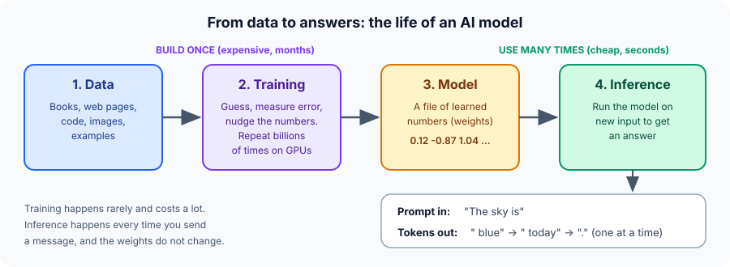

# AI Learn: How AI Models Really Work

**Beginner guide · Start here**

A from-zero guide in four parts: how AI models work, how to use them well, how to equip and control AI agents, and how to build software with them. Start with curiosity; no math needed.

## 1. Choose your route

Pick the goal that matches you today. The numbers are chapters; follow them in order. You can switch routes at any time.

Route A
<h4>I want to understand AI</h4>
For anyone curious about what happens behind the text box.

<a href="foundations.md">1</a> → <a href="neural-networks.md">2</a> → <a href="transformers.md">3</a> → <a href="training.md">4</a> → <a href="models.md">5</a> → <a href="using-ai.md">6</a> → <a href="connecting-ai.md">7</a> → <a href="tokens.md">8</a> → <a href="best-practices.md">9</a> → <a href="ai-at-work.md">10</a>
about 5 hours

Route B
<h4>I want to use agents safely</h4>
For people who already use an AI coding assistant.

<a href="using-ai.md">6</a> → <a href="connecting-ai.md">7</a> → <a href="best-practices.md">9</a> → <a href="agent-toolkit.md">11</a> → <a href="agent-guardrails.md">12</a>
about 2 hours

Route C
<h4>I want to build something new</h4>
For developers starting a project with Spec Kit.

<a href="agent-toolkit.md">11</a> → <a href="agent-guardrails.md">12</a> → <a href="spec-driven-development.md">13</a> → <a href="spec-kit.md">14</a> → <a href="sdd-examples.md">16</a> → <a href="sdd-production.md">18</a>
about 2 hours + practice

Route D
<h4>I already have a project</h4>
For teams adopting the workflow in an existing codebase.

<a href="spec-driven-development.md">13</a> → <a href="spec-kit.md">14</a> → <a href="sdd-existing-projects.md">15</a> → <a href="sdd-examples.md">16</a> → <a href="agent-guardrails.md">12</a> → <a href="squad.md">17</a>
about 2.5 hours + practice

Not sure? Start with Route A, or let the [Study Plan](study-plan.md) give you a week-by-week schedule.

**Routes B, C and D are hands-on.** Before you start them, spend half an hour on [Setup and Git basics](setup.md): the terminal, the tools to install and the ten Git commands the later chapters assume.

## 2. All chapters

Part 1 · Understand AI

<a class="card" href="foundations.md">
Chapter 1
<h4>Foundations</h4>
AI, machine learning, deep learning and generative AI; what a model is; training and inference.
~25 min</a>
<a class="card" href="neural-networks.md">
Chapter 2
<h4>Neural Networks</h4>
Neurons, weights, layers, loss and gradient descent, with a worked example.
~40 min</a>
<a class="card" href="transformers.md">
Chapter 3
<h4>Transformers &amp; LLMs</h4>
Embeddings, attention and how a language model predicts the next token.
~40 min</a>
<a class="card" href="training.md">
Chapter 4
<h4>Training &amp; Tuning</h4>
Pre-training, fine-tuning, instruction tuning, RLHF and why training is expensive.
~30 min</a>
<a class="card" href="models.md">
Chapter 5
<h4>Model Landscape</h4>
Proprietary and open-weight models, licences, sizes, model cards and how to choose.
~30 min</a>

Part 2 · Use AI well

<a class="card" href="using-ai.md">
Chapter 6
<h4>Using Models</h4>
The anatomy of a request, prompting, structured outputs, multimodal input, evaluation and speed.
~20 min</a>
<a class="card" href="connecting-ai.md">
Chapter 7
<h4>Connecting Models</h4>
Embeddings, RAG, tool calling, agents, what MCP is, failure modes and a mini project.
~25 min</a>
<a class="card" href="tokens.md">
Chapter 8
<h4>Tokens &amp; Cost</h4>
Tokens, context windows, how pricing works and how to estimate cost.
~25 min</a>
<a class="card" href="best-practices.md">
Chapter 9
<h4>Best Practices</h4>
Context engineering, evaluation, security, privacy, responsible AI and reliability.
~30 min</a>
<a class="card" href="ai-at-work.md">
Chapter 10
<h4>AI at Work</h4>
Finding AI-ready tasks, the delegate-review-refine loop and measuring impact.
~15 min</a>

Part 3 · Work with agents

<a class="card" href="agent-toolkit.md">
Chapter 11
<h4>Equip Your Agent</h4>
Instructions, skills, MCP servers and custom agents, with complete files you can copy.
~25 min</a>
<a class="card" href="agent-guardrails.md">
Chapter 12
<h4>Human Control &amp; Guardrails</h4>
Where a person decides, which settings really stop an agent, and what the community recommends.
~25 min</a>

Part 4 · Build with specs

<a class="card" href="spec-driven-development.md">
Chapter 13
<h4>Spec-Driven Development</h4>
What a spec is, when it is worth writing, and your route through this part.
~10 min</a>
<a class="card" href="spec-kit.md">
Chapter 14
<h4>Spec Kit from Zero</h4>
Install, specify, clarify, plan, implement and verify one small feature.
~25 min + practice</a>
<a class="card" href="sdd-existing-projects.md">
Chapter 15
<h4>Existing Projects &amp; Migration</h4>
Add Spec Kit to a codebase you already have and move a team over, phase by phase.
~30 min</a>
<a class="card" href="sdd-examples.md">
Chapter 16
<h4>Real Examples</h4>
The actual prompts and results from public repositories, new and existing.
~20 min</a>
<a class="card" href="squad.md">
Chapter 17
<h4>Squad</h4>
Create a small AI team, in a new or existing repository, and hand it approved work.
~25 min</a>
<a class="card" href="sdd-production.md">
Chapter 18
<h4>Shipping &amp; Reuse</h4>
Production scenarios, release gates, multiple projects and community lessons.
~25 min</a>

Plan and look things up

<a class="card" href="setup.md">
Prepare
<h4>Setup &amp; Git Basics</h4>
Terminal, tools, environment variables, Git and a first-hour path. Read before Part 3.
~30 min</a>
<a class="card" href="study-plan.md">
Plan
<h4>Study Plan</h4>
Three week-by-week paths that combine these chapters with free external courses.
plan</a>
<a class="card" href="sdd-reference.md">
Reference
<h4>Command Reference</h4>
Every Spec Kit and Squad command, file and setting in one place.
reference</a>
<a class="card" href="glossary.md">
Reference
<h4>Glossary</h4>
Every key term in one place.
reference</a>
<a class="card" href="resources.md">
Reference
<h4>Resources</h4>
Free courses, videos, papers and tools for going further.
reference</a>

Chapters 1–10 take about five hours to read. Parts 3 and 4 add about three hours of reading plus hands-on practice. The times on the cards include working through the examples; the time shown at the top of each page counts reading only. Mark a page as done at the bottom of each chapter; the menu then shows your progress.

## 3. How to use this site

1. **Read in order within a route.** Each chapter builds on the previous one. Chapter 3 (Transformers) makes much more sense after Chapter 2 (Neural Networks).
2. **Look for the callouts.** 📘 boxes restate an idea in plain words, 💡 boxes give examples, ⚠️ boxes flag common misconceptions, ✅ boxes summarize, and 🎯 boxes suggest something to try.
3. **Watch the code block labels.** A green **Terminal** block is typed in a shell. A purple **Agent chat** block is typed in the AI assistant's chat. Use the Copy button.
4. **Open the deep dives when you want them.** Sections marked **Optional deep dive** are collapsed. They add detail and can be skipped on a first read; nothing later in the course depends on them.
5. **Do the quiz.** Each chapter ends with "Check Your Understanding". If you miss a question, reread that section.
6. **Use the glossary.** Any unfamiliar word is probably in the [Glossary](glossary.md).

> **🎯 Try it:** Keep an AI chat tool open while you read. When a chapter explains an idea (for example, tokens or temperature), try it out and see the effect for yourself.

## 4. What this site is

AI Learn is a step-by-step course in four parts. Parts 1 and 2 explain what happens *inside* an AI model and how to use one well. Part 3 shows how to equip a coding agent and keep a person in control of it. Part 4 is a software-building workshop: turn an idea into a reviewed change with Spec Kit and Squad, adopt that workflow in a project you already have, and learn what it takes to ship.

Every chapter uses plain language first, then a small worked example, then a picture. Where a fact matters, we link to the source: mainly the [Google Machine Learning Crash Course](https://developers.google.com/machine-learning/crash-course), [Microsoft Learn: Introduction to AI concepts](https://learn.microsoft.com/training/modules/get-started-ai-fundamentals/), the [Hugging Face LLM Course](https://huggingface.co/learn/llm-course), the [3Blue1Brown neural network series](https://www.3blue1brown.com/topics/neural-networks), the original research papers, and the official documentation of the tools.

Found a mistake or something unclear? [Tell the author](about.md#2-how-to-give-feedback): corrections are welcome.

**Who it is for:** curious beginners who use AI chat tools; professionals (managers, analysts, writers, IT staff) who need a solid mental model instead of buzzwords; and developers who want to work with AI agents on real projects. You do **not** need calculus or statistics for Parts 1 and 2. Parts 3 and 4 assume you can open a terminal and use Git.

## 5. The big picture in 60 seconds

Imagine you want to build a machine that finishes sentences.

**Step 1 — Collect data.** You gather an enormous pile of text: books, articles, websites, code. This is the *training data*.

**Step 2 — Train.** You start with a giant mathematical function full of random numbers. You show it the beginning of a sentence from your data — "The cat sat on the" — and ask it to guess the next word. At first it guesses nonsense. You measure how wrong it was, then nudge every number a tiny bit in the direction that would have made the right answer ("mat") more likely. Repeat this trillions of times across the whole pile of text. This is *training*, and for large models it takes thousands of specialized chips (GPUs) running for weeks or months.

**Step 3 — Keep the numbers.** When training finishes, the numbers are frozen. These numbers are called *weights* or *parameters*, and together with the recipe for how to combine them, they *are* the model. A "7B" model has about 7 billion of them. The model does not store the books it read; it stores patterns compressed into those numbers.

**Step 4 — Use it (inference).** Now you type a *prompt*: "Write a haiku about rain." The text is chopped into small pieces called *tokens*. The model runs the tokens through its frozen weights and produces a probability for every possible next token. One token is picked, added to the text, and the whole process repeats — one token at a time — until the answer is complete. That is *inference*, and it is what happens every time you press Enter in a chat app.

*Figure 1 — The life of a model: build once (data and training), then use many times (inference).*

> **⚠️ Common misconception:** "The AI looks up answers in a database of everything it read." It does not. A plain language model has no search index of its training data. It generates text from patterns stored in its weights, which is why it can be fluent and wrong at the same time. (Some products *add* a search step on top — you will learn about that, called RAG, in [Connecting Models](connecting-ai.md).)

> **✅ Key takeaway:** Data → training → weights → inference. Almost every question about AI ("Why is it expensive?", "Why does it make things up?", "Why does it have a knowledge cut-off?") traces back to one of these four stages.

## 6. Ten terms to know first

Short definitions now; fuller explanations in the chapters and the [Glossary](glossary.md).

| Term | Quick definition |
|---|---|
| **Model** | A mathematical function with learned numbers that turns an input (text, image) into an output (an answer, a label, the next word). |
| **Parameters (weights)** | The learned numbers inside a model. Training adjusts them; inference uses them unchanged. |
| **Training** | The process of adjusting a model's parameters by showing it examples and correcting its mistakes. |
| **Inference** | Using a trained model to produce an output for new input — what happens when you chat with an AI. |
| **Neural network** | A model made of layers of simple units ("neurons") connected by weights. The engine behind modern AI. |
| **Transformer** | The neural network design (introduced in 2017) that powers today's language models, built around a mechanism called *attention*. |
| **LLM (large language model)** | A very large Transformer trained on huge amounts of text to predict the next token. GPT, Claude, Gemini, Llama and Mistral models are LLMs. |
| **Token** | A chunk of text (a word, part of a word, or punctuation) — the unit a language model reads, writes, and is billed by. |
| **Prompt** | The input you give a model: your question, instructions, and any context. |
| **Context window** | The maximum number of tokens a model can consider at once, including both your prompt and its reply. |

[Choose your path in the Study Plan →](study-plan.md) · [Start Chapter 1: Foundations →](foundations.md)
