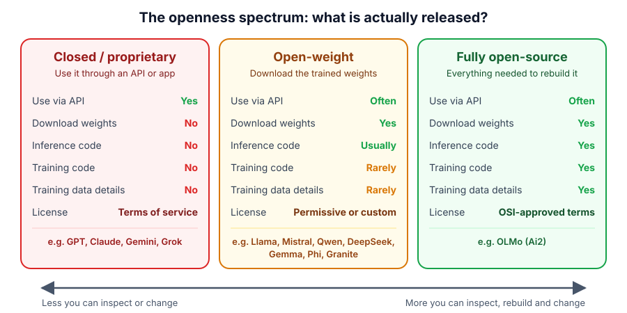

# The Model Landscape: Proprietary vs Open

**Chapter 5 · Model Landscape**

You now know what a model *is* — a huge set of trained weights running a transformer — so this chapter answers the next practical question: *which* model should you use, and what are you actually allowed to do with it? We sort today's models into closed, open-weight and fully open-source, decode licenses and model cards, run an open model on your own computer, and finish with a decision guide you can reuse every time a new model is announced.

## 1. Three Kinds of "Open"

People say "open model" to mean very different things. The useful question is not "is it open?" but **"what exactly was released, and under what terms?"** A trained model has several parts: the **weights** (the learned numbers from [Chapter 2](neural-networks.md)), the **inference code** that runs them, the **training code** that produced them, the **training data** (or a detailed description of it), and the **license** that says what you may do with all of it.



*Figure 1 — The openness spectrum. Moving right, more of the model is released and you can inspect, rebuild and change more of it.*

| | Closed / proprietary | Open-weight | Fully open-source |
|---|---|---|---|
| **How you use it** | API, chat app or cloud platform | Download and run anywhere, or use a hosted API | Download, run, study, retrain |
| **Weights** | Kept secret | Released | Released |
| **Inference code** | Hidden behind the API | Usually released | Released |
| **Training code** | Hidden | Rarely released | Released |
| **Training data** | Undisclosed | Usually only a vague summary | Released or described in detail |
| **License** | Provider's terms of service | Permissive (Apache-2.0, MIT) or a custom license | OSI-approved terms for all parts |
| **Examples** | OpenAI GPT, Anthropic Claude, Google Gemini, xAI Grok | Meta Llama, Mistral, Qwen, DeepSeek, Gemma, Phi, Granite | Ai2 OLMo |

### 1.1 Closed (proprietary) models

The provider trains the model, keeps the weights on its own servers and sells access. You send text (or images, audio, files) over the internet and get a response back. You never see the weights, and the provider can update or retire a model version on its own schedule.

> **📘 In plain words:** A closed model is like a restaurant. You can order anything on the menu and the food may be excellent, but you never get the recipe and you eat on their premises.

### 1.2 Open-weight models

The creator publishes the trained weights so anyone can download them, run them on their own hardware, and usually fine-tune them. This is what most people mean today by "open model." However, the training data and the full training pipeline are usually **not** released, and the license may add conditions.

> **📘 In plain words:** An open-weight model is like a frozen ready-meal. You can take it home, heat it in your own kitchen and add your own spices (fine-tuning), but you still do not know exactly how it was cooked or where every ingredient came from.

### 1.3 Fully open-source models

Everything needed to understand and reproduce the model is released: weights, training and inference code, detailed data information, and often intermediate checkpoints — all under open terms. Ai2's [OLMo](https://allenai.org/olmo) family is a well-known example: Ai2 publishes the weights together with its training data, code and evaluation tooling.

> **⚠️ Common misconception:** "I can download it, so it is open source." Downloadable weights alone make a model **open-weight**. Calling it open source also requires the code and data information, under terms that let anyone use, study, modify and share it — see the next section.

## 2. The OSI Open Source AI Definition

For software, "open source" has had a precise meaning for decades, maintained by the [Open Source Initiative (OSI)](https://opensource.org/). In October 2024 the OSI published version 1.0 of the [Open Source AI Definition (OSAID)](https://opensource.org/ai/open-source-ai-definition) to do the same for AI.

The definition says an Open Source AI system must grant four freedoms, adapted from the Free Software Definition:

| Freedom | What it means in practice |
|---|---|
| **Use** | Use the system for any purpose without asking permission |
| **Study** | Inspect how the system works and its components |
| **Modify** | Change the system for any purpose, including changing its output |
| **Share** | Pass the system on to others, with or without changes, for any purpose |

To actually exercise those freedoms you need the **preferred form for making modifications**, which the OSAID spells out as three elements:

1. **Data information** — enough detail about the training data (where it came from, how it was selected, labeled and filtered, and where to obtain publicly available or third-party data) that a skilled person could build a substantially equivalent system.
2. **Code** — the complete source code used to train *and* run the system, including data processing, training settings and the model architecture, under OSI-approved licenses.
3. **Parameters** — the model weights and other configuration, under OSI-approved terms.

> **💡 Example:** A model released with weights under Apache-2.0 but with no training code and only a one-line note that it was "trained on public web data" meets the *Parameters* element but not *Code* or *Data information*. Under the OSAID it is open-weight, not Open Source AI.

Notice that the OSAID does not require publishing the raw training data itself — some data cannot legally be shared — but it does require a complete description and pointers to obtainable data. The OSI also explains the difference between [open weights and open source AI](https://opensource.org/ai/open-weights) on a separate page.

> **✅ Key takeaway:** "Open source AI" has an official definition: freedom to use, study, modify and share, backed by data information, full code and parameters. Most popular "open" models are open-weight, which is still very useful.

## 3. Licenses in Practice

The license is what decides whether your project is allowed. Always read the license file in the model repository, because two models from the same family can have different licenses.

| License | Commercial use? | Fine-tune and modify? | Redistribute? | Main conditions | Seen on |
|---|---|---|---|---|---|
| **Apache-2.0** | Yes | Yes | Yes | Keep the license and notices; mark changed files; includes a patent grant | Many Mistral, Qwen, IBM Granite and Ai2 OLMo releases; Gemma 4 |
| **MIT** | Yes | Yes | Yes | Keep the copyright and license notice | Microsoft Phi; several DeepSeek releases |
| **Llama Community License** | Yes, with a big-company limit | Yes | Yes | Companies with over 700 million monthly active users must ask Meta for a license; show "Built with Llama"; start derivative model names with "Llama"; follow the Acceptable Use Policy | Meta Llama 3.x |
| **Gemma Terms of Use** | Yes | Yes | Yes | Pass on the Prohibited Use Policy restrictions to your users; include the license and a notice file | Gemma 1–3 and related Gemma variants |
| **Research-only / non-commercial** | No | Usually, for research | Limited | Personal, academic or evaluation use only | Some research releases (for example under CC BY-NC or a vendor "research license") |
| **Proprietary terms of service** | Yes, as a paying customer | Only through the provider's own fine-tuning service, if offered | No | Usage policies, rate limits, data-handling terms | GPT, Claude, Gemini, Grok |

The Llama row comes from the [Llama 3.1 Community License](https://huggingface.co/meta-llama/Llama-3.1-8B-Instruct/blob/main/LICENSE): it grants a royalty-free license to use, copy, modify and distribute, then adds the 700-million-user clause, the "Built with Llama" attribution and the naming rule. Because these extra conditions restrict *who* can use it and *how*, the Llama license is not an OSI-approved open source license.

The Gemma row comes from Google's [Gemma Terms of Use](https://ai.google.dev/gemma/terms), which apply to Gemma 1 through 3 and related variants; Google publishes the newer [Gemma 4 under Apache 2.0](https://ai.google.dev/gemma/apache_2). Google also states it claims no rights in the outputs you generate.

> **💡 Example:** You fine-tune a Llama 3.1 model on your company's support tickets and ship it inside your app. Under its license you need to include a copy of the license, display "Built with Llama" somewhere such as your About page, and name your model something like "Llama-SupportBot".

> **⚠️ Warning:** This section is a beginner's map, not legal advice. Licenses change between versions, and a fine-tuned model on Hugging Face may carry a different license than its base model. For anything commercial, read the actual license text and check with your legal team.

## 4. The Major Model Families

Model versions change every few months, so learn the **families** — who makes them, what kind they are, and what they are known for — and then check the current model card or documentation for the latest version.

### 4.1 Proprietary families

| Family | Provider | What it is known for | Where you can use it |
|---|---|---|---|
| **GPT and reasoning models** (earlier reasoning models were branded "o-series") | [OpenAI](https://developers.openai.com/api/docs/models) | General-purpose chat and coding, reasoning effort controls, built-in tools, very large developer ecosystem | ChatGPT, OpenAI API, Microsoft Foundry |
| **Claude** (tiers such as Haiku, Sonnet, Opus) | [Anthropic](https://docs.anthropic.com/) | Long documents, careful instruction following, coding and agent work | Claude apps, Anthropic API, Amazon Bedrock, Google Cloud, Microsoft Foundry |
| **Gemini** (tiers such as Flash and Pro) | [Google](https://ai.google.dev/) | Native multimodal input (text, images, audio, video), very long context windows | Gemini app, Google AI Studio, Gemini Enterprise Agent Platform |
| **Grok** | [xAI](https://docs.x.ai/) | Conversational model integrated with X, real-time information features | Grok app, xAI API, some cloud platforms |

Providers usually sell each family in **tiers**: a small fast cheap tier for high-volume simple tasks and a large slower expensive tier for hard problems. Many recent models also offer a **reasoning** or "thinking" mode that spends extra tokens working through a problem before answering (more on cost in [Chapter 7](tokens.md)).

### 4.2 Open-weight and open-source families

| Family | Creator | Typical license | Strengths |
|---|---|---|---|
| **Llama** | Meta | Llama Community License | The largest ecosystem of fine-tunes, tutorials and tooling |
| **Mistral / Mixtral** | Mistral AI (France) | Many models Apache-2.0; some premium models proprietary or research-only | Efficient models; Mixtral helped popularize Mixture-of-Experts in open models |
| **Qwen** | Alibaba Cloud | Many models Apache-2.0 | Very wide size range, strong multilingual and coding variants, vision variants |
| **DeepSeek** | DeepSeek | Recent major releases MIT | Strong reasoning and coding; large Mixture-of-Experts designs |
| **Gemma** | Google | Gemma Terms of Use; Apache 2.0 from Gemma 4 | Small, efficient, built for laptops and phones; shares research with Gemini |
| **Phi** | Microsoft | MIT | "Small language models" that punch above their size, good for edge devices |
| **Granite** | IBM | Apache-2.0 | Enterprise focus, transparency about training data sources |
| **OLMo** | Ai2 (Allen Institute for AI) | Apache-2.0, with data, code and checkpoints | A fully open model you can study end to end — popular in research and teaching |

> **📘 In plain words:** Proprietary families are usually the strongest at the very top end and the easiest to start with. Open families give you control: you choose where the model runs, you can fine-tune it, and nobody can switch it off or change it under you.

> **⚠️ Common misconception:** "Open models are always far behind." The gap between the best open-weight and the best proprietary models has shrunk a lot, and for many everyday tasks — summarizing, classifying, extracting data, simple chat — a good open model is more than enough. Compare on *your* task, not on headlines.

## 5. Model Sizes and What They Imply

Model size is measured in **parameters** (weights). Bigger models generally know more and reason better, but need more memory, are slower, and cost more to run. Remember from [Chapter 4](training.md) that **Mixture-of-Experts (MoE)** models have a large *total* parameter count but only use a fraction of them — the *active* parameters — for each token.

| Size class | Rough parameter count | Where it runs | Good for |
|---|---|---|---|
| **Tiny / edge** | Under about 4 billion | Phones, laptops, browsers, small devices | Autocomplete, simple chat, classification, offline features |
| **Small** | About 4–15 billion | A laptop with a decent GPU or Apple silicon; a single small server GPU | Summaries, RAG over documents, coding help, most business chat |
| **Medium** | About 15–70 billion | A workstation or one or two data-center GPUs | Harder reasoning, better writing quality, agents with tools |
| **Large / frontier** | Hundreds of billions or more (often MoE; often undisclosed for closed models) | Clusters of data-center GPUs | The hardest reasoning, long multi-step agent tasks, broad expert knowledge |

> **💡 Example:** A note-taking app that suggests tags for each note offline uses a tiny model on the phone. A legal research assistant that must reason over 200-page contracts uses a frontier model through an API. Same technology, very different size choices.

> **✅ Key takeaway:** Start with the smallest model that does your task well enough. It will be faster and cheaper, and you can always move up a size if quality is not good enough.

## 6. Reading a Model Card

A **model card** is the "nutrition label" of a model. On [Hugging Face](https://huggingface.co/docs/hub/model-cards) it is the `README.md` of the model repository: a block of YAML metadata at the top, followed by a written description. According to the Hugging Face docs, a good card describes the model, its intended uses and limitations (including bias and ethical considerations), training details, the datasets used, and evaluation results.

### 6.1 Decoding model names

Model names look cryptic, but they follow common conventions:

| Name part | Example | Meaning |
|---|---|---|
| Family and version | `Llama-3.1`, `Qwen2.5` | Which model line and which generation |
| Size | `8B`, `70B`, `0.5B` | Billions of parameters (`B`); sometimes `M` for millions |
| MoE size | `8x7B`, `30B-A3B` | Mixture-of-Experts: number of experts × expert size, or total size with "A" = active parameters |
| `-Base` | `...-7B-Base` | Pre-trained only; continues text, not tuned to follow instructions |
| `-Instruct`, `-Chat`, `-it` | `...-8B-Instruct` | Fine-tuned to follow instructions and chat — what beginners usually want |
| Specialty | `-Coder`, `-VL`, `-Vision`, `-Embedding` | Tuned for code, vision-language input, or producing embeddings |
| File format | `GGUF`, `safetensors`, `AWQ`, `GPTQ`, `MLX` | How the weights are stored; GGUF is used by llama.cpp, Ollama and LM Studio |
| Quantization | `Q4_K_M`, `Q8_0`, `FP16`, `BF16` | Bits per weight (see [Chapter 4](training.md)); `Q4_K_M` is a popular 4-bit llama.cpp format balancing size and quality |
| Context length | `128k`, `32k` | Maximum tokens the model can read at once (its context window, from [Chapter 3](transformers.md)) |

> **💡 Example:** A file named `Llama-3.1-8B-Instruct-Q4_K_M.gguf` is Meta's Llama 3.1, 8 billion parameters, tuned to follow instructions, quantized to about 4 bits per weight in llama.cpp's K-quant "medium" style, stored in GGUF format — ready to run in Ollama, LM Studio or llama.cpp.

### 6.2 A model card walkthrough

Here is the metadata block of a made-up model card, written in the format Hugging Face uses. Read it top to bottom before you read any code:

```yaml
---
license: apache-2.0
base_model: example-org/Helper-7B-Base
pipeline_tag: text-generation
library_name: transformers
language:
  - en
  - fr
datasets:
  - example-org/helpdesk-conversations
tags:
  - chat
  - customer-support
---
```

What each line tells you:

- `license: apache-2.0` — you may use it commercially, modify it and redistribute it, keeping the notices. If you see `license: other`, look for `license_name` and `license_link` and read that custom license.
- `base_model` — this is a fine-tune of another model. The base model's license and limitations may still matter.
- `pipeline_tag: text-generation` — the task it is built for (others include `feature-extraction` for embeddings or `image-text-to-text` for vision).
- `library_name` — which library loads it (here, Hugging Face Transformers).
- `language` and `datasets` — what it was trained or fine-tuned on; a model fine-tuned on English and French support chats may be weak at Spanish legal text.

Below the metadata, look for these written sections and ask these questions:

| Section | Ask yourself |
|---|---|
| Model description | Is it a base model or an instruction-tuned model? How big? What context length? |
| Intended uses and limitations | Is my use case listed? Is it explicitly out of scope (for example medical advice)? |
| Training data | Where did the data come from? Could it contain personal or copyrighted data I am worried about? |
| Evaluation | Which benchmarks? Are they relevant to my task, and were they run by the creator or independently? |
| Bias, risks and safety | What known failure modes or biases are documented? |
| How to use | Is there a prompt template or chat format I must follow? |

> **🎯 Try it:** Open any popular model on Hugging Face, for example a Qwen, Granite or OLMo model. Find the license in the right sidebar, the `base_model`, the context length and the intended-use section. Then compare it with a quantized GGUF version of the same model uploaded by someone else and note what changed.

## 7. Running Open Models Locally

Running a model on your own computer means your prompts never leave the machine, there is no per-token bill, and it works offline. The trade-off is that you need enough memory, and you are limited to models your hardware can hold.

| Tool | What it is | Best for |
|---|---|---|
| [Ollama](https://docs.ollama.com/) | Command-line tool and desktop app with a local API server and a model library | The quickest start; developers who want a local API |
| [LM Studio](https://lmstudio.ai/) | Desktop app with a chat window, model browser and local server | Beginners who prefer clicking to typing |
| [llama.cpp](https://github.com/ggml-org/llama.cpp) | The C/C++ inference engine behind many local tools; runs GGUF models on CPUs and GPUs | Maximum control, small devices, custom builds |
| [vLLM](https://docs.vllm.ai/) | High-throughput inference server for GPUs, with an OpenAI-compatible API | Serving a model to many users on a server |

### 7.1 Step by step with Ollama

These steps follow the [Ollama quickstart](https://docs.ollama.com/quickstart) and [CLI reference](https://docs.ollama.com/cli). Model names in the Ollama library change over time, so check the [model library](https://ollama.com/search) for current tags.

**Step 1 — Install.** Download Ollama for Windows, macOS or Linux from [ollama.com/download](https://ollama.com/download) and open it. On Linux, start the server with `ollama serve` if it is not already running.

**Step 2 — Download and chat with a small model.** In a terminal, run the command below. Ollama downloads the model the first time, then opens an interactive chat:

```shell
ollama run gemma4:e2b
```

Type a question and press Enter. Type `/bye` to leave. At the time of writing the Ollama docs note this model is about a 7.2 GB download and recommend about 8 GB of available GPU memory (or unified memory on a Mac); with less, Ollama falls back to system RAM and runs slower.

**Step 3 — Manage your models.** These commands list downloaded models, show which ones are loaded in memory, and delete one you no longer need:

```shell
ollama ls
ollama ps
ollama rm gemma4:e2b
```

**Step 4 — Call it from code.** Ollama runs a local API server on port 11434. This request sends one chat message and asks for the whole answer at once instead of streaming:

```shell
curl http://localhost:11434/api/chat -H "Content-Type: application/json" -d "{\"model\": \"gemma4:e2b\", \"messages\": [{\"role\": \"user\", \"content\": \"Explain RAG in one sentence.\"}], \"stream\": false}"
```

The answer comes back as JSON, with the text in `message.content`. Ollama also offers OpenAI-compatible endpoints (such as `/v1/chat/completions` and `/v1/responses`), so code written for a cloud API can often point at your local model by changing only the base URL. On Windows PowerShell, type `curl.exe` instead of `curl` so you get the real curl program.

### 7.2 Hardware rule of thumb

Memory is the main limit. You already met the math in [Chapter 2](neural-networks.md) and [Chapter 4](training.md): every parameter takes a fixed number of bytes, depending on precision.

**Memory (GB) ≈ parameters (in billions) × bytes per weight × 1.2**

The extra 20% is a rough allowance for the runtime and the context (the KV cache), and long context windows need more.

| Model size | 16-bit (2 bytes) | 8-bit (1 byte) | 4-bit (about 0.5 byte) |
|---|---|---|---|
| 3B | ~7 GB | ~4 GB | ~2 GB |
| 8B | ~19 GB | ~10 GB | ~5 GB |
| 14B | ~34 GB | ~17 GB | ~8 GB |
| 70B | ~168 GB | ~84 GB | ~42 GB |

> **💡 Example:** A laptop with a 12 GB GPU comfortably runs an 8B model at 4-bit (about 5 GB) with room for a long conversation, but a 70B model will not fit even at 4-bit. For MoE models, plan for the **total** parameter count in memory, even though only the active parameters do work for each token.

> **⚠️ Warning:** Downloading model files from unknown uploaders carries risk. Prefer the creator's official repository or well-known quantizers, prefer `safetensors` and GGUF over formats that can run code when loaded (such as Python pickle files), and check the license of the quantized copy.

## 8. Using Models Through APIs and Platforms

If you do not want to manage hardware, call a model over the internet. You pay per token (see [Chapter 7](tokens.md)), and someone else handles the GPUs, scaling and updates.

| Platform | What it is | Good for |
|---|---|---|
| [OpenAI API](https://developers.openai.com/api/docs) | Direct access to OpenAI's GPT and reasoning models through the Responses API | Building with OpenAI models and built-in tools |
| [Anthropic API](https://docs.anthropic.com/) | Direct access to Claude models through the Messages API | Building with Claude |
| [Google AI Studio](https://aistudio.google.com/) and [Gemini Enterprise Agent Platform](https://docs.cloud.google.com/gemini-enterprise-agent-platform/models) (formerly Vertex AI) | AI Studio is a quick way to try the Gemini API; the Agent Platform is Google Cloud's enterprise service with Model Garden, including Gemini, Gemma, partner models such as Claude and Mistral, and open models | Prototyping with Gemini; enterprise deployments on Google Cloud |
| [Microsoft Foundry](https://learn.microsoft.com/azure/foundry/what-is-foundry) (formerly Azure AI Foundry) | Azure platform with a catalog of thousands of models from Microsoft, OpenAI, Anthropic, Meta and others, plus agents, evaluation and governance | Enterprises on Azure that need security, networking and compliance controls |
| [Hugging Face Inference Providers](https://huggingface.co/docs/inference-providers) | One API and account to call many open models hosted by Hugging Face partners | Trying many open models without hosting them |
| [Amazon Bedrock](https://aws.amazon.com/bedrock/) | AWS service offering models from Anthropic, Meta, Mistral, Amazon and others | Teams already on AWS |

> **⚠️ Warning:** Platforms change. For example, [GitHub Models has been retired](https://docs.github.com/en/github-models/about-github-models) as of July 30, 2026; GitHub now points users to Microsoft Foundry for model access and to [GitHub Copilot](https://docs.github.com/en/copilot) for AI inside GitHub workflows. Before you build on any platform, check its current documentation and model retirement schedule.

> **📘 In plain words:** Many providers and local tools speak the same "OpenAI-compatible" request format. That makes it easier to swap models: often you change the base URL, the API key and the model name, and the rest of your code keeps working.

## 9. Choosing a Model: A Decision Guide

There is no single best model — only the best model **for your constraints**. Go through these six factors in order of what matters most to you.

| Factor | Ask yourself | Leans proprietary API when… | Leans open-weight when… |
|---|---|---|---|
| **Privacy and data control** | Can this data leave my network? | Provider contract and data-handling terms satisfy your rules | Data must stay on your own servers or device |
| **Cost** | How many tokens per month? | Low or spiky volume — pay only for what you use | High, steady volume — owning hardware can be cheaper |
| **Latency** | How fast must it answer? | Provider's global infrastructure is fast enough | You need very low latency on-device or on-premises |
| **Quality** | How hard is the task? | You need top-end reasoning or very long context | A smaller model passes your quality tests |
| **License** | What will I build and sell? | Provider's terms allow your use | You need to modify, fine-tune deeply or redistribute the model |
| **On-device / offline** | Must it work without internet? | Always online | Offline, edge or air-gapped |

The same logic as a flowchart:

```text
START: What does your app need?
 │
 ├─ Must data stay on your own machines (law, contract, policy)?
 │     YES → Open-weight model, self-hosted (or a private cloud deployment
 │           whose data terms your compliance team approves)
 │     NO  ↓
 ├─ Must it run offline or on a phone/laptop?
 │     YES → Small open-weight model, quantized (Ollama, llama.cpp, on-device runtime)
 │     NO  ↓
 ├─ Is it a prototype or low-volume tool?
 │     YES → Proprietary API (fastest start, no hardware)
 │     NO  ↓
 ├─ Does a smaller/open model pass your quality tests on real examples?
 │     YES → Open-weight model on a hosted platform or your own GPUs
 │           (check the license allows your use)
 │     NO  → Proprietary frontier model through an API or cloud platform
 │
 └─ Either way: build a small test set, measure, and re-check every few months.
```

> **✅ Key takeaway:** Let your constraints choose the model. Privacy and offline needs point to open-weight; speed of getting started and top-end quality point to proprietary APIs. Many real products use both.

## 10. Proprietary vs Open: Pros, Cons and Real Scenarios

| | Proprietary (API) | Open-weight (self-hosted) |
|---|---|---|
| **Pros** | Top-end quality; no hardware; instant start; built-in tools, safety filters and scaling; provider handles updates | Full data control; works offline; predictable cost at scale; deep fine-tuning; no forced model changes; inspectable weights |
| **Cons** | Data leaves your network; per-token cost grows with use; provider can change or retire models; rate limits; vendor lock-in | You run and secure the hardware; you handle updates and scaling; the strongest models need serious GPUs; you own the safety layer |

### Scenario 1 — A hospital summarizing patient notes

Patient records are highly sensitive and regulated. The hospital either self-hosts an open-weight model inside its own data center, or uses a cloud platform deployment that its compliance team has reviewed, with a contract covering health data. A medium-size open model fine-tuned on clinical summaries may be enough, and every summary is still reviewed by a clinician.

### Scenario 2 — A startup prototype

A two-person startup wants to test whether customers like an AI writing assistant. Speed matters most, volume is low, and the data is not sensitive. They call a proprietary API, ship in a week, and revisit the choice only if usage — and the bill — grows.

### Scenario 3 — An offline field app

Inspectors in remote areas need an app that explains repair manuals with no internet signal. The team ships a tiny, quantized open-weight model inside the app, combined with the manuals stored on the device. Answers are simpler than a frontier model's, but they work anywhere.

### Scenario 4 — A support bot at large scale

A retailer answers millions of routine questions per month. It routes simple questions to a small, cheap model (open-weight on its own GPUs or a low-cost API tier) and escalates hard or unusual ones to a frontier model. This **routing** pattern keeps quality high and cost low.

> **🎯 Try it:** Pick a project idea of your own. Write one line for each of the six factors in Section 9, then decide: proprietary API, open-weight, or a mix? Keep the note — you will reuse it in [Chapter 8](best-practices.md).

## Recap

- "Open" has levels: **closed** (API only), **open-weight** (downloadable weights) and **fully open-source** (weights, code and data information).
- The **OSI Open Source AI Definition 1.0** requires freedom to use, study, modify and share, backed by data information, complete code and parameters.
- **Licenses decide what you may do**: Apache-2.0 and MIT are permissive; the Llama and earlier Gemma licenses add conditions; research-only licenses forbid commercial use.
- Learn **families**, not version numbers: GPT, Claude, Gemini and Grok are proprietary; Llama, Mistral, Qwen, DeepSeek, Gemma, Phi and Granite are open-weight; OLMo is fully open.
- **Model size** drives memory, speed and cost; start small and move up only if needed.
- A **model card** and the model's name tell you size, tuning, format, quantization, context length and license.
- You can **run open models locally** with Ollama, LM Studio, llama.cpp or vLLM; memory ≈ parameters × bytes per weight × 1.2.
- **APIs and platforms** (OpenAI, Anthropic, Google, Microsoft Foundry, Hugging Face, Amazon Bedrock) trade control for convenience — and platforms themselves change.
- Choose with a **decision guide**: privacy, cost, latency, quality, license and on-device needs.

## Check Your Understanding

**1. A company publishes its model's weights under Apache-2.0 but releases no training code and no training data information. What is it, according to the OSI definition?**

- A) Closed / proprietary
- B) Open-weight, but not Open Source AI
- C) Fully Open Source AI
- D) Research-only

> **✅ Answer:** B — The weights are openly licensed, so it is open-weight. The OSAID also requires complete code and detailed data information, so it does not meet the full definition.

**2. Which three elements make up the "preferred form for making modifications" in the OSAID?**

- A) Weights, a chat app and an API key
- B) Data information, code and parameters
- C) Model card, benchmark scores and a license
- D) Training data, GPUs and electricity

> **✅ Answer:** B — The OSAID lists data information, the complete code to train and run the system, and the parameters (weights).

**3. What does the file name `Qwen2.5-7B-Instruct-Q4_K_M.gguf` tell you?**

- A) A 7-million-parameter base model in Python pickle format
- B) A 7-billion-parameter instruction-tuned model, quantized to about 4 bits, in GGUF format
- C) A model with a 7k-token context window that only runs in the cloud
- D) A Mixture-of-Experts model with 7 experts

> **✅ Answer:** B — `7B` is the size, `Instruct` means tuned to follow instructions, `Q4_K_M` is a 4-bit llama.cpp quantization, and `.gguf` is the file format used by llama.cpp, Ollama and LM Studio.

**4. Roughly how much memory does an 8-billion-parameter model need at 4-bit quantization, using this chapter's rule of thumb?**

- A) About 1 GB
- B) About 5 GB
- C) About 19 GB
- D) About 80 GB

> **✅ Answer:** B — 8 billion × 0.5 byte = 4 GB, plus about 20% overhead ≈ 5 GB. At 16-bit it would be about 19 GB.

**5. A clinic needs an assistant that summarizes patient notes, and the data may not leave its own servers. Which choice fits best?**

- A) Any free public chatbot website
- B) A proprietary API with default settings
- C) A self-hosted open-weight model whose license allows the use
- D) A research-only model in production

> **✅ Answer:** C — Self-hosting an open-weight model keeps data on the clinic's own servers. The license still has to permit the use, which rules out research-only models in production.

[← Chapter 4: Training & Tuning](training.md) · [Chapter 6: Using Models →](using-ai.md)
