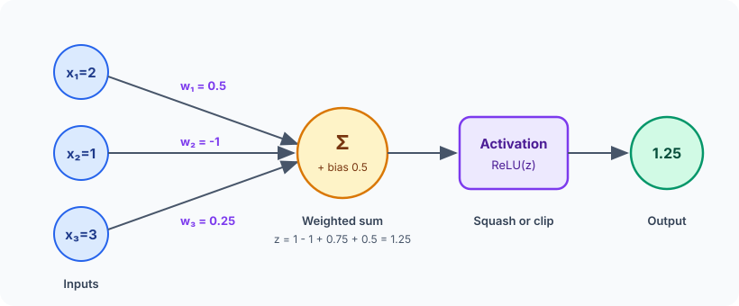
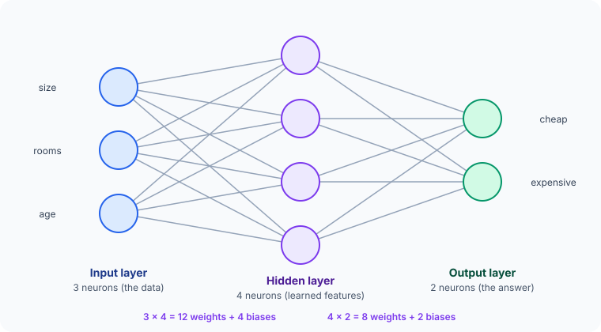
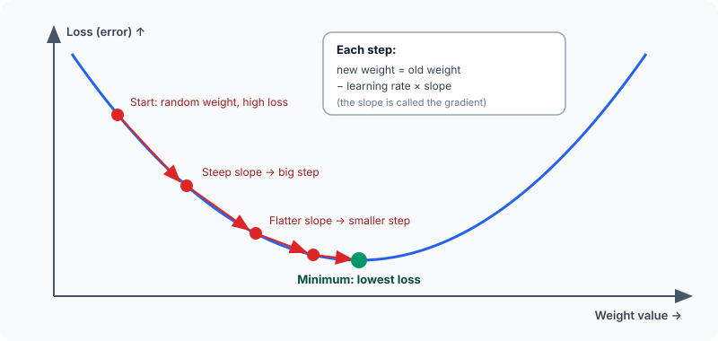

# Neural Networks: The Engine Inside AI

**Chapter 2 · Neural Networks**

Every modern AI model — from your phone's face unlock to the largest chatbot — is a neural network: layers of tiny calculators connected by adjustable numbers, tuned by showing it examples and correcting its mistakes millions of times.

## 1. Inspired by the brain (loosely)

Your brain contains roughly 86 billion nerve cells called *neurons*. Each one receives signals from other neurons, and if the combined signal is strong enough, it "fires" and passes a signal on. Learning, roughly speaking, changes how strongly neurons influence each other.

In 1943, Warren McCulloch and Walter Pitts proposed a mathematical model of a neuron, and in 1958 Frank Rosenblatt built the *perceptron*, an early learning machine based on the same idea. Today's artificial neural networks descend from that work.

> **⚠️ Common misconception:** "Neural networks work like the human brain." They borrow a single loose idea — many simple units passing weighted signals — and nothing more. Real neurons are electrochemical cells with complex timing and chemistry. An artificial neuron is a line of arithmetic. AI models do not think, feel, or learn the way people do.

## 2. The artificial neuron

An artificial neuron does three things:

1. **Multiply** each input by its own *weight* (how much that input matters).
2. **Add** everything up, plus one extra number called the *bias* (a baseline that shifts the result up or down).
3. **Pass** the total through an *activation function*, which decides what comes out.

In symbols:

```
z      = (x₁ × w₁) + (x₂ × w₂) + (x₃ × w₃) + b      ← weighted sum
output = activation(z)
```

In words: "multiply each input by how important it is, add them up with a baseline, then apply a simple rule to decide the output."

### 2.1 A worked example with three inputs

Inputs: `x₁ = 2`, `x₂ = 1`, `x₃ = 3`
Weights: `w₁ = 0.5`, `w₂ = -1`, `w₃ = 0.25`
Bias: `b = 0.5`

```
z = (2 × 0.5) + (1 × -1) + (3 × 0.25) + 0.5
  =    1.0    +   -1.0   +    0.75    + 0.5
  = 1.25
```

A negative weight (like `w₂ = -1`) means "this input pushes the answer *down*". A large weight means "this input matters a lot".



*Figure 1 — One neuron: inputs times weights, summed with a bias, then passed through an activation function.*

### 2.2 Activation functions

The activation function is applied to `z`. Three common ones:

| Activation | Rule in words | Formula | Our z = 1.25 gives | Used for |
|---|---|---|---|---|
| **ReLU** (rectified linear unit) | Negative numbers become 0; positive numbers pass through | `max(0, z)` | 1.25 | Hidden layers of most networks |
| **Sigmoid** | Squashes any number into the range 0 to 1 | `1 / (1 + e^(−z))` | ≈ 0.78 | Yes/no probabilities |
| **Softmax** | Turns a list of scores into probabilities that add up to 1 | `e^(score) / sum of e^(all scores)` | (needs a list) | Choosing one option out of many — including the next token in an LLM |

Checking the sigmoid: `e^(−1.25) ≈ 0.287`, so `1 / (1 + 0.287) = 1 / 1.287 ≈ 0.78`. (Here `e ≈ 2.718` is a fixed mathematical constant.)

**Softmax example.** A network deciding whether a photo shows a cat, a dog or a bird produces raw scores `[2.0, 1.0, 0.1]`:

```
e^2.0 = 7.39     e^1.0 = 2.72     e^0.1 = 1.11     total = 11.22

cat  = 7.39 / 11.22 ≈ 0.66   (66%)
dog  = 2.72 / 11.22 ≈ 0.24   (24%)
bird = 1.11 / 11.22 ≈ 0.10   (10%)
```

The biggest score gets the biggest probability, and all the probabilities add up to 100%. A language model does exactly this at every step — over a vocabulary of tens of thousands of tokens instead of three animals.

> **📘 In plain words:** Why bother with an activation? Without it, stacking layers would be pointless: a chain of "multiply and add" steps can always be collapsed into a single "multiply and add". The activation adds a bend (a *non-linearity*), and stacking many bends lets the network model curvy, complex patterns like language and images. Google's crash course explains this in [Activation functions](https://developers.google.com/machine-learning/crash-course/neural-networks/activation-functions).

## 3. Layers and depth

One neuron is not very smart. The power comes from connecting many of them in **layers**:

- **Input layer** — holds the raw data (house size, pixel brightness, token numbers). It does no calculation.
- **Hidden layers** — the neurons in between. Each one combines the previous layer's outputs into a new, more useful *feature*. They are "hidden" because you never see their values directly.
- **Output layer** — produces the final answer (a price, a probability per class, a probability per next token).

When every neuron in one layer connects to every neuron in the next, the layers are called *fully connected* (or *dense*).



*Figure 2 — A small fully connected network: 3 inputs, one hidden layer of 4 neurons, 2 outputs.*

**Depth** is the number of layers. "Deep learning" simply means networks with many hidden layers. Early layers tend to learn simple patterns, later layers combine them into complex ones. In an image network, early layers may react to edges, middle layers to shapes like eyes or wheels, and late layers to whole objects. The [3Blue1Brown video "But what is a neural network?"](https://www.3blue1brown.com/lessons/neural-networks) shows this idea beautifully with handwritten digits.

> **💡 Example:** In the house network of Figure 2, one hidden neuron might end up acting as a "spacious family home" detector (big size, many rooms), another as an "old fixer-upper" detector (high age). Nobody programs those roles — they emerge during training because they help predict the price.

## 4. Weights, parameters, and what "7B" means

**Parameters** are all the learned numbers in a network: every weight plus every bias. The word "weights" is often used loosely to mean all of them. When people say "the model's weights", they mean the file of learned numbers.

### 4.1 Counting parameters in a tiny network

For a fully connected layer: `parameters = (inputs × outputs) + outputs`. The first part counts the weights (one per connection); the second counts the biases (one per neuron).

For the network in Figure 2 (3 → 4 → 2):

```
Input → hidden:   3 × 4 = 12 weights  +  4 biases  =  16
Hidden → output:  4 × 2 =  8 weights  +  2 biases  =  10
                                          Total     =  26 parameters
```

Twenty-six numbers. A modern LLM has billions — GPT-3, described in 2020, had 175 billion ([Brown et al., 2020](https://arxiv.org/abs/2005.14165)). The principle is identical; there are just vastly more neurons, layers, and connections.

### 4.2 What "7B parameters" means for memory

"7B" means about 7 billion parameters. Each parameter is stored as a number that takes a certain number of bytes, depending on its **precision** (how many digits it keeps):

```
memory for weights ≈ number of parameters × bytes per parameter
```

| Precision | Bytes per parameter | 7B model needs about | 70B model needs about |
|---|---|---|---|
| FP32 (32-bit "full" precision) | 4 | 7B × 4 = **28 GB** | 280 GB |
| FP16 / BF16 (16-bit "half" precision) | 2 | 7B × 2 = **14 GB** | 140 GB |
| INT8 (8-bit quantized) | 1 | 7B × 1 = **7 GB** | 70 GB |
| INT4 (4-bit quantized) | 0.5 | 7B × 0.5 = **3.5 GB** | 35 GB |

(GB here means billions of bytes. These figures cover the weights only.)

**Quantization** means storing each parameter with fewer bits — like rounding 0.123456 to 0.12. It shrinks the model and speeds it up, usually at a small cost in quality. This is why a 4-bit 7B model can run on an ordinary laptop with 8–16 GB of memory, while the same model in FP32 cannot.

> **⚠️ Common misconception:** "If the weights fit, the model will run." Running a model also needs memory for the text being processed (the context) and temporary calculations, so plan for extra headroom on top of the table above. *Training* needs far more: a commonly cited estimate for standard mixed-precision training with the Adam optimizer is about 16 bytes per parameter before counting activations ([Rajbhandari et al., ZeRO, 2019](https://arxiv.org/abs/1910.02054)) — over 100 GB for a 7B model.

> **✅ Key takeaway:** Parameters = learned numbers. More parameters usually means more capability but also more memory, slower responses and higher cost. Memory ≈ parameters × bytes per parameter.

## 5. The forward pass

Running data through the network from input to output is called the **forward pass**. Every time you use a model (inference), you are doing forward passes.

Take our three inputs `[2, 1, 3]` and a hidden layer of two neurons, A and B, followed by one output neuron:

```
Hidden neuron A:  weights [0.5, -1, 0.25], bias 0.5
                  z = 1 - 1 + 0.75 + 0.5 = 1.25   → ReLU → 1.25

Hidden neuron B:  weights [1, 0, -0.5], bias -1
                  z = 2 + 0 - 1.5 - 1 = -0.5      → ReLU → 0

Output neuron:    weights [2, 1], bias 0.1
                  z = (1.25 × 2) + (0 × 1) + 0.1 = 2.6   → final answer 2.6
```

Notice that neuron B's negative total was switched off by ReLU — that is how a network "decides" which features matter for this particular input.

## 6. Measuring mistakes: the loss function

To learn, the network needs a single number that says *how wrong* it is. That number is the **loss** (also called *cost* or *error*). Lower is better; training is the search for parameters with the lowest loss.

### 6.1 Regression: guessing house prices

Suppose a model predicts prices (in thousands) for three houses:

| House | Real price | Predicted | Error (predicted − real) | Error squared |
|---|---|---|---|---|
| A | 300 | 350 | 50 | 2,500 |
| B | 200 | 180 | −20 | 400 |
| C | 250 | 260 | 10 | 100 |

**Mean squared error (MSE)** = average of the squared errors = (2,500 + 400 + 100) / 3 = **1,000**.

In words: square each mistake (so negatives do not cancel positives, and big mistakes count much more than small ones), then average them. See Google's [Loss](https://developers.google.com/machine-learning/crash-course/linear-regression/loss) page for more.

### 6.2 Classification: cross-entropy

For "pick one category" problems — including predicting the next token — the usual loss is **cross-entropy**. The idea: look at the probability the model gave to the *correct* answer, and penalize it if that probability is low.

```
loss = −log(probability given to the correct answer)
```

| Probability the model gave the correct answer | Loss |
|---|---|
| 0.9 (confident and right) | −log(0.9) ≈ **0.11** |
| 0.5 (unsure) | −log(0.5) ≈ **0.69** |
| 0.1 (confident and wrong) | −log(0.1) ≈ **2.30** |

(`log` here is the natural logarithm, a calculator button usually labelled "ln".) Confidently wrong answers are punished heavily. When an LLM is trained on the sentence "The cat sat on the mat", the loss at the last step is −log of the probability it gave to "mat".

## 7. Gradient descent: walking downhill

We have a loss. How do we change the parameters to make it smaller?

**The hiker in the fog.** Imagine you are on a hillside in thick fog and want to reach the valley floor. You cannot see the valley, but you can feel the slope under your feet. So you take a step in the steepest downhill direction, feel the slope again, take another step, and repeat. Eventually you reach low ground.

That is **gradient descent**:

- The *landscape* is the loss for every possible combination of parameter values.
- Your *position* is the current parameter values.
- The *slope* under your feet is the **gradient** — for each parameter, it says "if you increase this number a little, does the loss go up or down, and how fast?"
- Each *step* updates every parameter a little in the downhill direction.

```
new weight = old weight − learning rate × gradient
```

In words: "move each weight a small step in the direction that lowers the loss." The minus sign means "go *against* the uphill direction".



*Figure 3 — Gradient descent: steps are bigger where the slope is steep and shrink as the curve flattens near the minimum.*

### 7.1 The learning rate

The **learning rate** controls the size of each step. It is a *hyperparameter* — a setting chosen by people, not learned by the model.

- **Too small:** you inch downhill and training takes forever.
- **Too large:** you overshoot the valley and bounce around, or even climb higher.
- **Just right:** steady progress toward low loss.

You will see this happen with real numbers in the worked example in section 12. Google's crash course page on [Gradient descent](https://developers.google.com/machine-learning/crash-course/linear-regression/gradient-descent) and the [3Blue1Brown lesson on gradient descent](https://www.3blue1brown.com/lessons/gradient-descent) are excellent companions.

> **⚠️ Common misconception:** "Gradient descent finds the perfect answer." For big networks the landscape has billions of dimensions and many dips. Gradient descent finds *good enough* low points, not a guaranteed best one — and in practice that works remarkably well.

## 8. Backpropagation: assigning the blame

A network with billions of weights produced a wrong answer. *Which* weights were responsible, and by how much? Working that out is the job of **backpropagation** (short for "backward propagation of errors"), popularized by Rumelhart, Hinton and Williams in their 1986 paper *Learning representations by back-propagating errors*.

**Blame assignment analogy.** A restaurant receives a complaint: the soup was too salty. The head chef asks the cook who finished the soup; that cook says the stock was already salty; the stock maker says the salt measurement was off. Blame flows *backwards* through the kitchen, and each person adjusts in proportion to their share of the problem.

Backpropagation does the same:

1. Run the forward pass and compute the loss.
2. Start at the output and work backwards, layer by layer.
3. At each layer, use calculus (the *chain rule*) to calculate how much each weight contributed to the error — that is its gradient.
4. Hand those gradients to gradient descent, which nudges every weight.

> **📘 In plain words:** Backpropagation figures out *who is to blame and by how much*. Gradient descent *does the correcting*. Together, they are how almost every neural network learns. The [3Blue1Brown lesson "What is backpropagation really doing?"](https://www.3blue1brown.com/lessons/backpropagation) visualizes this without heavy math, and Google covers it in [Training using backpropagation](https://developers.google.com/machine-learning/crash-course/neural-networks/backpropagation).

## 9. The training loop: epochs, batches, iterations

Training repeats forward pass → loss → backpropagation → update, over and over. Three words describe the rhythm:

- **Batch** — a small group of examples processed together (e.g. 32 or 1,000). Averaging over a batch gives a more stable gradient than one example, and is efficient on GPUs.
- **Iteration** (or *step*) — one parameter update, made after one batch.
- **Epoch** — one full pass through the entire training dataset.

*Numeric example:* 10,000 training examples with a batch size of 100 means 10,000 / 100 = **100 iterations per epoch**. Training for 5 epochs is 500 updates.

```
initialize all weights with small random numbers

for epoch in 1 to number_of_epochs:
    shuffle the training data
    for each batch in the training data:
        predictions = forward_pass(batch.inputs)
        loss        = loss_function(predictions, batch.labels)
        gradients   = backpropagation(loss)
        for each weight:
            weight = weight - learning_rate * gradient_of(weight)
    check the loss on the validation set
```

> **💡 Example:** Large language models are often trained for about one epoch (or a few) over a dataset of trillions of tokens, because the dataset is so large that one pass already takes weeks on thousands of GPUs. Small models on small datasets may run for hundreds of epochs.

## 10. Overfitting and regularization

As you saw in [Chapter 1](foundations.md), a model can memorize its training data instead of learning general patterns. Neural networks — with their huge numbers of parameters — are especially prone to this. **Regularization** is the umbrella term for techniques that keep a model honest:

| Technique | What it does | Analogy |
|---|---|---|
| **More (and more varied) data** | Harder to memorize; patterns that hold across lots of data are more likely to be real | Practising with many different past papers |
| **Early stopping** | Watch the validation loss; stop training when it starts rising even though training loss keeps falling | Stop cramming when practice-test scores stop improving |
| **Dropout** | During training, randomly switch off a fraction of neurons at each step, so no neuron can rely on specific partners ([Srivastava et al., 2014](https://jmlr.org/papers/v15/srivastava14a.html)) | A team that practises with random players absent, so everyone learns every role |
| **Weight decay (L2 regularization)** | Adds a small penalty for large weights, nudging the model toward simpler solutions | Preferring the simplest explanation that fits |
| **Data augmentation** | Create extra variations of training examples (flip or crop images, rephrase text) | Seeing the same lesson explained different ways |

Google's crash course covers these in [Overfitting](https://developers.google.com/machine-learning/crash-course/overfitting/overfitting) and [L2 regularization](https://developers.google.com/machine-learning/crash-course/overfitting/regularization).

> **✅ Key takeaway:** If training loss keeps falling but validation loss starts rising, the model has begun memorizing. Stop, add data, or add regularization.

## 11. Why GPUs: it is all matrix multiplication

A layer of neurons is really one big table operation. Put the inputs in a row and the weights in a grid (a **matrix**), and computing every neuron at once is a *matrix multiplication*:

```
inputs [2, 1, 3]  ×  weight matrix        =  sums for each neuron
                     neuron A  neuron B
                     [ 0.5      1   ]
                     [ -1       0   ]
                     [ 0.25    -0.5 ]

neuron A: 2×0.5 + 1×(−1) + 3×0.25 = 0.75
neuron B: 2×1   + 1×0    + 3×(−0.5) = 0.5
```

(Then add the biases and apply the activation, as in section 5.) Each neuron's sum is independent of the others, so they can all be computed *at the same time*.

- A **CPU** has a handful of powerful cores — great for doing different, complicated tasks one after another.
- A **GPU** (graphics processing unit) has thousands of simpler cores — built to do the same arithmetic on many numbers simultaneously, originally for drawing pixels in video games.

A large model needs billions of multiply-and-add operations for every token it reads or writes, which is exactly the kind of work GPUs (and specialised AI chips such as Google's TPUs) excel at. The 2012 *AlexNet* image-recognition network, trained on two consumer GPUs, is often credited with kicking off the deep learning boom.

> **📘 In plain words:** A CPU is a few expert chefs; a GPU is a thousand line cooks all chopping onions at once. Neural networks need a mountain of chopped onions.

## 12. Worked example: one training step, by hand

Let us train the tiniest possible network — a single neuron with no activation — to learn the pattern **"output = 2 × input"**.

**Training data:**

| Input x | Correct output y |
|---|---|
| 1 | 2 |
| 2 | 4 |
| 3 | 6 |

**Model:** `prediction = w × x + b`. The perfect answer is `w = 2`, `b = 0`, but the model does not know that.

**Start:** random-ish values `w = 0.5`, `b = 0`. **Learning rate:** 0.01. **Loss:** squared error, `(prediction − y)²`.

### Step 1 — Forward pass (take the example x = 3, y = 6)

```
prediction = 0.5 × 3 + 0 = 1.5
error      = prediction − y = 1.5 − 6 = −4.5
loss       = (−4.5)² = 20.25
```

The model guessed 1.5 instead of 6 — far too low.

### Step 2 — Backpropagation (compute the gradients)

Calculus gives simple rules for this model:

```
gradient for w = 2 × error × x = 2 × (−4.5) × 3 = −27
gradient for b = 2 × error     = 2 × (−4.5)     = −9
```

In words: both gradients are negative, which means "increasing w and b would *reduce* the loss". The gradient for `w` is bigger because the input (3) amplifies `w`'s effect.

### Step 3 — Gradient descent (update)

```
new w = 0.5 − 0.01 × (−27) = 0.5 + 0.27 = 0.77
new b = 0   − 0.01 × (−9)  = 0   + 0.09 = 0.09
```

### Step 4 — Check: did it improve?

```
new prediction = 0.77 × 3 + 0.09 = 2.40
new error      = 2.40 − 6 = −3.60
new loss       = (−3.60)² = 12.96
```

The loss fell from **20.25 to 12.96** in one step. The model learned something.

### Repeating the step

Doing the same calculation again on the same example:

| Step | w | b | Prediction for x = 3 | Loss |
|---|---|---|---|---|
| Start | 0.50 | 0.00 | 1.50 | 20.25 |
| 1 | 0.77 | 0.09 | 2.40 | 12.96 |
| 2 | 0.99 | 0.16 | 3.12 | 8.29 |
| 3 | 1.16 | 0.22 | 3.70 | 5.31 |

Each step shrinks the loss. In real training you would cycle through *all three* examples (an epoch) many times; using all of them forces the model toward `w ≈ 2`, `b ≈ 0`, the rule that fits every example — not just one.

### What if the learning rate is too big?

Try the very first update with a learning rate of **0.1** instead of 0.01:

```
new w = 0.5 − 0.1 × (−27) = 3.2
new b = 0   − 0.1 × (−9)  = 0.9
new prediction = 3.2 × 3 + 0.9 = 10.5   → error 4.5, loss 20.25
```

The model jumped from far too low (1.5) to far too high (10.5) — overshooting the valley — and the loss did not improve at all. This is exactly the "too large" learning rate from section 7.1.

> **✅ Key takeaway:** That is all training is: forward pass → loss → gradients → small update → repeat. An LLM does the same four steps, just with billions of parameters, cross-entropy loss over tokens, and trillions of examples.

> **🎯 Try it:** Open Google's interactive [Neural networks exercises](https://developers.google.com/machine-learning/crash-course/neural-networks/interactive-exercises) or the free TensorFlow Playground, change the learning rate and the number of hidden neurons, and watch the loss curve respond.

## Recap

- An artificial neuron multiplies inputs by weights, adds a bias, and applies an activation function (ReLU, sigmoid, softmax).
- Activations add non-linearity; without them, many layers collapse into one.
- Networks stack neurons into input, hidden and output layers. "Deep" means many hidden layers.
- Parameters are all the weights and biases. Count per dense layer: inputs × outputs + outputs.
- Memory for weights ≈ parameters × bytes per parameter: a 7B model is about 14 GB in FP16 and about 3.5 GB in 4-bit.
- The loss measures how wrong the model is: mean squared error for numbers, cross-entropy for categories and tokens.
- Gradient descent nudges each parameter downhill; the learning rate sets the step size.
- Backpropagation works backwards from the loss to assign each parameter its share of the blame (its gradient).
- Training loops over batches (iterations) and full passes over the data (epochs).
- Regularization (more data, early stopping, dropout, weight decay) fights overfitting.
- GPUs excel because neural networks are mostly giant matrix multiplications.

## Check Your Understanding

**1. A neuron has inputs [1, 2], weights [3, −1], bias 1 and ReLU activation. What is its output?**

- A) 0
- B) 1
- C) 2
- D) 6

> **✅ Answer:** C — z = (1 × 3) + (2 × −1) + 1 = 3 − 2 + 1 = 2. ReLU keeps positive numbers unchanged, so the output is 2.

**2. How many parameters does a fully connected layer with 4 inputs and 3 outputs have?**

- A) 7
- B) 12
- C) 15
- D) 16

> **✅ Answer:** C — 4 × 3 = 12 weights plus 3 biases = 15 parameters.

**3. Roughly how much memory do the weights of a 13-billion-parameter model need at 4-bit (INT4) precision?**

- A) About 3 GB
- B) About 6.5 GB
- C) About 26 GB
- D) About 52 GB

> **✅ Answer:** B — 13 billion × 0.5 bytes = 6.5 GB. (FP16 would be 26 GB; FP32 would be 52 GB.)

**4. What does backpropagation do?**

- A) Collects more training data
- B) Calculates how much each parameter contributed to the error (its gradient)
- C) Converts text into tokens
- D) Picks the learning rate automatically

> **✅ Answer:** B — Backpropagation works backwards from the loss to compute a gradient for every parameter. Gradient descent then uses those gradients to update the parameters.

**5. During training, the loss jumps around and sometimes increases sharply after each update. What is the most likely cause?**

- A) The learning rate is too high
- B) The learning rate is too low
- C) The model has too few epochs
- D) The softmax is missing

> **✅ Answer:** A — Steps that are too large overshoot the low point of the loss landscape, as in the worked example with a learning rate of 0.1.

**6. A dataset has 50,000 examples and the batch size is 500. How many iterations make up one epoch?**

- A) 10
- B) 100
- C) 500
- D) 50,000

> **✅ Answer:** B — One epoch processes every example once: 50,000 / 500 = 100 batches, so 100 iterations (parameter updates).

[← Chapter 1: Foundations](foundations.md) · [Chapter 3: Transformers & LLMs →](transformers.md)
