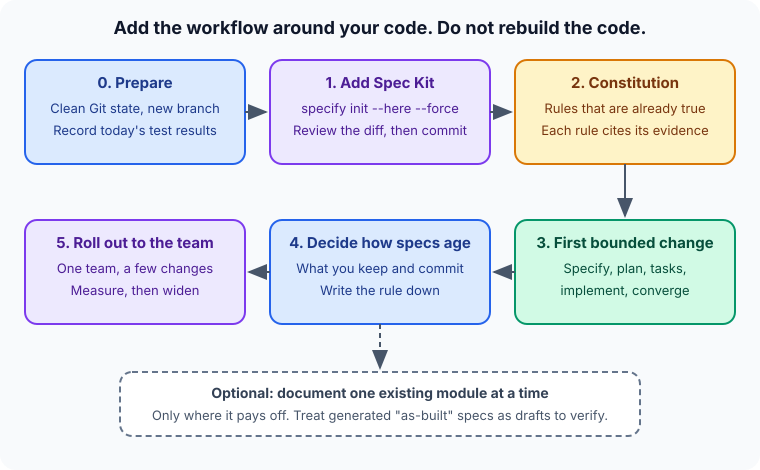

# Spec Kit in an Existing Project: Adoption and Migration

**Chapter 15 · Existing projects**

You already have an application, a backlog and habits. This page shows how to bring spec-driven development into that project step by step: what to run, what changes in your repository, what to type in chat, and how to move a team over without stopping delivery.

> **🧭 The running example:** RoomBook, the room-booking service built in [Chapter 14](spec-kit.md), is now a year old. It has real users, a backlog, and code written before anyone on the team used Spec Kit. In this chapter the team adopts Spec Kit in that repository and adds one feature: a CSV export of bookings. Read "RoomBook" as "your existing application".

> **📘 In plain words:** Migrating to Spec Kit does **not** mean rewriting your application or writing specifications for everything it already does. You add a few folders next to your code, write down the rules your project already follows, and send your *next* change through the workflow. The old code stays as it is.

## 1. What "migration" really means

The official [existing-project guide](https://github.github.io/spec-kit/how-to/existing-projects.html) starts with one sentence that removes most of the fear: *"You do not need to recreate an existing system from specifications before using Spec Kit."*

| You might expect | What actually happens |
|---|---|
| Spec Kit scans my code and writes specs for it | No. Initialization "does not rewrite your application or infer specifications for existing behavior" |
| I must document the whole system first | No. The guide says not to make "document the entire existing system" your first feature, unless that inventory is the deliverable you actually want |
| My source code gets changed during setup | No. Setup adds Spec Kit's own files. Your code changes only later, when you approve an implementation step |
| The team must switch on one day | No. One person can run one change this way while everyone else works as before |
| Old tickets and documents become useless | No. They become the input you paste into a spec |

**Three levels of adoption.** The levels are this guide's way of organizing the choice, not official terminology. Pick the lowest level that solves your problem. You can stop at any level.

| Level | What you do | Good for |
|---|---|---|
| **1. One change** | Run a single feature through the workflow on a branch | Trying it out with no commitment |
| **2. Team habit** | Every consequential change gets a spec; small fixes use the normal process | Most teams; this is the usual meaning of "we migrated" |
| **3. As-built specs** | Additionally document selected existing modules | Risky or poorly understood areas you change often. Optional, and outside the official core workflow |



*Figure 1 — The adoption path. Each phase ends with something you can review in Git before you continue.*

## 2. The whole path on one screen

| Phase | You do | You end up with | Rough effort |
|---|---|---|---|
| **0. Prepare** | Clean Git state, new branch, record current test results | A baseline you can compare against | 15 min |
| **1. Add Spec Kit** | Run `specify init --here --force`, review the diff, commit | `.specify\` and the agent skills in your repository | 30 min |
| **2. Constitution** | Let the agent draft rules from your real files, then check every rule | A short, true `constitution.md` | 1–2 hours |
| **3. First change** | Take one bounded change through specify → converge | A reviewed pull request and your first `specs\` folder | Half a day to two days |
| **4. Ageing policy** | Decide what happens to specs after delivery and what you commit | One paragraph in the constitution or onboarding notes | 30 min |
| **5. Team rollout** | Repeat with a few more changes and people, measure, adjust | A working agreement the team actually follows | 3–4 weeks |

The effort figures are this guide's planning estimates for a small service, not measurements. A large or unfamiliar codebase takes longer, mostly in Phase 2.

**Before you start** you need the tools from the [Spec Kit setup page](spec-kit.md#1-prerequisites-and-version-baseline) and you should have completed one practice feature in a throwaway repository. Learning the commands and learning your legacy system at the same time is harder than doing them one after the other.

## 3. Phase 0 — Prepare a safe baseline

Everything Spec Kit adds should arrive in a single, reviewable commit. That only works if you start clean.

```terminal
git status --short
```

If this lists any changes, commit or stash them **before** going on, so that your unfinished work does not end up on the adoption branch. When the output is empty, create the branch:

```terminal
git switch -c chore/adopt-spec-kit
```

Then run your project's normal build and test commands and **write down the result**, including failures that already exist. Later, when a test fails, you need to know whether it was failing before you started.

> **💡 Example:** Your test run shows 412 passed, 3 failed. Note the three names in the pull request description. They are existing problems, not something Spec Kit or the agent introduced, and nobody should "fix" them as a side effect of the adoption branch.

## 4. Phase 1 — Add Spec Kit to the repository

Run this **from the root of the existing repository**. Do not create a new project folder around it.

```terminal
specify init --here --force --integration copilot --script ps
git status --short
git diff
```

Use `--script sh` on macOS or Linux. `--here` means "this folder". `--force` allows initialization in a folder that is not empty.

| What happens to… | Result | Source |
|---|---|---|
| Your application code, `.git\`, existing `specs\` | Not touched | [Upgrade guide](https://github.github.io/spec-kit/upgrade.html) |
| `.specify\templates\` and `.specify\scripts\` | Created; overwritten if they already exist | Upgrade guide |
| `.github\skills\speckit-*\` (Copilot skills) | Created; overwritten if they already exist | [Copilot integration](https://github.github.io/spec-kit/integrations/copilot.html) |
| An existing `.specify\memory\constitution.md` | Preserved | Upgrade guide |
| Git branches | None created. Branch handling is the optional `git` extension | [Existing projects](https://github.github.io/spec-kit/how-to/existing-projects.html) |

> **⚠️ Common misconception:** "`--force` is the safe option." It is the opposite of a safety switch: it "may replace files at conflicting managed paths". That is harmless on first adoption and matters later, if you have customized templates or skills. Always read `git diff` and `git status` afterwards.

**Things to check in the diff before you commit:**

- Only Spec Kit paths appear: `.specify\`, `.github\skills\speckit-*` and possibly a Spec Kit hooks file under `.github\hooks\`. Anything else is a surprise worth understanding.
- If your repository already has `.github\copilot-instructions.md` or `AGENTS.md`, confirm they are unchanged. This guide did not test how initialization treats them; your diff is the authority.
- `.specify\.gitignore` exists. It keeps machine-local state such as `feature.json` out of version control.

Commit the result as its own change with a plain message such as "Add Spec Kit scaffolding (no application changes)". A reviewer can then approve the tooling separately from any feature.

**Later refreshes use a different command.** `init --here --force` is for first adoption. When you upgrade Spec Kit afterwards, prefer `specify integration upgrade copilot`, which stops if you have locally modified managed files. See [upgrades](spec-kit.md#10-troubleshooting-and-deliberate-upgrades).

## 5. Phase 2 — Write a constitution from evidence

In a new project you invent the rules. In an existing project the rules already exist, scattered across the README, the CI configuration, the linter settings and people's heads. Your job is to collect them, not to invent better ones. The official guide is direct about this: *"Do not invent standards merely to fill the constitution template."*

**Step 1 — let the agent gather evidence, without writing anything yet:**

```chat
Read this repository before proposing anything: README, CONTRIBUTING,
docs\ and any architecture decision records, the CI workflow files,
linter and formatter configuration, the test setup and the dependency
manifests. List the engineering rules this project ALREADY follows.
For every rule, name the file and line that proves it.
Mark anything you are inferring from only one or two examples as a guess.
Do not write or change any file.
```

**Step 2 — check the list.** Open the files it cites. Delete rules whose evidence is missing or weak. Add the rules everyone knows but nobody wrote down, such as "never change the public API without a deprecation period".

**Step 3 — create the constitution from the checked list:**

```chat
/speckit-constitution Use only the rules I confirmed below. Keep each one
short and testable. Do not add principles that are not in this list.
- Preserve public API compatibility; breaking changes need an approved
  deprecation plan.
- Follow the existing service boundaries in src\; do not add a new layer.
- Every database migration includes a rollback or repair plan.
- Run the existing unit and integration test suites; new behaviour needs tests.
- Search for existing functionality before writing new helpers or classes.
- Reuse the current frameworks and libraries; justify any new dependency.
```

| Weak principle (remove or rewrite) | Usable principle |
|---|---|
| "Code must be clean and maintainable" | "New code passes the existing linter configuration with no new suppressions" |
| "Performance is critical" (no measurement exists) | Leave it out until you have an agreed, measured target |
| "Legacy modules are frozen" (nobody decided this) | Leave it out, or ask the team and record the real decision |
| "Use best practices for security" | "Derive the user from the authenticated session; never trust a caller-supplied user ID" |

> **⚠️ Why the checking step matters:** One practitioner [audited a reverse-engineered constitution against the project's Git history](https://hubreb.github.io/blog/spec-kit-brownfield-setup) (May 2026, an older Spec Kit version with a different agent). Of the six mandates it produced, four were correct and two had no evidence behind them; a seventh, real rule was missing. A scan can also treat a pattern seen in a few files as if it were a universal rule. These are single experiences, not statistics, but they show the failure mode: a confident, tidy constitution that describes a project you do not have.

**Stop here until** a second team member has read the constitution and agrees it describes the project as it is today.

## 6. Phase 3 — Run your first change

### Choose the right first change

| Good first candidates | Poor first candidates |
|---|---|
| A new, self-contained capability in an area with tests | "Document the whole system" |
| A change with clear users and clear acceptance examples | A large refactoring with no behaviour change |
| Something worth one to three days of work | A one-line fix (too small to learn from) |
| An area one team member knows well | The most fragile module in the system |
| Normal priority | A production incident or a hard deadline |

### Describe the change in four parts

For existing code, a good request states what must **stay the same** as clearly as what should change. A simple structure, borrowed from a [vendor guide to brownfield specs](https://www.augmentcode.com/guides/spec-driven-development-brownfield-codebases):

| Part | Question it answers | Example (RoomBook, one year on) |
|---|---|---|
| **Current behaviour** | What happens today? | The bookings list shows bookings with filters by room and date; results exist only on screen |
| **Target behaviour** | What should be possible afterwards? | A signed-in user can download the filtered list as CSV |
| **Invariants** | What must not change? | Permission checks, the JSON API response, existing filters |
| **Out of scope** | What are we deliberately not doing? | Scheduled exports, Excel format, changes to how bookings are created or cancelled |

```chat
/speckit-specify Add CSV export to the existing RoomBook bookings list.
Current behaviour: the list shows bookings using the existing room and date filters.
Target: a signed-in user can download the currently filtered bookings as CSV,
limited to rows that user is already authorized to see.
Must not change: the existing JSON API response, the permission checks, the
filter behaviour and the booking-conflict rule.
Out of scope: scheduled exports, other file formats, creating or cancelling bookings.
Ask me to decide the maximum export size instead of choosing one.
```

The resulting `spec.md` "defines the change you intend to make, not a retroactive specification of every existing behavior". The full set of acceptance checks for this example is in [Scenario A of the shipping guide](sdd-production.md#3-scenario-a-add-a-feature-to-an-existing-product).

### Pin down today's behaviour first

This step is this guide's recommendation; it is not part of the official Spec Kit procedure. A **characterization test** records what the code does *now*, right or wrong, so you notice when a change alters it. If the area you are about to touch has few tests, add some before the feature work:

```chat
Before any feature work: write characterization tests for the current
behaviour of the bookings list endpoint, covering filters, sorting,
paging and the permission checks. Assert what the code does today,
even where that looks odd, and list the odd cases for me separately.
Use the existing test framework. Do not change production code.
```

Run them, confirm they pass against the untouched code, and commit them separately.

### Then follow the normal workflow, with brownfield checks

The command order is the same as in the [first-feature walkthrough](spec-kit.md). What changes is what you look for at each stop.

| Step | Extra check in an existing project |
|---|---|
| `/speckit-clarify` | Questions about existing behaviour are answered from the code or by a person who knows it, not guessed |
| `/speckit-plan` | The plan names the **existing** files, helpers and libraries it will reuse. A plan that introduces a new framework or a parallel data-access layer is a red flag |
| `/speckit-tasks` | No task recreates something that already exists. Tests are included. The list has not grown beyond the spec |
| `/speckit-analyze` | Contradictions are fixed in the documents before any code is written |
| `/speckit-implement` | The diff touches only the expected area. Characterization tests still pass |
| `/speckit-converge` | Review any tasks it appends; repeat implement and converge until nothing remains |

A plan prompt that works well for existing code:

```chat
/speckit-plan Read the repository first. Reuse the existing authorization
and query helpers, the installed CSV library if there is one, and the
current test conventions. For every new file you propose, name the existing
file you considered and explain why it could not be extended.
Do not add a dependency or a framework without asking. Do not implement yet.
```

> **💡 Example:** The plan proposes a new `ExportService` class and a new CSV writer. You search the RoomBook repository and find `ReportWriter`, which already produces escaped CSV for the monthly room-usage report. You send the plan back with one sentence: "Reuse `ReportWriter`; extend it if needed." Duplicating something that already exists is a problem several practitioners report when agents work in existing code, which is why the check is in the table above.

## 7. Not every backlog item needs a spec

Trying to push every ticket through the full workflow is the fastest way to make a team abandon it. Match the process to the item.

| Backlog item | Proportionate route |
|---|---|
| New feature with several behaviours | Full workflow: specify → clarify → plan → tasks → analyze → implement → converge |
| Small, well-understood enhancement | Short path: specify → plan → tasks → implement → converge |
| Bug with a reproducible symptom | The optional **bug** extension, or your normal bug process |
| Vague idea or an unrefined ticket | The optional **assess** extension, then specify if the verdict is "go" |
| Typo, dependency bump, obvious one-liner | Your normal pull request. No spec |
| Production incident | Your incident process. Capture the learning afterwards |

**Bug fixing** is a bundled, opt-in extension described in the [official bug-fix guide](https://github.github.io/spec-kit/guides/bugfix.html). Install it once per project, then work in three stages. Only the middle stage edits source code.

```terminal
specify extension add bug
```

```chat
/speckit-bug-assess "Export returns an empty file when the status filter is 'cancelled'" slug=empty-export
/speckit-bug-fix slug=empty-export
/speckit-bug-test slug=empty-export
```

Records are written to `.specify\bugs\empty-export\` as `assessment.md`, `fix.md` and `test.md`, and the last stage ends with a verdict: verified, partial or failed. The guide's own warning is worth repeating: a passing test suite is not enough if the original reproduction was never exercised.

**Idea assessment** is the second bundled extension, described in the [assessment guide](https://github.github.io/spec-kit/guides/assessment.html). It is useful when a ticket says "we want better reporting" and nobody knows what that means yet. It changes no source code and ends in a decision: go, needs-clarification or kill.

```terminal
specify extension add assess
```

```chat
/speckit-assess-intake "Facility managers ask for better room-usage reporting" slug=room-usage-reporting
/speckit-assess-research slug=room-usage-reporting
/speckit-assess-define slug=room-usage-reporting
/speckit-assess-shape slug=room-usage-reporting
/speckit-assess-decide slug=room-usage-reporting
```

If the decision is "go", hand it to the normal workflow:

```chat
/speckit-specify Use the handoff summary in
.specify\assessments\room-usage-reporting\decision.md to specify the approved concept.
```

## 8. Phase 4 — Decide how specs age and what you commit

After your first delivery you have a `specs\` folder. Agree **now** what it means, before there are twenty of them. The [persistence guide](https://github.github.io/spec-kit/how-to/persisting-specs.html) describes four models and states that none is the default; the comparison table is in the [shipping guide](sdd-production.md#2-decide-how-specifications-age).

| If your team… | A reasonable starting choice (this guide's suggestion) |
|---|---|
| Wants a readable history of why each change was made | **Flow-forward:** finished feature folders are left alone; new changes get new folders |
| Wants one current description of a feature | **Living spec:** keep `spec.md` up to date; regenerate plan and tasks |
| Already keeps requirements in Azure DevOps or Jira and does not want two homes | **Constitution-only:** use specs as working documents and retire them after delivery |

Two practical details:

- Whether `specs\` is committed is your choice. Spec Kit's own repository ignores it. If you decide to ignore it later, remember that adding `specs\` to `.gitignore` "does not untrack files already committed".
- Write the decision into the constitution or the onboarding notes. It is "a team convention, not a CLI setting", so nothing enforces it except people.

## 9. Migrating from what you use today

| Coming from | What to do | What to keep |
|---|---|---|
| **Prompting an agent without specs** ("vibe coding") | Start at Level 1. For the next consequential change, write the four-part request from section 6 before any code. Add `/speckit-clarify` and a review of `plan.md` as the two new habits | Your prompts become spec input |
| **`copilot-instructions.md` or `AGENTS.md`** | Keep the file. Use it as evidence for the constitution in Phase 2. Avoid copying the same rule into both places; let the constitution point to the existing source where one exists | The file stays the agent's everyday context |
| **Azure DevOps or Jira work items** | Keep the tracker as the place for priority and status. Paste the item's description and acceptance criteria into `/speckit-specify`, put the work item ID in the spec and link the pull request back to the item | The tracker remains the backlog; the spec holds the detailed agreement |
| **Existing design documents and ADRs** | Do not convert them. Reference them from the constitution and from each plan. Tell the agent which ones are current, because stale documents produce stale rules | Documents stay where they are |
| **Another spec tool** (OpenSpec, Kiro, BMAD and similar) | Leave completed specs where they are as history. Start **new** work in Spec Kit and move a spec across by hand only when you next change that feature | Old specs as read-only reference |

**What we could not find.** No first-hand report of a team converting specs from another spec tool into Spec Kit, and no Spec Kit-specific team rollout playbook, turned up in our search (November 2026). The advice in the last row is this guide's cautious default, not a tested recipe. Community extensions for Azure DevOps and Jira synchronization are listed in the [community catalog](https://github.github.io/spec-kit/community/extensions.html); we did not inspect or run them, so the table above describes the manual route only.

## 10. Optional — documenting what already exists

Sometimes you do want a written description of an existing module: before a rewrite, when the only person who understands it is leaving, or because you change it every sprint. This is **Level 3**. It is not part of the official core workflow, and the maintainers [chose to leave it to extensions](https://github.com/github/spec-kit/issues/1436).

### A safe manual procedure

1. **One module per session.** Start a fresh chat for each subsystem so earlier conclusions do not leak into the next one.
2. **Ask for a description with evidence, not a specification.** Use the prompt below.
3. **Label the result.** Put "As-built draft, not verified" at the top until a person has checked it.
4. **Verify against tests and behaviour.** Where the description and the code disagree, the code is evidence for a discussion, not automatically the truth: it may contain bugs.
5. **Collect gaps separately.** Unclear, risky or untested behaviour goes into a short list. That list is often more valuable than the description.

```chat
Describe the current behaviour of the module in src\bookings\ only.
For each behaviour give: who can do it, what happens, the file and
function that implements it, and the test that covers it (or "no test").
Describe the architecture as it is; do not propose improvements.
List separately anything unclear, inconsistent or untested.
Do not create or change any file.
```

One developer [reported](https://habr.com/ru/articles/1064628/) documenting eight subsystems in a day with the community Brownfield Bootstrap extension listed below: one subsystem per session, as-built specs kept in their own number range (a `000-` prefix), and a final list of about 76 gaps that fed 30 new draft specs. He reviewed every generated spec the way he would review a pull request, which is the reason for step 4.

### Community extensions

These are listed in the [community catalog](https://github.github.io/spec-kit/community/extensions.html), where the maintainers state that they "do **not review, audit, endorse, or support the extension code itself**". We read their READMEs; we did not install or run them.

| Extension | What its README says it does | Last update seen |
|---|---|---|
| [Brownfield Bootstrap](https://github.com/Quratulain-bilal/spec-kit-brownfield) | Scans a codebase, writes a constitution and can reverse-engineer spec, plan and tasks | April 2026, one release |
| [BrownKit](https://github.com/MaksimShevtsov/BrownKit) | Builds a capability model with security and quality risk evidence, through a multi-step pipeline | September 2026 |
| [Archive](https://github.com/stn1slv/spec-kit-archive) | Merges a delivered feature's knowledge into `.specify\memory\` | October 2026 |
| [Reconcile](https://github.com/stn1slv/spec-kit-reconcile) | Applies a gap report to spec, plan and tasks, asking before it edits | October 2026 |
| [Spec Sync](https://github.com/bgervin/spec-kit-sync) | Analyses drift between specs and code and proposes updates | March 2026; installs from a branch, not a tagged release |

Before trying one: read its source, check its Spec Kit version requirement, install it in a **copy** of your repository, and review every file it writes. Community extensions install by URL (`specify extension add --from <archive-url>`), and their READMEs write commands in the dotted form (`/speckit.brownfield.scan`); with Copilot skills the name is normally hyphenated, which we did not test. Be careful with tools that run the whole workflow, including implementation, for every feature they detect.

**Large-codebase examples.** The docs list [community walkthroughs](https://github.github.io/spec-kit/community/walkthroughs.html) that add features to big existing systems, including an [ASP.NET CMS of about 307,000 lines](https://github.com/mnriem/spec-kit-aspnet-brownfield-demo) and a [Java project with about 180 Maven modules](https://github.com/mnriem/spec-kit-java-brownfield-demo). They are labelled as not reviewed or supported by GitHub, and they are useful mainly for reading real prompts.

## 11. Monorepos and several applications in one repository

The [monorepo guide](https://github.github.io/spec-kit/how-to/monorepo.html) defines a project as whichever folder contains `.specify\`; the nearest one wins.

| Situation | Approach |
|---|---|
| One product, one team, shared rules | Initialize once at the repository root |
| Independently governed applications in one repository | Initialize each one separately, for example `specify init apps\web --integration copilot --script ps` |
| Running a command for one member from the root | Set `SPECIFY_INIT_DIR` to that member's folder **before** starting the agent, for example `$env:SPECIFY_INIT_DIR = "apps/web"` in PowerShell; it fails with an error if the path is wrong |

Each member then has its own `specs\`, feature numbering and constitution. There is **no built-in constitution inheritance**, so shared rules must be copied or referenced deliberately. Git branches are still shared across the whole repository.

## 12. Phase 5 — Roll it out to the team

This plan is this guide's suggestion. Adjust the pace to your team.

| Week | Who | Goal | Evidence to keep |
|---|---|---|---|
| 1 | One volunteer | Phases 0–3 on one real change | The adoption commit, the reviewed constitution, one merged pull request |
| 2 | Volunteer plus one colleague | A second change by the colleague; a bug through the bug flow if one comes up | Notes on what was confusing; time spent reviewing documents |
| 3 | The team | Agree the "which items need a spec" table and the ageing policy; trim templates that produce noise | The written working agreement |
| 4 | The team | Compare three or four spec-driven changes with similar earlier work | Review time, rework, defects found after merge, model usage |

**Decide with numbers, not enthusiasm.** Track review time, rework after review, defects that escaped and total model usage. If the workflow costs more than it saves for a class of work, take that class out of scope rather than abandoning everything.

Independent reports give a realistic picture of what to expect. The [Thoughtworks Technology Radar](https://www.thoughtworks.com/en-cl/radar/languages-and-frameworks/github-spec-kit) (April 2026, "Assess") notes that its teams use Spec Kit mostly on existing systems and found the output verbose until they trimmed the templates. [Birgitta Böckeler's analysis](https://martinfowler.com/articles/exploring-gen-ai/sdd-3-tools.html) (October 2025) describes a large amount of generated Markdown and a workflow that felt too heavy for a small story. Both observations support the same practice: use the full process for consequential changes only.

## 13. Pitfalls and how to recover

| Symptom | Likely cause | What to do |
|---|---|---|
| The constitution contains rules nobody recognises | The agent generalized from a few files or filled the template | Delete them. Keep only rules with evidence or an explicit team decision |
| The plan ignores your architecture | The plan step did not read the code, or the constitution is too vague | Send it back with the files to reuse; add a "search before writing" principle |
| New classes duplicate existing ones | Same as above | Name the existing class in the plan review; reject the task |
| The task list is much bigger than the request | Scope creep in tasks | Remove tasks without a matching requirement, then run `/speckit-analyze` |
| A skill works on the wrong feature | The active-feature pointer is stale | Check `.specify\feature.json`; switching Git branches does not change it |
| Unexpected files changed after `init` | `--force` replaced managed files you had customized | Restore from Git; move customizations to `.specify\templates\overrides\` |
| Installed presets stopped applying after re-running `init` | A bug in older CLI versions, fixed in August 2026 ([issue #3990](https://github.com/github/spec-kit/issues/3990)) | Upgrade the CLI. For refreshes, still prefer `specify integration upgrade copilot` over re-running `init` |
| Pages of Markdown nobody reads | The full workflow is being used for small work | Use the short path or no spec; trim templates |
| Two agent sessions in one checkout work on each other's feature | They share one `feature.json` pointer | Give each session its own checkout or worktree, or set `SPECIFY_FEATURE_NO_PERSIST=1` and a separate `SPECIFY_FEATURE_DIRECTORY` for each session |
| Specs and code disagree after a few weeks | No ageing policy | Go back to Phase 4 and choose one |

## 14. Adoption checklist

Tick these off as you go. Your ticks are saved in this browser.

- [ ] I completed one practice feature in a throwaway repository
- [ ] Git state is clean and I am on an adoption branch
- [ ] I recorded the current build and test results, including existing failures
- [ ] I ran `specify init --here --force` from the repository root and read the full diff
- [ ] The Spec Kit files are committed separately from any feature work
- [ ] The constitution contains only rules with evidence or an explicit team decision
- [ ] A second person reviewed the constitution
- [ ] I chose a bounded first change and wrote it in four parts
- [ ] Characterization tests cover the area I am about to change
- [ ] The plan reuses existing components and the tasks match the spec
- [ ] Tests pass, the diff is reviewed and converge reports nothing remaining
- [ ] The team agreed which backlog items need a spec
- [ ] The ageing policy and the commit policy for `specs\` are written down

## Recap

- Adopting Spec Kit adds files beside your code. It does not rewrite or document the system for you.
- Build the constitution from evidence, and verify every rule.
- Send the **next** change through the workflow; state what must not change.
- Use the bug and assessment extensions, or no spec at all, for work that does not need the full process.
- Document existing modules only where it pays off, and treat generated descriptions as drafts.

## Check Your Understanding

**1. You run `specify init --here --force` in a ten-year-old repository. What specifications exist afterwards?**

- A) One spec for every module that the scan of your code found
- B) A single generated spec that summarizes how the whole existing system behaves today
- C) None for the existing behaviour; you get templates, scripts and agent skills
- D) A draft spec for the next change, taken from your backlog

> **✅ Answer:** C — None for the existing behaviour. Initialization adds Spec Kit's templates, scripts and agent skills. It does not read your code and infer specs.

**2. The generated constitution says "all endpoints must respond within 200 ms". Nobody on the team has ever measured that. What do you do?**

- A) Remove it, or replace it with a target the team agrees and can measure
- B) Keep it, because a strict rule in the constitution does no harm
- C) Keep it, and add tasks to the backlog so that every endpoint meets the target
- D) Mark it as a guess and leave it in the constitution for later

> **✅ Answer:** A — Remove it, or replace it with a target the team actually agrees and can measure. A constitution should hold rules that are already true or explicitly adopted; a rule without evidence describes a project you do not have.

**3. A colleague wants to start by generating specs for the entire system. What does the official guide say?**

- A) It requires that inventory before any feature can be specified
- B) It recommends it as the safest first feature in an existing project
- C) It says initialization has already written those specs for you
- D) It advises against it as a first feature, unless the inventory is the deliverable

> **✅ Answer:** D — It advises against making that your first feature unless the inventory itself is the deliverable. Start with one bounded change and document existing modules later, selectively.

**4. A ticket describes a bug with clear reproduction steps. Do you need the full specify-to-converge workflow?**

- A) Yes. Every backlog item goes through the full workflow
- B) No. Use your normal bug process or the optional bug extension
- C) No. Use the assess extension, which ends in go, needs-clarification or kill
- D) Yes, but you may leave out the constitution for a bug

> **✅ Answer:** B — Use your normal bug process or the optional bug extension's assess, fix and test stages. The assess extension is for vague ideas and unrefined tickets, not for a bug with a reproducible symptom.

**5. What does `--force` do in `specify init --here --force`?**

- A) It makes initialization safe, because it never replaces a file that already exists
- B) It makes the agent write specs for the code that is already there
- C) It allows initialization in a non-empty folder and may replace managed files
- D) It creates the adoption branch and commits the new files for you

> **✅ Answer:** C — `--force` allows initialization in a folder that is not empty, and it "may replace files at conflicting managed paths". It is the opposite of a safety switch, so always read `git diff` and `git status` afterwards.

[← Chapter 14: Spec Kit from Zero](spec-kit.md) · [Chapter 16: Real Examples →](sdd-examples.md)
