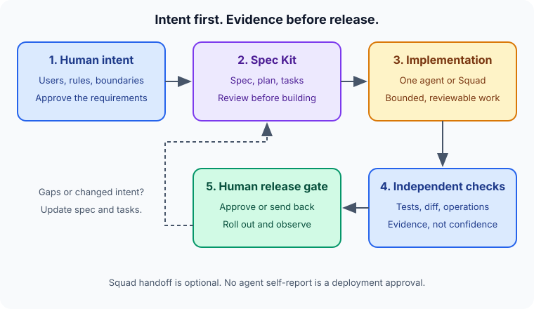

# Spec-Driven Development: From Idea to Reviewed Change

**Chapter 10 · Build with a spec**

Instead of asking an AI to "build an app" and hoping it guesses correctly, agree on the behaviour first, turn it into a plan, and check the result against that agreement. This four-part guide takes you from your first specification to using Spec Kit and Squad across real projects, with production release gates that remain under human control.

> **📘 In plain words:** A spec is the agreement about what you are building. Spec Kit helps you write and carry that agreement through development. Squad helps coordinate a team of AI agents. Neither replaces your judgement, tests, or release process.

## 1. Your route through this section

| Read | What you will do | Suggested time |
|---|---|---|
| **This page: understand the approach** | Learn the vocabulary and decide when a spec is worth writing | ~10 min |
| [Spec Kit: setup and first feature](spec-kit.md) | Install the tools, write requirements, review a plan, implement, and check for gaps | ~25 min reading, then a hands-on session |
| [Squad: setup and team workflow](squad.md) | Create an AI team and hand it a bounded piece of approved work | ~20 min reading |
| [Shipping and reusing the workflow](sdd-production.md) | Handle existing code, multiple projects, production risks, and community lessons | ~25 min reading |

You do **not** have to install Squad to use Spec Kit. Start with one feature and one coding agent; add a team when the work genuinely benefits from separate specialists.

**Before the hands-on pages:** know how to open a terminal, navigate to a project folder, and run that project's tests. Basic Git and programming knowledge are useful. If you have never shipped software, use a throwaway learning repository and get an experienced developer to review the production parts. Knowing how to prompt is not the same as knowing how to operate a service.

**Freshness:** documentation and release references were checked on **25 November 2026**. The walkthrough uses GitHub Copilot's default Spec Kit skills interface. Tool versions and interfaces change; the linked documentation and your installed help take precedence. These are source-checked instructions, not a claim that every tool/platform combination was executed here.

## 2. What spec-driven development means

**Spec-driven development (SDD)** means using an explicit specification to guide implementation and verification. A useful specification describes observable outcomes: who can do what, under which conditions, and how you will know it works.

Compare these two requests:

| Vague request | Reviewable specification |
|---|---|
| "Build a room-booking app." | "An authenticated employee can reserve an available room. Overlapping bookings for the same room are refused, including simultaneous requests." |
| "Make it secure." | "The server obtains the employee identity from the authenticated session. A caller cannot cancel another employee's booking by changing an ID." |
| "Make it fast." | "In the agreed staging environment, 95% of availability requests finish within 300 ms at 50 concurrent users." |
| "Make it production-ready." | "Ship only after authorization, concurrency, migration and restore checks pass; name the release owner and rollback procedure." |

Those numbers are **example product targets**, not promises from Spec Kit or Squad. Your team must choose targets that fit its users and infrastructure.

> **⚠️ Common misconception:** "A longer spec is a better spec." A short, testable requirement beats three pages of "robust, scalable, enterprise-grade". Write enough to remove consequential ambiguity, not every implementation detail in advance.

## 3. Three tools, three different jobs

| Component | Its job | What it does not guarantee |
|---|---|---|
| **[GitHub Spec Kit](https://github.github.io/spec-kit/)** | Provides a CLI, templates, scripts and agent instructions for specifications, plans, tasks and checks | That the requirements are correct, or that generated code is safe |
| **[Squad](https://github.github.io/squad/)** | Coordinates AI-emulated specialist roles with repository-based team context and decisions | That parallel work is isolated, cheap, conflict-free, or independently correct |
| **Your repository and CI/CD** | Record changes and run repeatable build, test and delivery checks; CI means continuous integration, CD means continuous delivery/deployment | That a green build proves the product meets users' needs |

The **coding agent** is the host that reads files, calls tools and writes changes, such as GitHub Copilot. The **model** is the reasoning engine behind it. Spec Kit is not a new model, and Squad's "tester" is an AI role, not a human quality-assurance department.

*Figure 1 — Use Spec Kit to structure the work, optionally use Squad to distribute implementation, and keep verification and release decisions outside the agent's self-assessment.*

The combined workflow in this guide is a **manual handoff**, not a promised built-in Spec Kit-to-Squad integration. The [Squad walkthrough](squad.md) shows exactly which artifacts to hand over and what to do if the coordinator goes off-plan.

## 4. A tiny vocabulary before you start

| Term | Plain-language meaning | Example |
|---|---|---|
| **Repository (repo)** | The project files and their version history | Your RoomBook application |
| **Branch / pull request (PR)** | A separate line of work / a proposal for reviewed changes | One booking feature submitted for review |
| **Constitution** | A short set of project-wide engineering rules | "Do not weaken authorization; use the existing test runner." |
| **Feature spec** | The behaviour and boundaries of one change | Who can reserve a room, and what counts as a conflict |
| **Acceptance criterion** | An observable condition for accepting the work | Two simultaneous conflicting requests produce only one booking |
| **Plan** | The technical design for meeting the spec | API contract, data model, transaction strategy |
| **Task** | A bounded implementation or verification step | Add the database constraint and its integration test |
| **Artifact** | A saved output of a development step | A Markdown spec, a test report, or a migration |
| **Brownfield / greenfield** | Changing an existing system / starting a new one | Add export to an existing app / build RoomBook |
| **Spec drift** | Requirements and actual behaviour no longer agree | Code allows cancellations after start, but the spec forbids them |

## 5. The smallest useful development loop

1. **Agree on intent.** Describe the user, the outcome, the boundaries and the failure cases. Answer the agent's questions rather than letting it invent business policy.
2. **Review the plan.** Check that it fits the real codebase and uses existing components before introducing new ones.
3. **Implement one slice.** A slice is a small end-to-end outcome, not "build the entire backend".
4. **Collect evidence.** Run the relevant tests; inspect actual results, the diff and the user experience.
5. **Decide.** A human accepts the change, requests revisions, or stops. Update the spec when the intended behaviour changes.

**Worked example:** You want room reservations. Start with one room and one create-booking endpoint, including permission checks and a conflict test. Do not start with recurring meetings, calendar synchronization, payments and an admin dashboard. A smaller feature can still have serious correctness requirements.

> **💡 Example:** The agent asks, "Can bookings touch at their boundaries?" You decide that 10:00–11:00 and 11:00–12:00 are allowed. That one sentence changes the database rule, API tests and UI behaviour. Clarifying it before coding is cheaper than finding three incompatible interpretations later.

## 6. When to use it — and when not to

| Situation | A proportionate approach |
|---|---|
| New feature with several behaviours or stakeholders | Spec Kit's full reviewed workflow |
| Existing service with compatibility or data-migration risks | A bounded change spec plus regression and rollout requirements |
| Independent API, UI and test work with an agreed contract | Consider Squad after the plan is stable |
| Small typo, obvious one-line fix, or routine dependency update | Existing issue, focused change and normal checks may be enough |
| Uncertain feasibility | Time-box a prototype; record what it proves before writing a detailed delivery plan |
| Production incident | Follow the incident process first; make the smallest safe repair and capture the learning afterwards |

Spec Kit also documents separate [bug-fixing](https://github.github.io/spec-kit/guides/bugfix.html) and [idea-assessment](https://github.github.io/spec-kit/guides/assessment.html) processes. They are opt-in extensions, not compulsory steps before every feature. You do not need them for this tutorial.

## 7. What remains your responsibility

You own product decisions, access permissions, dependency choices, acceptance criteria and releases. An agent can help draft all of them; it cannot grant itself business approval.

- Use approved AI services and synthetic data while learning. Files, prompts, team memory and logs can all contain sensitive information.
- Keep reviewable checkpoints. Read generated instructions, scripts and workflow files before allowing them to run.
- A constitution is guidance, **not an access-control boundary**. Enforce important rules with permissions, database constraints, required checks and human approvals.
- Agreement between two models is useful review input, **not proof**. Models can repeat the same outdated documentation or miss the same defect.

The [production guide](sdd-production.md) turns these responsibilities into concrete release gates and shows how to verify claims with sources and executable evidence.

## Recap

- Specify observable behaviour, not just aspirations.
- Spec Kit structures the process; Squad optionally distributes work; your delivery system enforces checks.
- Start with one small feature. Reuse the repository's existing patterns.
- Keep human decisions and test evidence between "the agent finished" and "we shipped".

## Check Your Understanding

**1. Is "the system must be secure" a sufficient acceptance criterion?**

> **✅ Answer:** No. Name the threat or permission boundary and an observable result, such as rejecting a request to cancel another user's booking.

**2. Do you need Squad before trying Spec Kit?**

> **✅ Answer:** No. One coding agent can execute Spec Kit's workflow. Squad is optional coordination for work that benefits from multiple roles.

**3. Two models say a change is correct. Is it ready for production?**

> **✅ Answer:** Not on that evidence alone. Check the actual code, run independent tests, verify operational readiness, and obtain the required human approval.

[← Chapter 9: AI at Work](ai-at-work.md) · [Set up Spec Kit →](spec-kit.md)
