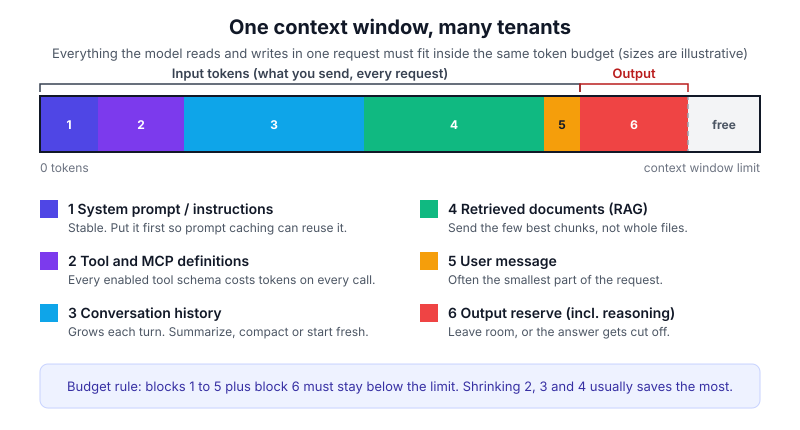

# Tokens, Cost & How to Use Fewer of Them

**Chapter 7 · Tokens & Cost**

Every time you talk to an AI model you pay in tokens: tokens decide what fits in the model's memory, how long you wait, and how much the bill says at the end of the month. This chapter turns that invisible meter into something you can read, predict and shrink, first for apps that call model APIs directly and then for everyday work with GitHub Copilot and other coding agents.

## 1. What a token is (quick recap)

A **token** is the small unit of text a model reads and writes. It can be a whole word, part of a word, a single character, punctuation, or a space attached to a word. In [Chapter 3](transformers.md) you saw how a tokenizer chops text into tokens before the model turns them into numbers. OpenAI's own rule of thumb for English is that **1 token ≈ 4 characters ≈ ¾ of a word**, so **100 tokens ≈ 75 words** ([OpenAI Help: Understanding and counting tokens](https://help.openai.com/en/articles/4936856-what-are-tokens-and-how-to-count-them)).

> **📘 In plain words:** A token is a "chunk" of text. Models count, think and charge in chunks, so the number that matters is chunks, not words or characters.

3Blue1Brown's [transformer lesson](https://www.3blue1brown.com/lessons/gpt) shows a real split of the sentence *"To date, the cleverest thinker of all time was"* into pieces like `To| date|,| the| cle|ve|rest| thinker| of| all| time| was`. Notice that common words stay whole, while a rarer word ("cleverest") breaks into three pieces.

The table below shows the kinds of text that surprise beginners. The splits are **illustrative**: the exact pieces and counts depend on which tokenizer the model uses.

| Kind of text | Example | What usually happens |
|---|---|---|
| Common English | `the cat sat` | About one token per word (spaces ride along with the word) |
| Rare or long word | `unbelievability` | Split into several sub-word pieces |
| Code | `for (int i = 0; i < n; i++) {` | Symbols, brackets and operators each tend to cost tokens; indentation and whitespace can add more |
| Non-English text | The same sentence in Greek, Hindi or Japanese | Often **more** tokens than the English version, because tokenizers saw less of that language during training |
| Emojis | `🚀🎉` | Each emoji is several bytes, so one emoji can be **several** tokens |
| Numbers and dates | `2026-10-13`, `3.14159265` | Split into small digit groups and punctuation; long numbers become many tokens |

> **⚠️ Common misconception:** "The same text always costs the same number of tokens." Different model families use different tokenizers. Anthropic notes that its newer tokenizer produces roughly 30% more tokens for the same text than earlier Claude models, and advises recounting prompts against the exact model you plan to use ([Anthropic: Token counting](https://platform.claude.com/docs/en/build-with-claude/token-counting)).

## 2. The four kinds of tokens on your bill

Providers split usage into categories that are priced differently ([OpenAI Help](https://help.openai.com/en/articles/4936856-what-are-tokens-and-how-to-count-them)):

| Token type | What it is | Typical price behaviour |
|---|---|---|
| **Input tokens** (prompt tokens) | Everything you send: instructions, history, documents, tool definitions, the question | The base rate |
| **Cached input tokens** | Input the provider recognises from a recent request and reuses through prompt caching | A fraction of the base input rate |
| **Output tokens** (completion tokens) | Everything the model writes back | Several times the input rate on the pricing pages we checked |
| **Reasoning tokens** | Hidden "thinking" a reasoning model does before it answers | **Billed as output tokens**, even though you never see them |

Reasoning tokens deserve special attention. OpenAI states that reasoning tokens "are not visible via the API" but "still occupy space in the model's context window and are billed as output tokens" ([OpenAI: Reasoning models](https://developers.openai.com/api/docs/guides/reasoning)). A short visible answer can therefore cost far more than its length suggests.

> **💡 Example:** You ask a reasoning model "Is 7,919 prime?" It replies "Yes." The visible answer is 1–2 tokens, but the usage report may show hundreds of reasoning tokens. You pay for all of them at the output rate.

## 3. How cost is calculated

### 3.1 The formula

Model APIs price tokens **per million tokens** (often written "per 1M" or "/MTok"). A request's cost is simply each token category multiplied by its rate:

```text
cost = ( uncached_input_tokens × input_price
       + cached_input_tokens   × cached_input_price
       + cache_write_tokens    × cache_write_price      (only on providers/models that charge it)
       + output_tokens         × output_price )         (output already includes reasoning tokens)
       ÷ 1,000,000
```

Read it line by line: count the tokens in each bucket, multiply by that bucket's price, add the results, and divide by one million because prices are quoted per million.

### 3.2 A worked example with placeholder prices

The prices below are **made up for teaching**. Real prices change often and differ by model, so always check the provider's pricing page (for example [GitHub Copilot models and pricing](https://docs.github.com/en/copilot/reference/copilot-billing/models-and-pricing)).

| Placeholder rate | Price per 1M tokens |
|---|---|
| Input | $2.00 |
| Cached input | $0.20 |
| Output | $8.00 |

A support chatbot sends a request with **12,000 input tokens** (a 10,000-token policy document plus a 2,000-token conversation) and gets back **800 output tokens** (of which 300 were reasoning).

| Scenario | Calculation | Cost per request |
|---|---|---|
| No caching | 12,000 × $2.00 + 800 × $8.00, all ÷ 1M | $0.0240 + $0.0064 = **$0.0304** |
| Policy document cached | 2,000 × $2.00 + 10,000 × $0.20 + 800 × $8.00, all ÷ 1M | $0.0040 + $0.0020 + $0.0064 = **$0.0124** |

At 10,000 requests per day that is about **$304 versus $124 per day**, just from reusing the same document prefix. (Some providers add a one-off cache-write premium the first time a prefix is stored; for a prefix reused thousands of times it barely moves the total.)

> **🎯 Try it:** Recalculate the table with your own model's real prices. Then halve the output tokens and see how much more the total drops compared with halving the input.

### 3.3 Why output tokens usually cost more

Input tokens are processed **in parallel**: the model reads your whole prompt in one big pass. Output tokens are generated **one at a time**, and each new token needs another full pass through the model that also looks back at everything before it. That sequential work ties up expensive GPU time per token, so providers charge more for it. The practical lesson: **a word you ask the model to write is usually more expensive than a word you send it.**

## 4. Latency vs tokens

Tokens also cost **time**. Two numbers matter:

- **Time to first token (TTFT)** grows with the amount of **input** the model must read before it starts answering. Prompt caching shortens it: Anthropic notes cached prompts generally give "improved time-to-first-token for long documents" ([Anthropic: Prompt caching](https://platform.claude.com/docs/en/build-with-claude/prompt-caching)).
- **Total response time** grows mostly with the number of **output** tokens, because they are produced one by one. Reasoning tokens count here too, even though you never see them.

| If you want... | Reduce... |
|---|---|
| Faster first word on screen | Input size (or cache the stable part) |
| Faster complete answer | Output length and reasoning effort |
| Both | Everything in section 7 |

## 5. The context window is a budget

The **context window** is the maximum number of tokens a model can handle in one request: input **and** output together. Think of it as a fixed-size suitcase. Everything has to fit: your instructions, the tools you offer, the conversation so far, any documents you paste or retrieve, the new question, and room for the answer.



*Figure 1 — The context window budget: six "tenants" share one fixed token limit, and the output (including hidden reasoning) needs reserved space too.*

If you fill the suitcase with input, the model may stop mid-answer. OpenAI warns that when generated tokens hit the context limit or your `max_output_tokens` value, the response ends as `incomplete`, possibly **before any visible text**, while you still pay for input and reasoning tokens. Their guidance is to reserve at least **25,000 tokens** for reasoning and output when you start experimenting with reasoning models ([OpenAI: Reasoning models](https://developers.openai.com/api/docs/guides/reasoning)).

A bigger window is not a free pass either. Anthropic describes **context rot**: "as the number of tokens in the context window increases, the model's ability to accurately recall information from that context decreases," so context should be treated "as a finite resource with diminishing marginal returns" ([Anthropic: Effective context engineering for AI agents](https://www.anthropic.com/engineering/effective-context-engineering-for-ai-agents)).

> **✅ Key takeaway:** Fewer, better tokens usually mean lower cost, faster answers **and** better quality. Token saving is a quality practice, not only a money practice.

## 6. How to count tokens

### 6.1 Tokenizer tools (before you send)

- **[OpenAI Tokenizer](https://platform.openai.com/tokenizer)**: paste text and see it split into colored tokens with a count. Great for building intuition.
- **Anthropic token counting endpoint** (`/v1/messages/count_tokens`): send the same structure you would send to the Messages API (system prompt, tools, images, PDFs) and get `input_tokens` back. It is free to use (rate-limited) and returns an **estimate** ([Anthropic: Token counting](https://platform.claude.com/docs/en/build-with-claude/token-counting)).
- **OpenAI input-token counting API**: counts a complete Responses API input, including message formatting, tools and files ([OpenAI Help](https://help.openai.com/en/articles/4936856-what-are-tokens-and-how-to-count-them)).

### 6.2 Usage fields (after you send)

Every API response reports what you actually used. Field names differ by provider and endpoint:

| Provider / endpoint | Input | Output | Cache | Reasoning |
|---|---|---|---|---|
| OpenAI Responses API | `usage.input_tokens` | `usage.output_tokens` | `usage.input_tokens_details.cached_tokens` | `usage.output_tokens_details.reasoning_tokens` |
| OpenAI Chat Completions | `prompt_tokens` | `completion_tokens` | — | — |
| Anthropic Messages API | `usage.input_tokens` (only tokens **after** the last cache breakpoint) | `usage.output_tokens` | `cache_read_input_tokens`, `cache_creation_input_tokens` | — |
| Gemini API | — | — | `usage.total_cached_tokens` | — |

Sources: [OpenAI Reasoning](https://developers.openai.com/api/docs/guides/reasoning), [OpenAI Prompt caching](https://developers.openai.com/api/docs/guides/prompt-caching), [Anthropic Prompt caching](https://platform.claude.com/docs/en/build-with-claude/prompt-caching), [Gemini Context caching](https://ai.google.dev/gemini-api/docs/caching).

> **⚠️ Common misconception:** On Anthropic, `input_tokens` is **not** your total input when caching is on. The docs give the formula `total_input_tokens = cache_read_input_tokens + cache_creation_input_tokens + input_tokens`.

### 6.3 Counting locally with `tiktoken`

[`tiktoken`](https://github.com/openai/tiktoken) is OpenAI's open-source tokenizer library for Python. Install it with `pip install tiktoken`, then run:

```python
import tiktoken

# o200k_base is the encoding used by recent OpenAI models
enc = tiktoken.get_encoding("o200k_base")

text = "Tokens decide cost, speed and what fits in the context window. 🚀"
tokens = enc.encode(text)

print("Token count:", len(tokens))
print("Pieces:", [enc.decode([t]) for t in tokens])

# Or pick the encoding that matches a specific model name
enc_for_model = tiktoken.encoding_for_model("gpt-4o")
print("Same text, model-specific count:", len(enc_for_model.encode(text)))
```

The script prints how many tokens the sentence uses and shows each piece, so you can see the emoji turn into several tokens. Two caveats: `tiktoken` only knows **OpenAI** tokenizers, and a plain-text count does not include the extra tokens added by message formatting, tools, images or files ([OpenAI Help](https://help.openai.com/en/articles/4936856-what-are-tokens-and-how-to-count-them)). For other providers, use their counting endpoint or the usage fields.

## 7. Token-saving techniques: the catalog

Each technique below lists **why** it works, **how** to do it, a short **example**, and the **trade-off** to keep in mind. Start at the top: the first few are free and safe.

### 7.1 Write concise prompts and remove boilerplate

- **Why:** Every word you send is billed on every request, and repeated filler ("You are a world-class, highly skilled, extremely helpful assistant who always...") adds up quickly.
- **How:** State the task, the constraints and the output format. Cut politeness padding, repeated rules and long role-play intros. Anthropic's guidance is to aim for "the smallest possible set of high-signal tokens" ([Anthropic](https://www.anthropic.com/engineering/effective-context-engineering-for-ai-agents)).
- **Example:** "Summarize the text below in 3 bullet points for a manager" beats a 120-word preamble that says the same thing.
- **Trade-off:** "Minimal does not necessarily mean short" (Anthropic). Remove fluff, not the facts the model needs.

### 7.2 Put stable content first to benefit from prompt caching

- **Why:** Providers can reuse the processed **prefix** of a prompt if a later request starts with exactly the same tokens. Reused tokens are billed at a steep discount and start faster.
- **How:** Order every request as **stable → changing**: system instructions, tool definitions and shared reference documents first; the user's question, timestamps and per-user data last. OpenAI recommends keeping repeated content "at the beginning of your prompt, and among the first API parameters you pass" ([OpenAI: Prompt engineering](https://developers.openai.com/api/docs/guides/prompt-engineering)).
- **Example:** A legal assistant sends the same 50-page contract with every question. Placing the contract before the question lets all follow-ups read it from cache.
- **Trade-off:** Caches expire after a while, have a minimum size, and break on any change to the prefix (even a timestamp near the top).

**How it works in practice, provider by provider** (details change; check each page):

| | OpenAI | Anthropic (Claude) | Google Gemini |
|---|---|---|---|
| Turned on by | Enabled by default for supported models | `cache_control` at the top level (automatic) or on specific blocks (explicit breakpoints, up to 4) | Implicit caching on by default for Gemini 2.5 and newer; explicit caching also available |
| Minimum cacheable prefix | 1,024 tokens on the newest models; varies on older ones | 512 to 4,096 tokens depending on model | 2,048 to 4,096 tokens depending on model |
| Price of a cache hit | Discounted cached-input rate ("up to 95%" off) | 0.1× base input on most models (lower on some) | Discounted; passed on automatically |
| Price of writing the cache | 1.25× input on the newest models; none on older ones | 1.25× input (5-minute TTL) or 2× (1-hour TTL) | — |
| Lifetime | Model-dependent: minutes to hours, refreshed on reuse | 5 minutes by default, refreshed on each hit; optional 1 hour | Short; send similar prefixes close together |
| Order that matters | Whole rendered prefix, including tools | `tools` → `system` → `messages` | Large, common content at the beginning |

Sources: [OpenAI Prompt caching](https://developers.openai.com/api/docs/guides/prompt-caching), [Anthropic Prompt caching](https://platform.claude.com/docs/en/build-with-claude/prompt-caching), [Gemini Context caching](https://ai.google.dev/gemini-api/docs/caching).

> **⚠️ Common misconception:** "Caching changes the answer." It does not. Anthropic states that prompt caching "has no effect on output token generation," and OpenAI says the same. It only changes how the input is processed and billed.

### 7.3 Limit the output

- **Why:** Output tokens are the expensive ones and they drive total response time.
- **How:**
  - Set a hard cap: `max_output_tokens` (OpenAI Responses), `max_completion_tokens` (OpenAI Chat Completions), `max_tokens` (Anthropic), "max output tokens" (Gemini).
  - Ask for brevity explicitly: "Answer in at most 3 sentences", "Return only the code".
  - Use **stop sequences** so generation ends at a known marker (Gemini documents `stop_sequences` in its [prompt design guide](https://ai.google.dev/gemini-api/docs/prompting-strategies)).
- **Example:** A classifier only needs one word ("Positive", "Negative" or "Neutral"). Saying so and capping output at a few tokens turns a paragraph-long reply into a single token.
- **Trade-off:** On reasoning models the cap includes hidden reasoning tokens; set it too low and you can get an empty, incomplete answer that you still pay for ([OpenAI](https://developers.openai.com/api/docs/guides/reasoning)).

### 7.4 Choose the right model size, and route

- **Why:** Small models are typically much cheaper per token and faster. Many tasks (classification, extraction, reformatting) do not need a frontier model.
- **How:** Start with the smallest model that passes your tests. For mixed workloads, use **model routing**: send each request to a small model first and **escalate** to a larger one only when the task is hard or the small model's answer fails a check. OpenAI's prompt guide notes that "small models are generally faster and cheaper to use" ([OpenAI](https://developers.openai.com/api/docs/guides/prompt-engineering)).
- **Example:** A help-desk bot answers password-reset questions with a small model and routes "my invoice is wrong and I want a refund" to a larger one.
- **Trade-off:** VS Code's docs warn that "the lowest-cost model does not always produce the lowest-cost result": retries and rework on a weak model can cost more ([VS Code: Optimize AI credit usage](https://code.visualstudio.com/docs/agents/guides/optimize-usage)). Decide with measurements, not guesses.

### 7.5 Control reasoning effort and thinking budgets

- **Why:** Reasoning tokens are billed as output and add latency.
- **How:** Use the provider's effort or thinking setting. OpenAI's `reasoning.effort` supports model-dependent values such as `none`, `minimal`, `low`, `medium`, `high`, `xhigh` and `max`; "lower effort favors speed and lower token usage" ([OpenAI](https://developers.openai.com/api/docs/guides/reasoning)). Anthropic exposes an effort setting and a thinking configuration, and Gemini models also "think" internally ([Gemini prompt design](https://ai.google.dev/gemini-api/docs/prompting-strategies)).
- **Example:** Use `low` effort for drafting emails, `high` only for a tricky multi-file debugging session.
- **Trade-off:** Changing effort or thinking settings mid-conversation can invalidate the prompt cache on several providers ([Anthropic](https://platform.claude.com/docs/en/build-with-claude/prompt-caching), [OpenAI](https://developers.openai.com/api/docs/guides/prompt-caching)). Pick a level before you start.

### 7.6 Manage conversation history

- **Why:** In a chat, the **whole history is re-sent on every turn**. Turn 30 pays for turns 1–29 again.
- **How:** Pick one or more:
  - **Start a new chat** when the topic changes.
  - **Summarize / compact** older turns into a short recap. Anthropic calls compaction "the first lever in context engineering" ([Anthropic](https://www.anthropic.com/engineering/effective-context-engineering-for-ai-agents)).
  - **Truncate** or use a **sliding window**: keep only the last N turns plus the system prompt.
  - **Clear old tool results** that the agent no longer needs.
- **Example:** After 40 turns debugging a login bug, replace the history with a 150-token summary of what was tried and what is still broken.
- **Trade-off:** OpenAI notes that summarization, compaction or truncation "can change the prefix and reset cache reuse," so compare total cost before and after ([OpenAI Prompt caching](https://developers.openai.com/api/docs/guides/prompt-caching)). Over-aggressive summaries can also drop a detail that matters later.

### 7.7 Do RAG right instead of pasting whole documents

- **Why:** Pasting an entire manual into every request is expensive and can bury the relevant part (context rot).
- **How:** With [Retrieval-Augmented Generation](using-ai.md) you store documents in chunks, retrieve only the few chunks most related to the question, and optionally **rerank** them so the best 3–5 go into the prompt. Anthropic also describes "just in time" retrieval, where an agent keeps lightweight references (file paths, links) and loads data only when needed ([Anthropic](https://www.anthropic.com/engineering/effective-context-engineering-for-ai-agents)).
- **Example:** Instead of a 120-page HR handbook (≈80,000 tokens), send the 4 chunks about "parental leave" (≈2,000 tokens).
- **Trade-off:** Retrieval can miss the right chunk. Test retrieval quality separately from answer quality.

### 7.8 Trim tool definitions and exposed MCP tools

- **Why:** Every tool you offer the model is described in JSON schema, and **those descriptions are input tokens on every request**. Anthropic's token-counting example shows a single weather tool pushing a one-line question to about 400 input tokens ([Anthropic](https://platform.claude.com/docs/en/build-with-claude/token-counting)).
- **How:** Enable only the tools the task needs, keep descriptions short, and avoid overlapping tools. OpenAI offers `allowed_tools` and tool search with deferred loading so large tool sets do not all load up front ([OpenAI Prompt caching](https://developers.openai.com/api/docs/guides/prompt-caching)). See [Chapter 6](using-ai.md) for what MCP is.
- **Example:** An agent connected to an MCP server exposing 60 tools only needs 3 for "summarize my open pull requests". Disable the rest for that session.
- **Trade-off:** Too few tools and the agent cannot finish the job. Anthropic's test: "If a human engineer can't definitively say which tool should be used in a given situation, an AI agent can't be expected to do better."

### 7.9 Use batch APIs for non-urgent work

- **Why:** All three major providers charge **50% of the standard price** for batch jobs.
- **How:** Collect requests in a file and submit them as a batch: [OpenAI Batch API](https://developers.openai.com/api/docs/guides/batch) (results within 24 hours), [Anthropic Message Batches](https://platform.claude.com/docs/en/build-with-claude/batch-processing) (most finish within 1 hour, up to 24), [Gemini Batch API](https://ai.google.dev/gemini-api/docs/batch-api) (target 24 hours).
- **Example:** Classifying 50,000 product reviews overnight, running evaluation suites, or generating embeddings for a document library.
- **Trade-off:** No instant answers, results can come back in any order (match them by `custom_id` or key), and caching inside batches is best-effort.

### 7.10 Ask for structured output instead of prose

- **Why:** A JSON object with the fields you need is usually much shorter than a friendly paragraph, and your code can parse it without a second "extract the answer" call.
- **How:** Use the provider's structured-output feature with a JSON schema (for example [OpenAI Structured Outputs](https://developers.openai.com/api/docs/guides/structured-outputs)), and ask for only the fields you will use.
- **Example:**

```json
{"sentiment": "negative", "topic": "billing", "urgent": true}
```

  This replaces a reply like "Thank you for sharing this review! After carefully reading it, I would say the overall sentiment is negative, and it mainly concerns billing...". The JSON is a fraction of the tokens and is ready for your code.
- **Trade-off:** Schemas themselves cost input tokens, and very tight formats can hurt quality on tasks that benefit from explanation.

### 7.11 Avoid re-sending large files

- **Why:** Re-attaching the same 5,000-line log or PDF on every turn multiplies its cost.
- **How:** Send it once and refer back to it, keep it in a cached prefix, upload it once to a provider's file store where supported, or extract only the relevant section first (for example with `grep`, `head` or a script). Anthropic describes agents analysing large data "without ever loading the full data objects into context" ([Anthropic](https://www.anthropic.com/engineering/effective-context-engineering-for-ai-agents)).
- **Example:** Instead of pasting a 2 MB log, paste the 40 lines around the first `ERROR`.
- **Trade-off:** The model only knows what you show it. Make sure the excerpt contains the real cause.

### 7.12 Compress data formats

- **Why:** Formats with repeated keys and lots of punctuation cost more tokens for the same information.
- **How:** For tabular data, prefer CSV or a compact table over verbose JSON; drop fields the model does not need; round long decimals; shorten IDs when you can map them back.
- **Example:** The same three records:

```json
[{"customer_id": "C-0001", "country": "Romania", "orders": 12},
 {"customer_id": "C-0002", "country": "Germany", "orders": 3},
 {"customer_id": "C-0003", "country": "Spain", "orders": 7}]
```

```text
customer_id,country,orders
C-0001,Romania,12
C-0002,Germany,3
C-0003,Spain,7
```

  The CSV states each column name once instead of once per row, so it is noticeably shorter. Paste both into a tokenizer to see the difference for your own data; it grows with the number of rows.
- **Trade-off:** Deeply nested data does not fit CSV well, and the model may need column descriptions to interpret short headers.

### 7.13 Deduplicate and cache your own responses

- **Why:** The cheapest request is the one you never send.
- **How:** Store answers to frequent, identical questions (exact-match cache) in your own app, and remove duplicate documents or chunks before they reach the prompt.
- **Example:** An FAQ bot caches the answer to "What are your opening hours?" for a day.
- **Trade-off:** Cached answers go stale, and answers that depend on the user must never be shared across users.

### 7.14 Measure, then set budgets and alerts

- **Why:** You cannot shrink what you do not measure, and runaway loops (an agent that keeps calling tools) can burn budget fast. OWASP lists **Unbounded Consumption** as one of the top 10 risks for LLM apps ([OWASP](https://genai.owasp.org/llm-top-10/)).
- **How:** Log token usage per request, user and feature; track your cache-hit rate (OpenAI suggests "total cached tokens ÷ total input tokens"); set spend limits and alerts in the provider console; cap the number of steps an agent may take.
- **Example:** A daily report shows that one feature uses 70% of your tokens because it re-sends a full catalog each time. Fixing that one prompt halves the bill.
- **Trade-off:** Logging prompts can capture sensitive data; see [Chapter 8](best-practices.md) for safe observability.

## 8. Saving tokens with GitHub Copilot & coding agents

Coding agents send a **lot** of context: instructions, open files, search results, tool output and the whole conversation. GitHub's documentation is explicit that "open editor tabs, attached files, and the full back-and-forth of a long conversation all count as context" ([GitHub Docs: Optimizing your AI usage](https://docs.github.com/en/copilot/tutorials/optimize-ai-usage)).

### 8.1 How Copilot usage is measured today

As of this writing (October 2026), GitHub Copilot measures chat and agent usage in **GitHub AI Credits**: each interaction consumes input, output and cached tokens priced per model, and "the total is converted into AI credits, where 1 AI credit = $0.01 USD." Code completions and next edit suggestions are not billed in AI credits ([GitHub Docs: Models and pricing](https://docs.github.com/en/copilot/reference/copilot-billing/models-and-pricing)).

The older **premium request** system, where each prompt cost one premium request times a **model multiplier** (a heavier model might count as several requests, an included model as zero), now applies only to Copilot Pro and Pro+ subscribers who stayed on an existing annual plan after June 1, 2026 ([GitHub Docs: Requests in GitHub Copilot (legacy)](https://docs.github.com/en/copilot/concepts/billing/copilot-requests)). Either way the lesson is the same: **heavier models and bigger contexts cost more of your allowance.**

> **📘 In plain words:** Copilot now works like the APIs in this chapter: more tokens and bigger models use more credits. Every technique in section 7 also helps you inside your editor.

### 8.2 The Copilot token-saving checklist

| Technique | What to do | Source |
|---|---|---|
| **Keep custom instructions short and specific** | `.github/copilot-instructions.md` and `AGENTS.md` load on every chat interaction. Include build/test commands, required libraries and known pitfalls; avoid long generic documentation. | [VS Code best practices](https://code.visualstudio.com/docs/copilot/best-practices), [GitHub: Optimize AI usage](https://docs.github.com/en/copilot/tutorials/optimize-ai-usage) |
| **Scope instructions with `applyTo`** | Put language- or folder-specific rules in `.github/instructions/*.instructions.md` with an `applyTo` glob (for example `'**/*.py'`), so they load only when matching files are touched. | [VS Code: Custom instructions](https://code.visualstudio.com/docs/copilot/customization/custom-instructions) |
| **Reference specific files, not the whole workspace** | Use `#file`, `#folder` or `#symbol` mentions to point at what matters; reserve `#codebase` for genuinely broad questions. | [VS Code: Add context to chat](https://code.visualstudio.com/docs/copilot/chat/copilot-chat-context) |
| **Close irrelevant tabs** | Open editor tabs count as context. | [GitHub: Optimize AI usage](https://docs.github.com/en/copilot/tutorials/optimize-ai-usage) |
| **Start a new chat per task** | "Start a new conversation when you switch problems." Use `/compact` to shrink a long session you want to keep, and `/fork` to explore an alternative without re-explaining. | [GitHub: Optimize chat usage](https://docs.github.com/en/copilot/tutorials/optimize-chat-usage), [VS Code: Optimize AI credit usage](https://code.visualstudio.com/docs/agents/guides/optimize-usage) |
| **Pick a lighter model for simple tasks** | Lighter models for refactoring, formatting and docs; reasoning models for architecture and hard debugging. Auto model selection routes for you (and GitHub offers a 10% discount on model costs with it on paid plans). | [GitHub: Optimize AI usage](https://docs.github.com/en/copilot/tutorials/optimize-ai-usage) |
| **Keep reasoning at the default** | Higher reasoning levels and the 1-million-token context option consume more credits; raise them only for complex tasks. | [GitHub: Supported models](https://docs.github.com/en/copilot/reference/ai-models/supported-models) |
| **Limit enabled MCP tools** | "Large tool sets ... add to the context on every request." Use **Configure Tools** to enable only what the task needs, or give custom agents a narrow `tools` list. | [GitHub: Optimize AI usage](https://docs.github.com/en/copilot/tutorials/optimize-ai-usage), [VS Code: Optimize AI credit usage](https://code.visualstudio.com/docs/agents/guides/optimize-usage) |
| **Preserve the cache** | Avoid switching models, reasoning level, context size or the enabled tool set mid-session; each change can force the full context to be re-processed at the uncached price. | [GitHub: Optimize AI usage](https://docs.github.com/en/copilot/tutorials/optimize-ai-usage) |
| **Plan first** | Use the Plan agent (or `/plan` in Copilot CLI) with a strong model, review the plan, then implement with a cheaper model. This "avoids spending AI credits on code that needs to be thrown away." | [VS Code best practices](https://code.visualstudio.com/docs/copilot/best-practices) |
| **Write concise, complete agent prompts** | Give a clear task, the relevant files/errors, and a **stopping condition** ("done when the existing tests pass"). This reduces retries and scope drift. | [GitHub: Optimize AI usage](https://docs.github.com/en/copilot/tutorials/optimize-ai-usage) |
| **Exclude noisy files** | Use `.gitignore`, `files.exclude` and `search.exclude` so build output and logs do not flood search results; "search match snippets count toward the context window." | [VS Code: Optimize AI credit usage](https://code.visualstudio.com/docs/agents/guides/optimize-usage) |
| **Watch the meter** | Hover a chat response to see its credit cost, check the context window control for session totals, and use Agent Debug Logs and the Cache Explorer to find waste. | [VS Code: Optimize AI credit usage](https://code.visualstudio.com/docs/agents/guides/optimize-usage) |

### 8.3 Before and after: the same request, fewer tokens

Counts below are **approximate**, using the rule of thumb of about 100 tokens per 75 words. Use a tokenizer for exact numbers.

**Before (≈ 200 tokens of prompt, plus whatever the agent explores):**

```text
Hi Copilot! I hope you're doing well. I have a bit of a problem and I was
wondering if you could please help me out. So basically there's this thing in
our app where users sometimes can't log in, I think? It might be related to the
authentication stuff, or maybe the database, or maybe something else entirely,
I'm honestly not sure. Could you take a look at the whole codebase and figure
out what might be going wrong and then fix anything you think needs fixing? Also
feel free to clean up anything else you notice along the way, and maybe add some
comments and documentation too if you have time. Please explain everything you
do in a lot of detail so I can understand it. Thanks so much in advance!
```

**After (≈ 60 tokens):**

```text
Login fails with "401 invalid token" after the user's session is 24h old.
Repro: test_login_expired_session in #file:tests/test_auth.py.
Likely area: #file:src/auth/session.py (token refresh).
Fix the bug only. Done when tests/test_auth.py passes.
Reply with a 3-line summary of the change.
```

The second prompt is about **70% shorter**, but the bigger saving is everything it prevents: no whole-codebase search, no unrequested refactoring, no long explanation, and fewer retries because the agent knows exactly when it is finished.

> **🎯 Try it:** Take a prompt you used this week. Add a stopping condition and one `#file` reference, delete every sentence that does not change what the agent should do, and compare the credit cost shown when you hover the response.

## 9. Checklist: before you send

- [ ] Is the stable part (instructions, tools, shared documents) **first**, and the changing part **last**?
- [ ] Did I remove filler, repeated rules and politeness padding?
- [ ] Am I sending **only** the relevant chunks, files or log lines?
- [ ] Are only the **needed tools** enabled?
- [ ] Did I set an output cap and ask for a concise or structured format?
- [ ] Is this the **smallest model** (and lowest reasoning effort) that passes my tests?
- [ ] Should this be a **new chat** or a compacted one?
- [ ] Could this run as a **batch** job at half price?
- [ ] Am I logging usage and watching cache-hit rate and spend alerts?

## Recap

- A token is a chunk of text; English averages about 4 characters or ¾ of a word per token, but code, numbers, emojis and many non-English languages use more.
- Bills split into input, cached input, output and reasoning tokens; reasoning is billed as output, and output usually costs several times more than input.
- Cost = each token bucket × its per-million price ÷ 1,000,000. Always check current prices on the provider's pricing page.
- The context window is a shared budget for instructions, tools, history, documents, the question **and** the answer; more context is not automatically better (context rot).
- The biggest levers are prompt caching (stable content first), shorter output, the right model and effort level, lean history, good retrieval, fewer tools and batch jobs.
- In GitHub Copilot, usage is measured in AI credits based on tokens and model; short scoped instructions, focused context, new chats per task, lighter models and a plan-first workflow save the most.

## Check Your Understanding

**1. A reasoning model replies "Yes." but the usage report shows 600 output tokens. Why?**

- A) The tokenizer counted the answer incorrectly
- B) Hidden reasoning tokens are billed as output tokens
- C) Cached tokens are always reported as output
- D) The system prompt is counted as output

> **✅ Answer:** B — Reasoning tokens are invisible in the reply but still occupy the context window and are billed at the output rate.

**2. You send the same 20,000-token manual with every question. What change gives the biggest saving with no loss of quality?**

- A) Put the question first and the manual last
- B) Put the manual first and the question last so the prefix can be cached
- C) Switch to a model with a larger context window
- D) Ask the model to answer in more detail

> **✅ Answer:** B — Prompt caching reuses an identical prefix, so the stable manual must come before the changing question to be read from cache at the discounted rate.

**3. Using placeholder prices of $2 per 1M input tokens and $8 per 1M output tokens, what does a request with 5,000 input tokens and 1,000 output tokens cost?**

- A) $0.010
- B) $0.018
- C) $0.080
- D) $1.800

> **✅ Answer:** B — 5,000 × $2 ÷ 1M = $0.010 plus 1,000 × $8 ÷ 1M = $0.008, for a total of $0.018.

**4. Which job is the best fit for a batch API?**

- A) A live customer chat that must reply within two seconds
- B) Autocomplete while a developer types
- C) Classifying 50,000 product reviews overnight
- D) A voice assistant answering a phone call

> **✅ Answer:** C — Batch APIs trade speed for a 50% discount, which suits large, non-urgent jobs that can wait hours.

**5. In VS Code with Copilot, which habit reduces AI credit usage the most for a new, unrelated task?**

- A) Keep working in the same long chat so the model remembers everything
- B) Enable every available MCP tool just in case
- C) Start a new chat, reference only the relevant files, and give a clear stopping condition
- D) Switch to the largest model and the highest reasoning level

> **✅ Answer:** C — A fresh session avoids re-sending irrelevant history, focused references keep context lean, and a stopping condition prevents extra agent work and retries.

[← Chapter 6: Using Models](using-ai.md) · [Chapter 8: Best Practices →](best-practices.md)
