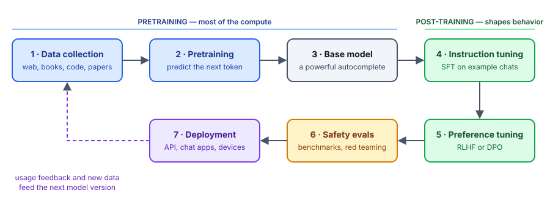

# How LLMs Are Trained & Tuned

**Chapter 4 · Training & Tuning**

In [Chapter 3](transformers.md) you saw what a transformer *is*. But a freshly built transformer knows nothing — its billions of weights start as random numbers. This chapter follows a model from that blank start to a helpful assistant: reading trillions of words in **pretraining**, learning to follow instructions in **fine-tuning**, being shaped by human preferences with **RLHF** and **DPO**, and finally being tested for safety. You will also learn the practical tools around models — LoRA, distillation, quantization, mixture of experts — and how to judge benchmark scores with a healthy dose of skepticism.

## 1. The Big Picture

Building a modern chat model happens in stages. Each stage starts from the result of the one before it.



*Figure 1 — The typical LLM pipeline. Pretraining uses most of the compute; post-training is smaller but decides how the model behaves.*

| Stage | What happens | Result |
|---|---|---|
| 1. Data collection | Gather and clean huge amounts of text and code | a training dataset of trillions of tokens |
| 2. Pretraining | Learn to predict the next token on that data | general knowledge and language skill |
| 3. Base model | The raw output of pretraining | a powerful autocomplete, not yet an assistant |
| 4. Instruction tuning (SFT) | Train on example conversations | follows instructions, answers questions |
| 5. Preference tuning (RLHF / DPO) | Learn which answers humans prefer | more helpful, honest, and harmless |
| 6. Safety evals | Test for dangerous or harmful behavior | decision to release, plus fixes |
| 7. Deployment | Serve the model through apps and APIs | the model you actually use |

> **📘 In plain words:** Pretraining is like a student reading an entire library — they absorb a huge amount, but they have never had a conversation. Post-training is like coaching that student on how to be a good assistant: answer the question asked, be clear, be polite, and refuse dangerous requests.

## 2. Pretraining: Learning from a Mountain of Text

### Where the data comes from

Pretraining data is mostly public text: web pages (often from large crawls like Common Crawl), books, Wikipedia, scientific papers, and source code, plus licensed and increasingly synthetic (model-generated) data. The amounts are enormous:

- GPT-3 (2020) was trained on about 300 billion tokens ([paper](https://arxiv.org/abs/2005.14165)).
- Meta's Llama 3.1 (2024) was pretrained on about **15 trillion** tokens ([model card](https://github.com/meta-llama/llama-models/blob/main/models/llama3_1/MODEL_CARD.md)).

Raw web text is messy, so most of the work is **cleaning**: removing duplicates, spam, low-quality pages, and personal information, and filtering by language and quality. Data quality has a big effect on the final model.

### Self-supervised learning

Normally, supervised learning (from [Chapter 1](foundations.md)) needs humans to label every example. Pretraining avoids that with a clever trick: **the text labels itself**. Hide the next token, ask the model to guess it, then reveal the answer and compute the [loss](neural-networks.md). This is called **self-supervised learning**.

> **💡 Example:** The single sentence `The cat sat on the mat` gives the model five practice questions for free:
>
> | Model sees | Must predict |
> |---|---|
> | The | cat |
> | The cat | sat |
> | The cat sat | on |
> | The cat sat on | the |
> | The cat sat on the | mat |
>
> Every guess is scored, and [gradient descent](neural-networks.md) nudges billions of weights slightly toward the right answer. Repeat this over trillions of tokens.

To predict the next word well across all of human writing, the model is forced to pick up grammar, facts, reasoning patterns, coding conventions, and even some common sense — all as a side-effect of one simple objective.

## 3. Compute: GPUs and Cost

Training is mostly giant **matrix multiplications** (multiplying big grids of numbers). **GPUs** (graphics processing units) and similar AI chips (like Google's TPUs) are built to do thousands of these multiplications in parallel, which makes them far faster than ordinary CPUs for this job. Large models are trained on clusters of thousands to tens of thousands of GPUs running for weeks or months — and the very largest projects use even more.

### How much compute?

A widely used rule of thumb ([Kaplan et al., 2020](https://arxiv.org/abs/2001.08361)) estimates training compute as:

```
training compute (FLOPs) ≈ 6 × parameters × training tokens
```

FLOPs means "floating-point operations" — individual multiplications and additions. The 6 comes from roughly 2 operations per parameter per token for the forward pass and about 4 more for backpropagation.

> **💡 Example:** A 7-billion-parameter model trained on 1 trillion tokens: 6 × 7,000,000,000 × 1,000,000,000,000 = **4.2 × 10²²** FLOPs. That is 42 thousand billion billion operations.

### A real-world example

Meta reports that training the Llama 3.1 family used a cumulative **39.3 million GPU-hours** on H100-80GB GPUs, of which **30.84 million** were for the 405-billion-parameter model ([model card](https://github.com/meta-llama/llama-models/blob/main/models/llama3_1/MODEL_CARD.md)).

> **💡 Example:** To get a feel for the cost, *assume* renting one such GPU costs $2 per hour (an illustrative figure — real prices vary widely, and Meta uses its own hardware). Then 30.84 million GPU-hours × $2 ≈ **$62 million** of compute for one final training run — before counting failed experiments, staff, data, and electricity.

> **✅ Key takeaway:** Pretraining a frontier model costs tens to hundreds of millions of dollars (or more) and is done by only a few organizations. Almost everyone else **starts from an existing model** and adapts it.

## 4. Scaling Laws

Researchers discovered that model quality improves in a remarkably **predictable** way as you increase three things:

1. **Parameters** — the size of the model.
2. **Data** — the number of training tokens.
3. **Compute** — the total amount of calculation (which depends on the first two).

Plot the loss against compute on a log scale and you get a fairly smooth line: each 10× increase in compute buys a reliable, if shrinking, improvement. These patterns are called **scaling laws** ([Kaplan et al., 2020](https://arxiv.org/abs/2001.08361)).

### The Chinchilla idea

For a fixed compute budget, should you build a bigger model or train on more data? DeepMind's Chinchilla paper ([Hoffmann et al., 2022](https://arxiv.org/abs/2203.15556)) trained over 400 models and found that many large models of the time were **undertrained** — too many parameters, too little data. Their finding: model size and training tokens should grow **together** — every time you double the model size, you should also double the training tokens.

They proved it with **Chinchilla**: 70 billion parameters trained on about 4× more data than DeepMind's earlier Gopher model (280 billion parameters), using the **same** compute. Chinchilla outperformed Gopher, GPT-3 (175B), and other larger models on a wide range of tasks.

> **💡 Example:** A common reading of the Chinchilla results is "about **20 training tokens per parameter**" for compute-optimal training. For a 70B model: 70 billion × 20 = **1.4 trillion tokens**, which is roughly what Chinchilla was trained on.

> **⚠️ Common misconception:** "Chinchilla's 20-to-1 ratio is how everyone trains now." Chinchilla optimizes **training** cost only. Because a model is run billions of times after training, many labs deliberately train *smaller* models on *far more* data so they are cheaper to use. Llama 3.1 8B saw about 15 trillion tokens — roughly 1,900 tokens per parameter.

## 5. Base Model vs. Instruct (Chat) Model

At the end of pretraining you have a **base model**. It is knowledgeable, but it only knows how to continue text — it has never been taught to be an assistant.

> **💡 Example:** The same prompt, given to two versions of a model (illustrative outputs):
>
> **Prompt:** `What is the capital of France?`
>
> **Base model:** `What is the capital of Germany? What is the capital of Italy? What is the capital of Spain?` — it guesses this text is from a quiz list and continues the list.
>
> **Instruct model:** `The capital of France is Paris.` — it recognizes a question and answers it.

| | Base model | Instruct / chat model |
|---|---|---|
| Trained with | pretraining only | pretraining + SFT + preference tuning |
| Behavior | continues text | follows instructions, holds a conversation |
| Typical use | research, further fine-tuning, text completion | assistants, apps, APIs |
| Naming hints | "base", no suffix | "Instruct", "Chat", "-it" |

Open-model families often publish both versions — for example, Llama 3.1 8B and Llama 3.1 8B Instruct.

## 6. Supervised Fine-Tuning (SFT)

**Supervised fine-tuning** (also called **instruction tuning**) continues training the base model on a much smaller set of high-quality example conversations: a prompt plus an ideal response, often written or checked by people.

```
Prompt:   Summarize this email in one sentence: <email text>
Response: The client wants to move Friday's meeting to Monday at 10am.
```

The training is the same next-token prediction as before — the model simply learns from examples of *assistant behavior* instead of random web text. A dataset of tens of thousands of examples (tiny compared with pretraining) can dramatically change how the model behaves. Meta, for example, reports using publicly available instruction datasets plus over 25 million synthetically generated examples for Llama 3.1's fine-tuning.

SFT also teaches the **chat format**: special tokens that mark where the system instructions, the user's message, and the assistant's reply begin and end.

> **📘 In plain words:** Pretraining teaches the model *what the world's text looks like*. SFT teaches it *what a good assistant's answer looks like*.

## 7. Preference Tuning: RLHF and DPO

SFT shows the model good answers, but it is hard to write a perfect example for everything. It is much easier for a person to look at two answers and say **which one is better**. Preference tuning uses those comparisons.

### RLHF step by step

**Reinforcement Learning from Human Feedback (RLHF)** was popularized by OpenAI's InstructGPT paper ([Ouyang et al., 2022](https://arxiv.org/abs/2203.02155)). It has three steps:

1. **Supervised fine-tuning.** Human labelers write example answers; fine-tune the model on them (section 6).
2. **Train a reward model.** For many prompts, the model writes several answers. Humans **rank** them from best to worst. A separate model — the **reward model** — is trained to predict those rankings, so it learns to give a score for "how much would a human like this answer?".
3. **Optimize with reinforcement learning.** The chat model writes answers, the reward model scores them, and an algorithm (PPO) adjusts the chat model's weights to earn higher scores. A penalty keeps it from drifting too far from the SFT model, so it does not learn to "game" the reward model with weird outputs.

> **💡 Example:** Prompt: "Explain photosynthesis to a 7-year-old." Answer A uses words like "chlorophyll-mediated carbon fixation"; answer B says "plants use sunlight to turn air and water into food". A labeler ranks **B above A**. After thousands of such rankings, the reward model learns that age-appropriate, clear answers score higher — and RL pushes the chat model toward them.

The InstructGPT result was striking: people preferred answers from a **1.3-billion-parameter** InstructGPT model over the **175-billion-parameter** GPT-3, despite it having over 100× fewer parameters. Alignment work can matter more than raw size for usefulness.

### DPO: a simpler shortcut

RLHF is powerful but complicated: you train an extra reward model and run an often-unstable reinforcement learning loop. **Direct Preference Optimization (DPO)** ([Rafailov et al., 2023](https://arxiv.org/abs/2305.18290)) showed that you can skip both.

DPO trains directly on preference pairs — (prompt, **chosen** answer, **rejected** answer) — with a simple classification-style loss: make the chosen answer more likely and the rejected answer less likely, relative to the starting model. The paper found it matched or beat PPO-based RLHF on the tasks tested while being much simpler to implement.

| | RLHF (PPO) | DPO |
|---|---|---|
| Needs a separate reward model | yes | no |
| Needs reinforcement learning loop | yes | no |
| Data | human rankings | pairs of chosen vs. rejected answers |
| Complexity | high | low |

> **✅ Key takeaway:** Both RLHF and DPO teach a model *which kind of answer people prefer* — helpful, clear, honest, safe — something that is hard to capture with example answers alone.

### AI feedback and Constitutional AI

Human feedback is slow and expensive. Anthropic's **Constitutional AI** ([Bai et al., 2022](https://arxiv.org/abs/2212.08073)) replaces much of it with **AI feedback**: the model is given a written list of principles (a "constitution"), asked to critique and revise its own answers according to those principles, and an AI judge — rather than humans — picks the better of two answers for the preference-training step. This is often called **RLAIF** (reinforcement learning from AI feedback). Today, most labs mix human and AI feedback.

### Reinforcement learning for reasoning

Newer post-training pipelines add another RL stage for **reasoning models**. Instead of a reward model guessing what people like, the reward comes from an automatic check: is the math answer correct, do the code's tests pass? The model tries many solutions, and the ones that reach a verifiably correct answer are reinforced. DeepSeek-R1 ([DeepSeek-AI, 2025](https://arxiv.org/abs/2501.12948)) showed that RL with such rule-based rewards can teach a model to produce long, self-checking chains of reasoning. See [Chapter 3](transformers.md) for how reasoning models behave in use.

## 8. Fine-Tuning for Your Own Use

You can also fine-tune an existing model on your own examples — for example to always answer in your company's format, or to classify support tickets into your categories.

### Full fine-tuning vs. parameter-efficient fine-tuning

- **Full fine-tuning** updates **every** weight. For large models that needs a lot of GPU memory, and each fine-tuned copy is as big as the original.
- **Parameter-efficient fine-tuning (PEFT)** freezes the original weights and trains only a small number of new ones. The most popular method is **LoRA**.

### LoRA — Low-Rank Adaptation

LoRA ([Hu et al., 2021](https://arxiv.org/abs/2106.09685)) keeps the original weight matrix `W` frozen and learns a small correction made of two thin matrices, `B` and `A`:

```
new weights = W + B × A

W : d × d   (frozen, huge)
B : d × r   (trainable, thin)
A : r × d   (trainable, thin)
r : the "rank", a small number like 8 or 16
```

> **💡 Example:** One weight matrix of size 4,096 × 4,096 has **16,777,216** numbers. With LoRA rank r = 8, the two thin matrices have 4,096 × 8 + 8 × 4,096 = **65,536** numbers — about **0.4%** of the original. You train only those, and store them as a small add-on file.

The LoRA paper reports that, compared with fully fine-tuning GPT-3 175B, LoRA can cut the number of trainable parameters by **10,000×** and GPU memory needs by **3×**, while matching or beating full fine-tuning quality on the models tested.

> **📘 In plain words:** Full fine-tuning is like reprinting an entire textbook to change a few chapters. LoRA is like adding **sticky notes** to the original textbook — the book stays untouched, the notes are small and cheap, and you can keep different sets of notes for different jobs.

**QLoRA** ([Dettmers et al., 2023](https://arxiv.org/abs/2305.14314)) goes further: it stores the frozen base model in compressed **4-bit** form (see quantization in section 10) and trains LoRA adapters on top. The paper showed fine-tuning a **65-billion-parameter** model on a **single 48 GB GPU**. Hugging Face's [PEFT library](https://huggingface.co/docs/peft) is the common open-source tool for both.

### When NOT to fine-tune

Fine-tuning is often the *last* tool to reach for, not the first. It needs good training data, evaluation, and maintenance, and it is poor at teaching a model **new, changing facts**.

> **⚠️ Common misconception:** "Fine-tuning is how you give the model my company's documents." Usually it is not. Facts that change, or that must be quoted accurately, are better handled with **RAG** (retrieval-augmented generation): look up the relevant documents and put them in the prompt. Fine-tuning is better for teaching a consistent **style, format, or narrow skill**.

| Your need | Try first | Why |
|---|---|---|
| Better answers to general tasks | **Prompting** (clear instructions, examples) | fast, free, easy to change |
| Answers based on your documents or current data | **RAG** | facts stay up to date and can be cited |
| A consistent tone, format, or structure every time | prompting with examples, then **fine-tuning** | fine-tuning bakes in style that prompts struggle to enforce |
| A narrow, repetitive task at high volume (e.g. classification) | **fine-tuning** a smaller model | can be cheaper and faster than a big model with long prompts |
| Teach brand-new knowledge that changes often | **RAG** (not fine-tuning) | fine-tuned facts go stale and can still be hallucinated |

> **✅ Key takeaway:** Prompting → RAG → fine-tuning, in that order. Move to the next step only when the previous one clearly falls short. See [Chapter 6](using-ai.md) for prompting and RAG in practice.

## 9. Distillation: Teacher and Student

**Knowledge distillation** ([Hinton et al., 2015](https://arxiv.org/abs/1503.02531)) trains a small **student** model to imitate a large **teacher** model. Instead of learning only from the right answers, the student learns from the teacher's full probability distribution — which also reveals which *wrong* answers are "almost right".

> **💡 Example:** For "The cat sat on the ___", the plain training data only says "mat". The teacher, however, says "mat 40%, floor 20%, sofa 15%...". That richer signal teaches the student more per example. DistilBERT ([Sanh et al., 2019](https://arxiv.org/abs/1910.01108)) used distillation to make a BERT model 40% smaller and 60% faster while keeping 97% of its language-understanding performance.

Today, distillation is also done by having a strong model **generate training data** (answers, explanations, reasoning steps) for a smaller model. Many small, fast models you can use are distilled from larger ones.

## 10. Quantization: Making Models Smaller

Each weight is stored as a number, and the **format** of that number decides how much memory it takes. **Quantization** stores weights with fewer bits — like saving a photo at lower quality to make the file smaller.

| Format | Bits per weight | Bytes per weight | 7B model (weights only) | 70B model (weights only) |
|---|---|---|---|---|
| FP32 (full precision) | 32 | 4 | ~28 GB | ~280 GB |
| FP16 / BF16 (half precision) | 16 | 2 | ~14 GB | ~140 GB |
| INT8 | 8 | 1 | ~7 GB | ~70 GB |
| INT4 | 4 | 0.5 | ~3.5 GB | ~35 GB |

The formula is simple:

```
memory for weights ≈ number of parameters × bytes per weight
```

> **💡 Example:** A 7-billion-parameter model in INT4: 7,000,000,000 × 0.5 bytes = 3.5 billion bytes ≈ **3.5 GB**. That fits on a laptop GPU or even a phone, while the FP32 version (28 GB) would not. Running the model also needs extra memory for the KV cache and activations, so real needs are somewhat higher.

- **FP16** and **BF16** both use 16 bits. **BF16** ("brain float") keeps FP32's range of very large and very small numbers but with less precision, which makes training more stable. Many models today are trained and released in BF16 (some newer ones also use 8-bit formats during training).
- **INT8** and **INT4** store weights as small integers plus scaling factors. Quality usually drops only a little at 8-bit and somewhat more at 4-bit; very low bit-widths (below 4) can hurt quality noticeably, especially on harder tasks.

Common names you will see when downloading open models:

| Name | What it is |
|---|---|
| **GGUF** | a file format from the llama.cpp project, popular for running quantized models locally on CPUs and Macs (e.g. via Ollama or LM Studio) |
| **GPTQ** | a post-training quantization method for GPUs ([Frantar et al., 2022](https://arxiv.org/abs/2210.17323)) |
| **AWQ** | Activation-aware Weight Quantization, which protects the most important weights ([Lin et al., 2023](https://arxiv.org/abs/2306.00978)) |

> **⚠️ Common misconception:** "A 4-bit model is just as good as the original." It is usually *close*, but not identical. Always test a quantized model on your own tasks before relying on it.

## 11. Mixture of Experts (MoE)

In a normal ("dense") transformer, every parameter is used for every token. A **Mixture of Experts** model replaces each feed-forward network with several smaller ones — the **experts** — plus a small **router** that picks which experts handle each token.

This creates two different parameter counts:

- **Total parameters:** all the experts added together. This decides how much memory you need to *store* the model.
- **Active parameters:** only the experts actually used for one token. This decides how much computation (and time) each token costs.

> **💡 Example:** Mistral AI's Mixtral 8x7B ([paper](https://arxiv.org/abs/2401.04088)) has 8 experts per layer and the router picks **2** for each token. Each token therefore has access to about **47 billion** parameters but only uses about **13 billion** active parameters. It runs at roughly the speed of a 13B model while performing like a much larger one — though you still need memory for all 47B.

> **📘 In plain words:** A hospital has many specialist doctors, but each patient sees only the two most relevant ones. The hospital is big (total parameters), but each visit is quick (active parameters).

Several large modern models are believed or confirmed to use MoE designs, since it lets models grow in knowledge without growing the per-token cost at the same rate.

## 12. Evaluation and Benchmarks

How do we know if a model is good? Labs publish scores on **benchmarks** — standard test sets. Some well-known ones:

| Benchmark | What it tests | How |
|---|---|---|
| **MMLU** ([Hendrycks et al.](https://arxiv.org/abs/2009.03300)) | broad knowledge | multiple-choice questions across 57 subjects, from math to law |
| **HumanEval** ([Chen et al.](https://arxiv.org/abs/2107.03374)) | basic coding | 164 hand-written Python problems checked by unit tests |
| **SWE-bench** ([Jimenez et al.](https://arxiv.org/abs/2310.06770)) | real software engineering | fix real GitHub issues from popular Python projects so the project's tests pass |
| **Arena** (formerly LMArena, [arena.ai](https://arena.ai)) | overall human preference | people chat with two anonymous models side by side and vote for the better answer; votes become a leaderboard rating |

### The limits of benchmarks

- **Contamination:** benchmark questions are published online, so they can leak into the pretraining data. A model may then partly *remember* answers instead of solving them — like a student who saw the exam beforehand.
- **Saturation:** top models now score very high on older tests. Llama 3.1 405B Instruct, for example, reports 87.3% on MMLU (5-shot). When everyone scores near the top, the test stops telling models apart, so harder benchmarks keep appearing.
- **Narrowness:** a benchmark measures one thing in one format. A high coding score says little about how well a model writes your marketing emails.
- **Teaching to the test:** once a number becomes a target, labs optimize for it, and it can stop reflecting real-world quality.
- **Human-vote leaderboards** capture what people *like*, which can reward style (length, formatting, confidence) as well as correctness.

> **✅ Key takeaway:** Treat benchmarks as a rough first filter. The best evaluation is your own: a small set of real examples from **your** task, scored the same way for every model you try. See [Chapter 8](best-practices.md).

## 13. Knowledge Cutoff

A model only knows what was in its training data, and that data stops at some date — the **knowledge cutoff** (or training cutoff). For example, Meta lists Llama 3.1's pretraining data cutoff as **December 2023** ([model card](https://github.com/meta-llama/llama-models/blob/main/models/llama3_1/MODEL_CARD.md)). Models are often released months after their cutoff, and then used for a long time after that.

> **⚠️ Common misconception:** "The model knows today's news." Unless the app gives it a **search tool** or you paste in current information, the model only knows the world up to its cutoff — and it may not even realize time has passed, confidently describing outdated "latest" versions.

Facts close to the cutoff are often weaker too, because less had been written about them yet. Provider documentation usually lists each model's cutoff date.

## 14. Safety and Alignment Basics

**Alignment** means making a model's behavior match what its developers and users intend — commonly summarized as **helpful, honest, and harmless**. It is built in at several layers:

- **Data filtering** removes some harmful content before pretraining.
- **Post-training** (SFT, RLHF, DPO, Constitutional AI) teaches the model to refuse clearly dangerous requests, admit uncertainty, and avoid toxic output.
- **Red teaming:** experts deliberately try to make the model misbehave — extracting dangerous information, bypassing its rules — and the findings feed back into training and testing.
- **Safety evaluations** check high-risk areas (for example cyberattack assistance or chemical/biological weapons uplift) before release. Labs often publish the results in a **model card** or **system card**.
- **System-level safeguards:** outside the model, apps add input and output filters, content classifiers (for example Meta's Llama Guard), rate limits, and monitoring.

There are real trade-offs. A model tuned to refuse too much becomes unhelpful ("over-refusal"); one that refuses too little can be misused. And no training is perfect: **jailbreaks** (cleverly worded prompts) and **prompt injection** (malicious instructions hidden in documents or web pages the model reads) can still get through, which is why safety is layered rather than left to the model alone.

> **✅ Key takeaway:** Safety comes from many layers working together — careful data, alignment training, testing, and safeguards in the application. When you build with models, you are responsible for the application layer. See [Chapter 8](best-practices.md).

## Recap

- Training runs in stages: **data → pretraining → base model → SFT → preference tuning → safety evals → deployment**.
- **Pretraining** is self-supervised next-token prediction over trillions of tokens; it takes most of the compute (millions of GPU-hours for frontier models).
- **Scaling laws** show quality improves predictably with parameters, data, and compute; **Chinchilla** showed size and data should grow together (~20 tokens per parameter for compute-optimal training).
- A **base model** continues text; an **instruct model** has been fine-tuned to follow instructions.
- **SFT** learns from example answers; **RLHF** uses human rankings, a reward model, and RL; **DPO** learns from chosen/rejected pairs without a reward model; **Constitutional AI** uses AI feedback guided by written principles; **RL with automatically checked rewards** trains reasoning models.
- **LoRA/QLoRA** fine-tune by training small add-on matrices; try **prompting, then RAG, then fine-tuning**.
- **Distillation** trains a small student to imitate a big teacher; **quantization** shrinks memory by storing weights in fewer bits (FP32 → BF16 → INT8 → INT4).
- **Mixture of Experts** models have many total parameters but only a fraction active per token.
- **Benchmarks** (MMLU, HumanEval, SWE-bench, Arena) are useful but limited by contamination, saturation, and narrowness.
- Models have a **knowledge cutoff**, and **safety** comes from layers of training, testing, and application safeguards.

## Check Your Understanding

**1. Why is pretraining called "self-supervised"?**

- A) The model labels its own mistakes with a separate AI judge
- B) The text provides its own labels — the next token is the answer to predict
- C) Humans supervise every training example
- D) The model chooses its own training data from the internet

> **✅ Answer:** B — Each next token in the text acts as the label, so no human labeling is needed. That is what makes training on trillions of tokens possible.

**2. What was the main finding of the Chinchilla paper?**

- A) Bigger models always beat smaller ones, regardless of data
- B) For a fixed compute budget, model size and training data should be scaled up together
- C) Training data quality has no effect on results
- D) Models should be trained on fewer tokens to avoid overfitting

> **✅ Answer:** B — Chinchilla found many models were undertrained and showed that doubling model size should come with doubling training tokens. Its 70B model beat the 280B Gopher using the same compute.

**3. In RLHF, what is the reward model's job?**

- A) It writes the example answers for supervised fine-tuning
- B) It predicts how much a human would prefer an answer, so the chat model can be optimized toward higher scores
- C) It compresses the model to 4-bit
- D) It removes duplicate web pages from the training data

> **✅ Answer:** B — The reward model is trained on human rankings of answers, then used to score the chat model's outputs during reinforcement learning. DPO skips this separate model.

**4. A company wants its chatbot to answer questions using its product manuals, which are updated every month. What should it try first?**

- A) Pretrain a new model from scratch
- B) Fully fine-tune a large model on the manuals every month
- C) Use retrieval-augmented generation (RAG) to put relevant manual sections into the prompt
- D) Raise the temperature

> **✅ Answer:** C — RAG keeps changing facts up to date and lets the model cite the source. Fine-tuning is better for style and format, and pretraining from scratch is far too costly.

**5. Roughly how much memory do the weights of a 7-billion-parameter model need in INT4?**

- A) About 3.5 GB
- B) About 7 GB
- C) About 14 GB
- D) About 28 GB

> **✅ Answer:** A — INT4 uses 0.5 bytes per weight: 7 billion × 0.5 = 3.5 GB. INT8 would be ~7 GB, BF16 ~14 GB, and FP32 ~28 GB.

[← Chapter 3: Transformers & LLMs](transformers.md) · [Chapter 5: Model Landscape →](models.md)
