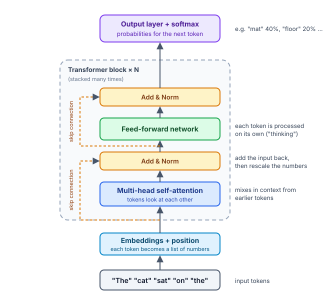
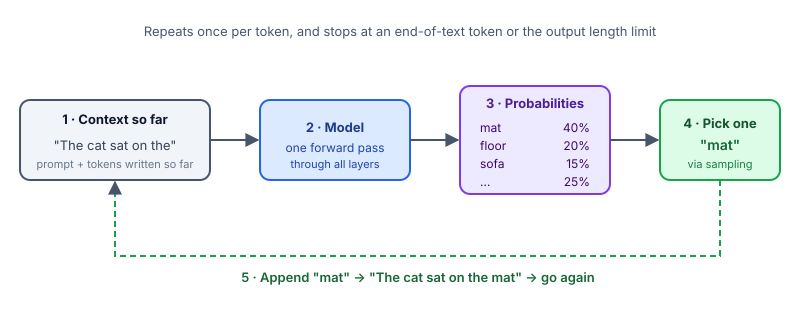

# Transformers & Large Language Models

**Chapter 3 · Transformers & LLMs**

A large language model (LLM) like ChatGPT, Claude, or Gemini looks like magic, but underneath it does one surprisingly simple job over and over: it guesses the next small piece of text. This chapter opens the box. You will see how text becomes numbers, how "attention" lets words look at each other, how the transformer architecture stacks these ideas together, and how the model writes a whole answer one token at a time. No math background needed — every formula comes with plain words and a tiny worked example.

## 1. What a Language Model Actually Does

A **language model** is a program that, given some text, predicts what text is likely to come next. That is the whole job. Everything else — answering questions, writing code, translating, summarizing — emerges from doing this one job extremely well.

> **📘 In plain words:** An LLM is a super-powered autocomplete. Your phone suggests the next word from a few options; an LLM scores *every* possible next piece of text, using everything written so far, and has learned those scores from a huge amount of reading.

### Next-token prediction

The model does not output one answer directly. It outputs a **probability** for every possible next token (a token is a word or a piece of a word — see section 2). Then one token is picked, added to the text, and the process repeats.

> **💡 Example:** Give the model the text `The cat sat on the`. Internally it produces a score for each of the tens of thousands of tokens it knows. After converting the scores to probabilities, the top of the list might look like this (illustrative numbers):

| Next token | Probability |
|---|---|
| ` mat` | 40% |
| ` floor` | 20% |
| ` sofa` | 15% |
| ` bed` | 10% |
| ` roof` | 8% |
| everything else | 7% |

All the probabilities add up to 100%. "Mat" is most likely because the model has seen "the cat sat on the mat" many times; "roof" is possible but less common. The model never "looks up" an answer — it only knows which continuations are likely given what it learned in training (covered in [Chapter 4](training.md)).

> **⚠️ Common misconception:** "The model searches a database of facts." It does not. A plain LLM has no database. Its knowledge is stored indirectly in its **parameters** (the billions of weights you met in [Chapter 2](neural-networks.md)), and it reconstructs answers from patterns. That is why it can be fluent and still wrong.

> **✅ Key takeaway:** An LLM is a next-token predictor. Long, smart-looking answers are built from many single next-token guesses chained together.

## 2. Tokens: How Text Becomes Numbers

Neural networks only work with numbers. So the first step is to chop text into pieces called **tokens** and give each piece an ID number. The tool that does this is the **tokenizer**, and its list of known pieces is the **vocabulary**. For example, GPT-2's vocabulary had 50,257 tokens; newer models often use larger vocabularies (Meta's Llama 3 uses about 128,000).

### Why not just use whole words or single letters?

- **Whole words:** the vocabulary would be enormous (every name, typo, and new word), and unknown words would break the model.
- **Single letters:** every text becomes very long, which makes the model slow and makes learning meaning harder.
- **Sub-word pieces (the winner):** common words get one token, rare words are built from a few pieces. Nothing is ever "unknown", because in the worst case a word can be spelled out from tiny pieces.

### Byte Pair Encoding (BPE) — the intuition

<!-- optional -->

Most modern tokenizers use a method called **Byte Pair Encoding (BPE)** or a close relative. The idea:

1. Start with single characters (or bytes) as the vocabulary.
2. Look through a giant pile of training text and find the pair of neighbors that appears most often, for example `t` + `h`.
3. Merge that pair into a new token `th` and add it to the vocabulary.
4. Repeat thousands of times: `th` + `e` → `the`, `ing`, ` the`, and so on.

Frequent chunks end up as single tokens; rare words stay split into several pieces.

> **💡 Example:** A tokenizer *might* split the sentence `Tokenization isn't magic!` like this (the exact split depends on the specific tokenizer):
>
> `Token` · `ization` · ` isn` · `'t` · ` magic` · `!`
>
> That is 6 tokens for 25 characters. Notice that spaces usually attach to the *start* of the following word (` magic`), and that a long word like "Tokenization" becomes two pieces.

### Rules of thumb

OpenAI's help center gives these rough estimates for **English** text ([source](https://help.openai.com/en/articles/4936856-what-are-tokens-and-how-to-count-them)):

- 1 token ≈ 4 characters
- 1 token ≈ ¾ of a word
- 100 tokens ≈ 75 words

So a 1,500-word article is roughly 1,500 ÷ 0.75 ≈ 2,000 tokens.

**Other languages and code usually differ.** Tokenizers are trained mostly on English-heavy text, so English words tend to be stored as whole tokens. Text in many other languages (especially ones with non-Latin scripts) is often split into more, smaller pieces — the same sentence can cost noticeably more tokens. Code is also different: indentation, brackets, and unusual variable names can all become separate tokens.

> **🎯 Try it:** Paste a sentence into the [OpenAI Tokenizer](https://platform.openai.com/tokenizer) and watch it get colored into tokens. Then try the same sentence in another language, a long URL, and a few lines of code. Compare the token counts.

> **⚠️ Common misconception:** "The model sees letters." It sees token IDs. That is why LLMs sometimes struggle with letter-level tasks like counting the `r`s in "strawberry" — the word may be just one or two tokens, and the individual letters are not directly visible to the model.

Tokens matter in everyday use because **models are priced and limited in tokens**. See [Chapter 8: Tokens & Cost](tokens.md) for the practical side.

## 3. Embeddings: Words as Points in Space

A token ID like `4523` is just a label — the number itself means nothing. The model's first layer swaps each ID for an **embedding**: a long list of numbers (a **vector**) that represents the token's meaning. The original transformer used 512 numbers per token; large modern models use thousands.

> **📘 In plain words:** Imagine a giant map where every word has a location. Words with similar meanings are placed close together: "cat" near "dog", "Paris" near "London". An embedding is a word's coordinates on that map — only the map has hundreds or thousands of directions instead of two.

The model is not told where to put words. It **learns** the positions during training, because placing similar words near each other helps it predict the next token.

### Measuring similarity

To check whether two embeddings are "close", a common measure is **cosine similarity**: it compares the *direction* two vectors point in. A value near 1 means "very similar direction", near 0 means "unrelated".

```
cosine_similarity(a, b) = (a · b) / (|a| × |b|)

a · b  = multiply matching numbers and add them up (the "dot product")
|a|    = the length of vector a = square root of (sum of each number squared)
```

> **💡 Example:** Use a toy 2-number embedding where the first number means "animal-ness" and the second means "machine-ness":
>
> `cat = [0.9, 0.1]`, `dog = [0.8, 0.2]`, `car = [0.1, 0.9]`
>
> **cat vs dog:** dot product = 0.9×0.8 + 0.1×0.2 = 0.74. Lengths: |cat| = √(0.81 + 0.01) ≈ 0.906, |dog| = √(0.64 + 0.04) ≈ 0.825. Similarity = 0.74 ÷ (0.906 × 0.825) ≈ **0.99** — nearly identical direction.
>
> **cat vs car:** dot product = 0.9×0.1 + 0.1×0.9 = 0.18. Similarity = 0.18 ÷ (0.906 × 0.906) ≈ **0.22** — mostly unrelated.

Real embeddings have no human-readable labels like "animal-ness"; the directions are learned and usually mix many ideas at once. But the "closeness" idea is exactly the same, and it powers features like semantic search (see [Chapter 7](connecting-ai.md)).

### The famous king − man + woman example

<!-- optional -->

Researchers working on earlier word embeddings (word2vec, [Mikolov et al., 2013](https://arxiv.org/abs/1301.3781)) found that directions in the space can capture relationships. Taking the vector for **king**, subtracting **man**, and adding **woman** lands close to **queen**.

```
king − man + woman ≈ queen
```

In words: "the difference between king and man" is roughly a "royalty" direction; adding it to "woman" points at a royal woman.

> **⚠️ Common misconception:** "Embedding arithmetic always works this neatly." The king/queen example is a famous best case from older word-level embeddings. Real embedding spaces are messier, and many analogies only *roughly* work.

## 4. Keeping Track of Word Order

"Dog bites man" and "man bites dog" contain the same tokens but mean very different things. As you will see in the next section, attention compares every token with every other token at once — on its own it has no idea which token came first. So transformers add **positional information** to each embedding.

- The original transformer added a fixed wave-like pattern (sine and cosine values) to each position's embedding, so position 1, position 2, and so on each get a unique "stamp".
- Many modern models use **RoPE (rotary position embedding)**, which encodes position by slightly *rotating* the vectors depending on where the token sits ([Su et al.](https://arxiv.org/abs/2104.09864)). It helps the model reason about *relative* distance ("these two words are 3 apart").

> **📘 In plain words:** Before the words enter the main network, each one gets a seat number. Without seat numbers, the model would see a bag of words instead of a sentence.

## 5. Attention: How Words Look at Each Other

This is the key idea that made modern LLMs possible, introduced in the 2017 paper ["Attention Is All You Need"](https://arxiv.org/abs/1706.03762).

The meaning of a word depends on its neighbors. "Bank" means something different in "river bank" and "bank account". **Attention** lets each token gather information from the other tokens in the text, so its numbers can be updated with context.

> **📘 In plain words:** Picture a stage with every word as an actor. When it is one word's turn, it shines a **spotlight** on the other words — brightly on the ones that matter for understanding it, dimly on the rest — and then blends in what it sees. That spotlight is attention.

### A worked example: what does "it" refer to?

Take the sentence:

**"The animal didn't cross the street because it was tired."**

To understand "it", the model must work out that "it" means **the animal**, not the street (streets do not get tired). In a trained model, when processing "it", the attention spotlight shines brightly on "animal". Change one word — "...because **it** was too wide" — and the spotlight shifts toward "street". The "tired" version of this sentence is visualized in Jay Alammar's [Illustrated Transformer](https://jalammar.github.io/illustrated-transformer/).

**Self-attention** simply means the words attend to other words in the *same* text (as opposed to attending to a separate text, like a source sentence during translation).

### Queries, keys, and values

How does a token decide where to point its spotlight? Each token's embedding is turned into three new vectors, using weights learned in training:

| Vector | Plain-words role | Library analogy |
|---|---|---|
| **Query (Q)** | "What am I looking for?" | the question you type into a library search |
| **Key (K)** | "What do I contain?" | the label on each book's spine |
| **Value (V)** | "What information do I hand over?" | the actual content of the book |

Each token compares its **query** with every other token's **key**. A good match means "pay attention to this one". Then it takes a weighted blend of the matching tokens' **values**.

The formula from the paper:

```
Attention(Q, K, V) = softmax( Q · Kᵀ / √d ) · V
```

In words:

1. **Q · Kᵀ** — score how well my query matches each key (a dot product: multiply and add).
2. **÷ √d** — divide by the square root of the vector size `d`, which keeps the scores from getting too large.
3. **softmax** — turn the scores into percentages that add up to 100% (the spotlight brightness).
4. **· V** — blend the values using those percentages.

> **💡 Example:** A tiny version with 2-number vectors (d = 2, so √d ≈ 1.41). The query for "it" is `[2, 1]`. Three keys:
>
> | Token | Key | Query · Key | ÷ 1.41 |
> |---|---|---|---|
> | animal | `[2, 1]` | 2×2 + 1×1 = 5 | 3.54 |
> | street | `[0, 1]` | 2×0 + 1×1 = 1 | 0.71 |
> | tired | `[1, 1]` | 2×1 + 1×1 = 3 | 2.12 |
>
> Softmax turns `3.54, 0.71, 2.12` into roughly **76.8% animal, 4.5% street, 18.7% tired**. So the new vector for "it" is built mostly from the value of "animal" — the model has linked "it" to "the animal".

**Softmax** itself just means: raise *e* (≈ 2.718) to the power of each score, then divide each result by their total. Bigger scores grow much bigger, so the best match dominates.

> **🎬 Watch:** 3Blue1Brown's video series on [transformers and attention](https://www.3blue1brown.com/topics/neural-networks) animates queries, keys, and values beautifully.

### Masking: no peeking at the future

When a model like GPT is trained to predict the next token, a token is only allowed to attend to tokens **before** it. Otherwise it could just "look ahead" at the answer. This is called **causal masking**.

## 6. Multi-Head Attention

One spotlight can only focus on one kind of relationship at a time. So transformers run several attention operations in parallel, called **heads**. The original transformer used 8 heads; large models use dozens.

> **📘 In plain words:** Instead of one reader, you have a team of readers going over the same sentence at once. One tracks "who did what", another tracks "which noun does this pronoun mean", another tracks grammar or nearby words. Their notes are then combined.

Researchers have found heads that appear to specialize (for example, heads that track the previous token or copy patterns), but most heads do not map cleanly onto human concepts. Each head learns whatever turns out to be useful for predicting the next token.

## 7. The Transformer Block

A transformer is built from one repeating unit — the **transformer block** — stacked many times (the original paper used 6; large modern models use around 30 to over 100). Each block has four parts:

1. **Multi-head self-attention** — tokens gather context from each other.
2. **Add & Norm** — add the block's input back to the attention output (a **residual** or **skip connection**), then **layer normalization** rescales the numbers to a steady range.
3. **Feed-forward network** — a small neural network (exactly like the ones in [Chapter 2](neural-networks.md)) applied to each token separately. This is where much of the model's stored knowledge appears to live.
4. **Add & Norm** again.

(This is the order used in the original paper. Most modern LLMs apply the normalization *before* the attention and feed-forward parts instead — called "pre-norm" — which makes very deep stacks easier to train. The ingredients are the same.)



*Figure 1 — A decoder-style transformer. Each block lets tokens share context (attention), then thinks about each token on its own (feed-forward). Dashed lines are skip connections.*

### Why the skip connections?

A skip connection means each block only needs to learn a *change* to add to its input, instead of rebuilding everything from scratch. This keeps the signal (and the gradients during [backpropagation](neural-networks.md)) flowing cleanly through very deep stacks. Without them, deep networks are much harder to train.

### The output layer

After the last block, an output layer turns the final vector of the **last** token into a score for every token in the vocabulary, and softmax turns those scores into the probabilities you saw in section 1.

> **✅ Key takeaway:** Attention = "look around and gather context". Feed-forward = "think about what you gathered". Repeat dozens of times, and each layer builds a richer understanding than the last.

## 8. Three Shapes of Transformer

<!-- optional -->

The original 2017 transformer had two halves: an **encoder** that reads the input and a **decoder** that writes the output (it was built for translation). Later models kept one or both halves.

| Shape | Sees | Good at | Famous example |
|---|---|---|---|
| **Decoder-only** | only earlier tokens (causal mask) | generating text, chat, code | GPT series (OpenAI), Llama, Gemini |
| **Encoder-only** | the whole text in both directions | understanding: classification, search embeddings | BERT ([Google, 2018](https://arxiv.org/abs/1810.04805)) |
| **Encoder-decoder** | encoder sees all input; decoder writes output | text-to-text: translation, summarization | T5 ([Google, 2019](https://arxiv.org/abs/1910.10683)) |

- **BERT** was trained by hiding random words and asking the model to fill in the blanks using words on *both* sides. Great for understanding, but not built to write long text.
- **GPT**-style models only predict the next token from the left. That simple setup scales extremely well and is what nearly all chat assistants use today.
- **T5** framed every task as "text in, text out", e.g. `translate English to German: Hello` → `Hallo`.

> **📘 In plain words:** Encoder = a careful reader. Decoder = a writer. Encoder-decoder = a reader who hands notes to a writer. Today's chatbots are writers that have read a *lot*.

The Hugging Face [LLM course](https://huggingface.co/learn/llm-course) has a clear chapter comparing these three families.

## 9. The Generation Loop

An LLM writes its answer **one token at a time**. Each new token requires a full pass through the whole network.

1. Start with the context (your prompt plus anything already written).
2. Run it through the model → get probabilities for the next token.
3. **Pick** one token (see sampling in the next section).
4. Append it to the context.
5. Go back to step 2. Stop when the model produces a special **end-of-text token** or hits the maximum output length.



*Figure 2 — Generation is a loop. A 500-token answer means 500 trips around this loop.*

This is why answers appear word-by-word when **streaming** is on: you are literally watching the loop run. It also explains why output tokens are usually priced higher than input tokens — each output token needs its own pass, while the prompt can be processed in one go.

> **⚠️ Common misconception:** "The model plans the whole answer, then types it out." There is no hidden finished draft. Each token is chosen based only on the tokens before it. (Models do develop internal representations that look ahead somewhat, but the text is still committed one token at a time.)

## 10. Sampling: Choosing the Next Token

The model gives probabilities; a **sampling strategy** decides which token actually gets picked. These are the settings you see in many APIs.

### Greedy decoding

Always pick the single most likely token. With the "cat sat on the" example, greedy always picks ` mat`. It is predictable, but on long texts it can become repetitive and dull.

### Temperature

**Temperature** reshapes the probabilities before picking. The model's raw scores (called **logits**) are divided by the temperature `T` before softmax:

```
p(token) = e^(score / T) / sum over all tokens of e^(score / T)
```

- `T` below 1 → sharper: the favorite becomes even more likely (more focused, more repeatable).
- `T` = 1 → the model's original probabilities.
- `T` above 1 → flatter: unlikely tokens get more chances (more varied, more random).
- `T` near 0 → effectively greedy.

> **💡 Example:** Three candidate tokens with raw scores `mat = 2.0`, `floor = 1.0`, `sofa = 0.5`.
>
> | Temperature | mat | floor | sofa |
> |---|---|---|---|
> | T = 0.5 (scores become 4, 2, 1) | **84%** | 11% | 4% |
> | T = 1.0 (scores stay 2, 1, 0.5) | **63%** | 23% | 14% |
> | T = 2.0 (scores become 1, 0.5, 0.25) | **48%** | 29% | 23% |
>
> Check T = 1: e² ≈ 7.39, e¹ ≈ 2.72, e^0.5 ≈ 1.65; total ≈ 11.76; so mat = 7.39 ÷ 11.76 ≈ 63%. Lower temperature makes "mat" dominate; higher temperature spreads the chances out.

### Top-k

Keep only the **k** most likely tokens, throw the rest away, rescale to 100%, then pick randomly among them.

> **💡 Example:** With the section 1 probabilities (mat 40%, floor 20%, sofa 15%, bed 10%, roof 8%, other 7%) and **top-k = 2**, only mat and floor survive. Rescaled: mat = 40 ÷ 60 ≈ **67%**, floor = 20 ÷ 60 ≈ **33%**.

### Top-p (nucleus sampling)

Keep the smallest group of top tokens whose probabilities **add up to at least p**, then rescale and pick. Unlike top-k, the group size adapts: when the model is confident, only one or two tokens qualify; when it is unsure, more do.

> **💡 Example:** Same probabilities, **top-p = 0.75**. Add from the top: mat 40% → 60% with floor → 75% with sofa. That reaches 0.75, so keep {mat, floor, sofa}. Rescaled: mat ≈ **53%**, floor ≈ **27%**, sofa = **20%**. "Bed", "roof", and the long tail can no longer be picked.

### Which to use?

| Goal | Typical setting |
|---|---|
| Facts, extraction, code, classification | low temperature (around 0–0.3) |
| Everyday chat and writing | default settings (often temperature around 0.7–1) |
| Brainstorming, creative variety | higher temperature, top-p around 0.9–1 |

Provider docs usually recommend adjusting temperature **or** top-p, not both at once. Some newer models (especially reasoning models) ignore or restrict these settings, so check the model's documentation.

> **⚠️ Common misconception:** "Temperature 0 makes the model always correct." It only makes the choice of token less random. A confident wrong answer is still wrong — and even at temperature 0, outputs are not always perfectly identical between runs because of tiny numerical differences on the servers.

## 11. The Context Window

The **context window** is the maximum number of tokens the model can consider at once — your instructions, the conversation history, any pasted documents, **and** the answer it is writing all count. Current models range from a few thousand tokens to over a million; for example, Meta's Llama 3.1 supports 128,000 tokens ([model card](https://github.com/meta-llama/llama-models/blob/main/models/llama3_1/MODEL_CARD.md)).

> **📘 In plain words:** The context window is the model's desk. Everything it can "see" right now has to fit on the desk. Anything that falls off the edge (for example, very old messages in a long chat) is simply gone for that request.

### Why is it limited?

- **Attention compares every token with every other token.** With `n` tokens that is about `n × n` comparisons. 1,000 tokens → about 1 million pairs; 10,000 tokens → about 100 million pairs. Ten times the text means roughly a hundred times the attention work (engineering tricks reduce this, but long contexts stay expensive).
- **Memory grows with length** (see the KV cache below).
- **Training:** a model only handles lengths it has been trained or adapted to handle well.

### Cost grows with length

You pay for every input token on **every** request. In a chat, the whole conversation is usually re-sent each turn, so turn 20 costs much more than turn 1. Long contexts are also slower to start answering.

### "Lost in the middle"

A bigger window does not mean the model uses all of it equally well. The study ["Lost in the Middle"](https://arxiv.org/abs/2307.03172) (Liu et al., 2023) found that models were often best at using information near the **beginning or end** of a long context, and performance dropped significantly when the key information sat in the **middle**. Newer models have improved, but it is still wise to put the most important instructions and facts at the start or end.

> **⚠️ Common misconception:** "The model remembers our earlier chats." A plain model has no memory between requests. Chat apps create the *feeling* of memory by re-sending the conversation (and sometimes saved notes) inside the context window every time.

## 12. The KV Cache

<!-- optional -->

Recall the generation loop: every new token needs a pass through the model, and attention needs the **keys** and **values** of all earlier tokens. Recomputing those for the whole text at every step would be wasteful — the earlier tokens have not changed.

The **KV cache** (key-value cache) stores the keys and values of tokens already processed. Each new step only computes them for the **one new token** and reuses the rest.

> **💡 Example:** Writing token number 1,001 *without* a cache means recomputing keys and values for all 1,000 earlier tokens again. *With* a cache, it computes them for just 1 token and reads the other 1,000 from memory.

The trade-off: the cache uses GPU memory that grows with context length (and with the number of users served at once), which is one reason long contexts are expensive to serve. A related idea, **prompt caching**, lets providers reuse the processed start of a prompt across requests and often charge less for those cached tokens — see [Chapter 8](tokens.md).

## 13. Why LLMs Hallucinate

A **hallucination** is when a model states something false or made-up with full confidence — a fake citation, a wrong date, a non-existent function name. It is a natural side-effect of how LLMs work:

1. **Trained for plausible, not verified, text.** Pretraining rewards predicting text that *looks* like the training data. A fluent, plausible-sounding answer scores well whether or not it is true.
2. **Guessing is often rewarded.** OpenAI's research on [why language models hallucinate](https://openai.com/index/why-language-models-hallucinate/) argues that common training and evaluation setups reward a confident guess over saying "I'm not sure", much like a multiple-choice test with no penalty for wrong answers.
3. **Rare facts are fuzzy.** Facts seen thousands of times in training are reproduced reliably; facts seen once or twice (a small company's founding date, a niche paper's authors) are stored weakly, so the model fills gaps with likely-sounding details.
4. **No built-in fact check.** The model has no internal database to verify against — only the patterns in its weights and whatever is in the context window.
5. **Knowledge cutoff.** The model knows nothing after its training data ends (see [Chapter 4](training.md)), but it may still answer as if it does.
6. **Sampling randomness** can occasionally pick a less likely — and wrong — token, and the following tokens then build on that mistake.

> **⚠️ Common misconception:** "If it sounds confident, it is probably right." Confidence of tone is not evidence. LLMs sound equally confident when right and wrong.

> **✅ Key takeaway:** Reduce hallucinations by **grounding** the model — give it the source material in the prompt (or via retrieval, RAG), ask it to quote or cite that material, explicitly allow it to admit uncertainty, and verify important facts. See [Chapter 7](connecting-ai.md) and [Chapter 9](best-practices.md).

## 14. Multimodal Models

<!-- optional -->

A **multimodal** model can take in (and sometimes produce) more than text: images, audio, even video. The trick is to turn every kind of input into token-like vectors that the same transformer can process.

- **Images:** the picture is cut into small square **patches** (the Vision Transformer paper, ["An Image is Worth 16x16 Words"](https://arxiv.org/abs/2010.11929), used 16×16-pixel patches). Each patch is converted into an embedding and treated like a token. A larger or more detailed image produces more tokens.
- **Audio:** sound is turned into a picture-like representation of frequencies over time (a spectrogram), then chopped into chunks that become embeddings — the approach used by OpenAI's [Whisper](https://arxiv.org/abs/2212.04356) speech model.
- **Output:** some models can also generate images or speech, either directly as tokens or by handing off to a specialized generator.

> **📘 In plain words:** To a multimodal model, a photo is just another "sentence" — made of image patches instead of word pieces. Once everything is a sequence of vectors, attention can relate a word in your question to a region of the picture.

Because images and audio become tokens, they **count against the context window and cost** just like text.

## 15. Reasoning Models

Some recent models — for example OpenAI's o-series and later GPT models ([Learning to reason with LLMs](https://openai.com/index/learning-to-reason-with-llms/)), DeepSeek-R1 ([paper](https://arxiv.org/abs/2501.12948)), and Claude or Gemini models with "thinking" modes — are trained to **think before they answer**.

Conceptually, a reasoning model is still a next-token predictor. The difference is that before writing the final answer, it generates a long stream of extra **reasoning tokens**: breaking the problem down, trying an approach, checking it, backtracking. These models are typically trained with **reinforcement learning** on problems whose answers can be checked (math, code tests, logic puzzles), so the model is rewarded for reasoning paths that actually reach correct answers.

> **💡 Example:** Asked "A bat and a ball cost $1.10 in total; the bat costs $1.00 more than the ball. How much is the ball?", a fast model may blurt the intuitive "10 cents". A reasoning model's hidden thinking might go: *"If the ball is 0.10, the bat is 1.10, total 1.20 — too much. Let ball = x, bat = x + 1.00, so 2x + 1.00 = 1.10, x = 0.05."* Then it answers **5 cents**.

Trade-offs to know:

- **Better** at multi-step math, coding, planning, and tricky logic.
- **Slower and more expensive:** reasoning tokens are generated just like normal tokens. OpenAI and Anthropic both bill reasoning (thinking) tokens as **output tokens**, even when they are hidden or summarized ([OpenAI reasoning guide](https://developers.openai.com/api/docs/guides/reasoning), [Anthropic thinking pricing](https://platform.claude.com/docs/en/build-with-claude/thinking-steering-and-cost#pricing)).
- **Overkill** for simple tasks like rewording a sentence or extracting a name.

> **⚠️ Common misconception:** "The thinking text is exactly how the model reached its answer." The visible reasoning (when shown) is helpful, but research shows it is not always a faithful record of the computation inside the network. Treat it as a useful explanation, not a guaranteed one.

## Recap

- An LLM predicts the **next token** from probabilities over its whole vocabulary; long answers are many single predictions chained together.
- **Tokens** are sub-word pieces (often built with BPE). In English, 1 token ≈ 4 characters ≈ ¾ word; other languages and code often need more tokens.
- **Embeddings** place tokens as points in a high-dimensional space where similar meanings sit close together.
- **Positional information** tells the model word order.
- **Self-attention** lets each token gather context from others using **queries, keys, and values**; **multi-head** attention runs many of these in parallel.
- A **transformer block** = attention + feed-forward, each with a skip connection and layer norm, stacked many times.
- **Decoder-only** (GPT) models generate; **encoder-only** (BERT) models understand; **encoder-decoder** (T5) models transform text to text.
- Generation is a **loop**, one token per pass. **Temperature, top-k, and top-p** control how the next token is picked.
- The **context window** limits how much the model sees; cost grows with length, and information in the middle can be used less well. The **KV cache** avoids recomputing earlier tokens.
- **Hallucinations** come from training for plausible text, rewarded guessing, weakly stored facts, and no built-in fact check.
- **Multimodal** models turn images and audio into tokens; **reasoning** models spend extra thinking tokens to solve harder problems.

## Check Your Understanding

**1. What is the basic job a large language model performs over and over?**

- A) Looking up answers in a database of facts
- B) Predicting the probabilities of the next token
- C) Translating text into a fixed set of commands
- D) Searching the internet for matching pages

> **✅ Answer:** B — An LLM predicts a probability for every possible next token, picks one, and repeats. A plain LLM has no fact database or live internet access.

**2. Roughly how many tokens is a 750-word English text?**

- A) About 250
- B) About 560
- C) About 1,000
- D) About 3,000

> **✅ Answer:** C — Using the rule of thumb 1 token ≈ ¾ of a word, 750 ÷ 0.75 ≈ 1,000 tokens. Other languages or code would usually need more.

**3. In self-attention, what does a token's *query* do?**

- A) It stores the token's final output text
- B) It describes what the token is looking for, and is compared with other tokens' keys
- C) It records the token's position in the sentence
- D) It decides the temperature for sampling

> **✅ Answer:** B — The query is "what am I looking for?". It is matched against each token's key to decide how much attention to pay, and the matching tokens' values are blended in.

**4. With probabilities mat 40%, floor 20%, sofa 15%, bed 10%, roof 8%, other 7%, which tokens remain under top-p = 0.75?**

- A) Only mat
- B) Mat and floor
- C) Mat, floor, and sofa
- D) All of them

> **✅ Answer:** C — Adding from the top: 40% + 20% + 15% = 75%, which reaches p = 0.75. Those three are kept and rescaled; the rest are removed.

**5. Why do long prompts cost more and run slower?**

- A) Every input token is processed and billed, and attention work grows roughly with the square of the length
- B) Long prompts switch the model to a larger version
- C) The model must download each document from the web
- D) Long prompts always use a higher temperature

> **✅ Answer:** A — Each token in the context is billed and processed, attention compares tokens pairwise (about n × n comparisons), and the KV cache memory grows with length.

[← Chapter 2: Neural Networks](neural-networks.md) · [Chapter 4: Training & Tuning →](training.md)
