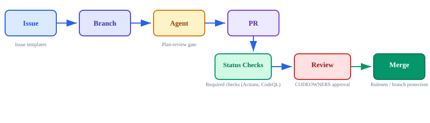

# Domain 1: Agent Architecture & SDLC (Software Development Lifecycle) Processes

**Domain 1 · Weight: 15–20%**

Learn how to design agent workflows that integrate safely into software delivery — defining planning vs execution boundaries, configuring governance, and building reliable, observable agent systems that your team can trust.

Official module: [Designing Agent Architecture and SDLC Integration](https://learn.microsoft.com/en-us/training/modules/design-agent-architecture-integration/)

## What You'll Learn & Why It Matters

- **Where an AI agent fits in day-to-day software work** — which steps it can safely do (fix, test, document) and which stay with people (roadmap, production go/no-go).
- **How to write a task an agent can actually finish** — clear inputs, a concrete deliverable, and success criteria a machine can check.
- **Why the plan and the action must be separate** — so a person can say "yes, do that" before anything in the repository changes.
- **How GitHub itself keeps agents in check** — pull requests, required checks, CODEOWNERS, rulesets, and environments act as the guard rails.
- **How much freedom to give an agent** — matching tool access and approvals to the risk of the files it touches.
- **How to see what an agent did afterwards** — logs, artifacts, and commit history that let anyone reconstruct the work.

Why it matters: this domain is 15–20% of the exam, and the same ideas (least privilege, reviewable plans, evidence over confidence) come back in every other domain.

**Prerequisites:** you should know what a repository, branch, commit, pull request, and GitHub Actions workflow are. If any of those are new, read [Fundamentals](basics.md) first.

## Official Skills Measured

From the [GH-600 study guide](https://learn.microsoft.com/en-us/credentials/certifications/resources/study-guides/gh-600) — *Prepare agent architecture and SDLC processes (15–20%)*:

**Integrate agents into the software development lifecycle (SDLC)**

- Identify steps for agents to perform → see [1. Agent Responsibilities in the SDLC](#1-agent-responsibilities-in-the-sdlc)
- Identify and mitigate common anti-patterns in agents → see [2. Anti-Patterns to Recognize](#2-anti-patterns-to-recognize)
- Define inputs, outputs, and success criteria for agents → see [3. Input, Output & Success Criteria](#3-input-output-success-criteria)

**Define boundaries between planning, reasoning, and action**

- Configure agent planning to be distinct from agent execution → see [4. Planning vs Execution Separation](#4-planning-vs-execution-separation)
- Configure an agent to output a structured plan → see [Configuring an Agent to Output a Structured Plan](#configuring-an-agent-to-output-a-structured-plan)
- Validate agent plans → see [Validating Agent Plans](#validating-agent-plans)
- Prevent agent action until the agent checked and approved → see [Enforcing planning boundaries](#enforcing-planning-boundaries) and [Built-in Approval Gates for Copilot Cloud Agent](#built-in-approval-gates-for-copilot-cloud-agent)

**Configure observability and control for autonomous agents**

- Plan and implement the degree of agent autonomy, including guardrails → see [5. Autonomy Levels](#5-autonomy-levels)
- Configure agent to produce inspectable artifacts within standard development tooling → see [Inspectable Artifacts and the Audit Trail](#inspectable-artifacts-and-the-audit-trail)
- Configure human intervention for autonomous agents without slowing delivery → see [Human Intervention Without Slowing Delivery](#human-intervention-without-slowing-delivery)

## 1. Agent Responsibilities in the SDLC

Let's start with the big picture. An **agentic AI system** is not a chatbot that answers questions — it's a system that plans, takes actions against real repositories and infrastructure, and evaluates the results.

A few terms you'll see everywhere in this domain:

- **SDLC (Software Development Lifecycle):** the stages work goes through from idea to running software — plan, build, test, release, operate.
- **PR (pull request):** a proposal to merge the changes on one branch into another (usually `main`). People review it and automated checks run on it before it can be merged.
- **CI (continuous integration):** automated builds and tests that run on every change. On GitHub, CI runs as **GitHub Actions workflows**.
- **Branch:** a separate line of commits, so work in progress doesn't affect `main` until a PR merges it.

> **📘 In plain words:** Think of an agent as a capable new contractor on your team. You give them a work order (the task), they write down how they'll do it (the plan), do the work in their own workspace (a branch), and hand it in for inspection (a PR with test results). They never get the keys to production on day one, and their work is inspected exactly like everyone else's.

### Assistant vs Agent and the Plan → Act → Evaluate Loop

The [Foundations module](https://learn.microsoft.com/en-us/training/modules/foundations-agentic-ai/2-define-agentic-ai) draws the line like this:

| | Assistant | Agent |
|---|---|---|
| Control | Reactive: the user decides each next step | Goal-driven: keeps a goal across multiple steps and decides intermediate actions |
| Output | Suggestions, explanations, summaries | Durable artifacts: branches, commits, pull requests |
| Tools | Doesn't take repository actions | Uses tools (GitHub API, CI workflows, repo writes) |
| Feedback | User applies each step manually | Iterates on checks, reviews, and scans |

An agent doesn't replace the workflow — it **enters the workflow as a participant**, visible through branches/commits, pull requests, workflow checks, and review comments.

The steps an agent performs follow the [plan → act → evaluate lifecycle](https://learn.microsoft.com/en-us/training/modules/foundations-agentic-ai/3-explain-agent-lifecycle-plan-act-evaluate), which is a **loop**, not a one-time sequence:

- **Plan:** interpret the goal and produce a structured, reviewable plan (PR description, linked issue/checklist) with scope, success criteria, and a rollback or escalation path.
- **Act:** create a branch, change files, push commits, open/update a PR, respond to review feedback — bounded to one repository, a branch, and PR workflows.
- **Evaluate:** use system signals — workflow runs and status checks, review feedback, and security signals (code scanning, secret scanning, dependency alerts). Evaluation must be grounded in **system signals, not the agent's confidence**.

If checks fail or requirements aren't met, the loop continues: revise the plan, adjust the change, re-evaluate — or hand off to a human.

> **📘 Teaching Tip:** In a well-designed system every phase is visible: the plan is inspectable, action is bounded to repository workflows, and evaluation uses objective signals. If any one is missing, trust degrades.

The official module simplifies the SDLC into four stages and maps each to a GitHub surface where work and evidence are recorded:

| SDLC stage | Typical agent responsibility in GitHub | Primary artifact |
|---|---|---|
| Planning | Draft scope, plan steps, define success criteria | GitHub Issues, PR descriptions/comments, Agents tab |
| Implementation | Create branch, make changes, open/update PR | Branch, commits, pull request |
| Validation | Run checks, attach artifacts, iterate on failures | Workflow runs, checks, artifacts |
| Deployment | Usually restricted; require approvals for sensitive actions | Environments and deployment approvals |

Most teams start by scoping agents to the **implementation and validation** stages, where pull requests and workflows provide natural control points. The design boundary is: **agents propose; humans and policy accept.**

The exam wants you to understand which stages are *good* for agents and which ones need human oversight. Here's the breakdown:

### Stages Where Agents Excel

- **Planning & Triage:** Agents can scan issue queues, classify bugs, suggest labels, and draft a scoped plan with success criteria. They can also research relevant code before a human picks up a ticket.
- **Implementation (Controlled):** Agents generate code, write tests, and refactor — but always inside a branch with guardrails, delivered through a pull request. They never commit directly to `main`.
- **Validation:** Agents can run CI workflows, parse build logs, detect regressions, and revise the PR branch when checks fail.
- **Release & Deploy:** Usually restricted. Agents can *prepare* releases and deployment changes, but production-impacting execution is gated behind environment approvals ("agent prepares but can't execute" for critical actions).
- **Monitoring:** Agents can watch signals, correlate alerts, and file new issues when anomaly patterns emerge.

### Stages Where Agents Are Less Suitable

- **Strategic Planning:** Agents don't decide the product roadmap. That requires human context, business judgment, and stakeholder alignment.
- **Code Review:** Agents can *assist* with review (linting, security scanning, diff analysis), but acceptance comes from humans and policy (required reviews, CODEOWNERS).
- **Incident Response (Severe):** While agents can triage, the actual decision to roll back, hotfix, or page an on-call engineer requires human judgment.
- **Production Deployments (Unsupervised):** Pushing to production without any human gate is an anti-pattern. Treat workflow and infra changes as higher risk than application code changes.

> **📘 Teaching Tip:** The exam will give you a scenario and ask: "Is this a good task for an agent?" The decision rule is: *Does the task have a clear input, a defined process, and a checkable output?* If yes, an agent can probably do it. If the success criteria are fuzzy or require human empathy, keep the human in the loop.

> **⚠️ Common mistake:** Treating an agent as "a smarter chatbot". The difference that matters for the exam is that an agent **acts** — it creates branches, commits, and PRs — so it needs the same controls as any contributor with write access.

> **🎯 Exam angle:** Scenario questions describe a task and ask whether, or how, to hand it to an agent. Reason in two steps: (1) is the task well-bounded with a checkable output? (2) which SDLC stage is it in? Implementation and validation → agent works through a PR. Deployment or severe incidents → the agent may prepare, but a human or an environment approval decides.

## 2. Anti-Patterns to Recognize

Domain 1 specifically tests your ability to **identify and mitigate common agent anti-patterns**.

An **anti-pattern** is a habit that looks reasonable at first but reliably causes problems. With agents, most anti-patterns boil down to one of two things: the agent can do *more* than it should, or people can see *less* than they need to.

> **📘 In plain words:** Handing a new contractor a master key, no work order, and then never checking their work isn't "trusting them" — it's skipping your own job. Each anti-pattern below is a version of that.

Terms used in the table:

- **`GITHUB_TOKEN`:** the short-lived credential GitHub automatically creates for each workflow run. What it can do is set by the workflow's `permissions:` block.
- **Environment:** a named deployment target (for example `production`) in repository settings that can require a person to approve before a job using it runs.
- **CODEOWNERS:** a file (`.github/CODEOWNERS`) that says which people or teams own which paths, so they're automatically asked to review changes there.
- **Rulesets / branch protection:** repository rules such as "no direct pushes to `main`" or "a PR needs one approval and passing checks before merge".
- **Required status check:** a CI check that must pass before a PR can merge.

### Official anti-patterns (Microsoft Learn)

The [Foundations module](https://learn.microsoft.com/en-us/training/modules/foundations-agentic-ai/5-identify-risks-traceability) names four common failure modes and their GitHub mitigations:

| Risk / anti-pattern | What it looks like in GitHub | Mitigation using GitHub controls |
|---|---|---|
| **Planless execution** | PR has a diff but no plan or rationale | Require a plan section via PR template; require review before merge |
| **Over-permissioned agents** | Workflows can write to repo, access secrets broadly | Least-privilege `GITHUB_TOKEN`; environments with required reviewers; restrict who can trigger workflows |
| **Hidden reasoning** | No assumptions/scope/decision trail | Require a plan, link workflow runs, record decisions in PR comments |
| **Blind trust in automation** | "CI passed, ship it" mindset | Combine checks with CODEOWNERS, required reviews, and risk-based approvals |

The Designing module adds **execution without validation**: "If an agent can bypass required checks or merge without reviews, the architecture loses its primary safety mechanisms."

### Responsibility doesn't move with execution

When an agent opens or revises a PR, it participates in the workflow but **doesn't own the outcome**. Accountability stays with the people who defined the task, set permissions, chose and configured the controls, and approved the change ([Learn](https://learn.microsoft.com/en-us/training/modules/foundations-agentic-ai/5-identify-risks-traceability)). When an agent's fix passes CI but later causes a regression, the useful question is whether the *system* made the mistake understandable and preventable: was there a visible plan and scope, were the right reviewers requested, did the checks match the risk, and can the audit trail reconstruct what happened?

### The contributor model

The [contributor model](https://learn.microsoft.com/en-us/training/modules/foundations-agentic-ai/6-apply-contributor-model-agent-generated-work) mitigates two opposite errors: **excessive suspicion** (rejecting work because AI wrote it) and **excessive trust** (accepting it because automation produced it). Review an agent PR exactly like a human PR, using this rubric:

| Check | Question |
|---|---|
| Intent | Clear goal and a visible plan? |
| Scope | Do the changed files match the plan? |
| Evidence | Required checks pass; logs/artifacts available? |
| Ownership | Did CODEOWNERS review sensitive areas? |
| Policy | Rulesets, branch rules, environments respected? |
| Fallback | Rollback or escalation clear for high-risk changes? |

A well-supervised agent contribution is **understandable, bounded, reviewable, policy-compliant, and reconstructable**.

### Additional anti-patterns (site's own framing, not from Learn)

These are useful mental models but are not named in the official modules.

#### 🔄 Autonomy Mismatch

Giving an agent *more* autonomy than a task requires — or *less* than it needs to be useful. For example, giving a code-generation agent full shell access when it only needs file-edit permissions. The result: unnecessary risk (this is the official "over-permissioned agents" anti-pattern). On the flip side, giving a monitoring agent *read-only* access when it needs to *remediate* means it can alert but never fix.

**Fix:** Match the minimum autonomy level to the task's actual risk. We'll cover autonomy levels in depth later.

#### 📋 Plan-as-Checklist

An agent generates a plan, the human approves it, and then the agent executes *exactly* what it said — even if conditions change during execution. This treats the plan as a rigid checklist instead of a set of intended outcomes.

**Fix:** The plan is a *reviewable intent*, not a fixed contract. Agents should re-evaluate against current state and flag deviations (the plan → act → evaluate loop).

#### 📈 Scope Creep

The agent starts with one task ("fix the bug in auth"), then widens into refactoring the entire auth module, adding tests, changing the database schema, and deploying a new version — all in one session without checkpointing or human approval.

**Fix:** Break large tasks into small, discrete steps. Check that "scope matches intent (no unexpected files changed)". Require human approval before crossing scope boundaries.

#### 🔇 Silent Failure

An agent encounters an error and quietly retries, gives up, or produces a degraded result without notifying anyone. This is dangerous because downstream processes depend on the agent's output.

**Fix:** Always log failures, surface them, and escalate to a human if retries are exhausted. The official safe iteration policy: if the same required check fails twice, escalate with what failed, what was attempted, what evidence exists, and the suggested next step.

> **⚠️ Exam Warning:** On the case study sections, expect scenarios involving missing plans, over-permissioned agents, or agents that skip validation. The wrong answer will sound reasonable but skip the governance step. Always pick the answer that includes **observability, required checks/reviews, or human escalation**.

> **⚠️ Common mistake:** Swinging between the two extremes the contributor model warns about — rejecting a PR *because* an agent wrote it, or approving it *because* "CI is green". Use the same rubric (intent, scope, evidence, ownership, policy, fallback) you would for a human.

## 3. Input, Output & Success Criteria

Every agent task must have **well-defined inputs, expected outputs, and measurable success criteria**. The official module defines them as:

> **📘 In plain words:** It's a recipe. *Inputs* are the ingredients and constraints ("no nuts"), the *output* is the dish you expect on the plate, and the *success criteria* are the taste test someone else can run. Without the taste test, "done" just means "the cook stopped".

- **Inputs:** what the agent needs (issue context, constraints, boundaries).
- **Outputs:** what the agent produces (plan + PR + evidence).
- **Success criteria:** how results are evaluated (checks, scans, review outcomes).

If any of these three is vague, the agent will produce unpredictable results. Here's a reference table (example thresholds are illustrative):

| Task | Input | Expected Output | Success Criteria |
|---|---|---|---|
| Classify incoming issues | Issue title + body | Label assignment, priority score | Accuracy > 90% vs human baseline |
| Generate unit tests | Source file, function signatures | Test file with assertions | Tests pass, coverage gain > 5% |
| Write PR description | Diff, commit messages | Summary, change log, testing notes | Follows team template, human approves |
| Remediate a vulnerable dependency | Security alert/issue link, allowed scope (`src/` + dependency files), constraints (no workflow changes, no secrets, no direct-to-main) | PR with structured plan, bounded changeset on an agent branch, links to workflow runs | Required checks pass, vulnerability actually resolved (incl. transitive), no unexpected files changed, rollback/escalation path recorded |
| Cut release + deploy to staging | Release tag, environment config | Deployment URL, health check pass | All smoke tests green, no rollback |

Notice the pattern: **success criteria are verifiable**. Not "make the code better" — that's not measurable. And "CI passed" is necessary but not always sufficient: make the criteria reflect the real intent ("vulnerability resolved" rather than "tests passed"). Enforce them as **required status checks** via rulesets or branch protection so success is enforced by the system, not assumed by the agent.

### Worked Example: Turning a Flaky Test Into an Agent-Ready Issue

**Scenario:** your team wants an agent to fix a **flaky test** — a test that sometimes passes and sometimes fails without any code change, usually because it depends on time, randomness, or ordering. Here's how the task moves through plan → act → evaluate.

**Step 1 — A human writes the issue.** This is the issue body you'd paste into GitHub. Each heading maps to inputs, output, or success criteria:

```markdown
## Goal
Make `tests/test_checkout.py::test_applies_discount` pass reliably.
It fails roughly 1 in 10 CI runs.

## Context (inputs)
- Failing runs: <links to 2–3 failed workflow runs>
- Suspected cause: the test depends on the current time (`datetime.now()`)
- Relevant code: `src/checkout/discount.py`, `tests/test_checkout.py`

## Constraints
- Change only files under `src/checkout/` and `tests/`
- Do not delete, skip, or add automatic retries to the test
- No new dependencies; no changes to `.github/workflows/`

## Expected output
- One PR with a filled-in Plan section, the fix, and a link to the passing workflow run

## Success criteria (verifiable)
- [ ] The test passes 20 times in a row in CI
- [ ] All other required checks pass
- [ ] Only files under `src/checkout/` and `tests/` changed
```

What each part does:

- **Goal** names one test, not "fix the tests" — the scope is obvious.
- **Context** gives the agent evidence (failing run links) and a hypothesis, so it doesn't start from zero.
- **Constraints** close the cheap loopholes: skipping or retrying the test would turn CI green without fixing anything.
- **Expected output** says exactly what the reviewer will receive.
- **Success criteria** are checkboxes a reviewer (or a workflow) can verify — "passes 20 times in a row" targets the real problem (flakiness), not just "passes once".

**Step 2 — Delegate.** Assign the issue to Copilot cloud agent. Cloud agent work can be started from an issue, a pull request, the agents panel, or a Copilot Chat conversation ([Docs](https://docs.github.com/en/copilot/concepts/agents/cloud-agent/about-cloud-agent)).

**Step 3 — Plan.** The agent writes its plan into the PR description (see the structured plan example in section 4).

**Step 4 — Act.** It works on its own `copilot/` branch, edits `src/checkout/discount.py` to accept an injectable clock, and updates the test to pass a fixed time.

**Step 5 — Evaluate.** Workflows wait until someone with write access clicks **Approve and run workflows**; then the required checks run. If the same required check fails twice, the agent stops and hands off with a summary instead of looping.

**Step 6 — Human review.** A reviewer compares changed files with the issue's constraints, checks the linked run, and merges — or requests changes.

> **⚠️ Common mistake:** Writing success criteria the agent can satisfy without solving the problem ("CI is green"). If deleting the test would meet your criteria, your criteria are wrong — add a constraint or a sharper check.

> **🎯 Exam angle:** When asked which success criterion is best, pick the one that is **verifiable by the system** and **matches the real intent** ("vulnerability resolved, including transitive dependencies"). Eliminate answers that rely on the agent's own judgment ("the agent confirms it's fixed") or on vague goals ("code quality improves").

## 4. Planning vs Execution Separation

This is one of the most important concepts in Domain 1. Reliable agent systems separate:

- **Planning:** what will be done and why.
- **Execution:** the concrete changes made to the repository.
- **Validation:** evidence that the outcome meets success criteria.

> **✅ Core Principle:** A **plan** is a **reviewable intent** — it describes what the agent proposes to do. **Execution** is the act of **changing state** — writing files, running commands, making API calls. Separation creates an opportunity to review intent before accepting impact.

> **📘 In plain words:** An architect draws a blueprint and the client signs it *before* the builders pour concrete. Changing a drawing is cheap; tearing down a wall is not. "State" here simply means what's actually in the repository (files, branches, settings) — execution is anything that changes it.

In GitHub, planning appears in a PR description, an issue comment, or a plan artifact; execution appears as commits on a branch; validation appears as checks, scans, artifacts, and review outcomes.

### Plan-first vs plan + execution

The official module describes two valid options. Both use the same GitHub controls — the difference is *when* human validation happens relative to code generation:

| | Option A: Plan-first PR | Option B: Plan + execution in the same PR |
|---|---|---|
| How | Agent opens a PR containing only the plan; reviewers approve; agent then implements | Agent opens a PR with a structured plan *and* initial commits |
| Human validation | **Before** any code is written | Code generated immediately; validation still required **before merge** |
| Use when | High-risk or hard-to-reverse changes (workflows, infra, auth, production) | Low/medium-risk, easily reversible changes where speed matters |

The choice is not *whether* work is reviewed — it always is.

### Enforcing planning boundaries

1. **Capability boundary:** planning agents are limited to read-only tools.
2. **Explicit handoff** to an implementation agent after plan approval.
3. **Tool gating** in orchestrators: run planning without tool execution, enable tools only after the plan is accepted.
4. **"Plan mode"** experiences that generate a plan artifact and pause before applying changes.

Treat "instructions not to edit" as guidance; treat tool allowlists and gates as enforcement.

> **⚠️ Common mistake:** Believing that writing "do not change any files until approved" in the agent's instructions creates a boundary. The model will *usually* follow it, but nothing stops it. A real boundary is something the platform enforces: a `tools` list without `edit`, a required reviewer on an environment, a required status check.

> **🎯 Exam angle:** "Prevent the agent from acting until the plan is approved" questions have one answer built on enforcement (read-only tools for the planner, an approval gate, required checks/reviews) and distractors built on wording (stronger instructions, bold text in a template). Choose enforcement.

### Configuring an Agent to Output a Structured Plan

A structured plan is a fixed set of sections the agent must fill in, so reviewers can compare plans and spot gaps. Two GitHub-native ways to get one:

1. **A planning custom agent whose instructions define the plan structure.** GitHub Docs' [implementation-planner](https://docs.github.com/copilot/tutorials/customization-library/custom-agents/implementation-planner) example tells the agent to always produce Markdown with *Overview* (problem, success criteria), *Technical Approach*, *Implementation Plan* (phases with tasks, complexity, dependencies), *Considerations* (assumptions, constraints, risks), and *Not Included*. You select it from the Agents tab after merging the profile to the default branch.
2. **A PR template** (section 7) with required *Plan*, *Evidence*, and *Review checklist* sections that the agent fills in.

Below is a minimal planning custom agent profile. A **custom agent profile** is a Markdown file in `.github/agents/` whose top part, between the `---` lines, is **YAML frontmatter** (YAML is a simple `key: value` text format for settings):

```markdown
<!-- .github/agents/planner.agent.md -->
---
name: planner
description: Produces a structured implementation plan; never changes code
tools: ["read", "search"]
---

Output a plan using exactly these headings:
## Goal
## Scope (paths/files)
## Steps
## Success criteria (verifiable)
## Risks and mitigations
## Rollback / escalation plan
## Out of scope
```

- `name` — how the agent appears in the agent picker.
- `description` — the only **required** field; tells people (and Copilot) what the agent is for.
- `tools: ["read", "search"]` — the agent can look at and search the code but has no `edit` or `execute` tool, so it physically can't change the repository.
- The body below the second `---` is the agent's instructions: here, a fixed list of headings every plan must use.

Here's what a filled-in plan from that agent could look like for the flaky-test issue in section 3:

```markdown
## Goal
Make test_applies_discount deterministic so it passes on every CI run.

## Scope (paths/files)
- src/checkout/discount.py
- tests/test_checkout.py

## Steps
1. Add an optional `now` parameter to `apply_discount()` (defaults to the current time).
2. Update the test to pass a fixed datetime instead of relying on the clock.
3. Run the checkout test 20 times in CI to confirm it no longer flakes.

## Success criteria (verifiable)
- test_applies_discount passes 20/20 runs; all required checks pass
- No files outside the scope above are changed

## Risks and mitigations
- Other callers of apply_discount() break → parameter is optional, existing calls unchanged

## Rollback / escalation plan
- Revert the PR; if the same check fails twice, stop and hand off with run links

## Out of scope
- Refactoring other checkout tests
```

- Every heading from the profile is present, so a reviewer can scan for gaps in seconds.
- *Scope* lists exact files — later, the reviewer compares this list with the PR's changed files.
- *Success criteria* repeat the issue's checks, tying the plan back to the task.
- *Rollback / escalation* shows the agent knows when to stop.

> **⚠️ Exam Trap:** The Docs implementation-planner example grants `edit` so it can write plan files. If the requirement is a planner that **can't** modify the repository, keep it to `read` + `search` and deliver the plan in the PR description or chat. Learn's tip: plans are most reviewable when they include **scope, success criteria, and a rollback or escalation path**.

### Validating Agent Plans

A plan is validated when a reviewer can confirm it before its impact is accepted. Turn that into enforcement, not a convention:

- **Plan gate as a required status check.** The [PR governance unit](https://learn.microsoft.com/en-us/training/modules/design-agent-architecture-integration/5-pull-request-governance-controls) shows a *Plan Gate* workflow that fails when the plan is missing; an admin marks it as a required check in a ruleset or branch protection so the PR can't merge without a plan.
- **Required PR reviews** so a human confirms the plan's intent and scope. A template alone isn't enough — it can be left blank. The most reliable combination is a **plan check as a required status check *plus* required reviews**.
- **Scope check during review:** compare the changed files against the plan's *Scope* (contributor-model rubric).

A plan gate that inspects the PR body (an illustrative variant of the Learn sample):

```yaml
# .github/workflows/plan-gate.yml
name: Plan Gate
on:
  pull_request:
    types: [opened, edited, synchronize]
    branches: [main]
permissions:
  contents: read
jobs:
  require-plan:
    runs-on: ubuntu-latest
    steps:
      - name: Require a Plan section in the PR description
        env:
          BODY: ${{ github.event.pull_request.body }}
        run: |
          if ! grep -q '^## Plan' <<< "$BODY"; then
            echo "PR description must contain a '## Plan' section."
            exit 1
          fi
```

*(Passing the body through `env` instead of inlining `${{ }}` in the script avoids script injection from PR text.)*

Reading the workflow line by line:

- `on: pull_request` with `types: [opened, edited, synchronize]` — runs when a PR is opened, its description is edited, or new commits are pushed; `branches: [main]` limits it to PRs **into** `main`.
- `permissions: contents: read` — the job's `GITHUB_TOKEN` can only read; a gate never needs write access.
- `runs-on: ubuntu-latest` — the job runs on a fresh GitHub-hosted Linux **runner** (the temporary machine that executes a job).
- `env: BODY: ...` — copies the PR description into an environment variable.
- `grep -q '^## Plan'` — looks for a line starting with `## Plan`; if it's missing, `exit 1` fails the job, which fails the check. Mark this job as a **required status check** and the PR can't merge without a plan.

### How It Works in Practice

A separated workflow in GitHub Actions looks like this. The plan workflow publishes the plan as an artifact:

```yaml
name: Agent Planning Session
on:
  workflow_dispatch:
    inputs:
      task_description:
        description: 'Describe the task for the agent'
        required: true

jobs:
  plan:
    runs-on: ubuntu-latest
    permissions:
      contents: read
    steps:
      - name: Generate plan from task
        run: |
          echo "## Agent Plan" > plan.md
          echo "### Proposed Changes" >> plan.md
          echo "1. Create src/utils/validator.py" >> plan.md
          echo "2. Add unit tests in tests/test_validator.py" >> plan.md
          echo "3. Update requirements.txt" >> plan.md
          echo "" >> plan.md
          echo "### Risk Assessment" >> plan.md
          echo "- No breaking changes expected" >> plan.md
          echo "- All new code covered by tests" >> plan.md
      - name: Upload plan as artifact
        uses: actions/upload-artifact@v4
        with:
          name: agent-plan
          path: plan.md
```

- `workflow_dispatch` with `inputs` — a person starts the run manually from the **Actions** tab and types a task description.
- `permissions: contents: read` — the planning job can't change the repository.
- The `echo ... >> plan.md` lines stand in for the agent writing its plan (in real use, an agent call would produce this file).
- `actions/upload-artifact` — saves `plan.md` as an **artifact**: a file attached to the workflow run that reviewers can download later.

A *separate* execution workflow is chained with `workflow_run`. `workflow_run` only fires when the plan workflow **completes** — it does not wait for a human. The human gate comes from an **environment with required reviewers**: the job pauses until a reviewer approves.

```yaml
name: Agent Execution
on:
  workflow_run:
    workflows: ["Agent Planning Session"]
    types: [completed]

jobs:
  execute:
    if: ${{ github.event.workflow_run.conclusion == 'success' }}
    runs-on: ubuntu-latest
    # Human gate: configure "agent-execution" with required reviewers
    environment: agent-execution
    permissions:
      contents: write
      pull-requests: write
      actions: read
    steps:
      - name: Check out repository
        uses: actions/checkout@v4
      - name: Download approved plan from the triggering run
        uses: actions/download-artifact@v4
        with:
          name: agent-plan
          run-id: ${{ github.event.workflow_run.id }}
          github-token: ${{ secrets.GITHUB_TOKEN }}
      - name: Execute agent tasks
        run: |
          # Agent generates code, writes files, runs tests
          mkdir -p src/utils
          echo '# Validator module' > src/utils/validator.py
          echo 'Execution complete'
      - name: Create Pull Request
        uses: peter-evans/create-pull-request@v6
        with:
          branch: agent-execution-${{ github.run_id }}
          title: 'Agent: Implement validator module'
          body-path: plan.md
```

- `on: workflow_run ... types: [completed]` — starts after the planning workflow finishes; it does **not** wait for a human by itself.
- `if: ... conclusion == 'success'` — skips execution if planning failed.
- `environment: agent-execution` — the actual human gate. If that environment has required reviewers, the job pauses with "Waiting for review" until someone approves.
- `permissions` — write access is granted **only** to this job, and only for what it needs (contents, pull requests, reading the other run's artifacts).
- `actions/download-artifact` with `run-id` — fetches the exact plan that was produced (and reviewed) in the planning run.
- `peter-evans/create-pull-request` — commits the changes to a new branch and opens a PR whose body is the plan, so review still happens before merge.

> **🧠 Teaching Tip:** Remember the slogan: *"Plan is reviewable intent; execution changes state."* For high-risk work, an answer that combines planning and execution with no human validation before code is generated is wrong. For low-risk work, plan + execution in one PR is acceptable — as long as required checks and reviews still gate the merge.

## 5. Autonomy Levels

Not all agent work needs the same level of freedom. The official module uses a **risk-based autonomy model** expressed through policy, not a single rule for everything:

> **📘 In plain words:** A learner driver can practise in an empty car park alone, needs an instructor on the motorway, and isn't allowed to drive a bus at all. Autonomy is the same: the riskier the files or actions, the more people and checks sit in the passenger seat. **Guardrails** are the limits that keep the agent on the road — tool restrictions, required reviews, approvals.

| Task type | Example paths | Risk level | Autonomy design |
|---|---|---|---|
| **Low** | `docs/`, formatting | Low | Merge can be automated using GitHub auto-merge after required checks (and reviews, if configured) pass |
| **Medium** | `src/`, dependency bumps | Medium | PR required + checks + at least one review |
| **High** | `infra/`, `.github/workflows/` | High | CODEOWNERS + multiple reviews + stricter rulesets |
| **Critical** | Production deploy settings, secrets | Critical | Environment approvals; agent prepares but can't execute |

Source: [Build reliable workflows](https://learn.microsoft.com/en-us/training/modules/design-agent-architecture-integration/6-reliable-workflows)

On the **capability** side, the same idea applies to tools: read-only toolsets for planning/review agents, edit/execute tools only for execution agents.

| Capability profile | Custom agent `tools` | Typical use |
|---|---|---|
| Read-only | `["read", "search"]` | Triage, research, planning, review |
| Implement | `["read", "search", "edit"]` (+ `"execute"` if it must run tests) | Code generation, bug fixes, refactoring through a PR |
| Extended | Add specific MCP tools (`server/tool`) or `"agent"` for delegation | Multi-step automation — only with guardrails (hooks, environments, reviews) |

### Choosing the Right Level

The rule of thumb: **start low, escalate only when needed**. If a task can be accomplished with read-only access, don't give the agent write tools. If a task needs to open a PR but doesn't need a shell, don't grant `execute`.

Here's how capability boundaries are configured for real, as GitHub Copilot **custom agent profiles** in `.github/agents/`. First, a read-only triage agent:

```markdown
<!-- .github/agents/triage-agent.agent.md -->
---
name: triage-agent
description: Researches and classifies issues; read-only, never edits files
tools: ["read", "search"]
---

You triage issues. Read and search the codebase, summarize findings,
and propose labels and a plan. Do not modify files.
```

- `tools: ["read", "search"]` is what makes it read-only; the sentence "Do not modify files" only explains intent.

Second, an implementation agent that may change files and run tests:

```markdown
<!-- .github/agents/fixer-agent.agent.md -->
---
name: fixer-agent
description: Implements approved plans under src/ and tests/ and opens a PR
tools: ["read", "search", "edit", "execute"]
---

Implement only the approved plan. Limit changes to src/ and tests/.
Run the test suite before finishing.
```

- `edit` lets it change files; `execute` lets it run shell commands such as the test suite.
- "Limit changes to src/ and tests/" is **guidance only** — the next paragraph explains how to enforce it.

> **⚠️ Common mistake:** Leaving out `tools` to "keep the profile simple". Omitting `tools` (or using `["*"]`) enables **all** available tools; `tools: []` disables all of them ([Docs](https://docs.github.com/en/copilot/reference/custom-agents-configuration)). Always list the tools explicitly.

Path restrictions, command deny lists, and file-size limits are **not** custom-agent frontmatter keys — enforce them with `preToolUse` hooks (section 9), CODEOWNERS, rulesets (e.g., *Restrict file paths*), and required reviews. MCP tools are scoped per server with `server-name/tool-name` entries in `tools` (prefer a narrow subset over `server/*`).

### Human Intervention Without Slowing Delivery

The goal is to put humans only where they materially reduce risk. The Designing module frames it as delegating repetitive work while keeping humans in control of "decisions that matter most" ([summary](https://learn.microsoft.com/en-us/training/modules/design-agent-architecture-integration/9-summary)). Practical levers:

- **Tier the gates by risk** (table above): low-risk paths can use auto-merge once checks pass; reserve multiple reviews and environment approvals for high/critical paths.
- **Route, don't broadcast:** CODEOWNERS requests review only from owners of the paths that changed, instead of a blanket approval from everyone.
- **Let checks do first-line validation** (required status checks) so reviewers judge intent and scope, not formatting.
- **Escalate by policy, not by default:** the agent may revise and rerun checks on failure; only when the *same required check fails twice* does it hand off to a human with a summary ([safe iteration policy](https://learn.microsoft.com/en-us/training/modules/design-agent-architecture-integration/7-agent-operations-controls)).
- **Steer during the session:** agent sessions are observable — you can watch the session log and give follow-up prompts instead of waiting for a finished PR ([Learn](https://learn.microsoft.com/en-us/training/modules/agent-tooling-mcp-execution-environments/5-agent-execution-limits-protections)).
- **Choose plan-first only where needed:** plan-first PRs for high-risk work; plan + execution in one PR for low/medium risk.

> **⚠️ Exam Trap:** The exam will test whether you can **match autonomy to risk**. "An agent that researches a bug" → read-only tools. "An agent that writes a fix and opens a PR in `src/`" → medium: PR + checks + one review. "An agent that edits `.github/workflows/` or infra" → high: CODEOWNERS + multiple reviews + stricter rulesets. "An agent that deploys to production or touches secrets" → critical: environment approval, agent prepares but can't execute. Don't over- or under-assign.

## 6. Task Quality: Weak vs Well-Defined

An agent is only as good as the task you give it. Vague instructions produce changes that look plausible but don't solve the underlying problem. The exam expects you to distinguish between **weak tasks** and **well-defined tasks**.

> **📘 In plain words:** "Fix the car" vs. "Replace the front-left brake pads, don't touch the engine, and the car must stop within 40 m at 100 km/h." The second one can be finished *and checked*.

### Weak Tasks (Avoid These)

- "Fix the login page" — What's wrong with it? What does "fixed" mean?
- "Improve performance" — By how much? Measured how? In what scope?
- "Review the code" — What kind of review? Security, style, correctness?
- "Make it better" — This isn't a task at all.

### Well-Defined Tasks (Good Examples)

- "Add input validation to `src/auth/login.ts` that rejects email addresses longer than 254 characters and returns a 400 error."
- "Generate unit tests for `src/services/payment.ts` that achieve at least 80% branch coverage. Tests must pass on CI."
- "Scan `requirements.txt` for packages with known CVSS 7+ vulnerabilities and open an issue for each one with remediation guidance."

### The Checklist for Well-Defined Tasks

When writing a task for an agent, check that it includes:

1. **Scope:** Which files or services are in scope?
2. **Action:** What exactly should the agent do?
3. **Constraints:** What must the agent NOT do?
4. **Quality bar:** How do we know it's done well?
5. **Output format:** What does the deliverable look like?

The block below rewrites a weak task into a well-defined one using that checklist:

```text
# ❌ Weak task
Task: Fix the error handling in the API

# ✅ Well-defined task
Task: Improve error handling in src/routes/users.ts

Scope:
  - File: src/routes/users.ts
  - Do not modify any other files

Action:
  - Wrap each route handler in a try/catch block
  - Return consistent JSON error responses: { "error": string, "code": integer }
  - Log each error with context using the existing logger

Constraints:
  - Do not change the route signatures or response shapes for success cases
  - Do not add external dependencies

Quality bar:
  - All existing tests must still pass
  - New error responses must match the format in /docs/api-errors.md
  - No lint warnings introduced
```

- **Scope** pins the work to one file — a reviewer instantly spots scope creep.
- **Action** lists concrete steps and the exact error shape.
- **Constraints** protect existing behavior and dependencies.
- **Quality bar** turns "done" into checks CI and the reviewer can verify.

> **🎯 Exam angle:** You'll be shown two or more task descriptions and asked which will produce the most reliable agent result. Pick the one with explicit scope, constraints, and verifiable criteria — even if it's longer. "Improve", "clean up", or "make better" with no measure is the tell-tale weak task.

## The Agentic SDLC Flow

Here's the end-to-end workflow that Domain 1 expects you to understand. An issue triggers a branch, an agent works on it, opens a PR, checks run, a human reviews, and changes are merged. Every step has a governance point.



*Figure 1: End-to-end agentic SDLC flow with governance controls at every step. Each box represents a stage with a human or automated gate.*

## 7. PR-Based Governance

Pull Requests are the **primary control mechanism** for agent execution in GitHub. Every change an agent makes should flow through a PR — never a direct push to a protected branch. A common safe workflow: agent creates branch → opens PR (includes plan) → required reviews validate approach → GitHub Actions run required checks → all checks pass + approvals complete → PR can be merged.

> **📘 In plain words:** A PR is the inspection desk. Nothing gets into `main` without passing through it, and the desk has a checklist (template), automated scanners (status checks), named inspectors for sensitive areas (CODEOWNERS), and house rules nobody can skip (rulesets). An environment is a second, locked door in front of production.

### GitHub as System of Record and Control Plane

The [Foundations module](https://learn.microsoft.com/en-us/training/modules/foundations-agentic-ai/4-describe-github-system-record-control-plane) separates two roles:

- **System of record** — where work is *stored and inspectable*: repositories and branches, commits and PRs, issues and discussions (intent), workflow runs and artifacts (evidence), review history (decisions).
- **Control plane** — where work is *enforced*: PRs, required reviews, required status checks, CODEOWNERS, rulesets/branch protection, and environments.

Enforcement only happens when the controls are turned on (typically an admin task). For agents, "what the agent can do" often reduces to "what the workflow token and tool credentials can do", so set default workflow token permissions to read-only and elevate per job.

### Built-in Approval Gates for Copilot Cloud Agent

Copilot cloud agent ships with gates that prevent its work from taking effect until a human checks it ([risks and mitigations](https://docs.github.com/en/copilot/concepts/agents/cloud-agent/risks-and-mitigations)):

- Only users with **write access** can trigger it; comments from users without write access are never shown to the agent.
- Its PRs must be reviewed and merged by a human. It **can't mark its PR "Ready for review", approve, or merge**.
- The user who asked Copilot to create the PR **can't approve it**, preserving "Required approvals".
- When a PR isn't attributed to a person (Copilot's own app identity), **one more approval** is required if the repo already requires at least one — on by default in rulesets (admins can turn it off), always applied in branch protection.
- **GitHub Actions workflows don't run** on its changes until a user with write access clicks **Approve and run workflows** (you can optionally allow them to run automatically).
- It's subject to the repository's branch protections and required checks.

It also self-validates before finishing: CodeQL, a GitHub Advisory Database check of new dependencies, secret scanning, and a Copilot code review pass — no GitHub Advanced Security license required. These tools can be individually disabled.

### PR Templates

Templates ensure agents produce consistent, reviewable PRs. An agent-generated PR should follow the same template as a human PR, with plan and evidence sections. PR templates are static Markdown — GitHub does **not** substitute variables, so leave placeholders for the agent to fill in. Save this file as `.github/pull_request_template.md`:

```markdown
<!-- .github/pull_request_template.md -->
## Plan (required)
- **Goal:**
- **Scope (paths/files):**
- **Steps:**
  1.
  2.
  3.
- **Success criteria (verifiable):**
  - [ ] Required checks pass
  - [ ] Security signals reviewed (as applicable)
- **Risks + mitigations:**
- **Rollback / escalation plan:**

## Evidence
- Workflow run(s):
- Scan results (if applicable):

## Agent Metadata
- **Agent:** <!-- agent name / custom agent profile -->
- **Task / issue:** <!-- link -->
- **Risk tier:** <!-- low | medium | high | critical -->

## Review checklist
- [ ] Plan reviewed and approved
- [ ] Required reviews satisfied
- [ ] Required checks satisfied
```

- **Plan** mirrors the structured plan headings, so plan and PR stay consistent.
- **Evidence** is where links to workflow runs and scan results go — reviewers check facts, not claims.
- **Agent Metadata** records which agent did the work, for which issue, at which risk tier.
- `<!-- ... -->` comments are hidden when the PR is rendered; they're hints for whoever fills it in.
- A template only pre-fills the description — it can be deleted or left blank, which is why section 4 adds a plan gate.

### Required Status Checks

Every agent PR should require passing checks before merge. This includes CI jobs, linting, security scanning, and test coverage thresholds. The settings below are what you'd tick in a ruleset or branch protection rule (shown as text, not a file):

```text
# Branch protection rule or ruleset targeting main
- Require a pull request before merging
  - Required approvals: 1 (rulesets add one more for unattributed Copilot PRs by default)
  - Require review from Code Owners
- Require status checks to pass before merging:
  ✅ build-and-test (ubuntu-latest)
  ✅ lint-and-format
  ✅ security-scan (codeql)   # or the "Require code scanning results" rule
  ✅ coverage-check (>= 80%)  # or the "Restrict code coverage" rule (preview)
- Block force pushes
```

- **Require a pull request** — nobody (human or agent) can push straight to `main`.
- **Required approvals / Code Owners** — a person, and the right person for sensitive paths, must approve.
- **Required status checks** — each listed job name must report success on the PR's latest commit.
- **Block force pushes** — history on `main` can't be rewritten, which keeps the audit trail intact.

### CODEOWNERS

CODEOWNERS files define who (or which team) must approve changes to specific files — enforced when combined with "Require review from Code Owners". If a path has multiple owners, approval from **any one** of them satisfies the requirement. This is critical when an agent touches sensitive code paths:

```text
# .github/CODEOWNERS
# Global owners for review
* @core-team

# Security-critical paths require security team approval
src/auth/** @security-team
src/secrets/** @security-team

# Deployment configs and workflows require platform team
deploy/** @platform-team
infra/** @platform-team
.github/workflows/** @platform-team

# Agent profiles and hooks are owned by the AI-Infra team
.github/agents/** @ai-infra-team
.github/hooks/** @ai-infra-team
```

- Each line is `path-pattern owner(s)`. `*` matches everything; `src/auth/**` matches everything under that folder.
- When several lines match a file, the **last** matching line wins — which is why the catch-all `*` goes first ([Docs](https://docs.github.com/en/repositories/managing-your-repositorys-settings-and-features/customizing-your-repository/about-code-owners)).
- Owners are GitHub users or teams (`@org/team` in a real org).
- Putting `.github/agents/**` and `.github/hooks/**` under an owner means changes to the agent's own permissions get reviewed like any high-risk change.

> **⚠️ Common mistake:** Adding a CODEOWNERS file and assuming it blocks merges. On its own it only **requests** reviews; it becomes a gate when the ruleset or branch protection has **Require review from Code Owners** turned on.

### Rulesets and Environment Gates

Repository **rulesets** enforce fine-grained policies — for example, requiring approvals from specific teams when certain paths change (the *Required reviewers* setting, up to 15 teams with per-team approval counts), requiring Code Owner review, required status checks, code scanning results, or restricting file paths. **Environment protection rules** gate jobs that reference an environment: *required reviewers* (manual approval, optionally preventing self-review), a *wait timer* (1–43,200 minutes) for cool-down periods, and deployment branch/tag restrictions — ensuring an agent can't promote a build without a human saying "go." Environment secrets are only released to the job after approval.

> **🔑 Exam Tip:** You'll be asked to choose the right governance mechanism for a scenario. "Prevent direct pushes to main" → **branch protection rule / ruleset**. "Require specific reviewers for security files" → **CODEOWNERS** (+ require Code Owner review) or ruleset *required reviewers*. "Require manual approval before production deploy" → **environment** with required reviewers. "Delay a deployment by N hours" → environment **wait timer**. Know the difference.

## 8. Reliable Workflows

Reliable agent workflows are built on four pillars: **outputs, contexts, triggers, and cross-job handoffs**. Let's break each one down.

Quick vocabulary for GitHub Actions:

- **Workflow:** a YAML file in `.github/workflows/` that describes automation.
- **Trigger (event):** what starts the workflow — a push, a PR, a schedule, a manual click (`on:`).
- **Job:** a group of steps that runs on one **runner** (a fresh virtual machine). Jobs run in parallel unless linked with `needs`.
- **Step:** one command (`run:`) or one reusable action (`uses:`) inside a job.
- **Expression:** `${{ ... }}` — a placeholder GitHub fills in before the step runs, for example `${{ github.actor }}`.

> **📘 In plain words:** A workflow is a relay race. Triggers fire the starting pistol, each job is a runner on a separate track, and outputs are the baton. If you don't hand the baton over explicitly, the next runner starts empty-handed.

### Outputs

Treat data that downstream steps or jobs consume as explicit outputs, not "just logs". Step outputs pass values between steps in the same job; job outputs pass values across jobs (through `needs`); environment variables configure runtime behavior but shouldn't replace outputs for structured data. Write step outputs to the `$GITHUB_OUTPUT` file:

```yaml
jobs:
  agent-plan:
    runs-on: ubuntu-latest
    outputs:
      plan_summary: ${{ steps.generate.outputs.summary }}
      branch_name: ${{ steps.create_branch.outputs.branch }}
    steps:
      - id: generate
        run: echo "summary=Fix null-pointer in UserService.process()" >> "$GITHUB_OUTPUT"
      - id: create_branch
        run: echo "branch=fix-null-ptr-user-service" >> "$GITHUB_OUTPUT"

  agent-execute:
    needs: [agent-plan]
    runs-on: ubuntu-latest
    steps:
      - run: |
          echo "Executing plan: ${{ needs.agent-plan.outputs.plan_summary }}"
          echo "On branch: ${{ needs.agent-plan.outputs.branch_name }}"
```

- `id: generate` names a step so others can refer to it.
- `echo "summary=..." >> "$GITHUB_OUTPUT"` writes a **step output** named `summary` (the `$GITHUB_OUTPUT` file is how steps publish values).
- The job-level `outputs:` block re-publishes step outputs as **job outputs**.
- `needs: [agent-plan]` makes `agent-execute` wait for `agent-plan` and gives it access to `needs.agent-plan.outputs.*`.

For larger evidence (reports, logs), upload artifacts where they're produced and download them where they're reviewed — instead of committing generated files back to the repo.

### Contexts

GitHub Actions provides contextual information — `github` (event metadata, repo, actor: "what triggered this run?"), `env` (job/step environment variables), `vars` (centrally managed configuration variables), and `secrets` (sensitive values). Agents and workflows use these contexts to make decisions:

```yaml
steps:
  - name: Agent reads context
    run: |
      echo "Event: ${{ github.event_name }}"
      echo "Branch: ${{ github.ref_name }}"
      echo "Actor: ${{ github.actor }}"
      echo "SHA: ${{ github.sha }}"
      echo "Repo: ${{ github.repository }}"

      # Use contexts in conditional logic
      if [ "${{ github.actor }}" == "github-actions[bot]" ]; then
        echo "This is an automated agent run"
      fi
```

- Each `${{ github.* }}` value is filled in by GitHub before the script runs: which event fired, which branch, who triggered it, which commit, which repository.
- The `if` checks whether the actor is the built-in Actions bot — a simple way to branch logic for automated runs.
- Only inline trusted values like these; user-controlled text (PR titles, bodies) should go through `env:` as shown in the plan gate.

### Triggers

Workflows can be triggered by **events** (push, pull_request, issues, schedule), **workflow_dispatch** (manual), **workflow_run** (chained), or **repository_dispatch** (external webhook). Each trigger type serves a different purpose for agent workflows. The snippets below are **separate examples** (a real file has one `on:` block):

```yaml
# Trigger on issue creation (planning phase)
on:
  issues:
    types: [opened, labeled]

# Trigger on PRs *targeting* main, then filter to agent head branches.
# Note: pull_request "branches" matches the BASE branch, not the head branch.
on:
  pull_request:
    branches: [main]
jobs:
  validate:
    if: startsWith(github.head_ref, 'agent-')
    runs-on: ubuntu-latest
    steps:
      - run: echo "Validating agent PR"

# Chain workflows: runs after the plan workflow completes (no human wait by itself)
on:
  workflow_run:
    workflows: ["Agent Plan"]
    types: [completed]

# External trigger (e.g., from an agent orchestrator)
on:
  repository_dispatch:
    types: [agent-execute-task]
```

- `issues: types: [opened, labeled]` — good for kicking off planning or triage when an issue appears or gets a label.
- `pull_request` + `if: startsWith(github.head_ref, 'agent-')` — validates only PRs whose **source** branch starts with `agent-`.
- `workflow_run` — chains one workflow after another.
- `repository_dispatch` — lets an outside system start the workflow through the GitHub API with a custom event type.

> **⚠️ Common mistake:** Writing `pull_request: branches: [agent-*]` to target agent branches. That filter matches the **base** (target) branch, not the branch the PR comes from — use `github.head_ref` in a job condition instead.

**Defensive gating:** repositories often have multiple triggers. Add job-level conditions so PR-only behavior doesn't run without a PR context:

```yaml
on:
  pull_request:
    branches: [ main ]
  workflow_dispatch:

jobs:
  validate-pr:
    if: github.event_name == 'pull_request'
    runs-on: ubuntu-latest
    steps:
      - uses: actions/checkout@v4
      - run: npm test
```

- Two triggers: PRs into `main` and manual runs.
- `if: github.event_name == 'pull_request'` skips the job on manual runs, where PR data (like `github.head_ref`) doesn't exist.
- `actions/checkout` copies the repository onto the runner before tests run.

### Cross-Job Handoffs with `needs`

The `needs` keyword creates a dependency graph of jobs within a workflow. A downstream job only runs after its upstream dependencies succeed; if a job fails or is skipped, jobs that need it are skipped unless they use a condition such as `always()`. This is essential for multi-step agent flows. The example below chains five jobs:

```yaml
jobs:
  validate-input:
    runs-on: ubuntu-latest
    outputs:
      valid: ${{ steps.check.outputs.is_valid }}
    steps:
      - id: check
        run: echo "is_valid=true" >> "$GITHUB_OUTPUT"

  generate-code:
    needs: [validate-input]
    runs-on: ubuntu-latest
    steps:
      - run: echo "Generating code..."

  run-tests:
    needs: [generate-code]
    runs-on: ubuntu-latest
    steps:
      - run: echo "Running tests..."

  create-pr:
    needs: [run-tests]
    runs-on: ubuntu-latest
    steps:
      - run: echo "Creating PR..."
      # If run-tests fails, create-pr never executes

  notify:
    if: always()
    needs: [create-pr]
    runs-on: ubuntu-latest
    steps:
      - run: echo "Pipeline completed. create-pr result: ${{ needs.create-pr.result }}"
```

Notice the `notify` job uses `if: always()` — a reliability pattern that ensures notification even if upstream jobs fail. Use `needs.<job>.result` to report upstream outcome (`job.status` would only report the `notify` job's own status).

> **🎯 Exam angle:** Data-passing questions usually hinge on scope. Same job → step output via `$GITHUB_OUTPUT`. Different job in the same workflow → job `outputs` + `needs`. Large files or evidence → artifacts. Another workflow → `workflow_run` (plus artifacts with `run-id`). "Always notify, even on failure" → `if: always()`.

## 9. Agent Operations: Observability, Governance & Reliability

The final section of Domain 1 covers the operational side — how you run agents reliably in production. This includes observability, tool governance, secrets management, hooks, and reliability patterns.

> **📘 In plain words:** **Observability** is the aircraft's flight recorder — after anything happens, you can replay what the agent saw, did, and why. **Governance** is the cockpit checklist that limits which switches the agent may touch. **Reliability** is what happens when an engine fails: a planned response, not panic.

### Observability

You can't manage what you can't see. The official **minimum observability set** for autonomous work uses GitHub-native artifacts:

- a visible, structured plan (PR description or discussion)
- a bounded PR and commit history
- workflow run links for required checks
- durable uploaded artifacts (logs, reports, traces)
- review outcomes and approvals

Evidence should be traceable to a **specific workflow run and a specific commit**. Learn recommends linking workflow runs and artifacts in an **"Evidence" section of the PR** so reviewers can validate quickly, and uploading artifacts where they're produced and downloading them where they're reviewed.

### Inspectable Artifacts and the Audit Trail

The [Foundations module](https://learn.microsoft.com/en-us/training/modules/foundations-agentic-ai/5-identify-risks-traceability) defines a **minimum audit trail** for every agent contribution:

1. A stated goal (issue link or PR description)
2. An inspectable plan (PR plan section or file)
3. A bounded changeset (branch and commits)
4. Automated evidence (workflow run and artifacts)
5. Human judgment (review and approval)
6. A clear outcome (merge, revert, or escalation)

The wider trail can include code scanning uploads (SARIF) and alerts, secret scanning alerts and push protection events, and organization audit log events (availability depends on org/enterprise configuration).

Copilot cloud agent produces these in standard tooling by design ([Docs](https://docs.github.com/en/copilot/concepts/agents/cloud-agent/risks-and-mitigations)):

- Commits are **authored by Copilot with the requesting developer as co-author**.
- Commits are **signed** and show as "Verified".
- Each commit message **links to the agent session log**.
- **Session logs and audit log events** are available to administrators.

Additional operational metrics worth tracking:

- **Execution time** per task — detect slowdowns
- **Success/failure rate** — spot regressions
- **Tool call frequency** — identify abuse patterns
- **Human intervention rate** — measure autonomy effectiveness
- **Token usage / API costs** — track resource consumption

Here's an illustrative structured log record for a single tool call (field names are an example, not a GitHub format). A **token** here means a unit of text the model processes — not an access token:

```json
{
  "timestamp": "2026-06-01T14:30:00Z",
  "agent_id": "fixer-agent-v2",
  "session_id": "sess_abc123",
  "event": "tool_call",
  "tool": "edit",
  "target": "src/auth/login.ts",
  "duration_ms": 342,
  "success": true,
  "tokens_used": 1250,
  "cost_usd": 0.025
}
```

- `timestamp`, `agent_id`, `session_id` — who did it and when, so events can be grouped per session.
- `event`, `tool`, `target` — what happened and to which file.
- `duration_ms`, `success` — feed the execution-time and failure-rate metrics above.
- `tokens_used`, `cost_usd` — feed cost tracking.

### Tool Governance

Not all tools should be available to all agents. Agent profile configuration gives three kinds of control: a **capability boundary** (which tools are allowed — prefer allowlists), a **visibility boundary** (whether the agent is user-selectable), and a **delegation boundary** (which subagents can be invoked). A common approach:

- **Allow lists:** Only approved tools can be called, via the custom agent `tools` property (e.g., `read`, `search`, `edit`, `execute`, or specific MCP tools like `github/<tool>`). `tools: []` disables all tools; omitting `tools` enables all.
- **Deny rules:** Block explicitly dangerous actions (e.g., `sudo`, `rm -rf`, network scanners) with a `preToolUse` hook that returns `"permissionDecision": "deny"`.
- **Rate limits / budgets:** Cap tool calls or runtime to prevent runaway agents (general practice; implement via hooks, job `timeout-minutes`, or orchestrator settings).

Treat changes to tool allowlists and MCP servers as governance-sensitive changes, reviewed like a high-risk dependency.

### Secrets Management

Keep secrets out of instructions files, committed config, and plain-text workflow YAML. Inject them at runtime through protected secret boundaries, pass them only to the components that need them, and scope them (e.g., by environment). GitHub masks registered secrets in logs, but any process that receives a secret in an environment variable **can read it** — so only pass secrets to steps that need them. Two ways to hand a secret to a step:

```yaml
steps:
  - name: Deploy using a secret via environment variable
    env:
      # Injected by GitHub at runtime; masked in logs
      DEPLOY_KEY: ${{ secrets.DEPLOY_KEY }}
    run: |
      # Any code in this step can read DEPLOY_KEY — only run trusted code here
      echo "Deploying with key length: ${#DEPLOY_KEY}"
      # ❌ Never do this: echo "Key is $DEPLOY_KEY"
      # ✅ Safe: pass the key only to the tool that needs it

  - name: Install SSH key securely
    uses: webfactory/ssh-agent@v0.9.0
    with:
      ssh-private-key: ${{ secrets.SSH_PRIVATE_KEY }}
```

- `env: DEPLOY_KEY: ${{ secrets.DEPLOY_KEY }}` scopes the secret to **this step only**; other steps never see it.
- `${#DEPLOY_KEY}` prints the length, never the value — a safe way to confirm a secret is present.
- The second step passes the key as an action input instead of an environment variable, so only that action receives it.

> **⚠️ Common mistake:** Assuming log masking makes a secret safe. Masking only hides the exact value in logs; any code running in that step (including an agent's shell commands) can still read and send it elsewhere. Keep secrets away from steps that run agent-generated code.

> "The agent's runtime environment has its own secret boundary; don't assume it automatically inherits repository CI secrets." For Copilot cloud agent, secrets used by MCP servers must be configured as **Agents secrets or variables** at the organization or repository level.

### Hooks

Hooks execute custom commands at specific points during agent execution — before a tool runs, after a tool completes, or when an error occurs. They provide enforceable control points that operate independently of the model's reasoning.

> **📘 In plain words:** A hook is a security guard at a door the agent must walk through. The agent can *want* to edit `infra/main.tf`; the guard checks the badge and says no, no matter how convincing the agent's reasoning is.

For Copilot cloud agent and Copilot CLI, hooks are JSON files in `.github/hooks/*.json` (`"version": 1`) with events such as `preToolUse`, `postToolUse`, `errorOccurred`, `sessionStart`, and `sessionEnd`. This example registers three hooks:

```json
{
  "version": 1,
  "hooks": {
    "preToolUse": [
      {
        "type": "command",
        "bash": "./.github/hooks/scripts/validate-path.sh",
        "timeoutSec": 10
      }
    ],
    "postToolUse": [
      {
        "type": "command",
        "bash": "cat >> logs/tool-results.jsonl"
      }
    ],
    "errorOccurred": [
      {
        "type": "command",
        "bash": "./.github/hooks/scripts/notify-team.sh"
      }
    ]
  }
}
```

- `"version": 1` — the hook file format version.
- `preToolUse` — runs `validate-path.sh` **before** every tool call; it can allow or deny. `timeoutSec: 10` caps how long it may take.
- `postToolUse` — appends each tool result to a log file after the tool finishes (audit trail).
- `errorOccurred` — runs a notification script when the agent hits an error.

The hook receives a JSON payload on stdin (`toolName`, `toolArgs`, …). A `preToolUse` hook denies a call by printing a decision object (or exiting non-zero — `preToolUse` command hooks are fail-closed on errors, but fail-open on timeout):

```bash
#!/usr/bin/env bash
# .github/hooks/scripts/validate-path.sh
input=$(cat)
tool=$(echo "$input" | jq -r '.toolName')
# Argument names vary by tool; "path" is used by file tools
target=$(echo "$input" | jq -r '.toolArgs.path // empty')
if [[ "$tool" =~ ^(edit|create)$ && -n "$target" && "$target" != src/* && "$target" != tests/* ]]; then
  echo "{\"permissionDecision\":\"deny\",\"permissionDecisionReason\":\"Unauthorized path: $target\"}"
  exit 0
fi
echo '{"permissionDecision":"allow"}'
```

- `input=$(cat)` reads the JSON payload describing the tool call.
- `jq -r '.toolName'` and `.toolArgs.path` pull out which tool is being called and on which file.
- If the tool edits or creates a file outside `src/` or `tests/`, the script prints a `deny` decision with a reason the agent (and the log) will see.
- Otherwise it prints `allow`. This is how "limit changes to src/ and tests/" becomes enforcement rather than a request.

Notes for Copilot cloud agent: hooks run in an ephemeral Linux sandbox (only `bash`/`command` entries honored, files written by hooks are discarded at job end), outbound network is restricted by the agent firewall (a Slack/webhook call needs an allow rule), and `${{ secrets.* }}` Actions expressions are **not** evaluated in hook files.

### Reliability Patterns

Reliable systems assume failure. The official module's core pattern is: **bounded retries** for transient failures (the agent may revise the PR branch and rerun checks), **escalation** for repeated failures (same required check fails twice → hand off to a human with a summary), **rollback readiness** for high-risk changes (operate on explicit commit/tag references), and **least-privilege permissions** to reduce blast radius. A least-privilege `permissions` block for an agent job that only needs to comment on or update PRs:

```yaml
permissions:
  contents: read
  pull-requests: write
```

- `contents: read` — the job's `GITHUB_TOKEN` can read code but not push commits.
- `pull-requests: write` — it can comment on and update PRs; every permission not listed is set to no access.

General reliability engineering patterns that also apply:

| Pattern | Description | Implementation |
|---|---|---|
| **Retry with Backoff** | Automatically retry failed operations with increasing delay | Exponential backoff: 1s, 2s, 4s, 8s — bounded retries; escalate after repeated failure |
| **Circuit Breaker** | Stop calling a failing service after N consecutive failures | After 10 failures, open circuit for 60s, then half-open test |
| **Dead Letter Queue** | Route failed tasks to a separate queue for human review | Create an issue with failure details and assign to on-call |
| **Timeout Enforcement** | Prevent agents from running indefinitely | `timeout-minutes` on jobs/steps (max 360); hook `timeoutSec` |
| **Checkpointing** | Save agent state at regular intervals for resume capability | Persist session state to workflow artifacts or an external store |

> **✅ Key Insight:** The exam treats agent operations as a **systems engineering** problem, not an AI problem. The same reliability patterns you'd apply to a microservice (retries, escalation, timeouts, least privilege) apply to agents. If an answer choice describes an agent architecture without observability or error handling, it's incomplete.

> **🎯 Exam angle:** Operations questions often ask how to *guarantee* a restriction ("the agent must never edit `infra/`"). Rank the options: a `preToolUse` hook, tool allowlist, ruleset, or CODEOWNERS gate **enforces**; instructions in `AGENTS.md` or the agent body only **guide**. For failures, the expected answer is bounded retries → escalation with evidence, never infinite retries or silent continuation.

## Instructor Summary — Domain 1 Exam Checklist

> **🎓** Before moving on, make sure you can answer these questions:
>
> 1. Which SDLC stages (planning, implementation, validation, deployment) are good for agents and which need human oversight?
> 2. Can you name the four official anti-patterns (planless execution, over-permissioned agents, hidden reasoning, blind trust in automation) and the GitHub mitigation for each?
> 3. What's the difference between a plan and execution, and when do you choose plan-first vs plan + execution?
> 4. How does the risk-based autonomy model (low / medium / high / critical) map to GitHub controls?
> 5. How do you write a well-defined task (inputs, outputs, success criteria) for an agent?
> 6. What governance mechanisms does a PR provide (templates, checks, CODEOWNERS, rulesets, environment gates)?
> 7. How do you pass data between steps and jobs (`$GITHUB_OUTPUT`, job outputs, `needs`) and chain workflows?
> 8. What reliability patterns (retries, escalation, rollback readiness, least privilege) apply to agent operations?
>
> If you can confidently answer all eight, you're ready for Domain 1 questions.

## Video Insight

> **🎓 Video Insight — "Trust but verify"** *(unverified community info; the quoted sentence matches the official [contributor model unit](https://learn.microsoft.com/en-us/training/modules/foundations-agentic-ai/6-apply-contributor-model-agent-generated-work))*: Ari emphasizes: "Evaluate the work by the standards of the workflow, not by the novelty of the author." The agent proposes, but humans and policy (rulesets, branch protection) decide what gets merged. The Plan → Act → Evaluate cycle is the central concept — plan your architecture, let agents act within scoped tools, then validate via checks and scans. Feed evidence back into the plan.

## Recap: Key Takeaways

- An agent **acts** (branches, commits, PRs) — it's a contributor, not a chatbot, and gets the same controls.
- The lifecycle is a loop: **plan → act → evaluate**, with evaluation based on system signals, not the agent's confidence.
- Agents fit best in **implementation and validation**; deployment and severe incidents stay human-gated.
- Every task needs **inputs, a defined output, and verifiable success criteria** that reflect the real intent.
- The four official anti-patterns: **planless execution, over-permissioned agents, hidden reasoning, blind trust in automation**.
- A plan is **reviewable intent**; execution **changes state**. Use plan-first PRs for high-risk work.
- Instructions *guide*; tool allowlists, hooks, required checks, and environments *enforce*.
- Match autonomy to risk: low (auto-merge after checks) → medium (PR + review) → high (CODEOWNERS + more reviews) → critical (environment approval; agent prepares only).
- PRs are the control point: template + required status checks + CODEOWNERS review + rulesets.
- Pass data with `$GITHUB_OUTPUT`, job `outputs` + `needs`, and artifacts; chain workflows with `workflow_run`.
- The minimum audit trail: goal, plan, bounded changeset, automated evidence, human approval, clear outcome.
- Failures: bounded retries, then escalate with evidence (same required check fails twice → hand off).

## Hands-On Practice

Use a personal repository you own (a new empty repo with a README is fine). Some steps need repository admin rights, which you have on your own repo.

**Exercise 1 — Make "no plan, no merge" a system rule**

1. Create `.github/pull_request_template.md` with the template from section 7.
2. Create `.github/workflows/plan-gate.yml` with the Plan Gate workflow from section 4 and commit both to `main`.
3. In **Settings → Rules → Rulesets**, create a branch ruleset targeting the default branch with **Require a pull request before merging** and **Require status checks to pass**, adding the `require-plan` check.
4. Create a branch, change the README, and open a PR. Delete the template text so the description is empty.

*Expected result:* the **Plan Gate / require-plan** check fails and the merge button is blocked. Edit the description to add a `## Plan` line — the check re-runs (because of the `edited` event) and passes.

**Exercise 2 — A planner that can't edit**

1. Create `.github/agents/planner.agent.md` with the read-only planner profile from section 4. Leave out the first `<!-- ... -->` line: the file must start with `---` for the frontmatter to be read.
2. In VS Code, open the repository, open Copilot Chat, and pick **planner** from the agent dropdown (VS Code detects agents in `.github/agents`; [VS Code docs](https://code.visualstudio.com/docs/copilot/customization/custom-agents)).
3. Ask: "Plan how to add a CONTRIBUTING.md file, then create it."

*Expected result:* you get a plan under the fixed headings, but no file is created, because the agent has no `edit` tool. Add `"edit"` to `tools`, retry, and notice the difference — then remove it again.

**Exercise 3 — A human gate in front of a job**

1. In **Settings → Environments**, create an environment named `agent-execution` and add yourself under **Required reviewers**.
2. Add a workflow with `on: workflow_dispatch` and one job that sets `environment: agent-execution` and runs `echo "Executing approved plan"`.
3. Run it from the **Actions** tab.

*Expected result:* the job shows **Waiting** for review and does nothing until you click **Review deployments → Approve**. This is the same gate the execution workflow in section 4 relies on.

**Related Microsoft Learn units:**

- [Map agent responsibilities to the SDLC](https://learn.microsoft.com/en-us/training/modules/design-agent-architecture-integration/2-agent-responsibilities)
- [Define inputs, outputs, and success criteria](https://learn.microsoft.com/en-us/training/modules/design-agent-architecture-integration/3-inputs-outputs-success-criteria)
- [Separate planning, reasoning, and execution](https://learn.microsoft.com/en-us/training/modules/design-agent-architecture-integration/4-plan-reason-execution)
- [PR governance with templates, checks, CODEOWNERS, rules, and environment gates](https://learn.microsoft.com/en-us/training/modules/design-agent-architecture-integration/5-pull-request-governance-controls)
- [Build reliable workflows](https://learn.microsoft.com/en-us/training/modules/design-agent-architecture-integration/6-reliable-workflows)
- [Control and operate agents](https://learn.microsoft.com/en-us/training/modules/design-agent-architecture-integration/7-agent-operations-controls)
- [Identify risks and traceability](https://learn.microsoft.com/en-us/training/modules/foundations-agentic-ai/5-identify-risks-traceability)

## Practice Questions

**1.** A team assigns an agent to remediate a vulnerable dependency. The agent's PR updates the package and CI passes, but a transitive dependency still pulls in the vulnerable version. Which change to the task definition would most directly have caught this?

- A. Add more unit tests to the CI workflow
- B. Make "vulnerability resolved (including transitive dependencies)" an explicit, verifiable success criterion
- C. Grant the agent the `execute` tool so it can run more commands
- D. Ask the agent to double-check its work in the instructions

> **✅ Answer:** B — success criteria must reflect the real intent; "CI passed" is necessary but not sufficient.

**2.** Your organization wants agents to propose changes to `.github/workflows/` and `infra/`. Reviewers must agree on the approach before any code is written. Which design fits?

- A. Plan + execution in the same PR with auto-merge after checks
- B. Plan-first PR: the agent opens a PR containing only the plan, reviewers approve it, then the agent implements
- C. Let the agent push directly to a feature branch and merge when tests pass
- D. Put "do not edit files until approved" in the agent's instructions

> **✅ Answer:** B — plan-first validates intent before code exists and is recommended for high-risk, hard-to-reverse changes; instructions alone are guidance, not enforcement.

**3.** Agent PRs keep arriving with an empty "Plan" section from the PR template, and some get merged. What is the most reliable fix?

- A. Rewrite the PR template with bolder headings
- B. Add a plan-gate workflow, mark it as a required status check, and require PR reviews
- C. Move the template to `.github/PULL_REQUEST_TEMPLATE/`
- D. Remind the agent in `AGENTS.md` to fill in the plan

> **✅ Answer:** B — a required plan check plus required reviews turns the expectation into a system guarantee; a template alone can be left blank.

**4.** Leadership wants agent changes to `docs/` to ship quickly, while production deployments always need a person's sign-off. Which configuration best meets both goals?

- A. Require two reviewers on every PR, including docs
- B. Disable required checks on docs PRs and let the agent deploy after tests pass
- C. Auto-merge low-risk `docs/` PRs after required checks pass, and gate production deployment jobs with an environment that has required reviewers
- D. Give the agent read-only tools everywhere

> **✅ Answer:** C — risk-based autonomy keeps low-risk work fast while environments with required reviewers protect critical actions.

**5.** An auditor asks you to prove which agent session produced a merged commit and who started the task. Copilot cloud agent did the work. Where do you look?

- A. Only the CI logs, since agents don't create commit metadata
- B. The commit itself: it's authored by Copilot, co-authored by the requesting developer, signed, and its message links to the session log
- C. The agent's private reasoning, which is stored in the repository
- D. Nowhere — agent work isn't attributable

> **✅ Answer:** B — cloud agent commits are co-authored by the requester, signed ("Verified"), and link to the session log; admins also get session logs and audit log events.

---

[← Home](index.md) · [Domain 2: Tooling & MCP →](domain-2.md)
