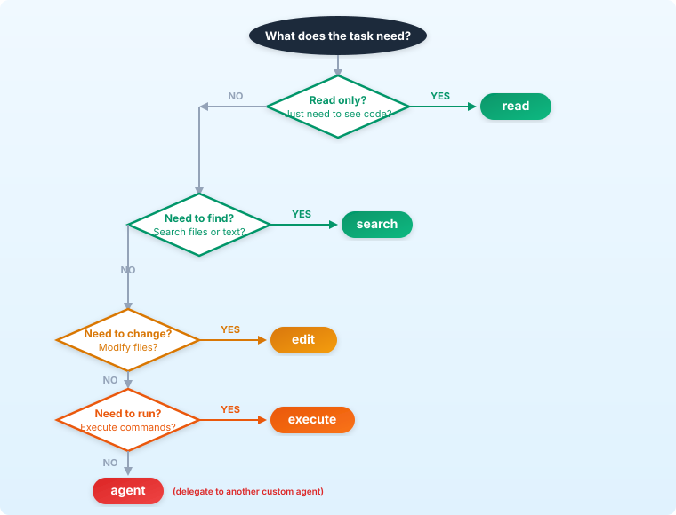
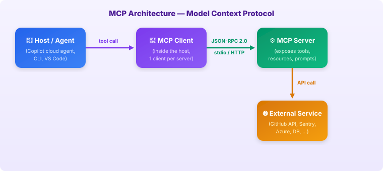

# Domain 2: Tool Use, MCP & Environment Interaction

**Domain 2 · Weight: 20–25% ★ Heaviest** (official name: *Implement tool use and environment interaction*)

This is the single most important domain on the exam: up to a quarter of your score. Master the core tool aliases, MCP architecture, agent profile configuration, execution contexts, and safe execution patterns. Most scenario questions in this domain test whether you can choose the *right tool with the right permission* for the job.

Official module: [Tooling, MCP, and Agent Execution Environments](https://learn.microsoft.com/en-us/training/modules/agent-tooling-mcp-execution-environments/)

## What You'll Learn & Why It Matters

- **What "tools" are and how to pick the fewest an agent needs** — the difference between letting an agent look, change, run, or delegate.
- **How to write an agent profile** (`.agent.md`) that sets an agent's purpose, tools, and extra connections.
- **What MCP is** — a standard plug that connects agents to outside systems — and how organizations control which plugs are allowed.
- **How to run an agent inside a CI pipeline** with Copilot CLI, the right token, and pre-approved commands.
- **Where an agent runs and what it can reach** — repository, branch, runner, firewall, secrets.
- **What to do when things go wrong** — bounded retries, rollbacks, escalation to a human, and a traceable record.

Why it matters: this is the heaviest domain (20–25%), and most of its questions are "pick the right tool/config with the least permission" scenarios you can reason through once the building blocks are clear.

**Prerequisites:** basic Git (branches, commits, pull requests), what a GitHub Actions workflow is, and the Copilot surfaces (VS Code, Copilot CLI, Copilot cloud agent on GitHub.com). If any are unfamiliar, start with [Fundamentals](basics.md). Domain 1's ideas on autonomy and governance ([Domain 1](domain-1.md)) are assumed here.

## Official Skills Measured

From the [GH-600 study guide](https://learn.microsoft.com/en-us/credentials/certifications/resources/study-guides/gh-600) — *Implement tool use and environment interaction (20–25%)*:

**Select and configure agent tools**

- Identify required tools → see [1. The Five Core Tools + Web & Todo Tools](#1-the-five-core-tools-web-todo-tools)
- Configure agent tools → see [2. Agent Profile Configuration](#2-agent-profile-configuration)
- Configure agent tool permissions → see [Tools in the Profile: Granular Control](#tools-in-the-profile-granular-control)

**Configure MCP servers**

- Add an MCP server as a tool to an agent → see [Adding an MCP Server as a Tool to an Agent](#adding-an-mcp-server-as-a-tool-to-an-agent)
- Configure a GitHub remote MCP server → see [GitHub Remote MCP Server](#github-remote-mcp-server)
- Configure the MCP registries → see [MCP Registries & Allow Lists](#mcp-registries-allow-lists)
- Configure MCP allow lists → see [MCP Registries & Allow Lists](#mcp-registries-allow-lists)

**Integrate agents within development environments**

- Evaluate the execution context for an agent → see [6. Execution Contexts](#6-execution-contexts)
- Configure an agent's scope to a specific repository → see [Repository Scope](#repository-scope)
- Configure an agent to be invoked in a CI workflow → see [5. CI Integration: Copilot CLI in Pipelines](#5-ci-integration-copilot-cli-in-pipelines)
- Configure an agent to use branch-based scope → see [Branch-Based Scope](#branch-based-scope)
- Enable an agent to perform autonomous actions, including creating branches and pull requests → see [8. Autonomous Actions: Creating Branches & PRs](#8-autonomous-actions-creating-branches-prs)
- Configure an agent to handle environment-specific constraints → see [Environment-Specific Constraints](#environment-specific-constraints)

**Operate agents with safe execution paths and robust error handling**

- Implement error handling → see [Error Handling](#error-handling)
- Implement retries → see [Retries](#retries)
- Implement rollbacks → see [Rollbacks](#rollbacks)
- Implement escalation paths → see [Escalation Paths](#escalation-paths)
- Implement traceability and accountability for agent actions → see [Traceability and Accountability](#traceability-and-accountability)

## 0. Why Domain 2 Matters Most

Welcome, student. If you only have time to master one domain on the GH-600, make it this one. Domain 2 is weighted at **20–25%**, the heaviest of all six domains. That works out to roughly **11–14 questions** if the exam has about 56 questions (unverified community info: Microsoft doesn't publish a fixed question count).

The official skills measured for this domain are mapped in [Official Skills Measured](#official-skills-measured) above.

By the time you finish this lesson, you'll know:

- Which tool to use in every scenario, and why *least privilege* is the deciding factor
- How MCP servers extend agent capabilities and how to configure them
- Every exam-critical file path (you **must** memorize these)
- How CI integration works with the Copilot CLI and token-based authentication
- Safe execution patterns: retries, rollbacks, escalation paths

Let's dive in.

## 1. The Five Core Tools + Web & Todo Tools

Every GitHub Copilot agent (on GitHub.com, in the IDE, or in the CLI) gets access to a set of **tools**. Tools are how the agent interacts with the outside world: reading files, searching code, editing source, running commands, and invoking other agents. In a custom agent profile you refer to them by **tool aliases**. The exam expects you to know the five core aliases cold, plus two context-specific ones.

> **📘 In plain words:** The model is the brain; tools are its hands. A **tool alias** is just the short, standard name for a group of hands — `read` means "can open files", `execute` means "can type commands into a terminal". Giving an agent tools is like handing a contractor keys: give the key to the room they're working in, not the master key.

### The Five Core Tools (Ranked by Permission Level)

These tools form a **permission hierarchy**. The rule is simple: *always use the least privileged tool that can accomplish the task.* This is called **least-privilege tool selection**, and it's one of the most tested concepts in Domain 2.

| Tool alias | Compatible aliases | Permission level | What it does | When to use |
|---|---|---|---|---|
| **read** | `Read`, `NotebookRead` | 🟢 Read-only | Read file contents (`view` in cloud agent) | You need to *see* code but not change it |
| **search** | `Grep`, `Glob` | 🟢 Read-only | Search for files or for text in files | You need to *find* something before you can read it |
| **edit** | `Edit`, `MultiEdit`, `Write`, `NotebookEdit` | 🟡 Write (local files) | Create or modify files in the workspace | You need to *change* code, but don't need to run anything |
| **execute** | `shell`, `Bash`, `powershell` | 🟠 Write + Execute | Run commands in the OS shell (`bash` or `powershell`): scripts, tests, builds | You need to *run* code: build, test, lint, install dependencies |
| **agent** | `custom-agent`, `Task` | 🔴 Highest autonomy | Invoke a different custom agent to accomplish a task | You need to *delegate* part of the work to a specialized agent |

> Searching issues and pull requests isn't done by the `search` alias. That comes from the built-in **GitHub MCP server** tools (for example `github/search_issues`).

### The Web Tool

The **web** alias (compatible aliases `WebSearch`, `WebFetch`) lets the agent fetch content from URLs and run web searches. *Critical exam note:* it's **currently not applicable to Copilot cloud agent**. It works in VS Code and similar surfaces (Copilot CLI has a `web_fetch` tool, subject to URL permissions such as `--allow-url`). A web grant doesn't depend on `execute`. And if you omit `tools`, the agent gets all available tools, not a reduced default set.

### The Todo Tool

The **todo** alias (compatible alias `TodoWrite`) creates and manages structured task lists. It's **not supported in Copilot cloud agent today** but is supported by VS Code. It doesn't depend on Codespaces.

> **🎓 Teaching Tip: The Decision Tree.** When the exam asks "which tool should the agent use?", walk through this: *Can I just look at the data?* → **read**. *Do I need to find something first?* → **search**. *Do I need to change a file?* → **edit**. *Do I need to run a command?* → **execute**. *Do I need another specialized agent to handle part of the task?* → **agent**. Never choose execute when edit will do. That privilege creep is a classic wrong answer.

### Tool Permission Decision Tree

Here's the mental model. Follow the arrows from top to bottom. The answer is the *first* tool that matches your task's requirements:



*Figure 2.1: Tool Permission Decision Tree. Follow the arrows from top to bottom and pick the least-privileged tool that meets your task's needs.*

> **⚠️ Exam Alert:** The exam will present scenarios where you must choose between **execute** and **edit**. Example: "The agent needs to add a new function to auth.py." The correct answer is **edit**, not execute, because you only need to write a file, not run a shell command. If the answer says "use execute to create the file," that's a trap. Execute is for running commands, not editing files.

> **⚠️ Common mistake:** Assuming `search` lets the agent search GitHub issues or PRs. `search` only looks through files in the workspace; issues and PRs come from GitHub MCP server tools such as `github/search_issues`.

## 2. Agent Profile Configuration

A custom agent is defined by an **agent profile**: a Markdown file with YAML frontmatter. At repository level it's stored at `.github/agents/*.agent.md`. Profiles can also be defined at organization and enterprise level; on name conflicts, the lowest level wins (repository over organization over enterprise). The profile declares which tools the agent can use, any extra MCP servers, the model, and more. The Markdown body (max 30,000 characters) holds the agent's instructions.

> **📘 In plain words:** An agent profile is a job description card. The top section (the **YAML frontmatter**, between two `---` lines, written as `key: value` pairs) is the HR form: title, role summary, which keys they get. The body underneath is the free-text briefing on how to do the job.

Here's the anatomy of an agent profile:

```markdown
---
description: >
  My code review assistant that checks for security
  vulnerabilities and suggests fixes.
name: security-reviewer
tools:
  - read
  - search
  - edit
  - vulnerability-db/*      # all tools from the MCP server below
mcp-servers:
  vulnerability-db:
    type: local
    command: node
    args: ["mcp-servers/vuln-db-server.js"]
    tools: ["*"]
    env:
      API_KEY: ${{ secrets.COPILOT_MCP_VULN_DB_API_KEY }}
target: github-copilot
model: gpt-5.4
disable-model-invocation: false
---

# Security Reviewer Agent

This agent reviews pull requests for security issues.
It checks for OWASP Top 10 patterns and suggests fixes.
```

- `description` (required) and `name` identify the agent.
- `tools` lists three built-in aliases plus `vulnerability-db/*` — every tool from the MCP server defined just below.
- `mcp-servers` defines that server inline: `type: local` means Copilot starts it as a local process with `command` + `args`; `env` passes an API key from an Agents secret (names must start with `COPILOT_MCP_`).
- `target: github-copilot` limits the agent to GitHub's Copilot surfaces (cloud agent, CLI) rather than VS Code.
- `model` pins a model; `disable-model-invocation: false` lets cloud agent pick this agent automatically when a task fits.

### Worked Example: An Annotated Beginner Profile

This is a complete, minimal profile for a documentation helper you could use in VS Code. YAML comments (`#`) explain each field and are ignored by Copilot:

```markdown
---
# Required. Shown in the agent picker; Copilot also reads it to decide when the agent fits.
description: Updates Markdown docs under docs/ to match code changes. Never edits code.
# Optional. Display name; if omitted, the filename (docs-writer) is used.
name: docs-writer
# Least privilege: look, find, and change files. No execute, so it can't run commands.
tools: ["read", "search", "edit"]
# Optional. vscode = only in VS Code; github-copilot = only on GitHub; omit for both.
target: vscode
# Optional. true = Copilot won't auto-select this agent; users must pick it.
disable-model-invocation: true
---

You update documentation in docs/ so it matches the current code.
- Read the relevant source files before editing any doc.
- Only edit files under docs/.
- Keep the existing heading structure and tone.
```

- Save it as `.github/agents/docs-writer.agent.md`; VS Code detects agents in that folder ([VS Code docs](https://code.visualstudio.com/docs/copilot/customization/custom-agents)).
- `tools` is the enforced limit; "Only edit files under docs/" in the body is guidance (enforce paths with hooks or rulesets).
- No `mcp-servers` here: that key isn't used by VS Code custom agents ([Docs](https://docs.github.com/en/copilot/reference/custom-agents-configuration)).
- Profiles are versioned by Git commit: a task uses the profile from the latest commit on that repository and branch ([Docs](https://docs.github.com/en/copilot/reference/custom-agents-configuration)).

### Frontmatter Keys: What Each One Does

| Key | Required? | Purpose |
|---|---|---|
| **description** | ✅ **Required** | Description of the agent's purpose and capabilities. Shown in the agent list and used when Copilot decides whether to use the agent. |
| **name** | Optional | Display name for the agent. The filename (minus `.md` / `.agent.md`) identifies the agent and is used for deduplication between levels. |
| **tools** | Optional | List (or comma-separated string) of tool names/aliases the agent can use, including MCP tools as `server/tool` or `server/*`. **If omitted (or `["*"]`), all available tools are enabled.** `tools: []` disables all tools. Unrecognized names are ignored. **This is the primary way you enforce least privilege.** |
| **mcp-servers** | Optional | An **object** with inline MCP server definitions (YAML version of the repository MCP JSON format). Not used by VS Code/IDE custom agents. The agent can also use the out-of-the-box servers (`github`, `playwright`) and any servers configured in repository settings, even without this key. |
| **target** | Optional | Target environment: `vscode` or `github-copilot`. If unset, the agent applies to both. |
| **model** | Optional | Which model powers this agent. If omitted, the agent inherits the default model. Available model names change over time, so check the current supported-models list. |
| **disable-model-invocation** | Optional | Boolean (default `false`). When `true`, Copilot cloud agent **won't automatically pick this agent based on task context**. It must be selected manually. Replaces the retired `infer: false`. |
| **user-invocable** | Optional | Boolean (default `true`). When `false`, users can't select the agent manually; it can only be used programmatically. |
| **metadata** | Optional | Name/value string pairs for annotation. Not used by IDE custom agents. |

> **📘 Teaching Tip: The description field.** The exam loves to test that `description` is the **only required** field in frontmatter. Everything else is optional. If you see an agent profile missing `name`, `tools`, or `model`, that's fine. If it's missing `description`, it's invalid. Remember: *description is mandatory, everything else is gravy.*

### Tools in the Profile: Granular Control

The `tools` property is a **flat list of tool names**. It doesn't accept per-tool sub-options such as allowed commands or directories. You get granularity in other ways:

- **Pick only the aliases you need** (for example `read`, `search`, `edit`, and no `execute`).
- **Scope MCP tools individually:** `github/get_file_contents` instead of `github/*`, or set the server's own `tools` list.
- **Restrict specific shell commands at run time:** in Copilot CLI use `--allow-tool='shell(npm test)'` / `--deny-tool='shell(git push)'` (deny always wins). In Copilot cloud agent, where tool calls are pre-approved, use a `preToolUse` hook in `.github/hooks/*.json` to deny unwanted commands.

For example, this profile grants `execute` but can only *ask* the agent to limit itself to two commands:

```markdown
---
description: Build and test agent for CI pipelines
name: ci-builder
tools: ["read", "edit", "execute"]
---

Only run `npm test` and `npm run build`. Only modify files under src/ and tests/.
```

The enforcement happens when you launch it. This Copilot CLI command turns those wishes into rules:

```bash
# Enforce the command allow-list when running the agent with Copilot CLI
copilot -p "Fix the failing build" --agent ci-builder \
  --allow-tool='shell(npm test)' --allow-tool='shell(npm run build)' \
  --allow-tool='write(src/*.ts)' --allow-tool='write(tests/*.ts)' \
  --no-ask-user
```

- `-p "..."` runs one prompt non-interactively and exits; `--agent ci-builder` selects the profile above.
- Each `--allow-tool='shell(...)'` pre-approves one exact command; anything else is denied in `-p` mode.
- `--allow-tool='write(...)'` pre-approves file writes only for matching paths.
- `--no-ask-user` stops the agent from pausing to ask questions nobody can answer.

> **⚠️ Exam Trap:** Some questions will describe an agent profile with `tools: [read, search, edit, execute, agent]` (all five tools) and ask if this is appropriate. Unless the agent needs all five (rare), this is an over-privileged profile. The same goes for **omitting** `tools`, which grants *every* available tool. The correct approach is to grant **only the tools the agent actually needs**.

> **📘 Note on the Learn module:** The Learn unit "Execution context and boundaries" shows a custom agent with `applyTo` and tool names like `read_file` / `search_files`. The GitHub Docs agent-profile reference doesn't list `applyTo` as an agent property (it belongs to `*.instructions.md` files). Unrecognized tool names are silently ignored, so prefer the documented aliases (`read`, `search`, ...).

> **🎯 Exam angle:** Profile questions usually test one of three facts: `description` is the only required key; omitting `tools` means *all* tools (not none, not a safe default); and `target` accepts only `vscode` or `github-copilot`. If an option adds a key that doesn't exist (`branch:`, `allowedCommands:`, `applyTo:` on an agent), eliminate it.

### Organization-Level Custom Agents

To share custom agents across an organization, store profiles in the `/agents` directory of the organization's **`.github`** or **`.github-private`** repository. Both work the same way and make the agents available to **all organization members, even without access to that repository** ([prepare for custom agents](https://docs.github.com/copilot/how-tos/administer-copilot/manage-for-organization/prepare-for-custom-agents)). GitHub suggests keeping `.github-private` private (members can still use its agents); use `.github` if you want members to view and collaborate on the profiles. Enterprise owners can configure a ruleset that restricts custom agents. Custom agents are in public preview.

### Custom Agents in the Copilot SDK

The [Copilot SDK](https://docs.github.com/copilot/how-tos/copilot-sdk/use-copilot-sdk/custom-agents) defines custom agents in code (`customAgents` on the session) rather than in `.agent.md` files. Differences worth memorizing:

| | Agent profile (`.agent.md`) | SDK `customAgents` entry |
|---|---|---|
| Required fields | `description` | `name` and `prompt` |
| Omit `tools` | All tools | All session tools (`tools: null` too) |
| Block auto-selection | `disable-model-invocation: true` | `infer: false` (default `true`) |
| Per-agent MCP | `mcp-servers` | `mcpServers` |

The runtime matches the prompt against each agent's `name` and `description`, runs the selected sub-agent in an **isolated context** with its own restricted tools, and streams `subagent.selected` / `started` / `completed` / `failed` events to the parent session. Session-level `availableTools` (allowlist) and `excludedTools` (blocklist) apply to everyone first; `defaultAgent.excludedTools` hides tools only from the main agent so it must delegate.

## 3. Exam-Critical Artifact Paths (Memorize These)

Now we come to one of the most **memorization-heavy** parts of the exam. A set of file paths in the GitHub ecosystem each serve a specific purpose, and the exam will ask you to match the path to its purpose. Let me break them down into logical groups.

> **🎓 Instructor's Note:** I recommend studying these in groups rather than as a flat list. Notice the pattern: many live under `.github/` because that's GitHub's convention directory for repository configuration.

> **📘 In plain words:** These paths are the agent's address book. GitHub and Copilot don't scan your whole repository for settings; they look in specific places. Put a file in the wrong folder and it's simply not read — no error, no warning.

### Group 1: Agent & Instructions (Who the Agent Is)

| File path | Purpose |
|---|---|
| `.github/copilot-instructions.md` | **Repository-wide custom instructions.** Apply to all requests made in the context of the repository (Copilot on GitHub.com, cloud agent, code review, IDE, CLI). Think of this as the "constitution" for how Copilot behaves in this repository. |
| `.github/instructions/**/*.instructions.md` | **Path-specific instructions.** Each file has an `applyTo` glob in its frontmatter and applies when Copilot works on matching files (combined with the repository-wide file). Optional `excludeAgent: "code-review"` or `"cloud-agent"` hides a file from one of those agents. |
| `.github/agents/*.agent.md` | **Agent profile definitions.** Each file defines one custom agent: its description, tools, MCP servers, and model. We covered the anatomy of these files in Section 2. |
| `AGENTS.md` | **Agent instructions** (not an agent registry). Natural-language guidance for AI agents. You can have one or more `AGENTS.md` files anywhere in the repo, and the **nearest one in the directory tree takes precedence**. Alternatives: a single `CLAUDE.md` or `GEMINI.md` at the repository root. Custom agents are discovered from `.github/agents/`, not from `AGENTS.md`. |

### Group 2: Prompts & Skills (What the Agent Does)

| File path | Purpose |
|---|---|
| `.github/prompts/*.prompt.md` | **Reusable prompt files** (VS Code). Standalone prompts that a **user invokes manually** in chat by typing `/` plus the prompt name. Frontmatter can set `description`, `agent`, `model`, and `tools`. Note: VS Code now marks prompt files as deprecated for Agent Host sessions and recommends migrating them to agent skills. |
| `.github/skills/<skill>/SKILL.md` | **Skill definition.** A skill is a packaged capability. Each skill lives in its own subdirectory and has a `SKILL.md` file with `name` and `description` frontmatter and instructions. It's loaded when invoked (`/skill-name`) or picked automatically by the agent. |

### Group 3: Hooks & Workflows (How the Agent Gets Triggered)

| File path | Purpose |
|---|---|
| `.github/hooks/*.json` | **Agent lifecycle hooks** (Copilot CLI and Copilot cloud agent). JSON files (`"version": 1`) that run commands at lifecycle events such as `sessionStart`, `sessionEnd`, `userPromptSubmitted`, `preToolUse`, `postToolUse`, `postToolUseFailure`, `agentStop`, `subagentStart`/`subagentStop`, and `errorOccurred`. `preToolUse` can allow, deny, or modify a tool call. |
| `.github/workflows/copilot-setup-steps.yml` | **Copilot cloud agent environment setup.** A special Actions workflow that must contain a single job named `copilot-setup-steps`. Its steps run in the agent's ephemeral GitHub Actions environment **before Copilot cloud agent starts working** (preinstall tools/dependencies, pick larger or self-hosted runners). Only `steps`, `permissions`, `runs-on`, `services`, `snapshot`, and `timeout-minutes` (max 59) are honored, and the file must be on the default branch. Copilot gets its own token. This file isn't a reusable step for your own CI workflows. |

### Group 4: MCP Configuration (How the Agent Connects to Servers)

| Location | Purpose |
|---|---|
| Repository **Settings → Copilot → MCP servers** (JSON entered on GitHub.com, no file) | **Repository-level MCP configuration for Copilot cloud agent and Copilot code review.** The JSON contains an `mcpServers` object. The GitHub and Playwright MCP servers are enabled by default. |
| `mcp-servers` in `.github/agents/*.agent.md` | **Per-agent MCP servers** (YAML version of the same format), used by custom agents on GitHub.com and in Copilot CLI. |
| `.mcp.json` | **Copilot CLI workspace config.** Read from any directory between the working directory and the repo root. Takes precedence over `.github/mcp.json` in the same directory. Loaded only in trusted folders. |
| `.github/mcp.json` | **Copilot CLI shared, committed project config.** Same format as `.mcp.json` (`mcpServers` object or bare server map). |
| `.vscode/mcp.json` | **VS Code workspace MCP config** (also used by Codespaces running VS Code). Uses a top-level `servers` key, and **Copilot CLI doesn't read it**. |
| `~/.copilot/mcp-config.json` | Copilot CLI **user-level** MCP config (where `copilot mcp add` writes). |

> **⚠️ Critical Path Memorization:** The exam will give you scenarios like "Where do you define reusable prompts?" The answer is `.github/prompts/*.prompt.md`. Or "Where do you configure MCP servers?" The answer depends on the surface: repository settings (cloud agent / code review), `mcp-servers` in an agent profile, `.mcp.json` / `.github/mcp.json` (Copilot CLI), or `.vscode/mcp.json` (VS Code). Know the difference between all of them.

> **⚠️ Common mistake:** Putting a custom agent definition in `AGENTS.md`, or MCP servers for Copilot CLI in `.vscode/mcp.json`. `AGENTS.md` holds instructions, not agent definitions (those go in `.github/agents/`), and Copilot CLI doesn't read `.vscode/mcp.json`.

## 4. MCP Architecture & Servers

**MCP** stands for **Model Context Protocol**. It's an open standard that lets AI clients connect to external tools, data sources, and services through MCP servers that expose tools in a structured format. Think of MCP as the **USB-C for AI agents**: a universal protocol that any agent can use to talk to any service.

The moving parts, in plain terms:

- **Host:** the app the agent lives in — VS Code, Copilot CLI, or Copilot cloud agent.
- **MCP client:** a connector inside the host; there's one per server.
- **MCP server:** a small program that wraps a service (GitHub, a database, a ticket system) and offers its abilities as named **tools**.
- **Transport:** how client and server talk. **stdio** means the host starts the server as a local process and they exchange messages over standard input/output; **HTTP** means the server runs somewhere else and is reached by URL. Messages use **JSON-RPC 2.0**, a simple "call this method with these arguments" format in JSON.

> **📘 In plain words:** Before USB, every printer needed its own cable and driver. MCP is the shared socket: build one MCP server for your ticket system, and every MCP-capable agent can use it. The organization's **allow list** is the IT policy saying which devices you're allowed to plug in.

### MCP Architecture Diagram

Here's the architecture you need to understand for the exam. The agent sends a request through the MCP client, which routes it to the correct MCP server, which in turn calls the external service:



*Figure 2.2: MCP Architecture. The host (Copilot cloud agent, CLI, VS Code) runs one MCP client per server; client and server talk JSON-RPC 2.0 over stdio or HTTP; the server exposes tools, resources, and prompts and calls the external service.*

### How MCP Servers Work in GitHub

Each server entry specifies how to connect. Local servers use a **command** (`type`: `local` or `stdio`, with `command` and `args`). Remote servers use a **URL** (`type`: `http` for Streamable HTTP, or the legacy `sse`). For Copilot cloud agent, every server also needs a `tools` list. Secrets must be Agents secrets/variables whose names start with `COPILOT_MCP_`.

This JSON, pasted into repository **Settings → Copilot → MCP servers**, defines one local and one remote server:

```json
{
  "mcpServers": {
    "vulnerability-db": {
      "type": "local",
      "command": "node",
      "args": ["mcp-servers/vuln-db-server.js"],
      "env": {
        "API_KEY": "$COPILOT_MCP_VULN_DB_API_KEY"
      },
      "tools": ["*"]
    },
    "github-remote": {
      "type": "http",
      "url": "https://api.githubcopilot.com/mcp/readonly",
      "headers": {
        "X-MCP-Toolsets": "repos,issues,pull_requests"
      },
      "tools": ["*"]
    }
  }
}
```

Line by line:

- `"mcpServers"` — the top-level object; each key inside is a server name you choose. That name becomes the prefix in tool references (`vulnerability-db/<tool>`).
- `"type": "local"` + `"command"` + `"args"` — Copilot starts `node mcp-servers/vuln-db-server.js` as a process on the agent's machine (stdio transport).
- `"env"` — environment variables for that process. `$COPILOT_MCP_VULN_DB_API_KEY` is replaced at run time with the Agents secret of that name, so the key never appears in the config.
- `"type": "http"` + `"url"` — a remote server reached over HTTP. The `/mcp/readonly` path limits GitHub's server to read-only tools.
- `"headers"` — extra HTTP headers; `X-MCP-Toolsets` picks which groups of GitHub tools are exposed.
- `"tools": ["*"]` — which of the server's tools the agent may call. `*` is all of them; in production, list specific read-only tools instead.

> Once an MCP server is configured, Copilot cloud agent uses its tools **autonomously, without asking for approval**. GitHub recommends allowlisting specific read-only tools instead of `*`. Cloud agent supports MCP **tools** only (not resources or prompts) and doesn't support remote servers that use OAuth.

> **⚠️ Common mistake:** Thinking an MCP tool will prompt for approval each time in cloud agent. It won't — configured MCP tools are used autonomously, so the `tools` list on the server entry is your real permission control.

### GitHub Remote MCP Server

GitHub provides its own **remote MCP server** that exposes GitHub capabilities (repositories, issues, pull requests, Actions, code security, and more) as MCP tools. The hosted endpoint is **`https://api.githubcopilot.com/mcp/`**. In VS Code you add it as an **HTTP** server with that URL and authenticate with GitHub. Key facts:

- **Copilot cloud agent** has the GitHub MCP server enabled by default, with a token that has **read-only access scoped to the current repository**. For wider access, override it in repository MCP settings with a fine-grained PAT (secret `COPILOT_MCP_GITHUB_PERSONAL_ACCESS_TOKEN`) or a GitHub App.
- **Toolsets:** select tool groups with the `X-MCP-Toolsets` header (for example `repos,issues,users,pull_requests,code_security,secret_protection,actions,web_search`). The `/mcp/readonly` URL restricts the server to read-only tools.
- **Copilot CLI** has the GitHub MCP server built in (`github-mcp-server`). Use `--add-github-mcp-toolset`, `--add-github-mcp-tool`, or `--enable-all-github-mcp-tools` to widen the default subset.
- GitHub Enterprise Server supports only the local (Docker image `ghcr.io/github/github-mcp-server`) configuration. GHE.com with data residency supports local and remote.

### Adding an MCP Server as a Tool to an Agent

How you add a server depends on the surface:

- **VS Code (Learn's walkthrough):** open Copilot Chat in **Agent** mode → **Tools** icon → **Configure tools** → **Add MCP server** → choose **HTTP** → enter the URL (for example `https://api.githubcopilot.com/mcp/`) → accept the generated name → choose scope (**current workspace** or **all workspaces**) → **Authenticate** with GitHub → save. A local server is added the same way with a local endpoint (Learn's example: `http://localhost:3000`); local servers can reach local resources and typically need no external authentication ([Learn](https://learn.microsoft.com/en-us/training/modules/agent-tooling-mcp-execution-environments/3-model-context-protocol-servers-registries-allow-lists)).
- **A custom agent on GitHub.com or Copilot CLI:** declare it under `mcp-servers` in the profile and allow its tools in `tools` (`server/tool` or `server/*`), as in section 2.
- **Copilot cloud agent for the whole repository:** paste `mcpServers` JSON in **Settings → Copilot → MCP servers**.
- **Copilot CLI:** `copilot mcp add` (user config) or a committed `.mcp.json` / `.github/mcp.json`.

Learn positions the **remote** GitHub MCP server as the recommended setup for most users in supported IDEs.

### MCP Registries & Allow Lists

An **MCP registry** is a catalog of MCP servers that compatible clients use for discovery. By default, supported IDEs and Copilot CLI use the **GitHub MCP Registry** (`github.com/mcp`). Organizations and enterprises can point Copilot at a **custom registry**. It must follow the MCP registry v0.1 spec (`GET /v0.1/servers`, `.../versions/latest`, `.../versions/{version}`, with CORS headers), or you can use **Azure API Center** as a managed registry.

Per [Learn](https://learn.microsoft.com/en-us/training/modules/agent-tooling-mcp-execution-environments/3-model-context-protocol-servers-registries-allow-lists), you can host a custom registry by forking and self-hosting the open-source MCP Registry, running it locally with Docker, or building your own implementation. Required CORS headers: `Access-Control-Allow-Origin: *`, `Access-Control-Allow-Methods: GET, OPTIONS`, `Access-Control-Allow-Headers: Authorization, Content-Type`. With Azure API Center, enable **anonymous access** and enter only the **base URL** in the policy (don't append `/v0.1/servers`).

An **allow list** decides which MCP servers are permitted. It's configured at **enterprise** level (**AI controls → MCP**) or **organization** level (**Settings → Copilot → Policies**):

- **MCP servers in Copilot** policy: enabled or disabled
- **MCP Registry URL:** your registry's base URL
- **Restrict MCP access to registry servers:** **Allow all** (any server) or **Registry only** (only servers in the registry; local servers must also be listed, with exactly matching IDs)

Copilot CLI enforces the enterprise allow list fail-closed (it blocks non-default servers if the policy can't be verified). Built-in default servers are exempt. Just like tools, MCP servers follow the principle of least privilege.

Allow list enforcement is tied to the **Copilot seat that governs the user**, and a newly selected policy **applies immediately** to all developers. Remember the division of labor: the **server** exposes tools, the **registry** makes approved servers discoverable, the **allow list** decides which servers are permitted.

> **🎯 Exam angle:** MCP governance questions are usually "which knob?" questions. "Developers should *find* approved servers" → registry. "Developers must *only use* approved servers" → registry **plus** the *Registry only* allow list policy. "This one agent needs one extra server" → `mcp-servers` in its profile. "Cloud agent in this repo needs a server" → repository MCP settings.

> **📘 Teaching Tip: MCP vs. Direct API.** Why use MCP instead of having the agent call the API directly? Three reasons. (1) **Standardization:** any MCP client can talk to any MCP server, with no custom integration code. (2) **Security:** MCP servers can enforce authentication, rate-limiting, and audit logging, and registries plus allow lists let the organization govern which servers are used. (3) **Discoverability:** agents discover available tools from the server in a structured format. The exam will expect you to know these benefits.

## 5. CI Integration: Copilot CLI in Pipelines

GitHub Copilot agents can run in CI/CD pipelines. The **Copilot CLI** (`copilot` command, npm package `@github/copilot`) can be installed and invoked inside GitHub Actions workflows, making agents a first-class part of your automated SDLC (Software Development Lifecycle). For most automation, GitHub now recommends **GitHub Agentic Workflows** (`gh-aw`), which use `GITHUB_TOKEN` by default and add guardrails such as read-only tokens, safe outputs, and sandboxed execution.

Terms for this section:

- **Runner:** the fresh virtual machine GitHub Actions starts for a job and throws away afterwards.
- **Token:** a credential string that proves who is calling GitHub and what they may do. `GITHUB_TOKEN` is created automatically per workflow run; a **PAT (personal access token)** is one you create yourself and store as a secret.
- **Non-interactive (`-p`) mode:** the CLI runs one prompt and exits, with no human at the keyboard to approve anything.

> **📘 In plain words:** Running Copilot CLI in CI is like leaving a contractor alone in the building overnight. Before you leave, you write down exactly which rooms they may enter (`--allow-tool`), tell them not to wait for you to answer questions (`--no-ask-user`), and give them a visitor badge that expires when the shift ends (`GITHUB_TOKEN`).

### The copilot CLI Command

The command you'll use in CI is:

```bash
copilot -p "Review this PR for security vulnerabilities" \
  --agent security-reviewer \
  --allow-tool='shell(git:*)' \
  --no-ask-user
```

It runs the `security-reviewer` agent once, pre-approves any `git` subcommand (`git:*`), and never stops to ask questions. Each flag is explained below.

### Key Command-Line Flags

| Flag | Purpose |
|---|---|
| `-p "<prompt>"` / `--prompt` | Runs a prompt **programmatically** and exits when done. |
| `--agent <name>` | Specifies **which custom agent** to use (matches the agent ID/filename or its `name`). Agents are loaded from `.github/agents/`, `~/.copilot/agents/`, and other locations. If omitted, the default agent is used. |
| `--no-ask-user` | Disables the `ask_user` tool, so the agent works autonomously without asking questions. Important in CI, where nobody can answer. |
| `--allow-tool=...` / `--deny-tool=...` | Pre-approves (or blocks) tool kinds such as `shell(npm test)`, `write`, or `MyMCP(tool)`. In `-p` mode, **any action that isn't pre-approved is denied automatically** because no approval prompt can be shown. `--allow-all-tools` (or `COPILOT_ALLOW_ALL`) approves everything, so avoid it unless the environment is fully sandboxed. |

### Authentication: COPILOT_GITHUB_TOKEN or GITHUB_TOKEN

Copilot CLI reads an auth token from environment variables in this order of precedence: **`COPILOT_GITHUB_TOKEN`**, then `GH_TOKEN`, then `GITHUB_TOKEN`. You have two options in Actions:

- **`GITHUB_TOKEN`** (recommended for organization-owned repos): grant `permissions: copilot-requests: write` and pass `GITHUB_TOKEN: ${{ github.token }}`. This requires the org policy *Allow use of Copilot CLI billed to the organization* (enabled by default when Copilot CLI is on).
- **A fine-grained PAT with the "Copilot Requests" permission**, stored as a secret and passed as `COPILOT_GITHUB_TOKEN`. This separates Copilot's permissions from the job's `GITHUB_TOKEN` and bills a specific user's seat. **Classic PATs (`ghp_`) aren't supported.**

Here's a complete workflow that reviews every PR with a custom agent:

```yaml
name: Agent Review
on: [pull_request]

permissions:
  contents: read
  copilot-requests: write

jobs:
  agent-review:
    runs-on: ubuntu-latest
    steps:
      - uses: actions/checkout@v6

      - name: Install Copilot CLI
        run: npm install -g @github/copilot

      - name: Run Agent
        env:
          GITHUB_TOKEN: ${{ github.token }}
          # or: COPILOT_GITHUB_TOKEN: ${{ secrets.PERSONAL_ACCESS_TOKEN }}
        run: |
          copilot -p "Review this PR for security issues" \
            --agent security-reviewer \
            --allow-tool='shell(git:*)' \
            --no-ask-user
```

Annotated:

- `on: [pull_request]` — runs on every PR event (opened, new commits, reopened).
- `permissions: contents: read` — the job can read code but not push; `copilot-requests: write` lets `GITHUB_TOKEN` make Copilot requests.
- `actions/checkout` — puts the repository (including `.github/agents/security-reviewer.agent.md`) on the runner.
- `npm install -g @github/copilot` — installs the CLI on the runner each run (runners start empty).
- `env: GITHUB_TOKEN: ${{ github.token }}` — hands the CLI the run's short-lived token; the commented line shows the PAT alternative.
- The `copilot` command — one prompt, one named agent, only `git` commands pre-approved, no questions asked.

> **⚠️ Exam Trap: Token Confusion.** Know the difference. `GITHUB_TOKEN` is the automatic, short-lived token GitHub creates for each workflow run, scoped by the workflow's `permissions` block. It **can** authenticate Copilot CLI when the workflow grants `copilot-requests: write` and the org policy allows it. `COPILOT_GITHUB_TOKEN` is a **CLI-specific variable** (usually holding a fine-grained PAT with "Copilot Requests") that takes precedence over `GH_TOKEN`/`GITHUB_TOKEN`, so Copilot can have different permissions from the rest of the job. Also note that Copilot CLI isn't a reusable workflow: `copilot-setup-steps.yml` configures **Copilot cloud agent's** environment and isn't called from your own CI jobs.

> The Learn module's example uses `npx @github/copilot-cli`, while GitHub Docs install the CLI with `npm install -g @github/copilot`.

### Traditional Workflows vs GitHub Agentic Workflows

[Learn](https://learn.microsoft.com/en-us/training/modules/agent-tooling-mcp-execution-environments/2-interact-github-apis-workflows) contrasts the two:

| | Traditional GitHub Actions workflow | GitHub Agentic Workflow (`gh-aw`) |
|---|---|---|
| Defined as | YAML with every step, trigger, and condition explicit | **Markdown** instructions (intent) + **frontmatter** (triggers, permissions, tools, safe outputs) |
| Executed as | The YAML itself | Compiled into a **lock file** that GitHub Actions runs |
| Best for | Deterministic CI/CD | Open-ended but bounded tasks: triage, reports, docs maintenance, CI failure analysis, code improvement |

Agentic workflows **extend** CI/CD ("Continuous AI"), they don't replace it. Their [guardrails](https://learn.microsoft.com/en-us/training/modules/agent-tooling-mcp-execution-environments/4-execution-context-boundaries): read-only tokens by default, **safe outputs** (the agent proposes; a separate gated step decides what's written), zero secrets in the agent process, sandboxed containerized execution, network isolation with allowlisted egress, and threat detection that scans proposed outputs before any write.

A minimal agentic workflow file looks like this:

```markdown
---
on:
  schedule: daily
permissions:
  contents: read
  issues: read
safe-outputs:
  create-issue:
    title-prefix: "[repo-status] "
tools:
  github:
---

Create a concise daily status report of recent issues, PRs, and commits.
```

- `on: schedule: daily` — runs once a day.
- `permissions` — read-only: the agent itself can't write anything.
- `safe-outputs: create-issue` — the *only* write allowed, performed by a separate step after the agent proposes it; issue titles get a fixed prefix.
- `tools: github:` — gives the agent the GitHub tools it needs to read issues, PRs, and commits.
- The body is the instruction in plain language; it gets compiled into a lock file that Actions runs.

## 6. Execution Contexts

Where and how an agent runs matters enormously for security and governance. Execution context is the set of constraints that define where an agent operates and what it can access: the **repository**, the **branch**, the **workflow**, and the **permissions** granted to that workflow. The exam tests three contexts you must understand:

> **📘 In plain words:** Execution context answers "which building, which floor, which badge?" The **repository** is the building, the **branch** is the floor the agent is allowed to work on, and the **workflow permissions/token** are the badge that decides which doors open.

### Repository Scope

Agents always operate within a repository. They can read and modify code only in that repository and interact with its issues, pull requests, and workflows. They **don't have access to other repositories** unless explicitly granted (for example, a wider-scoped token for the GitHub MCP server). For Copilot cloud agent, you enable and configure this boundary at **Settings → Copilot → Cloud agent**. Custom agents then refine *what* the agent can do inside that boundary through `tools` and their instructions.

GitHub Docs list the hard limits for cloud agent ([about cloud agent](https://docs.github.com/en/copilot/concepts/agents/cloud-agent/about-cloud-agent)): it can only change the **one repository** the task was started in, works on **one branch at a time** and opens **one PR per task**, and each session has a **maximum of 59 minutes** — so break big jobs into smaller tasks.

### Branch-Based Scope

Agents don't work directly on the default branch. Copilot cloud agent **creates a new branch** from the base branch you select (default branch unless you choose another one when delegating the task), commits its changes there, and the changes reach the base branch only through a **pull request** and review. Branch scope is **enforced by the execution context, not by the custom agent profile**. Custom agents control files, tools, and behavior, but not branch creation, pull request behavior, or isolation. In CI workflows, the workflow run determines the branch the agent works on.

GitHub Docs add the hard limits ([risks and mitigations](https://docs.github.com/en/copilot/concepts/agents/cloud-agent/risks-and-mitigations)): the agent can push to **only one branch** — a new `copilot/` branch, or the PR's own branch when you mention `@copilot` on an existing PR. It can only perform simple pushes (it can't run `git push` or other Git commands directly) and is subject to branch protections and required checks.

The profile below shows what you *can't* do: there's no branch setting to add.

```markdown
---
description: Feature-specific refactoring agent
name: feature-refactor
tools: ["read", "edit"]
# No branch setting exists in the profile: the branch comes from the
# execution context (cloud agent's base branch, or the workflow's ref)
---
```

- `tools: ["read", "edit"]` controls what the agent can do once it's working.
- The comment is the lesson: to work against `release/2.0`, choose that base branch when you start the task (or check out that ref in your workflow).

> **⚠️ Common mistake:** Expecting the custom agent profile to control *where* work lands. Branch, repository, and PR behavior come from the execution context; the profile controls tools and behavior.

### CI Workflow Invocation

When an agent is invoked from a **CI workflow**, it runs in a fresh, ephemeral runner environment. It has:

- A clean filesystem (checked-out repository)
- Only the credentials you pass in. `GITHUB_TOKEN` is short-lived and scoped by `permissions`, while a PAT in `COPILOT_GITHUB_TOKEN` is long-lived, so keep its scope minimal
- No access to the developer's local environment
- An audit trail in the workflow run logs

This is generally the **safest** execution context for autonomous work, because the runner is isolated and discarded. GitHub still warns that invoking Copilot CLI directly in workflow steps gives it broad access to the workflow environment, so review triggers and permissions carefully. Fork-triggered pull request workflows are particularly at risk.

### Environment-Specific Constraints

Copilot cloud agent runs in an ephemeral, GitHub Actions-powered environment. You adapt it to your environment's constraints in three places.

**1. Setup steps** (`.github/workflows/copilot-setup-steps.yml`, [Docs](https://docs.github.com/en/copilot/how-tos/copilot-on-github/customize-copilot/customize-cloud-agent/customize-the-agent-environment)):

- Deterministically **preinstall tools and dependencies**, especially private ones Copilot can't discover by trial and error.
- Switch `runs-on` to **larger runners** (more CPU/memory/disk, Azure private networking) or **self-hosted runners** (access to internal resources; GitHub recommends ephemeral single-use runners, e.g. via ARC).
- Use a **Windows** environment instead of the default Ubuntu. Only **Ubuntu x64 and Windows 64-bit** runners are supported; macOS isn't.
- Enable **Git LFS** with `actions/checkout` and `lfs: true`.
- Configure proxy variables (`https_proxy`, `http_proxy`, `no_proxy`, `ssl_cert_file`, `node_extra_ca_certs`) as Agents variables/secrets or on the runner image.
- If a setup step exits non-zero, Copilot **skips the remaining setup steps and starts working anyway** with the current environment. Any `fetch-depth` you set on checkout is overridden.
- Copilot code review reuses this file by default, or you can give it its own `copilot-code-review.yml`.

**2. Firewall** (Settings → Copilot → **Internet access**, [Docs](https://docs.github.com/en/copilot/how-tos/use-copilot-agents/cloud-agent/customize-the-agent-firewall)):

- On by default to limit data exfiltration. GitHub hosts Copilot needs are always allowed, and a **recommended allowlist** (OS package repos, container registries, language package registries, certificate authorities, Playwright browser hosts) is on by default.
- Org settings: *Enable firewall* and *Recommended allowlist* are **Enabled / Disabled / Let repositories decide** (default); *Allow repository custom rules* is Enabled by default. Org custom rules apply to all repos and can't be deleted at repo level; org and repo rules combine.
- Custom rules: a **domain** allows that domain and its subdomains; a **URL** allows only that scheme, host, and path (plus descendant paths).
- A blocked request adds a warning (blocked address + command) to the PR body or a comment.
- Limits: applies only to processes the agent starts through its Bash tool, **not to MCP server processes or setup steps**, and only inside the GitHub Actions appliance. It isn't compatible with **self-hosted runners** (you must disable it) or **Windows**; use your own network controls there.

**3. Secrets and variables:** MCP and environment secrets for the cloud agent are **Agents secrets/variables** (MCP ones prefixed `COPILOT_MCP_`), not inherited Actions secrets. For deployments, **environments** add approvals, restrict secrets, and control targets.

> **⚠️ Exam Trap:** "Copilot needs a package from `packages.contoso.corp`" → add a firewall **custom allowlist** rule (org or repo), don't disable the firewall. "Copilot can't install a private dependency" → preinstall it in **copilot-setup-steps**. "Copilot must reach an internal network" → **self-hosted** or private-networked larger runners, with the integrated firewall disabled and your own controls in place.

> **🎓 Teaching Tip: Context Choice.** When the exam asks which execution context is appropriate for a given task, think: *Does this agent need the whole repository or just one branch? Does it run in CI (isolated, auditable) or in the IDE (connected to a developer's local environment)?* CI or cloud-agent execution is generally preferred for autonomous actions because of its sandboxed, auditable nature.

## 7. Safe Execution Patterns

Agents can make mistakes. The exam tests your knowledge of how to design agent systems that handle failures gracefully. Here are the patterns you need to know:

> **📘 In plain words:** A good delivery driver who finds a road closed tries again in a minute (retry), takes a detour (fallback), and if the address truly doesn't exist, calls the office instead of driving in circles all night (escalation). If they delivered the wrong parcel, it can be collected back (rollback). Every stop is logged on the scanner (traceability).

### Error Handling

Every tool call can fail. Your agent system should have explicit error handling at every level:

- **Tool-level errors:** file not found, permission denied, network timeout. The agent should catch these and decide whether to retry or escalate.
- **Application-level errors:** tests fail, build breaks. The agent should stop and report rather than proceeding blindly. In workflows, fail fast (`continue-on-error: false`) and log meaningful errors.
- **System-level errors:** environment crash, resource exhaustion. The CI runner or orchestration layer should handle these.

### Retries

Transient failures (network blips, rate limits, temporary service unavailability) should be retried a **bounded** number of times. The standard pattern is **exponential backoff with jitter**:

```python
# Retry with exponential backoff (illustrative pseudocode)
max_retries = 3
for attempt in range(max_retries):
    try:
        result = tool_call(params)
        break
    except TransientError:
        if attempt == max_retries - 1:
            escalate_to_human(error)
            break
        sleep(2 ** attempt + random.uniform(0, 1))
```

- `max_retries = 3` — the retry count is **bounded**; there's always an end.
- Only `TransientError` is retried; real failures (bad input, failing tests) shouldn't be.
- On the last attempt the loop calls `escalate_to_human` instead of failing silently.
- `2 ** attempt` waits 1 s, 2 s, 4 s (exponential backoff); `random.uniform(0, 1)` adds **jitter** so many clients don't retry at the same instant.

In a workflow step, the Learn module shows the same idea as a shell loop: `for i in 1 2 3; do copilot -p "Run task" && break; sleep 5; done`.

### Rollbacks

When an agent makes changes that turn out to be wrong, you need to be able to **roll back**. In the GitHub context, branch isolation and pull request review provide rollback naturally:

- **Git revert:** if the changes were merged, create a revert commit.
- **Branch deletion:** if the agent created a branch with bad changes, delete it.
- **PR close without merge:** if the agent opened a PR that hasn't been merged, close it or discard the work.

### Escalation Paths

When an agent can't resolve an issue (after exhausting retries), a human must step in. The escalation path is typically:

1. **Retry:** try the operation again (up to N times)
2. **Fallback:** use an alternative approach or tool
3. **File an issue:** create a GitHub issue with full error details and assign it to the appropriate team
4. **Notify maintainers:** require PR review, assign reviewers automatically, or use workflow steps to alert the on-call engineer

Hooks give you lifecycle visibility. They don't implement retries or escalation targets themselves. The `errorOccurred` event fires on errors (its output isn't processed), so use it for logging. Put the escalation in the workflow. First, the hook file that logs errors:

```json
{
  "version": 1,
  "hooks": {
    "errorOccurred": [
      { "type": "command", "bash": "./scripts/log-agent-error.sh", "timeoutSec": 30 }
    ]
  }
}
```

- On any agent error, the script runs (up to 30 seconds) and records what happened; it can't change what the agent does next.

Then a workflow step that escalates when the job fails:

```yaml
      - name: Escalate on failure
        if: failure()
        env:
          GH_TOKEN: ${{ github.token }}   # job needs permissions: issues: write
        run: |
          gh issue create \
            --title "Agent run failed: ${{ github.workflow }} #${{ github.run_number }}" \
            --body "Logs: ${{ github.server_url }}/${{ github.repository }}/actions/runs/${{ github.run_id }}" \
            --label agent-escalation --assignee my-oncall-user
```

- `if: failure()` — runs only when an earlier step in the job failed.
- `GH_TOKEN` — lets the `gh` CLI authenticate with the run's token (the job needs `issues: write`).
- `gh issue create` — opens an issue whose body links straight to the failed run's logs, labelled and assigned so a person sees it.

> **⚠️ Common mistake:** Setting `continue-on-error: true` to "make the pipeline more reliable". It hides failures — the silent-failure anti-pattern. Reliability means failing visibly and escalating.

> **✅ Key Insight: The Exam Pattern.** Whenever you see a scenario question involving an agent failure, the correct answer will almost always include an **escalation path**. Wrong answers will suggest "retry indefinitely" (infinite loops are bad) or "ignore the error" (silent failure is an anti-pattern). Choose the answer that includes logging, bounded retries, and escalation. Traceability comes from workflow logs, commit history, session logs, and pull request discussions.

### Traceability and Accountability

Every agent action should be inspectable, understood, and **attributable** ([Learn](https://learn.microsoft.com/en-us/training/modules/agent-tooling-mcp-execution-environments/5-agent-execution-limits-protections)). GitHub provides this through workflow logs, commit history, and PR discussions; you strengthen it with clear commit messages, branch-scoped changes, and review of all actions through PRs. Every GitHub API call an agent makes is authenticated (PAT, GitHub App token, or `GITHUB_TOKEN`), so it's permission-controlled and auditable.

For Copilot cloud agent ([Docs](https://docs.github.com/en/copilot/concepts/agents/cloud-agent/risks-and-mitigations)):

- Commits are authored by Copilot with the **requesting developer as co-author**, and are **signed** ("Verified").
- Each commit message **links to the session log**; session logs and **audit log events** are available to administrators.
- Work started by an **automation** is attributed to the user who created the automation (who then can't approve it).

Accountability stays with people: the agent prepares changes, but humans review and finalize them.

## 8. Autonomous Actions: Creating Branches & PRs

The most autonomous thing a GitHub agent can do is **create branches and pull requests** without human intervention. This is where tool permissions, the agent profile, and the execution context all come together.

> **📘 In plain words:** The agent may draft the contract and put it on your desk (branch + PR), but only a person signs it (review + merge).

### Creating a Branch

With **Copilot cloud agent**, branch creation is done **by the platform**. You enable the agent (Settings → Copilot → Cloud agent) and assign a task from an issue, Copilot Chat, or the agents page. The agent then creates a branch, commits, and pushes, and you get a pull request to review. No `execute` grant in a custom agent is needed for that. When you drive the CLI yourself (for example in a workflow), the agent can use git through the **execute** tool:

```bash
# Agent creates a fix branch via the execute (shell) tool
git checkout -b fix/auth-timeout
git commit -am "Fix auth timeout bug"
git push origin fix/auth-timeout
```

- `git checkout -b` creates and switches to a new branch.
- `git commit -am` commits all changes to tracked files with a message.
- `git push origin ...` uploads the branch to GitHub — this needs a token with `contents: write`.

The built-in GitHub MCP server in cloud agent is **read-only and repository-scoped** by default, so don't rely on it for writes unless you've configured a wider-scoped token.

### Guardrails Built into Copilot Cloud Agent PRs

Per [GitHub Docs](https://docs.github.com/en/copilot/concepts/agents/cloud-agent/risks-and-mitigations), only users with **write access** can trigger the agent. Its PRs are drafts that a human must review and merge — it **can't mark them ready, approve, or merge**, and the person who requested the PR can't approve it. GitHub Actions workflows on its changes wait for a write-access user to click **Approve and run workflows** (configurable). Hidden characters, such as HTML comments in issues, are filtered out before reaching the agent to reduce prompt injection.

> **📘 Teaching Tip:** The Learn unit words this as "the agent prepares changes and you decide whether to create a pull request". Either way the exam point is the same: **a human finalizes** agent work.

### Creating a Pull Request

After the agent has made changes on a branch, it can open a PR. Outside cloud agent, the agent can use the `gh` CLI (via the execute tool) or the GitHub REST API:

```bash
# Agent opens a PR via gh CLI
gh pr create \
  --title "Fix auth timeout bug" \
  --body "Automated fix by security-reviewer agent" \
  --base main \
  --head fix/auth-timeout \
  --label "auto-pr" \
  --reviewer my-org/security-team
```

- `--base main --head fix/auth-timeout` — propose merging the fix branch into `main`.
- `--label` and `--reviewer` — tag the PR as agent-made and request review automatically; needs `pull-requests: write`.

PRs created with `GITHUB_TOKEN` don't trigger further workflow runs (loop protection). PATs or GitHub App tokens can, so design carefully to avoid recursive automation.

### Autonomy vs. Safety in Autonomous Actions

Creating branches and PRs autonomously is powerful but requires guardrails:

- **Branch naming conventions:** enforce patterns like `agent/<agent-name>/<description>` (for example with a `branch_name_pattern` ruleset rule) so agent-created branches are easy to identify.
- **PR templates:** require agents to use PR templates (`.github/pull_request_template.md` or `.github/PULL_REQUEST_TEMPLATE/`) that include the agent name, tool list, and a summary of changes.
- **CODEOWNERS:** set automatic reviewers for agent-created PRs.
- **Rulesets:** apply branch rules that prevent agents from pushing directly to `main`. Agents must always go through PRs.
- **Environments:** require approvals and restrict secrets before any deployment job runs.

This repository ruleset protects the default branch:

```json
{
  "name": "protect-default-branch",
  "target": "branch",
  "enforcement": "active",
  "conditions": {
    "ref_name": { "include": ["~DEFAULT_BRANCH"], "exclude": [] }
  },
  "rules": [
    { "type": "non_fast_forward" },
    { "type": "deletion" },
    {
      "type": "pull_request",
      "parameters": {
        "required_approving_review_count": 1,
        "dismiss_stale_reviews_on_push": true,
        "require_code_owner_review": true,
        "require_last_push_approval": true,
        "required_review_thread_resolution": false
      }
    }
  ]
}
```

*(Repository ruleset as sent to `POST /repos/{owner}/{repo}/rulesets`, or configured equivalently in **Settings → Rules → Rulesets**.)*

- `"target": "branch"` + `"~DEFAULT_BRANCH"` — applies to whatever the default branch is.
- `"enforcement": "active"` — enforced, not just evaluated.
- `non_fast_forward` blocks force pushes; `deletion` blocks deleting the branch.
- `pull_request` — changes need a PR with one approval, Code Owner review, and approval of the latest push; new pushes dismiss stale approvals.

> **⚠️ Common mistake:** Adding rules that Copilot can't satisfy and then wondering why the agent is blocked. If a ruleset or branch protection rule is incompatible with cloud agent (for example, one that only allows specific commit authors), access to the agent is blocked; with rulesets, an admin can add Copilot as a **bypass actor** ([Docs](https://docs.github.com/en/copilot/concepts/agents/cloud-agent/about-cloud-agent)).

> **⚠️ Exam Critical: Autonomy Levels.** A useful mnemonic maps autonomy to tool permissions (unverified community info, not an official GitHub taxonomy). **read/search** = advisory only, **edit** = can change files but not run them, **execute** = can run commands and make changes, **agent** = can delegate to other agents. Branch and PR creation isn't controlled by the custom agent's `tools` list. In **Copilot cloud agent** the platform creates the branch and the PR. When you run the CLI yourself, the agent needs **execute** (git/`gh`) plus a token with `contents: write` / `pull-requests: write`.

## 9. Putting It All Together: Scenario Walkthrough

Let's walk through an exam-style scenario to see how all these concepts connect.

> **🎓 Scenario:** Your team wants a "dependency-updater" agent that scans for outdated dependencies, updates them, runs tests, and creates a PR. How do you configure this agent?

**Step 1: Create the agent profile** at `.github/agents/dependency-updater.agent.md`:

```markdown
---
description: >
  Scans for outdated dependencies, updates them to latest
  compatible versions, runs the test suite, and creates a PR.
name: dependency-updater
tools: ["read", "search", "edit", "execute", "npm-registry/*"]
---

Use `npm outdated` and `npm update`, then run `npm test`.
Only open a pull request (`gh pr create`) when tests pass.
```

- `npm-registry/*` in `tools` refers to the MCP server configured in Step 2.
- `execute` is needed here because the agent runs `npm` and `gh` itself in a CLI-driven workflow.

The `tools` list can't restrict commands. Enforce the allowed commands with `--allow-tool` at run time (Step 3) or with a `preToolUse` hook.

**Step 2: Configure the MCP server.** For Copilot CLI, use `.github/mcp.json` (for cloud agent you'd put the same JSON in repository Settings → Copilot → MCP servers):

```json
{
  "mcpServers": {
    "npm-registry": {
      "type": "http",
      "url": "https://mcp.example.com/npm",
      "tools": ["*"]
    }
  }
}
```

*(The URL is a placeholder for whatever npm-registry MCP server your organization approves in its registry.)*

- The server name `npm-registry` must match the prefix used in the profile's `tools` list.

**Step 3: Create a CI workflow** that runs the agent on a schedule:

```yaml
name: Dependency Update
on:
  schedule:
    - cron: '0 6 * * 1'  # Every Monday at 6 AM UTC
  workflow_dispatch:       # Manual trigger too

permissions:
  contents: write
  pull-requests: write
  issues: write
  copilot-requests: write

jobs:
  update:
    runs-on: ubuntu-latest
    steps:
      - uses: actions/checkout@v6
      - uses: actions/setup-node@v7
      - run: npm ci
      - run: npm install -g @github/copilot

      - name: Run Dependency Update Agent
        env:
          GITHUB_TOKEN: ${{ github.token }}
          # -p mode skips workspace MCP config unless the folder is trusted
          GITHUB_COPILOT_PROMPT_MODE_WORKSPACE_MCP: "true"
        run: |
          copilot -p "Check for outdated dependencies, update them, run tests, and create a PR" \
            --agent dependency-updater \
            --allow-tool='shell(npm outdated)' --allow-tool='shell(npm update:*)' \
            --allow-tool='shell(npm test)' --allow-tool='shell(git:*)' \
            --allow-tool='shell(gh pr create:*)' --allow-tool=write \
            --allow-tool='npm-registry' \
            --deny-tool='shell(git push --force:*)' \
            --no-ask-user
```

- `schedule` with `cron: '0 6 * * 1'` — every Monday 06:00 UTC; `workflow_dispatch` adds a manual button.
- `permissions` — write access for contents, PRs, and issues because this agent pushes a branch, opens a PR, and may file an escalation issue.
- `npm ci` — installs dependencies exactly as locked, so tests can run.
- `GITHUB_COPILOT_PROMPT_MODE_WORKSPACE_MCP` — lets `-p` mode load `.github/mcp.json` from Step 2.
- The `--allow-tool` list pre-approves only the commands the job needs; `--deny-tool` blocks force pushes even if something else would allow them (deny wins).

**Step 4: Add guardrails:**

- Add `.github/PULL_REQUEST_TEMPLATE/agent-pr.md` so agent-created PRs always include a summary
- Set up CODEOWNERS so agent PRs are reviewed by the platform team
- Use rulesets to prevent the agent from pushing directly to `main`

**Step 5: Error handling.** Add the `if: failure()` escalation step from Section 7 to file an issue for the platform team. Optionally add `.github/hooks/on-error.json` with an `errorOccurred` hook for logging. In `-p` mode, repository hooks load only if the folder is trusted, `COPILOT_ALLOW_ALL` is set, or `GITHUB_COPILOT_PROMPT_MODE_REPO_HOOKS=true`. The escalation step for this workflow:

```yaml
      - name: Escalate on failure
        if: failure()
        env:
          GH_TOKEN: ${{ github.token }}
        run: |
          gh issue create \
            --title "dependency-updater failed (run ${{ github.run_number }})" \
            --body "Logs: ${{ github.server_url }}/${{ github.repository }}/actions/runs/${{ github.run_id }}" \
            --label dependency-update --label agent-failure
```

- Same pattern as Section 7: runs only on failure and opens a labelled issue that links to the run logs.

> **✅ Takeaway:** This scenario touches every concept in Domain 2: tool selection, agent profiles, MCP servers, CI integration, execution context, safe patterns, and autonomous actions. If you can walk through this scenario confidently, you're well prepared for the exam questions.

## Instructor Summary: Domain 2 Exam Checklist

> **🎓 Instructor Summary**
>
> Before moving on, make sure you can answer these ten questions. If any are fuzzy, review that section again:
>
> 1. What are the five core tool aliases, ranked by permission level? When should each be used?
> 2. What are the web and todo aliases, and where are they supported (VS Code: yes; cloud agent: not today)?
> 3. What is the format and location of agent profile files?
> 4. What are the frontmatter keys, and which one is **required**?
> 5. Can you list the exam-critical artifact paths and their purposes from memory?
> 6. How does MCP architecture work? What does each layer (Agent → Client → Server → External Service) do?
> 7. How do you run agents in CI? Which flags (`-p`, `--agent`, `--allow-tool`, `--no-ask-user`) and which token options (`GITHUB_TOKEN` + `copilot-requests: write`, or `COPILOT_GITHUB_TOKEN` PAT) apply?
> 8. What are the three execution contexts and when is each appropriate?
> 9. What are the four safe execution patterns (error handling, retries, rollbacks, escalation)?
> 10. Who creates branches and PRs in cloud agent versus a CLI-driven workflow, and what permissions are needed?
>
> If you can confidently answer all ten, you're ready for Domain 2 questions. This is the heaviest domain. Master it, and you're a quarter of the way to passing the exam.

> **🎓 Video Insight: Read-only planning, scoped execution** (unverified community info). Ari explicitly says: "All of my agents when I'm doing planning, they're just read." Planning agents need only read/search tools. Execution agents (coder, designer) get edit/execute. The exam tests whether you can pick the **least privilege** tool for each role. Also: "I would spend a lot of time on this module." Domain 2 is the heaviest exam domain.

## Recap: Key Takeaways

- Tools are the agent's hands; pick the **least privileged** alias: `read` → `search` → `edit` → `execute` → `agent`.
- `web` and `todo` work in VS Code but are **not applicable to Copilot cloud agent** today.
- Agent profiles live in `.github/agents/*.agent.md`; `description` is the **only required** key.
- Omitting `tools` grants **all** tools; `tools: []` grants none. `target` is `vscode` or `github-copilot`.
- `tools` can't restrict commands or paths — use `--allow-tool`/`--deny-tool` (CLI) or `preToolUse` hooks.
- MCP = a standard plug: host → client → server → service, over stdio or HTTP using JSON-RPC 2.0.
- MCP config location depends on the surface: repo settings (cloud agent), `mcp-servers` (profile), `.mcp.json`/`.github/mcp.json` (CLI), `.vscode/mcp.json` (VS Code, `servers` key).
- Registry = discovery; allow list (*Registry only*) = enforcement. MCP secrets start with `COPILOT_MCP_`.
- In CI: `copilot -p ... --agent ... --allow-tool ... --no-ask-user`, authenticated with `GITHUB_TOKEN` + `copilot-requests: write` or a fine-grained PAT in `COPILOT_GITHUB_TOKEN`.
- Branch, repository, and PR behavior come from the **execution context**, not the profile.
- Unblock cloud agent with a firewall allowlist rule and `copilot-setup-steps.yml` — don't disable protections.
- Failures: bounded retries → fallback → escalation issue with run links; never infinite retries or `continue-on-error` to hide them.

## Hands-On Practice

Use a personal repository and VS Code with GitHub Copilot signed in. Exercise 3 needs Copilot CLI (`npm install -g @github/copilot`).

**Exercise 1 — Least-privilege custom agent**

1. Create `.github/agents/docs-writer.agent.md` with the annotated profile from section 2.
2. In VS Code Copilot Chat, select **docs-writer** from the agent dropdown.
3. Ask it to update a doc — then ask it to "run `npm test`".

*Expected result:* it can read and edit files, but it can't run the command because `execute` isn't in its `tools`. Now delete the `tools` line, retry, and see that all tools become available — the reason you always list tools explicitly.

**Exercise 2 — Connect the GitHub remote MCP server in VS Code**

1. Create `.vscode/mcp.json` in your repository with this content (note the VS Code-specific top-level `servers` key):

   ```json
   {
     "servers": {
       "github": {
         "type": "http",
         "url": "https://api.githubcopilot.com/mcp/"
       }
     }
   }
   ```

   - `"servers"` — VS Code's key (Copilot CLI and cloud agent use `mcpServers` instead).
   - `"github"` — the name you'll see in the tools list.
   - `"type": "http"` + `"url"` — the hosted GitHub MCP server.

2. Start the server from the editor prompt and **Authenticate** with GitHub when asked.
3. In Agent mode, open the **Tools** picker and confirm the GitHub tools appear; ask "List the open issues in this repository".

*Expected result:* the agent calls a GitHub MCP tool (shown in the chat) and returns your issues. Change the URL to `https://api.githubcopilot.com/mcp/readonly` and confirm write tools disappear.

**Exercise 3 — See `-p` mode deny what isn't pre-approved**

1. In a terminal at the repository root, run:

   ```bash
   copilot -p "Run 'git status' and then 'npm --version', and report both outputs" \
     --allow-tool='shell(git status)' --no-ask-user
   ```

   - `--allow-tool='shell(git status)'` pre-approves exactly one command.
   - `--no-ask-user` removes the ability to ask you anything.

*Expected result:* `git status` runs; `npm --version` is denied because it wasn't pre-approved, and the agent reports that it couldn't run it. This is the same behavior that keeps CI runs within bounds.

**Related Microsoft Learn units:**

- [How agents interact with GitHub APIs and workflows](https://learn.microsoft.com/en-us/training/modules/agent-tooling-mcp-execution-environments/2-interact-github-apis-workflows)
- [MCP servers, registries, and allow lists](https://learn.microsoft.com/en-us/training/modules/agent-tooling-mcp-execution-environments/3-model-context-protocol-servers-registries-allow-lists)
- [Execution context and boundaries](https://learn.microsoft.com/en-us/training/modules/agent-tooling-mcp-execution-environments/4-execution-context-boundaries)
- [Agent execution limits and protections](https://learn.microsoft.com/en-us/training/modules/agent-tooling-mcp-execution-environments/5-agent-execution-limits-protections)
- [Exercise — Automate repository updates with GitHub Agentic Workflows](https://learn.microsoft.com/en-us/training/modules/agent-tooling-mcp-execution-environments/exercise)

## Practice Questions

**1.** A custom agent must add a new function to `src/auth.py`. It will not build or test anything. Which `tools` list follows least privilege?

- A. `["read", "search", "edit", "execute"]`
- B. `["read", "search", "edit"]`
- C. Omit `tools` so the agent picks what it needs
- D. `["execute"]`, because it can write files with shell commands

> **✅ Answer:** B — changing a file needs `edit`, not `execute`; omitting `tools` grants every available tool.

**2.** Your enterprise wants developers to use only MCP servers that security has approved, including local servers. What do you configure?

- A. A `.vscode/mcp.json` file in every repository
- B. A custom MCP registry listing the approved servers (local ones with exactly matching IDs), its URL in AI controls → MCP, and "Restrict MCP access to registry servers" set to **Registry only**
- C. The firewall custom allowlist for Copilot cloud agent
- D. `disable-model-invocation: true` on each custom agent

> **✅ Answer:** B — the registry makes approved servers discoverable and the Registry only allow list policy blocks everything else, including unlisted local servers.

**3.** Copilot cloud agent fails to install a private npm package from `packages.contoso.corp` and the PR shows a firewall warning. What is the best fix?

- A. Disable the firewall for the organization
- B. Add `packages.contoso.corp` to the firewall custom allowlist and preinstall the dependency in `copilot-setup-steps.yml`
- C. Grant the agent the `web` tool
- D. Add the package to `AGENTS.md`

> **✅ Answer:** B — a targeted allowlist rule keeps exfiltration protection on, and setup steps install dependencies deterministically before the agent starts.

**4.** A nightly workflow runs Copilot CLI with `-p`. Occasionally the model call times out and the job fails silently. Which change best implements safe execution?

- A. Wrap the call in an infinite retry loop
- B. Set `continue-on-error: true` so the job always passes
- C. Bounded retries (for example three attempts with a delay), then an `if: failure()` step that opens an issue with a link to the run logs
- D. Remove `--no-ask-user` so the agent can ask for help

> **✅ Answer:** C — bounded retries handle transient failures and the failure step escalates to a human with traceable evidence.

**5.** A team asks why its custom agent profile can't force Copilot cloud agent to work on the `release/2.0` branch. What's the correct explanation?

- A. Add `branch: release/2.0` to the profile frontmatter
- B. Branch scope comes from the execution context: choose `release/2.0` as the base branch when delegating the task (or in CI, the workflow's ref)
- C. Use `applyTo: release/2.0` in the profile
- D. Cloud agent always works on the default branch

> **✅ Answer:** B — custom agents control tools and behavior, not branch creation; the agent branches from the base branch selected at delegation.

---

[← Domain 1: Architecture](domain-1.md) · [Home](index.md) · [Domain 3: Memory & State →](domain-3.md)
