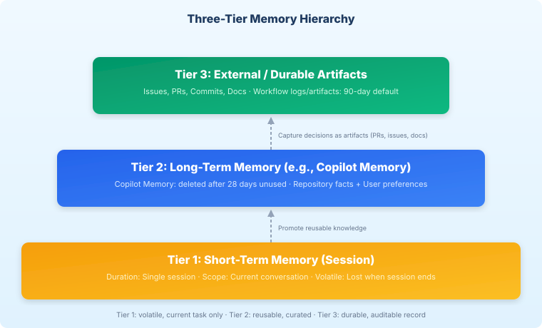

# Domain 3: Memory, State, & Execution

**Domain 3 · Weight: 10–15%**

Agents can't do useful work if they forget everything between turns. This domain covers how agents remember, how state persists across sessions, and how execution continuity is maintained across tools and environments — including the critical concept of context drift detection and correction.

## What You'll Learn & Why It Matters

Put simply, this domain answers one question: *how does an AI agent keep track of what it is doing — today, tomorrow, and when a different tool or person picks up the work?*

- **Where an agent's "memory" actually lives** — the current chat session, Copilot Memory, or GitHub records such as issues and pull requests — and how to pick the right one. *Why it matters:* information stored in the wrong place is the most common reason agents "forget" or redo work.
- **How to keep memory small and relevant** by scoping, expiring, pruning, and resetting it. *Why:* an agent buried in old or irrelevant notes makes worse decisions.
- **How Copilot Memory works** — what it learns, who can use it, and why unused entries disappear after 28 days. *Why:* the exam loves the difference between learned memory and authored rules.
- **How to save progress so work can resume** after a pause without repeating steps or changing earlier decisions.
- **How to spot and fix context drift** — when a long-running agent slowly wanders away from the goal.
- **How to keep the IDE, CLI, and cloud agent in sync** without contradictory or outdated information.

**Prerequisites:** You should know what a large language model (LLM), a context window, and a token are, plus basic Git, issue, pull request (PR), and GitHub Actions vocabulary. If any of these are new, read [Fundamentals](basics.md) first.

## Official Skills Measured

From the [GH-600 study guide](https://learn.microsoft.com/en-us/credentials/certifications/resources/study-guides/gh-600) — *Manage memory, state, and execution (10–15%)*:

**Implement agent memory strategies**

- Choose between short-term, long-term, and external memory → see [2. The Three-Tier Memory Hierarchy](#2-the-three-tier-memory-hierarchy)
- Scope agent memory to task-relevant information → see [3. Memory Scoping, Expiration, and Pruning](#3-memory-scoping-expiration-and-pruning)
- Define memory expiration, pruning, and reset rules → see [3. Memory Scoping, Expiration, and Pruning](#3-memory-scoping-expiration-and-pruning)

**Persist agent state and manage context drift**

- Capture task progress and decisions as durable artifacts → see [5. State Persistence via Durable Artifacts](#5-state-persistence-via-durable-artifacts)
- Resume agent work without repeating steps or diverging from prior decisions → see [5. State Persistence via Durable Artifacts](#5-state-persistence-via-durable-artifacts)
- Detect and correct drift during extended agent execution → see [6. Context Drift: Detection, Correction, and Re-Planning](#6-context-drift-detection-correction-and-re-planning)

**Ensure continuity of agent memory and state across tools and environments**

- Share agent state → see [7. Continuity Across Tools and Environments](#7-continuity-across-tools-and-environments)
- Prevent conflicting context → see [7. Continuity Across Tools and Environments](#7-continuity-across-tools-and-environments)
- Prevent stale context → see [7. Continuity Across Tools and Environments](#7-continuity-across-tools-and-environments)

## 1. Why Memory Matters in Agentic AI

Welcome, student. Domain 3 is all about one question: **how does an agent know what it's doing from one moment to the next?** Without memory, every agent interaction starts from zero — no awareness of previous turns, no knowledge of repository facts, no recollection of user preferences. That's why memory is arguably the most important infrastructure component in any agent system.

The Microsoft Learn module **"Memory, State, and Evaluation"** defines three memory categories: **short-term**, **long-term**, and **external** memory. The **GitHub Copilot Memory documentation** describes GitHub's built-in cross-session memory feature (repository-level facts and user-level preferences). Understanding the difference between these — and when each is appropriate — is the core skill tested in this domain.

By the end of this lesson, you'll be able to:

- Identify which memory type fits a given scenario
- Explain how memory scoping, expiration, and pruning work
- Describe Copilot Memory's repository-level and user-level mechanisms
- Recognize context drift and choose the right correction strategy
- Design for continuity across tool and environment boundaries

> **🎓 Teaching Tip — The Memory Mindset:** Think of memory like a construction site. **Short-term memory** is the foreman's clipboard for today's tasks. **Long-term memory** is the blueprint repository and site rules. **External durable artifacts** are the actual building — the concrete and steel that remain after everyone goes home. Each serves a different purpose, and confusing them leads to architectural mistakes the exam loves to test.

> **📘 In plain words:** An AI agent is like a very fast contractor who wakes up with amnesia every morning. Whatever it "knows" about your project must either be in front of it right now, be written in a notebook it is allowed to read, or be filed in the official project records. This whole domain is about choosing the right one of those three places.

### Key Terms for This Domain

- **Large language model (LLM):** the AI model behind Copilot that reads text and produces a response. Background: [Fundamentals](basics.md).
- **Token:** a small chunk of text (roughly a word or part of a word) that an LLM reads or writes. Model limits are counted in tokens.
- **Context window:** the maximum amount of text, measured in tokens, the model can "see" at once. Instructions, chat history, file contents, and tool results all share this space; anything outside it is invisible to the model.
- **Session:** one continuous working period of an agent — a chat conversation, a CLI run, or one cloud agent task. When it ends, its working context is gone.
- **Memory vs state:** *memory* is information the agent uses to make decisions; *state* is the record of progress — what is done, what was decided, and what remains ([Learn: state & drift](https://learn.microsoft.com/en-us/training/modules/memory-state-evaluation/3-agent-state-context-drift)).
- **Artifact / durable artifact:** a record that lives outside the agent and survives after the session ends — an issue, PR, commit, document, or workflow run. (In GitHub Actions, *workflow artifact* also has a narrower meaning: files a workflow uploads, such as a test report.)
- **Source of truth:** the one agreed place where a given kind of information is kept. If copies disagree, the source of truth wins.
- **Stale context:** information that was once true but no longer is. **Conflicting context:** two places say different things.
- **Context drift:** the agent's actions gradually stop matching the original goal or earlier decisions.
- **Scoping / expiration / pruning / reset:** deciding what to keep, when it disappears automatically, what to remove deliberately, and when to start over.
- **Status check / required status check:** a pass/fail result (usually from a GitHub Actions workflow) shown on a PR; a *required* one must pass before the PR can merge.

## 2. The Three-Tier Memory Hierarchy

The exam skill "Choose between short-term, long-term, and external memory" maps to **three memory types**. Each has different persistence, scope, and access characteristics. Here's the visual model — study this diagram carefully:



*Figure 3.1 — Three-Tier Memory Hierarchy: short-term (session), long-term (curated knowledge, e.g. Copilot Memory), and external (durable artifacts). Information flows upward as it becomes more permanent.*

> **📘 In plain words:** **Short-term memory** is a sticky note on your monitor — handy right now, thrown away at the end of the day. **Long-term memory** (Copilot Memory) is a team wiki page that gets archived automatically if nobody reads it for four weeks. **Durable artifacts** are a signed contract in the filing cabinet — anyone can pull it out years later and it says exactly what was agreed.

### Tier 1: Short-Term Memory (Session)

**Short-term memory** is the agent's working context for the current task or session. It includes:

- The current conversation history (user messages, agent responses, tool calls)
- In-session decisions, intermediate results, and tentative plans
- File contents the agent has read or edited during the session
- Temporary state that exists only for the duration of the interaction

Short-term memory is **volatile** — it is not preserved across sessions. Think of it as the agent's scratch pad. It's fast, local, and requires no special configuration.

### Tier 2: Long-Term Memory

**Long-term memory** contains curated knowledge that can be reused across tasks — more stable, typically summarized or structured information such as key decisions, patterns, and reusable knowledge. Repeatable processes belong in repository instructions or reusable skills.

On GitHub, the built-in long-term memory feature is **Copilot Memory** (public preview). It stores two categories of information:

- **Repository-level facts:** Coding conventions, architectural decisions, build commands, and project-specific rules for a repository
- **User-level preferences:** Implied or stated personal preferences about how a user wants to interact with Copilot (coding style, workflow habits)

Any Copilot Memory fact or preference that **goes unused for 28 days is automatically deleted**. The 28-day timer may reset whenever Copilot successfully validates and uses the entry. This prevents stale knowledge from lingering.

### Tier 3: External / Durable Artifacts

**External memory** is stored outside the agent in durable systems. On GitHub these are the records of agent actions — outputs that exist independently of any agent session:

- **Issues and comments:** Requirements, acceptance criteria, and discussion threads
- **Pull Requests:** Structured change proposals with plan, decisions, discussion history, and reviews
- **Commits:** Source code changes recorded in Git history
- **Documentation:** Repository docs and instructions
- **Workflow runs, logs, and artifacts:** CI/CD execution records and outputs

These artifacts are the **source of truth / system of record** — they can be reviewed at any time by any agent or human. Note that workflow logs and artifacts are an exception to "permanent": they are **retained for 90 days by default** (configurable) and then automatically deleted.

> **⚠️ Exam Alert:** The exam will test whether you know which memory tier applies in a given scenario. If the scenario says "the agent needs to remember a preference across sessions" → that's **long-term memory (e.g., Copilot Memory, Tier 2)**. If it says "the agent needs a permanent record of a configuration change" → that's a **durable artifact (Tier 3)**. Don't confuse session memory with long-term memory — session data is not preserved across sessions.

> **⚠️ Common mistake:** Thinking "Copilot Memory" means "Copilot remembers my chat." It doesn't. Chat history is short-term session context. Copilot Memory stores separate, validated repository facts and user preferences, and GitHub explicitly says passing context between Copilot Chat and a cloud agent session is distinct from Copilot Memory.

> **🎯 Exam angle:** Questions usually describe a piece of information and ask where it should live. Apply this rule in order: (1) only needed during this task? → **session context**; (2) a convention Copilot can learn and that may safely expire? → **Copilot Memory**; (3) a rule that must *always* apply and be reviewed by humans? → **custom instructions** (authored, durable); (4) a record of requirements, decisions, or results that must be auditable and permanent? → **durable artifact** (issue, PR, commit).

### Choosing Where Information Lives

Microsoft Learn ([Implement agent memory strategies](https://learn.microsoft.com/en-us/training/modules/memory-state-evaluation/2-agent-memory-strategies)) gives a simple placement rule:

| Information | Store it in | Why |
|---|---|---|
| Requirements and acceptance criteria | Issue or PR description | The agent can revisit the goal and validate against it |
| Plans and decisions | Same place (issue/PR, or documentation) | Work continues without reinterpreting earlier steps |
| Repeatable processes | Repository instructions or reusable skills | Avoids redefining the same workflow for every task |
| Execution results | Workflow logs and artifacts | Verifiable evidence of what ran |

> **⚠️ Exam Trap:** "Keep the requirements in the chat so the agent remembers them" is always wrong. Learn explicitly says to avoid storing critical information **only in prompts or chat history** — write it to an issue or PR ([Learn: continuity](https://learn.microsoft.com/en-us/training/modules/memory-state-evaluation/4-memory-state-continuity)).

### Worked Example: A Three-Day Agent Task

To see the three tiers working together, follow one realistic task: issue **#57 "Rate-limit failed logins"** in a Node.js repository, assigned to Copilot cloud agent. *(Illustrative scenario.)*

| When | Short-term (session context) | Copilot Memory (long-term, learned) | Durable artifacts (issue / PR / commits / runs) |
|---|---|---|---|
| **Day 1 — start** | Issue text, files the agent opened (`src/auth/login.ts`), test output, its draft plan | May learn a repository fact such as "tests run with `npm test`" — used later only if its citations still validate | Issue #57 holds the acceptance criteria; the agent opens PR #58 with its plan; first commits; workflow results in the **Checks** tab |
| **Day 1 — session ends** | **Gone.** Nothing from the working context carries into the next session | Learned facts remain (deleted if unused for 28 days) | Everything above is still there |
| **Day 2 — review** | A new session starts with only what it reads | Repository facts can also be applied by Copilot code review on PR #58 | Reviewer comments: "Use the shared Redis store, not an in-memory map." The decision is written into the PR description's **Decisions** block |
| **Day 3 — resume in the CLI** | A fresh CLI session reads PR #58's description, commits, and checks | The same repository facts are available to Copilot CLI | The agent continues from the **Next step** line in the PR description; new commits land on the same PR |

The lesson: everything that had to be known on Day 3 — the goal, the Redis decision, what was already finished — was written into the issue or PR. Copilot Memory helps with general repository conventions, but you cannot rely on it for task decisions: it is learned rather than authored, validated before use, and deleted after 28 days unused.

## 3. Memory Scoping, Expiration, and Pruning

Memory isn't just about storage — it's about relevance. An agent needs to know **what information is relevant to the current task** and **what information should be discarded**. The exam tests these memory management mechanisms:

In everyday terms: the context window is a small backpack. **Scoping** decides what goes in it, **expiration** is a best-before date that throws things out automatically, **pruning** is you deliberately clearing out what you no longer need, and a **reset** is emptying the backpack because the trip changed destination.

> **📘 In plain words:** Think of your fridge. Scoping = only buying what this week's recipes need. Expiration = the milk's best-before date. Pruning = clearing out leftovers on Sunday. Reset = emptying the fridge when you move house. A crammed fridge makes it harder to find what you need — and so does a crammed context window.

### Scoping

Memory scoping determines **which information is kept and visible** to the agent during a given task. Per Microsoft Learn, memory should be limited to information that affects the outcome: requirements and constraints, decisions that affect implementation, and validation/testing approaches. Temporary intermediate steps and duplicated context should not be stored. Scoping rules include:

- **Repository scope:** Copilot Memory repository-level facts can only be used in operations on the same repository
- **User scope:** Copilot Memory user-level preferences are only used in that same user's interactions (across repositories)
- **Task scope:** Only memory entries relevant to the current task are surfaced *(general pattern; tag/label-based scoping is not a documented Copilot Memory feature — unverified community info)*
- **Tool scope:** Memory from specific tool interactions (e.g., search results) is scoped to that tool's domain *(unverified community info)*

Also define a **single source of truth** per information type: Requirements → Issue; Decisions → Pull request or documentation; Validation rules → Repository instructions; Results → Workflow logs and artifacts.

### Expiration

Memory entries have **time-based expiration**:

- **Copilot Memory:** entries unused for 28 days are automatically deleted (timer may reset on successful validation and use)
- **Short-term memory:** ends with the session
- **Workflow logs and artifacts:** retained for **90 days by default**, then automatically deleted. Retention is configurable at repository, organization, or enterprise level (public repos 1–90 days; private repos up to 400 days). Since **October 1, 2026** the same retention setting also covers checks, workflow runs, and commit statuses (repository **Settings → Actions → General**) ([GitHub Docs: Actions settings](https://docs.github.com/en/repositories/managing-your-repositorys-settings-and-features/enabling-features-for-your-repository/managing-github-actions-settings-for-a-repository#configuring-the-retention-period-for-checks-workflow-runs-commit-statuses-artifacts-and-logs-in-your-repository))
- **Issues, PRs, commits:** persist until deleted

### Pruning

When memory exceeds capacity (especially the context window), the agent must **prune** less relevant information. General pruning strategies include:

- **Recency-based:** Keep the most recent N entries, discard older ones
- **Relevance-based:** Keep entries that match the current task's semantic context
- **Priority-based:** Keep high-priority entries (e.g., user preferences) over low-priority ones (e.g., intermediate calculations)

On GitHub, Microsoft Learn's pruning practices are: delete outdated workflow artifacts from the Actions tab (deleted artifacts cannot be restored), remove unused or stale workflow runs, avoid storing large or redundant outputs — and **summarize** detailed history (update the PR description with final decisions, reference key commits, link to workflow runs instead of copying logs).

### Reset Rules

Sometimes memory needs to be explicitly **reset** to avoid incorrect carryover. Reset triggers include:

- **Requirements change significantly** (e.g., the issue is rewritten)
- **A new implementation approach is chosen**
- **Previous assumptions are no longer valid** (e.g., context drift detected)
- **Error recovery:** After a critical failure, resetting memory prevents cascading errors
- **User request:** The user can explicitly request a reset (Copilot Memory entries can be deleted by users and repository owners)

In practice: update or rewrite the pull request description, close and recreate the PR if needed, and clearly document the new direction before continuing.

> **📘 Teaching Tip — The "Freshness" Concept:** The exam is big on **memory freshness**. Imagine an agent that memorized your database schema 30 days ago. If the schema changed last week, that memory is stale. Copilot Memory addresses this in two ways: repository facts are stored **with citations** that are checked against the current branch before use (only validated facts are used), and unused entries are deleted after 28 days. When you see a question about stale information, the answer usually involves **expiration**, **pruning**, **validation**, or **refreshing** from durable artifacts.

> **⚠️ Common mistake:** Believing "more context is always better." A context window stuffed with old logs and abandoned plans leaves less room for what matters and makes it easier for the model to latch onto outdated details. Summarize and link (for example, a PR description plus links to runs) instead of pasting everything.

> **🎯 Exam angle:** Look for the trigger word. "Information is outdated" → expiration, validation, or refresh from the source of truth. "Too much irrelevant history" → pruning or summarizing. "Requirements were rewritten" or "new approach chosen" → **reset**: rewrite the PR description (or close and recreate the PR) and document the new direction before continuing.

## 4. Copilot Memory — Repository Facts and User Preferences

Copilot Memory is GitHub's implementation of cross-session long-term memory (currently **public preview**). It is used by **Copilot cloud agent** (formerly "Copilot coding agent"), **Copilot code review**, **Copilot CLI**, and **agentic autofix**. Facts captured by one of these features can be used by another. Here are the exam-relevant details.

> **📘 In plain words:** Copilot Memory is like a careful colleague's notebook of project facts, where every note has a footnote pointing to the code that proves it. Before using a note, the colleague checks that the footnote still points at real code on the current branch. Notes nobody uses for four weeks are torn out.

### Repository-Level Facts

When Copilot works in a repository, Copilot Memory can learn facts about that repository, such as:

- **Code conventions:** Coding conventions and project-specific rules
- **Architectural patterns/decisions:** How the codebase is organized and why
- **Build commands:** How to build and test the project
- **Key file locations, API contracts, documentation references:** Other repository facts the agent discovers *(illustrative examples)*

Key rules:

- Facts are stored **with citations** pointing to the supporting code; before use, Copilot checks the citations against the current branch — **only validated facts are used**.
- Facts are only *created* from actions by users with **write access** who have Copilot Memory enabled; once stored they are available to anyone with Copilot Memory access in that repository.
- Facts are **repository-scoped** — they can only be used in operations on the same repository. This preserves privacy and security.
- Repository owners can review and manually delete stored facts — in the repository's **Settings → Copilot → Memory**; you review your own user-level preferences in your personal Copilot settings ([GitHub Docs: Managing Copilot Memory for your personal account](https://docs.github.com/en/copilot/how-tos/use-copilot-agents/copilot-memory/manage-for-yourself)).
- Copilot code review uses repository-level facts only (not user preferences).

### User-Level Preferences

Copilot Memory also stores preferences tied to the **user** (not the repository), available across repositories in that user's own Copilot interactions:

- **Coding style preferences:** Tabs vs spaces, naming conventions, comment styles
- **Testing preferences:** Preferred test framework, coverage requirements, mocking strategy
- **Tooling preferences:** Which linter, formatter, or build system the user prefers
- **Workflow habits:** Whether the user prefers PRs or direct commits, rebase or merge

Users can view and delete their own preferences. On Copilot Business/Enterprise, preferences are owned by the billing entity (org/enterprise), and admins can export or delete them (in bulk or per user). When building context for a session, Copilot only retrieves preferences owned by the user's **current** active billing entity; users with licenses from several places must pick a default billing entity before preferences are generated ([GitHub Docs: Copilot Memory](https://docs.github.com/copilot/concepts/agents/copilot-memory)).

User preferences are stored with citations that may include direct user quotes; unlike repository facts (checked against the branch), Copilot uses its best judgment to confirm a preference still applies.

Copilot Memory is **enabled per user**, not per repository: on by default for individual plans; for organization/enterprise-managed plans an administrator must enable the policy first, after which users can opt out.

### 28-Day Retention

This is the single most important Copilot Memory detail for the exam:

- Any stored fact or preference that **goes unused for 28 days is automatically deleted**
- The 28-day timer **may reset whenever Copilot successfully validates and uses** an entry
- Deleted memories must be re-learned *(no recovery mechanism is documented — unverified community info)*
- Facts captured from PRs closed without merging only affect behavior if the current codebase still substantiates them (validation step)

This design prevents **knowledge drift** — the risk that the agent acts on outdated information.

### Copilot Memory vs Custom Instructions vs Session Context

- **Copilot Memory** is *learned* by Copilot; GitHub positions it as reducing repeated prompting and the need for regular manual maintenance of custom instruction files — not replacing them.
- **Custom instructions** (`.github/copilot-instructions.md`, `*.instructions.md`, `AGENTS.md`) are *authored* by people and are the place for deliberate, reviewable rules.
- **Session context passing** between Copilot Chat and a Copilot cloud agent session on GitHub.com is scoped to the sessions you're actively working with and is explicitly **distinct from Copilot Memory** ([GitHub Docs: Copilot on GitHub.com](https://docs.github.com/en/copilot/concepts/agents/cloud-agent/about-cloud-agent)).

> **⚠️ Critical Exam Detail:** The 28-day retention applies to **Copilot Memory only**, not to durable artifacts. A commit you made 6 months ago is still accessible via Git history. But a preference Copilot learned 6 months ago will have been deleted if it went unused for 28 days. The exam WILL ask: "An agent needs to remember a fact from last year." The answer is NOT Copilot Memory — it's a durable artifact (a commit, a PR, an issue, a file in the repo). Note: default workflow logs/artifacts (90-day retention) would not qualify either.

> **⚠️ Common mistake:** Trying to *write* rules into Copilot Memory ("Copilot, remember that we always use tabs"). Copilot Memory is learned and curated by Copilot; people can only view and delete entries. Rules you want to control belong in custom instructions such as `.github/copilot-instructions.md`.

> **🎯 Exam angle:** Scenarios often contrast Copilot Memory with custom instructions or artifacts. Decision rule: "must *always* apply" → custom instructions; "must be retrievable months later" → durable artifact; "Copilot should pick up conventions over time without manual upkeep" → Copilot Memory. If the scenario involves **code review** ignoring a *personal* preference, remember code review uses repository facts only.

## 5. State Persistence via Durable Artifacts

When an agent needs to preserve state **permanently**, it uses **durable artifacts**. These are the concrete outputs of agent activity that survive session termination and agent restarts. Microsoft Learn's typical flow: create an issue with clear acceptance criteria → assign it to an agent → the agent creates a branch and opens a PR → workflows run on each push to validate changes.

**Durable** simply means "still there after the session, the tool, or the person is gone." An **artifact** is any concrete record the work leaves behind.

> **📘 In plain words:** Durable artifacts are the signed contract and the receipts. A conversation ("we agreed on Redis, right?") can be forgotten or remembered differently; a line in the PR description saying "D2: use Redis — approved by @maria" can't.

### Types of Durable Artifacts

| Artifact | Persistence Mechanism | Example Use Case |
|---|---|---|
| **Commits** | Git history | Agent writes a fix, commits it, and pushes — the change is recorded incrementally |
| **Pull Requests** | GitHub (persistent) | Agent opens a PR — description holds the current plan; thread, commits, and checks are aggregated |
| **Workflow Logs & Artifacts** | GitHub Actions storage (90-day default retention, configurable) | Agent runs a CI pipeline — every output and error is logged |
| **Issues & Comments** | GitHub (persistent) | Requirements/acceptance criteria; agent files a bug report with diagnostic information |
| **Releases & Tags** | GitHub releases (persistent) | Agent cuts a release with changelog and binary artifacts |

### Artifact as Memory

Durable artifacts serve as an **external memory store**. The **pull request is the state anchor**: keep the task description, acceptance criteria (or issue link), plan summary, and progress updates in the PR description, and update it when decisions change. To resume work without repeating steps:

1. Open the existing pull request
2. Review the description and linked issue
3. Check commits already made
4. Review workflow results under the "Checks" tab
5. Continue from the latest state

Other examples:

- Reading a previous PR's description to understand why a change was made
- Inspecting workflow logs to diagnose a previous CI failure
- Reviewing issues to understand the history of a bug

### Worked Example: Resuming After an Interruption

Continuing the issue #57 scenario, here is a PR description that works as a "save game" file. Microsoft Learn recommends the PR hold the task, acceptance criteria (or issue link), the plan, and progress updates, updated whenever decisions change ([Learn: state & drift](https://learn.microsoft.com/en-us/training/modules/memory-state-evaluation/3-agent-state-context-drift)). The headings below are one practical layout, not a required GitHub format:

```markdown
## Task
Closes #57 — rate-limit failed logins (acceptance criteria live in the issue).

## Plan
1. Add `loginLimiter` middleware in `src/middleware/`
2. Wire it into `POST /login`
3. Add tests for the 6th failed attempt and for the reset window

## Decisions
- D1 (Day 1): 5 failed attempts per IP per 15 minutes (from issue #57)
- D2 (Day 2, reviewer @maria): use the shared Redis store, not an in-memory map, so limits work across instances
- D3 (Day 2): no change to the public `/login` response body

## Progress
- [x] Step 1 — middleware added (commit a1b2c3d)
- [x] Step 2 — wired into `/login` (commit d4e5f6a)
- [ ] Step 3 — tests

## Next step
Write the step 3 tests, push, and confirm all required checks pass.

## Evidence
- Latest workflow run: <link to run> — green, but no limiter tests yet
```

An agent (or a human) resuming on Day 3 reads this block first, then follows Learn's resume flow: check the commits listed under **Progress**, open the **Checks** tab, and start at **Next step**. Because **Decisions** records D2 and D3 with who approved them, the agent won't quietly switch back to an in-memory map or change the response body. The **Evidence** line links to the run instead of pasting logs, which keeps the description short.

### Agent Commits as Traceable State

Commits from **Copilot cloud agent** are authored by Copilot with the person who started the task as **co-author**, are signed (shown as **Verified**), and each commit message links to the **session logs** — so any later session, reviewer, or auditor can trace why a change was made ([GitHub Docs: Managing agent sessions](https://docs.github.com/en/copilot/how-tos/use-copilot-agents/cloud-agent/track-copilot-sessions)).

This is the pattern the exam expects: **short-term memory** for the current session, **long-term memory (e.g., Copilot Memory)** for cross-session preferences and facts, and **durable artifacts** for state that must survive everything.

> **🎓 Teaching Tip — The "Write It Down" Rule:** If you want an agent to remember something permanently, the answer is always: **write it to a durable artifact**. Commit a config file. Open an issue. Post a comment. Update the PR description. If the memory exists only in the agent's short-term or long-term memory, it's temporary. The exam loves this distinction.

> **⚠️ Common mistake:** Restarting an interrupted task with a brand-new prompt that re-describes the work from memory. That invites duplicated steps and silently reversed decisions. Point the agent at the existing PR instead and let it reconstruct state from the description, commits, and checks.

> **🎯 Exam angle:** Scenarios read like "an agent resumes and repeats work" or "a new session contradicts an earlier decision." The correct answer anchors on the **existing PR**: review its description and linked issue, the commits, and the Checks tab, then continue from the latest state. Answers that rely on chat history or on re-prompting from scratch are distractors.

## 6. Context Drift: Detection, Correction, and Re-Planning

**Context drift** occurs when the agent's actions no longer align with the original goal or prior decisions — often because its internal model of the world diverges from reality. It's one of the most dangerous failure modes in agentic systems because it's silent — the agent doesn't know it's operating on outdated assumptions.

> **📘 In plain words:** Drift is the children's game of telephone. The first person whispers "use the shared Redis store"; ten whispers later it has become "store attempts somewhere." Each step looks reasonable, but the final message no longer matches the original. The fix is not to whisper more carefully — it's to go back and re-read the original message (the issue and PR description).

### What Causes Context Drift?

- **Stale memory:** The agent remembers a file structure that has since changed
- **External state changes:** An environment variable, API response, or database state changed without the agent noticing
- **Concurrent modifications:** Another agent or human changed files while this agent was working
- **Time-sensitive information:** The agent is using timing-dependent data (e.g., rate limits, token expiration) that is no longer valid
- **Erroneous assumptions:** The agent inferred something about the system that was never true

### Detection Strategies

In GitHub workflows (per Microsoft Learn), drift is identified by checking:

- Whether pull request changes satisfy the **acceptance criteria**
- Whether commits **contradict earlier decisions**
- Whether workflow checks are **failing or missing**

General techniques that support detection:

- **Re-read confirmation:** Before making a change, the agent re-reads the file to verify its mental model matches reality
- **Timestamp checking:** Comparing the agent's last-known state timestamp with the actual file modification timestamp
- **Consistency validation:** Running validation checks (e.g., parsing config files) to confirm expected structure
- **Diff comparison:** Comparing the expected file content with the actual content before editing

### Correction and Re-Planning

To correct drift, re-align the agent with the source of truth (re-read the issue or PR description, compare current changes with acceptance criteria, update the PR description if needed, re-run workflows or push new commits to trigger validation). Steps:

1. **Flag the drift:** Log the discrepancy for auditability
2. **Refresh context:** Re-read the issue/PR and relevant files, re-query the environment, and rebuild the mental model
3. **Re-plan:** Re-evaluate the plan against the corrected context — update the PR description if the plan changes
4. **Escalate if needed:** If the drift is severe enough to invalidate the entire plan, escalate to a human

### Steering and Stopping a Cloud Agent Session

For Copilot cloud agent, GitHub provides direct drift-correction controls ([GitHub Docs: Managing agent sessions](https://docs.github.com/en/copilot/how-tos/use-copilot-agents/cloud-agent/track-copilot-sessions)):

- **Steer:** type a follow-up in the prompt box below the session log to redirect the agent *without stopping it*; Copilot applies it after finishing its current tool call. Each steering message consumes AI credits; steering isn't available for third-party coding agents.
- **Stop session:** ends the underlying GitHub Actions run and **preserves commits already pushed** — use it when the task is obsolete or you want to restart with a new prompt.
- **Archive:** cloud agent sessions can be archived but **not deleted** (only local CLI/IDE/app sessions can be deleted).

### Worked Example: Detecting and Correcting Drift

Back to PR #58. Forty minutes into the Day 3 session, the agent pushes a commit that stores attempt counts in `new Map()` and changes `/login` to return `{ "error": "rate_limited", "retryAfter": 900 }`. Each change looks sensible in isolation. *(Illustrative scenario.)*

**Detect** — using Learn's three checks:

| Check | What you see | Drift? |
|---|---|---|
| Do changes satisfy acceptance criteria? | Limit works on one server, but issue #57 requires it across instances | Yes |
| Do commits contradict earlier decisions? | `new Map()` contradicts **D2** (Redis); new response body contradicts **D3** | Yes |
| Are checks failing or missing? | The API contract test fails on the response body | Yes |

**Correct** — because the session is still running and its earlier commits are useful, steer it rather than stopping it. A good steering message points back to the source of truth instead of restating everything:

```text
Stop and re-read the Decisions block in this PR's description and issue #57.
Your last commit contradicts D2 (use the shared Redis store, not new Map())
and D3 (do not change the /login response body). Revert those two changes,
implement the limiter with the existing Redis client in src/lib/redis.ts,
then re-run the tests and update the Progress block.
```

The message names the exact decisions broken, says what to undo, and tells the agent where to look — re-read, re-validate, re-plan. After the agent pushes the fix, the workflows run again; once the contract test passes and the Progress block is updated, the PR is back in line with its source of truth. If the decisions themselves had become wrong (say, the team dropped Redis), the right move would instead be a **reset**: update the issue and PR description first, then continue.

### Preventing Context Drift

Prevention is better than correction. Best practices include:

- **Validate before each write:** Re-read the target file immediately before editing
- **Keep branches up to date** with the base branch before continuing work
- **Use transactions:** Group related changes so partial failures don't leave inconsistent state
- **Short task durations:** Shorter tasks are less likely to experience drift than long-running tasks. Copilot cloud agent enforces this anyway: each session has a hard **59-minute** maximum, works on **one branch** and opens **one PR** per task, and can only change the repository the task was started in. GitHub's advice is to break complex work into smaller tasks; you can set a shorter limit with `timeout-minutes` in `copilot-setup-steps.yml` ([GitHub Docs](https://docs.github.com/en/copilot/concepts/agents/cloud-agent/about-cloud-agent))
- **Environment checks:** Verify environment variables, service health, and auth tokens at the start of each task
- **Required status checks / branch protection:** Ensure workflows pass (and optionally that branches are up to date) before merging

> **⚠️ Exam Trap:** A common wrong answer on context drift questions is "just retry the operation." Retrying without refreshing context will fail the same way — the agent will use the same stale assumptions. The correct response is always **re-read → re-validate → re-plan**, not just retry. If you see a question where an agent keeps failing the same operation, look for the answer that includes re-reading the current state.

> **⚠️ Common mistake:** Waiting for drift to announce itself. Agents rarely say "I've drifted"; you catch drift only by comparing the work against the issue's acceptance criteria and the PR's recorded decisions — or by letting required checks fail loudly.

> **🎯 Exam angle:** Drift questions are usually framed as "what should happen next?" Decision rule: session still useful, just off course → **steer**; task obsolete or you want a clean restart → **stop** (pushed commits are kept); requirements or assumptions changed → **reset** the PR description/issue first; plan invalid and you can't tell what's right → **escalate** to a human. "Retry" without refreshing context is almost always wrong.

## 7. Continuity Across Tools and Environments

Modern agent workflows span multiple tools and environments. An agent might start work in the IDE, continue in the CLI, and complete tasks in a GitHub-hosted environment — all within the same task. The exam tests whether you understand how continuity is maintained across these boundaries: by relying on **durable artifacts and consistent sources of truth rather than temporary session context**.

In plain terms: each tool (VS Code, the CLI, the cloud agent) starts its own fresh session and cannot read another tool's chat. Continuity therefore means "every tool reads the same records."

> **📘 In plain words:** Continuity is a relay race. The baton is not the runner's memory of the race — it's the PR link. Each new runner (tool) picks up the baton, reads where things stand, and keeps going. Dropping the baton means a new runner starting from the beginning.

### The Continuity Challenge

Each environment has different capabilities and limitations:

| Environment | Memory Available | Continuity Mechanism |
|---|---|---|
| **IDE (VS Code)** | Short-term (chat session) | Copilot Memory is not listed as used by IDE chat; re-anchor to the PR/issue, repository instructions, and commits |
| **Copilot CLI (`copilot`)** | Short-term (CLI session) + Copilot Memory | CLI sessions are independent; Copilot Memory (repo facts + the initiating user's preferences) provides continuity |
| **Copilot cloud agent (runs in a GitHub Actions–powered environment)** | Short-term (agent session) + Copilot Memory | PR, commits, and session logs; Copilot Memory shared with code review and CLI |
| **CI (plain GitHub Actions workflows)** | Short-term (workflow run) only | No cross-run memory; relies on durable artifacts (logs, artifacts, git state) |
| **Codespaces** | Same as the IDE running in it | Workspace persists while the codespace exists; durable artifacts bridge sessions |

### Sharing Agent State

Per [Learn: continuity](https://learn.microsoft.com/en-us/training/modules/memory-state-evaluation/4-memory-state-continuity), share state through **durable references, not copied context**:

- PR numbers and branch names
- Commit SHAs
- Workflow run links
- Issue and PR URLs

Any tool (IDE, CLI, GitHub UI) can open the same PR and reconstruct progress from its commits and workflow runs, so no session context needs to be transferred.

GitHub-native sharing mechanisms worth knowing:

- **Copilot Memory across features:** a fact learned by cloud agent can be applied later by code review, and vice versa (e.g., code review learns two settings files must stay in sync → cloud agent updates both) ([GitHub Docs](https://docs.github.com/copilot/concepts/agents/copilot-memory)).
- **Session sharing:** cloud agent sessions are **shared by default** (visible in the repository's Agents tab to anyone with repo access); local CLI/IDE sessions are **unshared by default** and can be shared view-only ([GitHub Docs](https://docs.github.com/en/copilot/how-tos/use-copilot-agents/cloud-agent/track-copilot-sessions)).
- **Chat ↔ cloud agent:** starting a session from Copilot Chat carries the conversation's context in; afterwards Chat can answer "what changed, what was validated, and why" from the session logs.

### Preventing Conflicting Context

**Conflicting context** = the same information exists in multiple places with different values. Prevent it by:

- Defining a **single source of truth** per information type (requirements → issue; decisions/progress → PR; validation rules → repository instructions; results → workflow runs/artifacts)
- Not duplicating requirements or decisions across locations — e.g., don't redefine acceptance criteria in several prompts
- **Updating the original source** instead of creating new copies

### Preventing Stale Context

**Stale context** = outdated information used during execution. Typical GitHub causes: the PR is behind the base branch, workflow results no longer reflect the current code, or requirements changed without the issue being updated. Prevent it by:

- Bringing the branch up to date with the base branch before continuing
- Reviewing the latest commits and workflow runs before making changes (re-run workflows after changes; check the **Checks** tab)
- Updating issues/PRs when requirements change
- Letting GitHub enforce it: **required status checks** and branch protection can require branches to be up to date before merging
- On the memory side, Copilot Memory's citation validation and 28-day expiry keep learned facts from going stale ([GitHub Docs](https://docs.github.com/copilot/concepts/agents/copilot-memory))

### Other Continuity Patterns

- **Checkpoint artifacts:** Write intermediate state to files (JSON, YAML) that the next environment can read
- **Shared configuration:** Use `.github/copilot-instructions.md`, `.github/instructions/*.instructions.md` (with `applyTo` globs), and/or `AGENTS.md` so environments share the same behavioral guidelines
- **Token-based identity:** Use GitHub tokens (GitHub App installation tokens or PATs) so the agent can authenticate in any environment
- **State files in the repo:** Store agent progress state in a well-known path such as `.github/agent-state/` *(illustrative convention, not a GitHub feature; Microsoft Learn prefers issues/PRs as the state record)*

The example below shows what such a checkpoint file might contain when an IDE agent hands work to a CI job. Treat it as a team convention you might see, not something GitHub creates for you:

```text
# Example: Continuity via checkpoint file (illustrative convention)
# Written by IDE agent, read by CI agent

.github/agent-state/task-42-checkpoint.json:
{
  "task_id": "42",
  "phase": "code-review",
  "files_scanned": [
    "src/auth/login.ts",
    "src/auth/register.ts"
  ],
  "findings": [
    {
      "severity": "high",
      "file": "src/auth/login.ts",
      "line": 45,
      "description": "SQL injection vulnerability in raw query"
    }
  ],
  "next_environment": "ci",
  "continuation_url": "https://github.com/org/repo/actions/runs/12345"
}
```

The file records the phase, what was already scanned (so the next environment won't rescan it), the findings so far, and a link to the run that continues the work. Notice it stores **references** (file paths, a run URL) rather than copying full logs. If you use a file like this, keep it alongside — not instead of — the PR, which remains the primary state record.

> **⚠️ Common mistake:** Copy-pasting a long chat transcript from VS Code into the CLI to "bring it up to speed." That duplicates context and creates a second, unofficial copy that will soon disagree with the PR. Share the PR number, branch, and commit SHAs instead.

> **🎯 Exam angle:** Handoff questions ask how agent B learns what agent A did in a different tool. The right answer is always a durable reference (PR, issue, commit SHA, workflow run link) — never "transfer the session," "copy the chat," or "rely on Copilot Memory for task progress." For *conflicting* context pick "single source of truth, update the original"; for *stale* context pick "update the branch and review latest commits and runs."

> **📘 Teaching Tip — Environment Handoff:** On the exam, questions about environment handoff are really testing **durable artifact usage**. The agent in environment A writes its state to a durable artifact (PR description, issue, commit, workflow artifact), and the agent in environment B reads it to continue. There's no magic "environment bridge" — it's always: *write state, reference via artifact, read state*. Typical flow: start in the IDE → open/reference the PR → continue via CLI or automation → validate with workflows → review and finalize in the PR.

## 8. Domain 3 Quick Reference

Use this table for a final review: you should be able to explain each row in one sentence, in your own words.

| Concept | Key Detail | Exam Tip |
|---|---|---|
| Short-Term Memory | Session/task-scoped, volatile, not preserved across sessions | Also called "session memory" — do not confuse with Copilot Memory |
| Long-Term Memory / Copilot Memory | Curated reusable knowledge; Copilot Memory: deleted after 28 days unused, citation-validated, repository facts + user preferences | Tier 2 — remembers preferences and facts across sessions |
| External Memory / Durable Artifacts | Issues, PRs, commits, docs, workflow runs (logs/artifacts: 90-day default) | Tier 3 — source of truth; use for anything that must survive |
| Memory Scoping | Keep only outcome-relevant info; repo facts limited to their repo | Prevents irrelevant data from cluttering the context window |
| Context Drift | Actions diverge from the original goal or prior decisions | Fix: re-read, re-validate, re-plan — never just retry |
| Continuity | State shared via durable references (PR #, SHAs, run links) | Write state → reference via artifact → read state in next environment |

> **🎓 Video Insight — Context rot and the persistent timeline:** Ari describes "context rot" — when the context window is too full, the model drifts from the main goal. The GitHub platform (issues, PRs, commits, workflow artifacts) is the **system of record**. Agents don't start over — they check the PR history, commits, and past workflow runs to know what happened and decide what to do next. *(unverified community info — video source not checked)*

## Recap: Key Takeaways

- An agent's working context lives in the **session** and disappears when the session ends.
- **Copilot Memory** (public preview) stores learned repository facts and user preferences across sessions.
- Copilot Memory entries unused for **28 days** are deleted; repository facts are used only after their citations validate against the current branch.
- Copilot Memory is used by cloud agent, code review (repository facts only), Copilot CLI, and agentic autofix.
- Rules that must always apply go in **custom instructions**, not Copilot Memory.
- **Issues, PRs, and commits** are the durable source of truth; workflow logs and artifacts expire after **90 days** by default.
- Use the **PR description** as the state anchor: task, plan, decisions, progress, next step.
- Resume by reading the PR, linked issue, commits, and Checks tab — never by re-prompting from scratch.
- **Context drift** is silent; detect it by comparing work against acceptance criteria, recorded decisions, and checks.
- Correct drift with **re-read → re-validate → re-plan**; steer a useful session, stop an obsolete one, reset when requirements change.
- Share state across tools via **references** (PR #, SHAs, run links), with one source of truth per information type.

## Hands-On Practice

Use a personal repository you can experiment in (a small Node.js or Python project is ideal).

**Exercise 1 — Build a PR "save game" and resume from it**

1. Create an issue titled "Add a `/health` endpoint" with three acceptance criteria (returns HTTP 200, JSON body `{"status":"ok"}`, has a test).
2. Create a branch, make one small commit, and open a draft PR that links the issue. Paste the Task / Plan / Decisions / Progress / Next step layout from the worked example and fill it in.
3. Close your editor. Later, open a **fresh** Copilot Chat session (or the CLI), give it only the PR URL or description, and ask it to continue from **Next step**.

*Expected result:* Copilot picks up at the next unfinished step without redoing the first commit or changing your recorded decisions. If it repeats work, your Progress block was too vague — tighten it and try again.

**Exercise 2 — Plant and catch drift**

1. In the same PR, add a decision: "D1: no new dependencies — use the standard library only."
2. Deliberately push a commit that adds a new package (for example, an HTTP framework) to build the endpoint.
3. Run the three drift checks from the worked example (acceptance criteria, decisions, checks) and write down which one caught it.
4. Correct it: revert the commit, re-run the workflow, and update the Progress block.

*Expected result:* the "commits contradict earlier decisions" check flags the new dependency; after the revert, the PR description, commits, and checks agree again.

**Exercise 3 — Inspect memory and retention settings**

1. If your Copilot plan includes Copilot Memory, open the repository's **Settings → Copilot → Memory** and review any stored facts; then check your own preferences in your personal Copilot settings.
2. Open **Settings → Actions → General** and find the retention setting for checks, workflow runs, statuses, artifacts, and logs.

*Expected result:* you can say which memories exist (the list may be empty if no supported Copilot feature has run in the repo yet), and you can see the repository's current retention period (90 days unless changed).

**Related Microsoft Learn units:** [Implement agent memory strategies](https://learn.microsoft.com/en-us/training/modules/memory-state-evaluation/2-agent-memory-strategies) · [Persist agent state and manage context drift](https://learn.microsoft.com/en-us/training/modules/memory-state-evaluation/3-agent-state-context-drift) · [Continuity of memory and state across tools](https://learn.microsoft.com/en-us/training/modules/memory-state-evaluation/4-memory-state-continuity) · [Full module: Memory, state, and evaluation](https://learn.microsoft.com/en-us/training/modules/memory-state-evaluation/)

## Practice Questions

**1.** A team wants an agent to apply the same multi-step release checklist on every release task without restating it in each prompt. Where should the checklist live?

- A. In the first message of each chat session
- B. In a pinned issue comment that is copied into each new PR
- C. In repository instructions or a reusable skill
- D. In Copilot Memory, by asking Copilot to remember it

> **✅ Answer:** C — Repeatable processes belong in instructions or reusable skills; Copilot Memory is learned (and expires when unused), and copying text creates conflicting context.

**2.** A cloud agent session is clearly implementing the wrong approach, but its first commits are useful. You want it to switch to the team's existing `ErrorHandler` utility without losing progress. What is the best action?

- A. Stop the session and delete the branch
- B. Steer the session with a follow-up prompt in the session log view
- C. Close the PR and reassign the issue
- D. Wait for the 59-minute timeout and start a new session

> **✅ Answer:** B — Steering redirects a running session after its current tool call, without stopping it or discarding pushed commits.

**3.** A developer continues an agent's work in the CLI and finds that acceptance criteria in their prompt differ from those in the issue. Which practice prevents this?

- A. Keep both versions and let the agent pick the newest
- B. Copy the criteria into every prompt to be safe
- C. Store the criteria in Copilot Memory
- D. Keep the issue as the single source of truth and update it instead of restating criteria elsewhere

> **✅ Answer:** D — Conflicting context is prevented by one source of truth per information type and updating the original source.

**4.** An agent resumes a PR from last week. Its last green check run predates several commits merged into `main`. What should happen before it continues?

- A. Bring the branch up to date with the base branch and review the latest commits and workflow runs
- B. Trust the old green checks and keep coding
- C. Retry the last failing step without changes
- D. Reset Copilot Memory for the repository

> **✅ Answer:** A — That's stale context; refresh from the base branch and latest workflow results (required status checks can enforce up-to-date branches).

**5.** Copilot Memory stored a fact from a PR that was closed without merging, and the code it described was never added. What happens when Copilot later considers using that fact?

- A. It uses the fact because facts are only deleted after 28 days
- B. It checks the fact's citations against the current branch and does not use it if the code doesn't substantiate it
- C. It asks a repository owner to approve the fact
- D. It applies the fact only during Copilot code review

> **✅ Answer:** B — Repository facts are citation-validated against the current branch; only validated facts are used.

---

[← D2: Tooling & MCP](domain-2.md) · [Home](index.md) · [Glossary](glossary.md) · [D4: Evaluation →](domain-4.md)
