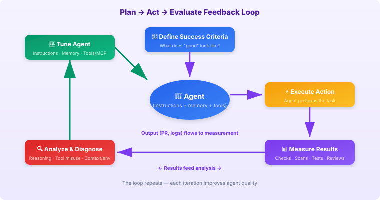

# Domain 4: Evaluation, Error Analysis, & Tuning

**Domain 4 · Weight: 15–20%**

You've built your agent. Now how do you know if it's working? Domain 4 is about the **feedback cycle** — defining success criteria, detecting failures, diagnosing root causes, and iteratively tuning agent behavior. This is where theory meets practice on the exam.

## What You'll Learn & Why It Matters

Put simply, this domain answers: *did the agent actually do the job — and if not, why not, and what do we change?*

- **How to write a "definition of done" for an agent task** — expected outcomes plus the limits it must work within. *Why it matters:* an agent can't hit a target nobody wrote down, and you can't grade it either.
- **Which evaluation signals to collect** — numbers (tests, coverage, alert counts) and human judgment (reviews). *Why:* each catches problems the other misses.
- **What GitHub's automated scanners catch** — CodeQL, Dependabot / dependency review, and secret scanning — and how to make them block a merge.
- **How to read the evidence** (session logs, workflow logs, artifacts, the PR) to find *why* an agent failed, and sort it into reasoning error, tool misuse, or context issue.
- **Which lever to adjust** — instructions, memory/state, or tools — and how to re-run to prove the fix worked.

**Prerequisites:** basic Git, pull request (PR), and GitHub Actions/YAML knowledge, plus what an LLM and a prompt are — see [Fundamentals](basics.md). It also helps to have read [Domain 3](domain-3.md), because the evidence you evaluate lives in issues, PRs, and workflow runs.

## Official Skills Measured

From the [GH-600 study guide](https://learn.microsoft.com/en-us/credentials/certifications/resources/study-guides/gh-600) — *Perform evaluation, error analysis, and tuning (15–20%)*:

**Define success criteria and evaluation signals for agent tasks**

- Specify expected outcomes and operational constraints for agent tasks → see [3. Defining Success Criteria and Evaluation Signals](#3-defining-success-criteria-and-evaluation-signals)
- Identify qualitative and quantitative evaluation signals to evaluate agents → see [3. Defining Success Criteria and Evaluation Signals](#3-defining-success-criteria-and-evaluation-signals)
- Align evaluation criteria with development intent → see [3. Defining Success Criteria and Evaluation Signals](#3-defining-success-criteria-and-evaluation-signals)
- Generate evaluation signals by using automated scanning tools → see [4. Automated Scanning Tools for Evaluation](#4-automated-scanning-tools-for-evaluation)

**Analyze agent failures and identify root causes**

- Identify failures by using logs, plans, traces, outputs, and workflow artifacts → see [7. Evaluation Methods: Session Logs, Workflow Artifacts, PR Reviews](#7-evaluation-methods-session-logs-workflow-artifacts-pr-reviews)
- Classify root causes, including reasoning errors, tool misuse, and context or environment issues → see [5. Root Cause Analysis: Symptom → Root Cause → Fix](#5-root-cause-analysis-symptom-root-cause-fix)

**Tune agent behavior based on evaluation results**

- Revise instructions, workflows, or constraints → see [6. The Tuning Levers: Instructions, Memory, Tools (incl. Environment & MCP)](#6-the-tuning-levers-instructions-memory-tools-incl-environment-mcp)
- Refine memory usage → see [6. The Tuning Levers: Instructions, Memory, Tools (incl. Environment & MCP)](#6-the-tuning-levers-instructions-memory-tools-incl-environment-mcp)
- Refine tool usage and tool access → see [6. The Tuning Levers: Instructions, Memory, Tools (incl. Environment & MCP)](#6-the-tuning-levers-instructions-memory-tools-incl-environment-mcp)

## 1. The Evaluation Mindset

Welcome to Domain 4. If Domain 3 was about how agents *remember*, Domain 4 is about how agents *improve*. The core loop is simple: **Define criteria → Execute → Measure → Analyze → Tune → Repeat**. This site calls it the **Plan-Act-Evaluate (PAE)** cycle *(term not used in official sources — unverified community info)*. Microsoft Learn describes the same feedback loop as: run the agent on a task → observe failures through logs and artifacts → identify the root cause → apply fixes to prompts, memory, or tools → re-run the workflow. The exam expects you to understand every step.

In this lesson, I'll teach you:

- How to define meaningful success criteria that an agent or CI pipeline can verify
- Which automated scanning tools are available and what each one detects
- How to do root cause analysis when an agent fails — with a structured decision framework
- The tuning levers: instructions, memory/state, and tools (including environment and MCP)
- How session logs, workflow artifacts, and PR reviews serve as evaluation methods

> **📘 Teaching Tip — Evaluation Is Not Optional:** The exam treats evaluation as a **first-class concern**, not an afterthought. Every agent workflow should have explicit evaluation checkpoints. If a question presents an agent workflow without any evaluation step, the implied correct answer is usually: *"add an evaluation gate."* This is similar to how you'd never deploy code without tests — you should never deploy an agent configuration without evaluation.

> **📘 In plain words:** Evaluating an agent is like a driving test. The examiner has a checklist written *before* the drive (success criteria), watches specific things (signals), and if you fail, tells you exactly why (root cause) so you can practise that skill (tuning) and retake the test (re-run).

### Key Terms for This Domain

- **Evaluation:** checking an agent's output against what was intended.
- **Success criteria / acceptance criteria:** the written, checkable conditions that mean "done" — usually in the issue.
- **Operational constraints:** limits the agent must respect (files in scope, tools allowed, time, approvals).
- **Signal:** any piece of evidence that tells you whether a criterion was met — a test result, an alert count, a review comment.
- **Quantitative vs qualitative signal:** a number or pass/fail result vs a human judgment.
- **Gate / quality gate:** a checkpoint that must pass before work moves on (for example, a required status check before merge).
- **Status check / required status check / branch protection:** pass/fail results shown on a PR; branch protection rules can make specific checks *required* for merging.
- **Root cause vs symptom:** the symptom is what you observe ("wrong code"); the root cause is the underlying reason ("the issue never mentioned the auth rule").
- **Tuning / lever:** a deliberate change to instructions, memory/state, or tools to improve the next run.
- **Session log / trace:** the step-by-step record of what an agent did and why — prompts, reasoning, tool calls, results.
- **Workflow artifact:** a file a GitHub Actions run uploads, such as a test or coverage report (kept 90 days by default).

## 2. The Evaluation Feedback Loop

Here's the core mental model for Domain 4. The evaluation feedback loop shows how agent output flows through measurement, analysis, and tuning back into the agent:



*Figure 4.1 — The Evaluation Feedback Loop: Define criteria → Execute → Measure results → Analyze root causes → Tune the agent (instructions, memory, tools/MCP) → Repeat.*

The exam frames evaluation questions within this loop. If you're asked about a failure, trace backward: was the **criteria** poorly defined? Was the **measurement** incomplete? Was the **analysis** wrong? The answer will point to one of these stages.

> **📘 In plain words:** It's a taste-and-adjust loop in cooking: decide what "good" tastes like, cook, taste, figure out what's off (too salty? undercooked?), change one thing, and cook again. Changing five things at once means you never learn which one helped.

> **🎯 Exam angle:** When a question describes a broken agent workflow, ask which stage of the loop is missing or weak. No written criteria → fix **Define**. No checks or reviews → fix **Measure**. Guessing at fixes without reading logs → fix **Analyze**. Fix applied but never re-run → the loop isn't closed.

## 3. Defining Success Criteria and Evaluation Signals

Every agent task needs explicit success criteria **before** the agent starts. In GitHub workflows, write acceptance criteria directly in the **issue**, reference them in the **pull request**, and use them as the basis for validation. The exam skills include "Specify expected outcomes and operational constraints", "Identify qualitative and quantitative evaluation signals", and "Align evaluation criteria with development intent". It helps to distinguish **weak** and **strong** evaluation signals.

> **📘 In plain words:** A recipe that says "bake until it looks done" is a weak criterion; "bake until golden and 75 °C in the centre" is a strong one. Success criteria for agents work the same way: specific, measurable, and written before anyone starts cooking.

### Expected Outcomes and Operational Constraints

An agent task spec needs two halves:

- **Expected outcomes** — what must be true when the task is done. Learn's examples: the feature behaves as expected, tests pass, and no new security issues are introduced ([Learn: evaluation signals](https://learn.microsoft.com/en-us/training/modules/memory-state-evaluation/5-evaluation-signals-quality-gates)).
- **Operational constraints** — the limits the agent must work within: files/paths in scope, tools allowed, time, approvals, and what is explicitly out of scope.

GitHub's [implementation planner](https://docs.github.com/copilot/tutorials/customization-library/custom-agents/implementation-planner) custom agent is a good template for this. Its profile (`tools: ["read", "search", "edit"]` — no `execute`) instructs it to write markdown plans with:

- **Overview** — the problem, **success criteria ("what does 'done' look like?")**, and who will use it
- **Technical Approach** — architecture, key APIs/data structures, major decisions and trade-offs
- **Implementation Plan** — phases with tasks, Small/Medium/Large complexity estimates, and dependencies
- **Considerations** — **Assumptions**, **Constraints**, **Risks**
- **Not Included** — items deferred to later versions

Platform constraints are also operational constraints: a Copilot cloud agent session can only change the repository it was started in, works on one branch and opens one PR per task, and stops after **59 minutes** ([GitHub Docs](https://docs.github.com/en/copilot/concepts/agents/cloud-agent/about-cloud-agent)).

### Qualitative vs Quantitative Signals

| Kind | Examples on GitHub | Strength |
|---|---|---|
| **Quantitative** (pass/fail or numeric) | Status checks, test results, coverage %, lint errors, number of code scanning/Dependabot/secret scanning alerts | Automatable; can be enforced as **required** checks |
| **Qualitative** (judgment) | PR review comments and approvals, Copilot code review feedback, adherence to design intent, readability | Catches business-logic and design issues tools can't |

Use both: quantitative signals gate the merge automatically; qualitative signals come from the required human review.

### Aligning Evaluation Criteria with Development Intent

*Intent* lives in the **issue** (requirements, acceptance criteria) and the **PR description** (plan, decisions); *results* live in commits, code changes, and workflow outputs ([Learn: failures](https://learn.microsoft.com/en-us/training/modules/memory-state-evaluation/6-agent-failures-behavior-improvement)). Alignment means:

1. Write acceptance criteria directly in the issue
2. Reference those criteria in the PR
3. Use them as the basis for validation — each criterion should map to a check, a test, or an explicit review item
4. When intent changes, update the issue/PR first, then the checks

> **⚠️ Exam Trap:** All-green checks don't prove the agent met intent. If an option says "the workflows passed, so the task is complete" while the PR doesn't satisfy the issue's acceptance criteria, it's wrong — evaluation is against intent, and checks are only as good as their mapping to it.

### Weak vs Strong Signals

| Type | Example | Problem |
|---|---|---|
| ❌ Weak | "The PR looks good" | Subjective, unmeasurable, depends on reviewer opinion |
| ❌ Weak | "Tests pass" | Tests could be incomplete or not cover the agent's changes |
| ✅ Strong | "All existing + new tests pass; coverage ≥ 80%; no lint warnings" | Quantitative, verifiable, multi-dimensional |
| ✅ Strong | "PR has exactly 3 files changed (2 source + 1 test); all status checks green" | Scope-bound, automated, specific |

### Evaluation Signal Types

Useful categories of evaluation signals:

- **Functional signals:** Does the output do what it's supposed to? (Tests pass, code compiles, API returns expected status)
- **Quality signals:** Is the output well-made? (Code coverage, lint score, performance benchmarks, accessibility checks)
- **Compliance signals:** Does the output follow governance rules? (No secrets committed, follows team conventions, meets security policies)
- **Process signals:** Was the workflow followed correctly? (Plan was reviewed, approvals obtained, audit trail complete)

On GitHub these surface as **status checks**, **workflow runs**, and results in the PR's **Checks** tab, and are enforced with **required status checks** in branch protection rules (optionally requiring branches to be up to date before merging).

> **🎓 Teaching Tip — The "So What?" Test:** For every success criterion you define, ask: *"If this criterion passes, does that actually mean the agent succeeded?"* If "tests pass" is your only criterion, the agent could delete all tests (making them pass vacuously) or write trivial tests that assert nothing. Strong criteria are **specific, quantitative, and hard to game**.

> **⚠️ Common mistake:** Writing criteria *after* the agent finishes, based on what it produced. That grades the agent against its own output. Criteria belong in the issue before the work starts, so they reflect intent.

> **🎯 Exam angle:** You'll often get four candidate success criteria and must pick the best. Choose the one that is **measurable, tied to the issue's intent, and hard to game** (for example, "new tests cover the empty-input case and all required checks pass") over vague ones ("code looks clean") or single-dimension ones ("tests pass").

## 4. Automated Scanning Tools for Evaluation

GitHub provides several automated scanning tools that serve as evaluation signals for agent outputs ("Generate evaluation signals by using automated scanning tools"). The exam expects you to know what each tool does and when to use it.

First, the vocabulary:

- **Code scanning:** GitHub's feature that analyzes source code for security problems and shows the results as alerts.
- **CodeQL:** GitHub's code analysis engine that powers code scanning; it searches code for known vulnerability patterns (such as SQL injection).
- **SARIF (Static Analysis Results Interchange Format):** a standard JSON format (an OASIS standard; GitHub supports version 2.1.0) for reporting analysis results. Any tool that outputs SARIF can feed code scanning ([GitHub Docs: SARIF support](https://docs.github.com/en/code-security/code-scanning/integrating-with-code-scanning/sarif-support-for-code-scanning)).
- **Dependency / advisory / CVE:** a dependency is a third-party package your project uses; an advisory is a published notice that a package version is vulnerable, often with a CVE ID (a public identifier for a known vulnerability).
- **Secret:** a credential such as an API key, token, or password that must never be committed.

> **📘 In plain words:** These are three different alarms in a house. CodeQL is the inspector checking *your own* wiring for faults. Dependabot and dependency review are the recall notices for appliances you *bought* from someone else. Secret scanning is the alarm that goes off when someone leaves the front-door key under the mat.

| Tool | What It Scans | What It Detects | Trigger |
|---|---|---|---|
| **CodeQL (code scanning)** | Source code — default setup analyzes the default branch, protected branches, and PRs; advanced setup scans whatever the workflow triggers on | Security vulnerabilities and coding errors: injection flaws, XSS, SQLi, path traversal, etc. | **Default setup** (no workflow file needed) or **advanced setup** via a workflow such as `.github/workflows/codeql.yml` (push/PR/schedule) |
| **Dependabot** | Dependency manifests and lock files (`package.json`, `requirements.txt`, `Gemfile`, etc.) on the default branch | Known vulnerabilities in dependencies (advisories/CVEs); version updates for outdated packages | Alerts when a new advisory is added to the GitHub Advisory Database or the dependency graph changes; security-update PRs if enabled; version updates on a schedule via `.github/dependabot.yml`. For PR gating use **dependency review** |
| **Secret Scanning** | Repository content (full Git history on all branches, plus issues, PR titles/descriptions/comments, etc.) | Hard-coded secrets: API keys, tokens, passwords, certificates, private keys, connection strings | Detects on push and generates alerts; **push protection** can block the push before the secret lands |

### How These Fit Into Evaluation

Each tool produces **evaluation signals** that answer specific questions about agent output:

- **CodeQL** answers: "Did the agent introduce any security vulnerabilities?"
- **Dependabot / dependency review** answers: "Did the agent introduce any vulnerable dependencies?"
- **Secret Scanning** answers: "Did the agent accidentally expose any credentials?"

These tools should be part of every agent workflow as **automated evaluation gates**. Microsoft Learn: enable available security features, **treat security alerts or failed checks as blockers**, and review security results in the pull request. If a PR from an agent triggers a CodeQL alert (and code scanning is a required check), the evaluation fails — the agent must fix the issue before the PR can merge.

### Built-In Validation in Copilot Cloud Agent

By default, **Copilot cloud agent checks the code it generates for security issues and gets a second opinion from Copilot code review**, then tries to resolve what they find *before* completing the PR — reducing hardcoded secrets, insecure dependencies, and other vulnerabilities. Repository administrators can toggle these under **Settings → Copilot → Cloud agent → Validation tools** (e.g., to speed up work or avoid conflicts with other security products) ([GitHub Docs: Configuring cloud agent settings](https://docs.github.com/en/copilot/how-tos/use-copilot-agents/cloud-agent/configuring-agent-settings)).

> **⚠️ Exam Trap:** By default, **GitHub Actions workflows do not run automatically when Copilot pushes** to its PR. Someone must click **Approve and run workflows** in the merge box (review `.github/workflows/` changes first). Admins can disable **Require approval for workflow runs**, but GitHub warns this may let unreviewed Copilot code gain write access or reach Actions secrets. So "why are no checks showing on the agent's PR?" → workflows are awaiting approval.

### Tool Details Worth Knowing

- **Code scanning** can use **CodeQL** or any **third-party tool that outputs SARIF**; it runs on GitHub Actions (consumes Actions minutes; private repos need GitHub Code Security). Alerts close automatically once the triggering code is fixed, and **Copilot Autofix** suggests fixes for alerts ([GitHub Docs: Code scanning](https://docs.github.com/en/code-security/code-scanning/introduction-to-code-scanning/about-code-scanning)).
- **Dependency review** shows added/removed/updated dependencies and their vulnerabilities in the PR's **Files changed** tab. The **dependency review action** fails its check **by default if any vulnerable package is introduced**; make it a required check to block the merge. It's configurable (failure severity level, license allow/deny lists), and org owners can enforce it across repos as a **required workflow via repository rulesets**. Dependabot alerts find vulnerabilities already present; dependency review stops new ones ([GitHub Docs: Dependency review](https://docs.github.com/en/code-security/supply-chain-security/understanding-your-software-supply-chain/about-dependency-review)).
- **Push protection** blocks secrets in command-line pushes, GitHub UI commits, file uploads, REST API requests, and **GitHub MCP server interactions (public repos only)**. Repository-level push protection is off by default and requires GitHub Secret Protection; push protection for users is on by default for public repos. Bypasses with "I'll fix it later" create an **open** alert and are written to the audit log; **delegated bypass** restricts who may bypass ([GitHub Docs: Push protection](https://docs.github.com/en/code-security/secret-scanning/introduction/about-push-protection)).

### End-to-End Quality Gate Flow

Learn's reference flow ([evaluation signals](https://learn.microsoft.com/en-us/training/modules/memory-state-evaluation/5-evaluation-signals-quality-gates)):

1. An issue defines the task and success criteria
2. An agent creates a branch and opens a PR
3. Workflows run automatically (on `pull_request`/`push`)
4. Status checks appear in the PR
5. **Required** checks must pass
6. A reviewer approves
7. The PR is merged

Enforce it with branch protection: **Require status checks to pass before merging** (select the specific checks), require at least one approving review, and prevent direct pushes to protected branches.

> **⚠️ Exam Trap:** The exam will test whether you know which scanning tool to use for a given scenario. If the scenario mentions a **vulnerable library** → that's **Dependabot** (or dependency review on the PR). If it mentions **hard-coded API keys** → that's **Secret Scanning**. If it mentions **SQL injection in custom code** → that's **CodeQL**. Don't confuse them — each tool has a distinct purpose.

> **⚠️ Common mistake:** Assuming Dependabot scans *your* code for bugs. It only knows about published vulnerabilities in packages you depend on. A SQL injection you wrote yourself is invisible to Dependabot — that's CodeQL's job.

> **🎯 Exam angle:** Tool-matching questions describe the *thing found* and ask which feature finds or blocks it. Decision rule: flaw in your own code → CodeQL / code scanning; vulnerable package already in the repo → Dependabot alerts; stopping a vulnerable package *on a PR* → dependency review action as a required check; credential in code → secret scanning, and *blocking it before it lands* → push protection. "No checks appear on Copilot's PR" → workflows are awaiting approval.

## 5. Root Cause Analysis: Symptom → Root Cause → Fix

When an agent fails, the exam expects you to identify failures using **logs, plans, traces, outputs, and workflow artifacts**, compare **intent** (issue/PR description) with **results** (commits, workflow output), and classify the root cause. Microsoft Learn's categories are:

- **Reasoning errors** — misinterpreting requirements, incorrect logic, ignoring acceptance criteria
- **Tool misuse** — misconfigured workflows, incorrect commands or scripts, failing to trigger/use workflows properly
- **Context (or environment) issues** — outdated PR state, missing prior decisions, conflicting information across artifacts

> **📘 In plain words:** A fever is a symptom; the infection is the root cause. Giving paracetamol makes the fever go away for a while, but only treating the infection stops it coming back. In agent terms: "the PR was rejected" is the symptom; "the issue never stated the auth rule" is the root cause.

A quick way to classify: if the agent *had* the right information and still chose wrongly, it's a **reasoning error**; if its plan was right but a command, workflow, or tool configuration broke it, it's **tool misuse**; if the information it used was missing, stale, or contradictory, it's a **context issue**.

Here's a structured decision framework:

| Symptom | Likely Root Cause | Fix |
|---|---|---|
| Agent produces incorrect code (wrong logic, wrong API calls) | **Reasoning error / instructions too vague** — agent lacks specific behavioral guidelines or acceptance criteria | Clarify acceptance criteria in the issue; add task-specific instructions in `.github/instructions/*.instructions.md` (with `applyTo`) or improve the prompt |
| Agent can't find the right files or functions | **Context issue — missing context** — agent doesn't know the codebase structure | Provide file path hints in the task; document structure in `.github/copilot-instructions.md`/`AGENTS.md` (Copilot Memory can also learn repo facts over time, but isn't manually edited) |
| Agent tries to use a tool it doesn't have access to | **Tool misconfiguration in agent profile** — the `tools` list in `.github/agents/*.agent.md` doesn't include the required tool | Add the missing tool (or alias) to the profile's `tools` list (omitting `tools` enables all tools), or reassign the task to an agent with the right tools |
| Agent's MCP calls fail | **MCP server misconfiguration** — server not defined, wrong command/URL, missing `tools` allowlist, or authentication issues | Verify MCP config where the agent reads it: cloud agent → repository **Settings → Copilot → MCP servers** (secrets as `COPILOT_MCP_*` Agents secrets) or the profile's `mcp-servers`; Copilot CLI → `.mcp.json` / `.github/mcp.json` / `~/.copilot/mcp-config.json`; VS Code → `.vscode/mcp.json`. Check the "Start MCP Servers" step in the session logs |
| Agent makes changes to wrong files or scope | **Context drift or insufficient scoping** — agent's mental model of which files are in scope is wrong | Re-read files before editing; add explicit scope constraints to task instructions; use `applyTo` patterns for path-specific instructions |
| Agent's PR gets rejected in review | **Poor output quality** — agent didn't follow team conventions, missing tests, no documentation | Add PR template requirements; include quality checks in the evaluation criteria; tune agent instructions for the expected output format |
| Agent silently fails (no output, no error) | **No error handling or logging** — agent encounters an error but doesn't surface it | Implement error handling in the agent workflow; configure hooks in `.github/hooks/*.json` (e.g., `errorOccurred`, `postToolUse`, `sessionEnd`) for lifecycle monitoring; add logging and alerting |
| Agent keeps repeating the same mistake | **Insufficient feedback loop** — evaluation signals are too weak or don't reach the agent's tuning mechanism | Strengthen evaluation criteria; add automated scanning gates; implement a formal iterative tuning loop |
| Agent's output violates security policies | **Lack of guardrails or too much autonomy** — agent has too much freedom without governance | Reduce autonomy level; add CodeQL/Secret Scanning gates; enforce branch protection rules; add human review requirement; use a `preToolUse` hook to deny dangerous commands |
| Agent uses the wrong tool for the task | **Tool misuse / misconfigured least privilege** — agent tool set doesn't match the task requirements | Audit the agent's `tools` list; apply least-privilege principle; add tool-use instructions in the agent profile or prompt |

> **📘 Teaching Tip — The Diagnosis Tree:** When the exam presents a failure scenario, always start by asking: *"Is the agent's configuration correct?"* If yes, ask: *"Are the instructions complete enough?"* If yes, ask: *"Is the evaluation catching the right signals?"* Work through this tree — the exam's wrong answers typically skip a level and go directly to a complicated fix when the real fix is simple configuration.

> **⚠️ Common mistake:** Labelling every failure "the model got it wrong" (reasoning error). Many failures are tool misuse (a broken script) or context issues (an outdated PR). Check the session logs and workflow logs before blaming the model.

> **🎯 Exam angle:** Classification questions describe evidence and ask for the category. Look for the tell: "plan and reasoning were correct, but the command/workflow failed" → **tool misuse**; "used an old decision" or "two artifacts disagree" → **context issue**; "ignored an acceptance criterion that was clearly stated" → **reasoning error**.

## 6. The Tuning Levers: Instructions, Memory, Tools (incl. Environment & MCP)

When evaluation reveals that an agent isn't performing as expected, you have **tuning levers** to adjust. The exam skills are: *revise instructions, workflows, or constraints*; *refine memory usage*; *refine tool usage and tool access*. Microsoft Learn groups improvements into three areas — **prompts and instructions**, **memory and state**, and **tool configuration**. This site splits tool configuration further into Tools, Environment, and MCP; the exam expects you to know which lever to use for each type of problem.

> **📘 In plain words:** The levers are the knobs on a sound mixing desk. If the vocals are too quiet, you turn up the vocal knob — you don't rewire the speakers. Match the knob to the problem and turn the smallest one that fixes it.

### Lever 1: Instructions

**What it controls:** The agent's understanding of what to do and how to behave.

**When to adjust:** When the agent produces incorrect or low-quality output because it doesn't have enough context, doesn't understand the expected output format, or follows wrong conventions.

**How to adjust:**

- Clarify acceptance criteria and constraints in the issue
- Update `.github/copilot-instructions.md` for repo-wide behavior (or `AGENTS.md`)
- Create or modify `.github/instructions/*.instructions.md` (scoped with `applyTo` globs) for path/task-specific guidance
- Improve prompt files in `.github/prompts/*.prompt.md` (IDE feature)
- Add explicit examples of desired output (few-shot prompting)

### Lever 1b: Memory and State

**What it controls:** What information the agent relies on across sessions.

**When to adjust:** When failures stem from stale, missing, or conflicting context.

**How to adjust:**

- Update issues or pull requests with clearer decisions
- Remove outdated or conflicting context
- Ensure a single source of truth is maintained
- Review/delete incorrect Copilot Memory entries (repository owners and users can delete stored facts/preferences)

Refining memory usage in practice:

- **Summarize instead of hoarding:** put final decisions in the PR description and link to commits/workflow runs rather than copying full logs ([Learn: state & drift](https://learn.microsoft.com/en-us/training/modules/memory-state-evaluation/3-agent-state-context-drift))
- **Reset when assumptions change:** rewrite the PR description, or close and recreate the PR, and document the new direction before continuing
- **Move durable rules out of learned memory:** Copilot Memory entries expire after 28 days unused and are applied only after validation, so a rule that must *always* apply belongs in custom instructions ([GitHub Docs: Copilot Memory](https://docs.github.com/copilot/concepts/agents/copilot-memory))
- **Know where memory applies:** Copilot code review uses repository facts only (no user preferences); Copilot CLI uses repository facts plus the initiating user's preferences

### Lever 2: Tools

**What it controls:** Which actions the agent is allowed to take.

**When to adjust:** When the agent tries to use tools it doesn't have, or when it has tools it shouldn't use (privilege creep). Also when the agent's tool permissions don't match the task's requirements.

**How to adjust:**

- Update the `tools` list in `.github/agents/*.agent.md` (aliases: `execute`, `read`, `edit`, `search`, `agent`, `web`, `todo`; `server/tool` or `server/*` for MCP tools; `[]` disables all)
- Add tool-specific constraints (restricted commands, allowed directories), e.g., via `preToolUse` hooks
- Enable or disable the `web` tool for fetching URLs/web search (currently not applicable to cloud agent)
- Add or remove the `agent` tool for invoking other custom agents
- Update workflow files in `.github/workflows/`; ensure they trigger on the correct events and verify permissions and required checks

### Lever 3: Environment

**What it controls:** The execution context where the agent runs — including secrets, environment variables, runtime versions, and workspace layout.

**When to adjust:** When the agent fails due to missing dependencies, wrong runtime versions, missing authentication tokens, or incorrect workspace setup.

**How to adjust:**

- Configure `.github/workflows/copilot-setup-steps.yml` (job named `copilot-setup-steps`) to preinstall tools/dependencies for **Copilot cloud agent's** environment
- Set Agents secrets and variables for Copilot cloud agent (repository or organization level), or Actions/Codespaces secrets for those environments
- Use `target` in the agent profile to limit where a custom agent is available — valid values are `vscode` or `github-copilot` (unset = both)
- Configure environment protection rules for deployment gates

### Lever 4: MCP

**What it controls:** Which external services the agent can access via the Model Context Protocol.

**When to adjust:** When the agent needs access to external data sources, APIs, or specialized services that aren't available through its built-in tools.

**How to adjust:**

- Add or modify MCP server definitions: repository **Settings → Copilot → MCP servers** (cloud agent and code review), `.mcp.json` / `.github/mcp.json` / `~/.copilot/mcp-config.json` (Copilot CLI), or `.vscode/mcp.json` (VS Code)
- Define servers in the agent profile's `mcp-servers` **object** (not used by IDE custom agents) and allowlist specific tools via `tools`
- Configure the **MCP allow list** policy for security control
- Point to an organization **MCP registry** URL for server discovery

> **🎓 Teaching Tip — The Lever Priority:** Start with instructions (cheapest, lowest risk), then memory/state cleanup, then tools (still low risk), then environment (medium risk), then MCP (highest risk, widest blast radius). The exam will test whether you choose the **minimal effective change**. Don't reconfigure MCP servers when a better instruction file would fix the problem. *(Ordering is this site's heuristic — unverified community info.)*

> **⚠️ Common mistake:** Giving the agent *more* tools or MCP servers when it misbehaves. More access rarely fixes a misunderstanding and widens the blast radius (how much damage a mistake can do). Usually the fix is clearer instructions or removing an unneeded tool.

> **🎯 Exam angle:** Lever questions describe a root cause and ask for the best fix. Decision rule: vague or missing guidance → **instructions**; stale, missing, or conflicting decisions → **memory/state** (update the issue/PR, single source of truth); wrong commands, missing permissions, or bad workflow triggers → **tools/workflows**; missing runtime or secrets → **environment** (`copilot-setup-steps.yml`, Agents secrets); missing external data → **MCP**. Prefer the minimal effective change.

## 7. Evaluation Methods: Session Logs, Workflow Artifacts, PR Reviews

Beyond automated scanning tools, three primary methods provide evidence for evaluating agent performance. Each provides different signals at different stages of the agent workflow.

> **📘 In plain words:** Session logs are the aeroplane's flight recorder (what happened, step by step). Workflow artifacts are the receipts (proof that tests and scans actually ran). PR review is the human inspector who signs off. You need all three: the recorder explains, the receipts prove, the inspector judges.

### Session Logs

Session logs capture the record of an agent's interaction: prompts, tool calls, outputs, and errors. They are the **ground truth** for understanding what the agent did and why.

- **Use for:** Post-mortem analysis, debugging failures, auditing agent decisions
- **Contains:** Timestamped sequence of events, tool inputs and outputs, model responses, error messages
- **Storage:** Copilot cloud agent session logs (open via **View session** on the PR), GitHub Actions workflow logs (90-day default retention, configurable), local log files, or external log aggregation
- **Exam tip:** If an agent produces unexpected output, a first diagnostic step is: *check the session/workflow logs* (and the PR's Checks tab)

### Using Cloud Agent Session Logs, Plans, and Traces

Per [GitHub Docs: Managing agent sessions](https://docs.github.com/en/copilot/how-tos/use-copilot-agents/cloud-agent/track-copilot-sessions):

- Session logs show Copilot's **internal reasoning and the tools it used** to understand the repo, make changes, and validate them (it runs tests and linters in its own ephemeral environment before pushing); the session overview also shows progress, token usage, and session length.
- **Trace commits to logs:** every cloud agent commit message links to its session logs — the trace from a line of code back to the reasoning behind it.
- **Ask Chat about a session:** on a Copilot-created PR, Copilot Chat can explain what changed, what was validated, and why, using the session logs.
- **Query past sessions** in natural language (e.g., "sessions where the agent struggled or I had to correct it multiple times") across synced CLI, cloud agent, and code review sessions — only sessions you started, and only if session syncing is enabled/allowed by policy.
- **Plans** are evidence too: compare the plan (PR description or a planner agent's markdown plan) with what the commits actually did to spot reasoning errors.

GitHub notes that logs **do not replace your own review and testing** ([GitHub Docs](https://docs.github.com/en/copilot/concepts/agents/cloud-agent/about-cloud-agent)).

Learn's failure-analysis routine: open the PR and review recent changes → check the **Checks** tab for failed workflows → inspect workflow logs → compare the expected outcome with the actual result ([Learn: failures](https://learn.microsoft.com/en-us/training/modules/memory-state-evaluation/6-agent-failures-behavior-improvement)).

### Workflow Artifacts

Workflow artifacts are outputs generated during agent execution — test reports, coverage summaries, build outputs, scanned file lists, generated documentation.

- **Use for:** Verifying that the agent's output meets quality and completeness criteria
- **Contains:** Build artifacts, test results, coverage reports, lint output, security scan results
- **Storage:** GitHub Actions artifact storage (90-day default retention, configurable), committed files in the repository, or external blob storage
- **Exam tip:** Workflow artifacts serve as **evidence** that evaluation happened — they can be inspected by humans or other agents later (within the retention period; link runs from the PR for visibility)

### PR Review

PR review is the **human evaluation gate**. It's the final check before an agent's changes enter the main codebase.

- **Use for:** Catching issues that automated tools miss (design concerns, code clarity, business logic correctness)
- **Mechanism:** Required reviewers (CODEOWNERS), required approving reviews via branch protection, PR templates, change request workflows
- **Integration:** PR review is the bridge between automated evaluation and human judgment
- **Exam tip:** PR review is not a substitute for automated evaluation — it's a **complement**. Automated checks run first; humans review the results and make the final call

The workflow below shows how the three methods fit together on every PR. It's a sketch: `./.github/workflows/security-scan.yml` stands for a reusable workflow you would write yourself.

```yaml
# Evaluation workflow: Combining all three methods

name: Agent Evaluation
on:
  pull_request:
    types: [opened, synchronize]

jobs:
  # 1. Automated scanning (e.g., CodeQL advanced setup, dependency review).
  #    Dependabot alerts and secret scanning run as repository features, not in this workflow.
  security-scan:
    uses: ./.github/workflows/security-scan.yml

  # 2. Build and test (produces workflow artifacts)
  build-test:
    runs-on: ubuntu-latest
    steps:
      - uses: actions/checkout@v4
      - run: npm ci
      - run: npm test -- --coverage
      - run: npm run lint
      - uses: actions/upload-artifact@v4
        with:
          name: test-results
          path: coverage/

  # 3. Workflow logs are automatically captured by GitHub Actions

  # 4. Human PR review is required by branch protection rules
```

The `on: pull_request` trigger runs this on every new or updated PR. The `security-scan` job calls a reusable workflow for scanning; `build-test` installs dependencies, runs tests with coverage and the linter, then uploads the `coverage/` folder as a workflow artifact (your "receipt"). Logs are captured automatically. The human review is not in the YAML at all — it's enforced by branch protection, which is why both pieces are needed.

> **⚠️ Common mistake:** Treating the agent's own session log as proof the work is correct. GitHub notes logs don't replace your own review and testing — the log shows what the agent *believed* it did; checks and review show what is actually true.

> **⚠️ Exam Trap:** A question might ask: "What's the best evaluation method for catching business logic errors?" The answer is **PR review**, not CodeQL or Dependabot. Automated tools catch *technical* errors (vulnerabilities, CVEs, secrets). Only a human reviewer can reliably catch *business logic* errors — an agent might produce perfectly valid code that does the wrong thing. Know the boundary between automated and human evaluation.

## 8. Putting It All Together: A Tuning Workflow

Here's a complete example of how the feedback loop works in practice. The agent fails evaluation, we analyze the root cause, apply a tuning change, and re-evaluate:

```text
# Scenario: Agent generates test files without assertions

# Step 1: Define success criteria
# Criteria: Every generated test file must have at least one assertion
# Measurement: Count assertions per test file via AST analysis

# Step 2: Agent executes → generates empty test files → FAIL

# Step 3: Analyze root cause
# Symptom: Tests missing assertions
# Root cause: Instructions don't specify assertion requirements
# Correction: Add assertion requirement to instructions

# Step 4: Apply tuning change
# File: .github/instructions/test-generation.instructions.md
#   (frontmatter: applyTo: "**/*.test.ts")
# Before:
#   "Generate unit tests for the given functions."
# After:
#   "Generate unit tests for the given functions.
#    Each test file MUST include assertions using assert() or expect().
#    Every test function must have at least one assertion.
#    Include edge case tests (empty input, null, boundary values)."

# Step 5: Re-run evaluation
# Agent regenerates tests → assertions present → PASS

# Step 6: Document the lesson learned
# Add to .github/copilot-instructions.md:
#   "All agent-generated test files must contain assertions.
#    Validation: Automated assertion-count check runs after test generation."
```

The scenario walks one full loop. "AST analysis" means inspecting the code's *abstract syntax tree* — its parsed structure — so a script can count real `assert`/`expect` calls instead of searching text. The root cause here was missing guidance, so the cheapest lever (instructions) was enough, and the path-specific file (`applyTo`) applies the rule only to test files. Step 6 makes the lesson durable so the next agent doesn't relearn it.

### Worked Example: End-to-End Evaluation of an Agent PR

This longer example runs the whole loop on one agent PR — criteria, signals, failures, classification, lever, re-run. *(Illustrative scenario.)*

**Step 1 — Success criteria.** Issue **#88 "Add CSV export to reports"** is written *before* assigning Copilot cloud agent. Each criterion is mapped to the signal that will prove it:

| # | Acceptance criterion | Signal that proves it | Kind |
|---|---|---|---|
| AC1 | `GET /reports/:id/export` returns `text/csv` with a header row | Test in the `build-test` job | Quantitative |
| AC2 | Only admins can export; non-admins get HTTP 403 | Test + reviewer checks the auth middleware | Both |
| AC3 | No new dependency with a known vulnerability | Dependency review action (required check) | Quantitative |
| AC4 | No new code scanning alerts | CodeQL (required check) | Quantitative |
| AC5 | Large reports are streamed, not built fully in memory | PR review | Qualitative |

Constraints: change only `src/reports/` and `test/reports/`.

**Step 2 — Run 1 signals.** After approving the workflow run on Copilot's PR, you see:

| Signal | Result |
|---|---|
| `build-test` | ✅ green — but the log shows the same test count as `main` |
| Dependency review | ❌ fails — the PR adds a CSV package with a known high-severity advisory |
| CodeQL | ✅ no new alerts |
| PR review | ❌ AC2 not implemented; no 403 test |

**Step 3 — Root-cause classification.** Compare intent (issue, PR plan) with results (commits, logs):

| Failure | Evidence | Root cause | Why this class |
|---|---|---|---|
| F1: AC2 missing | Session log: the plan lists "add route, add CSV serializer" — auth never mentioned, though AC2 is in the issue | **Reasoning error** | The information was there; the agent ignored a criterion |
| F2: new tests never ran | Workflow log test count unchanged; the `test` script only matches `test/unit/**` | **Tool misuse** | Correct plan, misconfigured script/workflow |
| F3: vulnerable package added | The team's "no new runtime dependencies" decision lived only in an old chat thread — not in the issue or instructions | **Context issue** | A prior decision was missing from every source the agent reads |

Notice F2: the check was green, yet it proved nothing — "green checks only prove what they test."

**Step 4 — Pick the lever** (smallest effective change for each):

| Failure | Lever | Change |
|---|---|---|
| F1 | Instructions | Add path-specific instructions for `src/reports/**` (see before/after below) |
| F2 | Tools (workflow) | Fix the `test` script to include `test/reports/**`; keep `build-test` required |
| F3 | Memory & state | Record the decision in the issue and in `.github/copilot-instructions.md` — one durable source of truth |

**Step 5 — Re-run.** Ask the agent to iterate (steer the session if it's still running, or comment on the PR mentioning `@copilot`): "Re-read issue #88 and the updated instructions; implement AC2 with a 403 test and remove the new CSV package." Approve the new workflow run:

| Signal | Run 2 |
|---|---|
| `build-test` | ✅ test count rose; AC1 and AC2 tests pass |
| Dependency review | ✅ no new dependencies |
| CodeQL | ✅ no new alerts |
| PR review | ✅ approved (streaming confirmed for AC5) |

**Step 6 — Keep it traceable.** Update the PR description with what changed and why, linking the two workflow runs — Learn's "document changes in PR updates, reference related commits and workflow runs" ([Learn: failures](https://learn.microsoft.com/en-us/training/modules/memory-state-evaluation/6-agent-failures-behavior-improvement)).

### Sample Custom-Instructions Change: Before and After

Here is the F1 fix from the example. This is the path-specific instructions file *before* tuning:

```markdown
---
applyTo: "src/reports/**"
---
Write clean, well-tested code for the reports module.
```

It sounds reasonable but gives the agent nothing it can check: "clean" and "well-tested" mean different things to everyone. This is the same file *after* tuning:

```markdown
---
applyTo: "src/reports/**"
---
# Reports module rules
- Every new route under src/reports/ must use the requireAdmin middleware from src/auth/middleware.ts.
- For every route, add a test in test/reports/ asserting that a non-admin request returns HTTP 403.
- Do not add runtime dependencies. Build CSV output with the existing src/lib/csv.ts helper.
- Stream large exports; never load a full report into memory.
- In the PR description, list each acceptance criterion from the linked issue and how it was verified.
```

Each line is now specific and verifiable, and most map directly to a signal (a test, dependency review, or a review checklist item). The `applyTo` glob keeps these rules out of unrelated parts of the codebase. The last line also strengthens evaluation: the agent has to show its own mapping from criteria to evidence, which makes a missed criterion obvious in review.

> **📘 Teaching Tip — The Iteration Mindset:** The exam wants to see that you understand evaluation as a **continuous process**, not a one-time check. Each evaluation cycle produces insights that feed into the next cycle. Over time, your instructions get better, your tool configurations get tighter, and your evaluation signals get stronger. Keep improvements **traceable**: document changes in PR updates, reference related commits and workflow runs, and keep changes scoped and reviewable.

> **🎯 Exam angle:** Multi-step scenarios often hide the answer in the *order* of steps. The correct sequence is always criteria first, then run, then read evidence, then classify, then apply **one** targeted fix, then re-run. Options that tune before reading logs, or that change several levers at once, are distractors.

## 9. Domain 4 Quick Reference

Use this table for a final review: you should be able to explain each row in one sentence, in your own words.

| Concept | Key Detail | Exam Tip |
|---|---|---|
| Feedback loop ("PAE") | Run → observe → root cause → fix prompts/memory/tools → re-run | Every question traces back to one stage of this loop |
| Strong vs Weak Signals | Strong = quantitative, verifiable, hard to game | Always choose the most specific, measurable criterion |
| CodeQL | Detects security vulns and coding errors in custom code | SQL injection, XSS, path traversal → CodeQL |
| Dependabot | Detects known vulnerabilities in dependencies | Vulnerable package/library → Dependabot (dependency review on PRs) |
| Secret Scanning | Detects hard-coded secrets; push protection blocks pushes | API key, token, password in code → Secret Scanning |
| Tuning Levers | Instructions, memory/state, tools (incl. environment & MCP) | Start with the cheapest, least risky lever first |
| Root Cause Analysis | Reasoning errors, tool misuse, context/environment issues | Trace symptom back to config, instructions, context, or tools |
| Evaluation Methods | Session logs (debugging), Artifacts (evidence), PR Review (human gate) | Business logic errors → PR Review (not automated tools) |

> **🎓 Video Insight — Planning documents as feedback loops:** Ari recommends creating a planning document (markdown file) and updating it as the agent iterates. "I have my agent constantly do those checkpoints where it understands I got to update the plan because we're changing direction or maybe we have more information." Evaluation feeds back into the plan — it's a cycle, not a one-time check. *(unverified community info — video source not checked; compare GitHub's implementation-planner custom agent example, which writes structured markdown plans with success criteria)*

## Recap: Key Takeaways

- Write acceptance criteria in the **issue before** the agent starts; reference them in the PR.
- A task spec has two halves: **expected outcomes** and **operational constraints**.
- Use **quantitative** signals (checks, tests, alerts) to gate merges and **qualitative** signals (reviews) for judgment.
- Strong criteria are specific, measurable, and hard to game; "tests pass" alone is weak.
- Green checks prove only what they test — map every criterion to a check, test, or review item.
- **CodeQL** → flaws in your code; **Dependabot / dependency review** → vulnerable packages; **secret scanning / push protection** → credentials.
- Workflows on Copilot's pushes need **Approve and run workflows** by default.
- Find failures with session logs, workflow logs, artifacts, and the PR; compare **intent** with **results**.
- Root causes: **reasoning error**, **tool misuse**, or **context issue**.
- Tune with the smallest effective lever: **instructions**, **memory/state**, or **tools** (incl. environment and MCP).
- Rules that must always apply belong in custom instructions; Copilot Memory entries expire after 28 days unused.
- Close the loop: re-run, and keep every change traceable in the PR.

## Hands-On Practice

Use a **public** personal repository with a small JavaScript or Python project, so code scanning and dependency review are free.

**Exercise 1 — Wire up automated quality gates**

1. In the repository settings, enable **code scanning with CodeQL default setup**.
2. Add the dependency review workflow below as `.github/workflows/dependency-review.yml`.
3. Add a branch protection rule (or ruleset) on `main` that requires the dependency review and CodeQL checks to pass before merging.
4. Open a PR that adds an old package version with known advisories (for example `lodash@4.17.15` in `package.json`).

This is the minimal dependency review workflow from GitHub's docs ([GitHub Docs: Configuring the dependency review action](https://docs.github.com/en/code-security/supply-chain-security/understanding-your-software-supply-chain/configuring-the-dependency-review-action)):

```yaml
name: 'Dependency Review'
on: [pull_request]

permissions:
  contents: read

jobs:
  dependency-review:
    runs-on: ubuntu-latest
    steps:
      - name: 'Checkout Repository'
        uses: actions/checkout@v4
      - name: Dependency Review
        uses: actions/dependency-review-action@v4
```

It runs on every PR with read-only repository permissions and compares the dependency changes against the GitHub Advisory Database. You can add `with: fail-on-severity: high` to fail only on high and critical issues.

*Expected result:* the dependency review check fails on your PR and the merge button is blocked; removing the vulnerable version turns it green.

**Exercise 2 — Run one tuning loop on custom instructions**

1. Write three success criteria for "generate unit tests for `utils.js`" (for example: every test has an assertion; covers empty input; runs with `npm test`).
2. Ask Copilot Chat (agent mode) to generate the tests with *no* custom instructions. Score the output against your criteria.
3. Create `.github/copilot-instructions.md` (or a path-specific `.github/instructions/tests.instructions.md` with `applyTo`) that states the criteria explicitly.
4. Start a fresh chat, repeat the same request, and score again.

*Expected result:* the second run meets more criteria. Record what changed in a commit message — that's your traceable tuning change.

**Exercise 3 — Root-cause drill on a broken workflow**

1. In a test workflow, deliberately misspell the test command (for example `npm run tset`).
2. Open a PR, go to the **Checks** tab, open the failed job, and find the error in the log.
3. Classify the root cause (tool misuse), fix the command, and re-run the job.

*Expected result:* you can point to the exact log line that proved the cause, and the re-run passes.

**Related Microsoft Learn units:** [Evaluation signals and quality gates](https://learn.microsoft.com/en-us/training/modules/memory-state-evaluation/5-evaluation-signals-quality-gates) · [Analyze agent failures and improve behavior](https://learn.microsoft.com/en-us/training/modules/memory-state-evaluation/6-agent-failures-behavior-improvement) · [Full module: Memory, state, and evaluation](https://learn.microsoft.com/en-us/training/modules/memory-state-evaluation/)

## Practice Questions

**1.** An agent's PR has all checks green, but the reviewer notices it didn't implement one acceptance criterion from the issue. What should the team change so this is caught earlier next time?

- A. Add more required approvers
- B. Map each acceptance criterion in the issue to a test or check referenced in the PR
- C. Disable Copilot code review to avoid noise
- D. Increase workflow log retention

> **✅ Answer:** B — Aligning evaluation with intent means every criterion becomes a verifiable signal; green checks only prove what they test.

**2.** Copilot cloud agent opened a PR, but no workflow checks appear on it. Nothing is misconfigured in the workflow files. What is the most likely reason?

- A. Code scanning default setup is disabled
- B. The 28-day Copilot Memory timer expired
- C. Workflows on Copilot's pushes require someone to click **Approve and run workflows** by default
- D. Agent PRs never run GitHub Actions

> **✅ Answer:** C — By default, Actions workflows don't run automatically on Copilot pushes until approved (an admin setting can change this).

**3.** An organization wants every PR in every repository to fail if it introduces a dependency with a known high-severity vulnerability. What is the best approach?

- A. Enforce the dependency review action as a required workflow via repository rulesets, configured with a failure severity
- B. Enable Dependabot version updates
- C. Enable secret scanning push protection
- D. Add a CodeQL query for package versions

> **✅ Answer:** A — The dependency review action blocks vulnerable dependency changes on PRs and can be enforced org-wide through rulesets.

**4.** An agent repeatedly runs the wrong test command; its plan and reasoning in the session logs are correct, but the workflow it triggers calls a script that no longer exists. How should this root cause be classified?

- A. Reasoning error
- B. Context issue
- C. Tool misuse
- D. Model capacity issue

> **✅ Answer:** C — Incorrect commands/scripts and misconfigured workflows are tool misuse; fix the workflow or tool configuration.

**5.** Copilot keeps forgetting a mandatory license-header rule after a few quiet weeks in a repository. What is the best fix?

- A. Ask Copilot to remember the rule again each month
- B. Put the rule in the repository's custom instructions
- C. Extend workflow artifact retention to 400 days
- D. Enable user-level preferences for every developer

> **✅ Answer:** B — Copilot Memory entries unused for 28 days are deleted; rules that must always apply belong in authored instructions.

---

[← D3: Memory & State](domain-3.md) · [Home](index.md) · [Glossary](glossary.md) · [D5: Multi-Agent →](domain-5.md)
