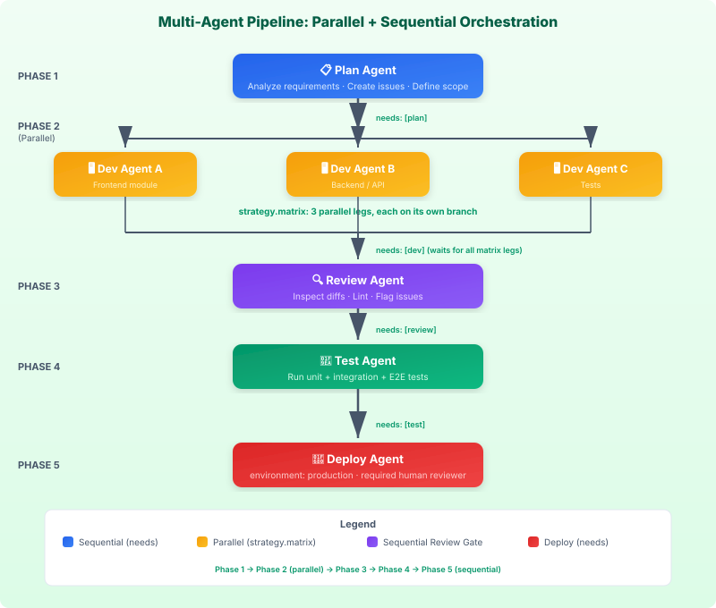

# Domain 5: Orchestrate Multi-Agent Coordination

**Weight: 15–20%**

One agent is a tool. Multiple agents are a **system**. Domain 5 teaches you how to design, coordinate, and troubleshoot multi-agent workflows — deciding *which* agent does *what* and *when*, while managing isolation, conflicts, and observability across the entire pipeline.

## What You'll Learn & Why It Matters

- How to split work across several specialized AI agents (planner, coder, tester, reviewer) instead of one do-everything agent, and why that is safer.
- The main ways to coordinate agents — one after another, side by side, or a lead agent delegating to helpers — and how to pick one from a scenario.
- How to stop agents from tripping over each other with separate branches, separate jobs, narrow permissions, and concurrency groups.
- What to do when two agents change the same code, duplicate each other's work, or contradict each other.
- How to leave a paper trail (logs, artifacts, PR notes) so anyone can reconstruct later what each agent did.
- How to detect, recover from, and escalate failures, and how to add, update, or retire agents without breaking running work.

**Why it matters:** this domain is 15–20% of the exam, and nearly every question is a scenario ("two agents…, which mechanism…?"). The decision rules on this page turn most of them into quick picks.

**Prerequisites:** Git branches and pull requests, GitHub Actions basics (workflows, jobs, steps, YAML), and what a custom agent is. If any of these are new, read [Fundamentals](basics.md) first.

### Key Terms in Plain Words

| Term | Plain-language meaning |
|---|---|
| **Orchestration** | Deciding which agent does what, in what order, and how the results are combined — "conducting" several agents. |
| **Subagent** | A helper agent that a parent agent calls to do one piece of a task; it works in its own context and reports back. |
| **Handoff** | Passing work, and the context it needs, from one agent to the next (for example planner → coder). |
| **Fan-out / fan-in** | Fan-out: start several jobs in parallel. Fan-in: one later job waits for all of them and combines their results. |
| **Matrix (`strategy.matrix`)** | A GitHub Actions feature that runs the *same* job several times with different input values (one "leg" per value). |
| **Concurrency group** | A label set with the `concurrency:` key; GitHub runs at most one run or job with that label at a time. |
| **Artifact** | A file a workflow job saves (plan, report, test results) that people and later jobs can download. |
| **HITL (human-in-the-loop)** | A point where a person must review or approve before automation continues. |

> **📘 In plain words:** Picture a restaurant kitchen. The head chef (the orchestrator) reads the order, line cooks (subagents) each prepare one part at their own station, and nothing leaves the pass until the head chef checks the plate. Domain 5 is about running that kitchen so cooks never bump into each other — and knowing what to do when a dish comes out wrong.

## Official Skills Measured

From the [GH-600 study guide](https://learn.microsoft.com/en-us/credentials/certifications/resources/study-guides/gh-600), with the section of this page that covers each bullet.

**Operate and manage multi-agent workflows**

- Apply an orchestration pattern to coordinate multiple agents → see [2. Orchestration Patterns](#2-orchestration-patterns-hierarchical-sequential-parallel-competitive)
- Configure agent isolation for parallel execution → see [4. Agent Isolation](#4-agent-isolation-branches-workflows-permissions-concurrency)
- Detect and resolve agent conflicts, including overlapping code changes, duplicated effort, and contradictory outputs → see [5. Conflict Detection and Resolution](#5-conflict-detection-and-resolution)

**Configure observability for multi-agent behavior by using logs, artifacts, and operational signals**

- Configure multi-agent workflows to produce artifacts suitable for review and audit → see [6. System Observability](#6-system-observability-attribution-evidence-cross-job-handoffs)
- Document key decisions, handoffs, and outcomes across agents → see [Cross-Job Handoffs](#cross-job-handoffs)
- Perform post-hoc analysis of multi-agent behavior → see [Post-Hoc Analysis of Multi-Agent Behavior](#post-hoc-analysis-of-multi-agent-behavior)

**Detect and respond to multi-agent failures and degraded behavior**

- Identify failed, partial, or stalled agent executions → see [7. Failure Diagnosis and Recovery at Scale](#7-failure-diagnosis-and-recovery-at-scale)
- Respond to degraded behavior or coordination across agents → see [Recovery Strategies](#recovery-strategies)
- Implement multi-agent recovery patterns, including rollback and human-in-the-loop → see [Recovery Strategies](#recovery-strategies)

**Manage the lifecycle of agents within multi-agent workflows**

- Add agents to existing multi-agent workflows → see [Adding Agents to an Existing Workflow](#adding-agents-to-an-existing-workflow)
- Update, reconfigure, or replace agents without disrupting active workflows → see [Updating or Replacing Agents Without Disruption](#updating-or-replacing-agents-without-disruption)
- Retire agents while preserving auditability and workflow continuity → see [Retiring Agents While Preserving Auditability](#retiring-agents-while-preserving-auditability)

---

## 1. Multi-Agent Responsibilities in the SDLC (Software Development Lifecycle)

In a modern agentic SDLC, different agents specialize in different stages of the software lifecycle. Rather than one monolithic agent doing everything, you build a **team of agents** — each with its own profile, tools, scope, and responsibilities. Microsoft Learn frames the boundary as: **agents propose; humans and policy accept**.

> **📘 In plain words:** An agent "role" is a job title. The planner only writes the plan, the coder only codes, the reviewer only reviews. A narrow job means a mistake stays small and it is obvious which agent made it — like a kitchen where the pastry cook never touches the grill.

### Common Agent Roles Across the SDLC

Tool names below are the real custom-agent tool aliases (`read`, `edit`, `search`, `execute`/`shell`, `web`, `agent`) plus GitHub MCP server tools (`github/*`). Note: `web` is currently not applicable to Copilot cloud agent.

| SDLC Phase | Agent Role | Typical Tools |
|---|---|---|
| **Planning** | Plan Agent — analyzes requirements, breaks down work, produces a plan (PR plan section or `PLAN.md`) | `read`, `search`, `github/*` (issues) |
| **Development** | Dev Agent — writes code in an isolated branch, runs tests, commits changes | `read`, `edit`, `execute`, `search` |
| **Review** | Review Agent — inspects PR diffs, runs linters, flags issues | `read`, `search`, `github/*` (PR comments) |
| **Testing** | Test Agent — writes and runs unit, integration, and E2E tests | `execute`, `edit`, `search` |
| **Deployment** | Deploy Agent — builds artifacts, deploys via an approval-gated GitHub environment | `execute`, `read` (+ workflow `environment:`) |
| **Monitoring** | Monitor Agent — watches for alerts, investigates incidents | `read`, `search`, `web` |

Learn's reference mapping: Planning → PR plan / `PLAN.md`; Implementation → branch + commits + PR; Validation → Actions runs + checks + artifacts; Acceptance → CODEOWNERS + reviews + required checks; Deployment → environments + approvals.

The key insight: **each agent has a bounded scope** (by path and artifact type). A dev agent shouldn't deploy. A review agent shouldn't write code. This separation of concerns is what makes multi-agent systems safe and auditable at scale.

> **📘 Teaching Tip — Role Separation Is Governance:** The exam treats agent role separation as a **governance mechanism**, not just a design pattern. When a scenario describes an agent that both writes *and* deploys code, the correct answer is usually to split it into two agents with different permission boundaries. Think of it like separation of duties in financial systems — no single agent should have end-to-end power.

> **⚠️ Common mistake:** Assuming "one powerful agent with every tool" is better than several narrow ones. It is harder to review, harder to audit, and does more damage when it goes wrong. On the exam, "split into narrower agents with separate permissions" usually beats "give the agent more access".

---

## 2. Orchestration Patterns: Hierarchical, Sequential, Parallel, Competitive

Once you have multiple agents, you need a way to **coordinate them**. Microsoft Learn covers **sequential** orchestration, **parallel** (fan-out/fan-in) orchestration, **artifact-based coordination**, and subagent **handoffs**; the "four patterns" grouping below is this guide's framing. Each maps to a GitHub-native mechanism.

> **📘 In plain words:** **Orchestration** is just organizing who works when. *Hierarchical* = a head chef handing out tasks as the order unfolds. *Sequential* = an assembly line, each station waits for the previous one. *Parallel (fan-out/fan-in)* = several cooks at separate stations, then one person assembles the plate. *Competitive* = several cooks try the same dish and the best one is served.

### Hierarchical (Parent/Child via the `agent` tool)

A parent agent delegates sub-tasks to child (sub)agents. The parent defines the task, the child executes it, and the parent collects the result. This is the most flexible pattern — the parent can dynamically decide which child to invoke based on the task at hand.

- **When to use:** Complex tasks that require specialized sub-tasks; dynamic delegation based on runtime context
- **GitHub mechanism:** Parent agent profile includes the `agent` tool alias (`custom-agent`/`Task`), which lets it invoke another custom agent. In VS Code, the parent can also list allowed subagents with `agents: [...]` and define `handoffs`; `handoffs` is **ignored by Copilot cloud agent on GitHub.com**. A child with `disable-model-invocation: true` cannot be called as a subagent.
- **Pros:** Dynamic, flexible, perfect for divide-and-conquer
- **Cons:** Parent becomes a potential single point of failure; parent must have the `agent` tool

### Sequential (Pipeline via `needs` or `workflow_run`)

Agents execute in a fixed sequence, where each agent's output feeds the next. Within one workflow use job-level `needs` — Job B waits for Job A to complete successfully. Across workflows use the `workflow_run` trigger (e.g., run security validation after the "CI Validation" workflow completes).

- **When to use:** Linear workflows where each step depends on the previous (plan → code → test → deploy)
- **GitHub mechanism:** `jobs: { job_a: {…}, job_b: { needs: [job_a], … } }` or `on: workflow_run: { workflows: [CI Validation], types: [completed] }`
- **Pros:** Predictable, easy to reason about, natural dependency model
- **Cons:** Slow — total time is sum of all steps; failures block the entire pipeline

### Parallel (Fan-out/fan-in, `strategy.matrix`)

Multiple agents execute simultaneously. **Fan-out/fan-in** = independent jobs run in parallel, then a downstream job lists them all in `needs` (Learn's example: `plan_merger` with `needs: [spec_analyzer, risk_reviewer]`). `strategy.matrix` is the variant for running the **same** job with different inputs.

- **When to use:** Agents working on isolated paths (e.g., docs agent + refactor agent); running tests across multiple OS/version combinations
- **GitHub mechanism:** separate jobs + fan-in `needs`, or `strategy: { matrix: { os: [ubuntu-latest, macos-latest, windows-latest] } }`
- **Pros:** Fast — total time equals the slowest parallel job; natural for CI/CD
- **Cons:** Requires isolation — if agents can collide on the same files, parallelism increases instability; matrix sprawl; harder to aggregate results

### Competitive (Contest Pattern) (unverified community info)

Multiple agents independently attempt the same task. The first to produce a valid result wins; other agents are cancelled. This pattern is not covered in the official Learn module.

- **When to use:** When you need the fastest possible answer; when different approaches might yield different quality results
- **GitHub mechanism:** Custom workflow with cancellation of redundant jobs; result comparison gate
- **Pros:** Lowest latency; redundancy against individual agent failure
- **Cons:** Resource waste (N-1 agents' work is discarded); result reconciliation complexity. Note Learn lists **duplicate effort** (two PRs solving the same problem) as a conflict to avoid.

### Artifact-Based Coordination

[Learn](https://learn.microsoft.com/en-us/training/modules/multi-agent-systems-orchestration/3-agent-orchestration-github-workflows) considers direct agent-to-agent communication less reliable than shared, reviewable artifacts. The robust pattern is three steps: run the agent with restricted permissions → have it produce a structured output (plan, report, proposal) uploaded as an artifact → let a separate, controlled step apply only the operations the workflow allows (e.g., create an issue from `report.json`). This separates "reasoning" from "writing" and leaves evidence for reviewers.

Triggers that keep coordination visible: `schedule` for periodic work, `pull_request` events for validation, and `workflow_run` when one step must follow another. Coordination that happens outside GitHub and leaves no trace in PRs or workflow runs makes failures impossible to diagnose.

### Subagents, Handoffs, and Fleet Mode

- **VS Code handoffs** ([Learn](https://learn.microsoft.com/en-us/training/modules/multi-agent-systems-orchestration/7-scale-failure-recovery)): the parent profile lists allowed subagents in `agents: [...]`; each `handoffs` entry has a `label` and target `agent`, and can auto-submit a prompt (`send: true`) or set a `model`. Handoffs resolve to a subagent by its `name` attribute or by matching filename.
- **Invocation flags** ([GitHub Docs](https://docs.github.com/en/copilot/reference/custom-agents-configuration)): `disable-model-invocation: true` stops Copilot from picking the agent automatically (Learn: it then can't be invoked as a subagent, a common orchestration failure); `user-invocable: false` hides it from manual selection so it can only be reached programmatically. `infer` is retired.
- **Copilot CLI `/fleet`** ([GitHub Docs](https://docs.github.com/en/copilot/concepts/agents/copilot-cli/fleet)): the main agent splits a plan into independent subtasks and acts as orchestrator, running subagents in parallel where dependencies allow. Each subagent has **its own context window**, uses a low-cost model by default (unless the prompt or the custom agent profile names a model), and may pick a matching custom agent — or you force one with `@CUSTOM-AGENT-NAME`. Monitor subtasks with `/tasks` (Enter = details, `x` = kill). `--fleet` is the command-line equivalent (works with `-p`, `-i`, or piped input; not with `--acp`). `/fleet` and autopilot are separate features that are often combined.

> **⚠️ Exam Trap:** `/fleet` only helps when work decomposes into **independent** subtasks; an inherently sequential request gains nothing, and because each subagent calls the model independently, fleet mode can consume **more** GitHub AI Credits.

> **⚠️ Exam Trap:** The exam will give you a scenario and ask which orchestration pattern to use. If the scenario mentions **dynamic delegation** where a lead agent decides sub-tasks at runtime → **hierarchical/subagents**. If it's a **fixed sequence of steps** → **sequential** (`needs` / `workflow_run`). If agents work **in parallel on isolated paths** and a later job must combine results → **fan-out/fan-in** with `needs`. If it's **same task with different inputs** → **matrix**. Learn's rule: use parallel orchestration only when agents operate on isolated paths.

> **⚠️ Common mistake:** Using `strategy.matrix` for agents that need *different* permissions. Every matrix leg shares one job definition, so every leg gets the same `permissions:`, runner, and steps. When roles need different access (a reader and a writer), use separate jobs plus a fan-in `needs`.

> **🎯 Exam angle:** Pattern questions hide the answer in one phrase. "Decides at runtime which helper to call" → hierarchical/subagents. "Must run after" → `needs` or `workflow_run`. "Run at the same time, then combine" → fan-out/fan-in. "Same job, different inputs" → matrix. "Split a plan into independent subtasks from the CLI" → `/fleet`.

---

## 3. Multi-Agent Pipeline: Parallel + Sequential Orchestration

The diagram below shows a multi-agent pipeline that combines **parallel** (matrix-based) and **sequential** (needs-based) orchestration. The Plan Agent kicks things off, then Dev Agents work in parallel, followed by sequential review and deployment phases:



*Figure 5.1 — Multi-Agent Pipeline: Plan Agent initiates parallel Dev Agents (one matrix job, `dev`, with three legs), then sequential Review → Test → Deploy Agents (via `needs`). A downstream job references the matrix job by its single job ID (`needs: [dev]`) and waits for all legs.*

This combined approach gives you the **speed of parallelism** where it matters (development) and the **safety of sequential gates** where it matters (review, testing, deployment). The exam expects you to recognize when each pattern is appropriate and how to combine them.

### Worked Example: Planner → Implementer + Test Writer → Reviewer → Human Merge

**Scenario:** when someone labels an issue `agent-ready`, a planner agent writes a plan; an implementer agent (allowed to change only `src/`) and a test-writer agent (only `tests/`) then work at the same time on their own branches; a reviewer agent combines both branches, runs the tests, and opens **one** pull request; a human approves and merges it.

The flow, in GitHub terms:

1. **Plan (sequential start):** job `plan` writes `plan.json` and uploads it as an artifact — the durable handoff.
2. **Fan-out:** job `build` uses a matrix with two legs (`implementer`, `test-writer`), each on its own branch `agent/<role>/issue-<n>`.
3. **Fan-in:** job `review` lists `build` in `needs`, so it waits for **both** legs, then merges the branches into an integration branch (the merge validation check), runs tests, and opens the PR.
4. **HITL:** a ruleset on `main` requires a pull request, an approving review, and passing checks, so only a human can finish the job (see [Domain 6](domain-6.md)).

Here is the complete workflow. `./scripts/run-agent.sh` is a **placeholder** for however you invoke an agent (for example a CLI agent in programmatic mode); assume it commits its work to the current branch.

```yaml
# .github/workflows/multi-agent-feature.yml
name: Multi-agent feature pipeline

on:
  issues:
    types: [labeled]                        # runs whenever a label is added to an issue

permissions:
  contents: read                            # default token for every job: read-only

concurrency:
  group: ${{ github.workflow }}-issue-${{ github.event.issue.number }}  # one pipeline per issue at a time
  cancel-in-progress: false                 # never kill agents mid-work; a newer run waits as pending

jobs:
  plan:                                     # 1) Planner agent
    if: github.event.label.name == 'agent-ready'   # react to this label only
    runs-on: ubuntu-latest
    outputs:
      risk: ${{ steps.plan.outputs.risk }}  # machine-readable value for later jobs
    steps:
      - uses: actions/checkout@v4
      - id: plan
        run: |
          ./scripts/run-agent.sh planner "${{ github.event.issue.number }}" > plan.json
          RISK=$(jq -r .risk plan.json)
          case "$RISK" in low|medium|high|critical) ;; *) echo "::error::invalid risk '$RISK'"; exit 1 ;; esac
          echo "risk=$RISK" >> "$GITHUB_OUTPUT"   # validated before anyone else uses it
      - uses: actions/upload-artifact@v4    # the plan becomes evidence and the handoff to the next agents
        with:
          name: plan
          path: plan.json

  build:                                    # 2) Fan-out: implementer + test writer in parallel
    needs: plan                             # starts only after the planner succeeds
    runs-on: ubuntu-latest
    permissions:
      contents: write                       # may push its branch; every other scope becomes none
    strategy:
      fail-fast: false                      # one failing agent doesn't cancel the other
      matrix:
        include:
          - role: implementer
            scope: src/                     # the only folder this agent may change
          - role: test-writer
            scope: tests/
    env:
      BRANCH: agent/${{ matrix.role }}/issue-${{ github.event.issue.number }}  # branch isolation
    steps:
      - uses: actions/checkout@v4
      - uses: actions/download-artifact@v4  # both agents start from the same plan
        with:
          name: plan
      - run: |
          git config user.name "github-actions[bot]"
          git config user.email "41898282+github-actions[bot]@users.noreply.github.com"
          git switch -c "$BRANCH"
      - run: ./scripts/run-agent.sh "${{ matrix.role }}" plan.json   # placeholder agent runner
      - name: Enforce path scope            # fail if the agent touched files outside its folder
        run: |
          OUT=$(git diff --name-only "$GITHUB_SHA" HEAD | grep -v "^${{ matrix.scope }}" || true)
          if [ -n "$OUT" ]; then echo "::error::Out-of-scope changes: $OUT"; exit 1; fi
      - run: git push origin "$BRANCH"

  review:                                   # 3) Fan-in: combine, test, open ONE PR
    needs: [plan, build]                    # waits for the planner and ALL matrix legs
    runs-on: ubuntu-latest
    permissions:
      contents: write                       # push the integration branch
      pull-requests: write                  # elevated scope, granted to this job only
    env:
      N: ${{ github.event.issue.number }}
      RISK: ${{ needs.plan.outputs.risk }}  # passed via env, never pasted into the script text
      GH_TOKEN: ${{ github.token }}         # lets the gh CLI use this job's token
    steps:
      - uses: actions/checkout@v4
        with:
          fetch-depth: 0                    # full history so the agent branches can be merged
      - name: Merge agent branches (merge validation check)
        run: |
          git config user.name "github-actions[bot]"
          git config user.email "41898282+github-actions[bot]@users.noreply.github.com"
          git switch -c "agent/integration/issue-$N"
          git merge --no-ff "origin/agent/implementer/issue-$N"
          git merge --no-ff "origin/agent/test-writer/issue-$N"   # stops here on a textual conflict
      - run: ./scripts/test.sh              # catches semantic conflicts: clean merge, broken behavior
      - run: ./scripts/run-agent.sh reviewer > review.md
      - uses: actions/upload-artifact@v4
        with:
          name: review
          path: review.md
      - name: Open the pull request for a human
        run: |
          git push origin "agent/integration/issue-$N"
          gh pr create --base main --head "agent/integration/issue-$N" \
            --title "[agent: pipeline] Issue #$N (risk: $RISK)" --body-file review.md
```

What the important lines do:

| Line(s) | Why it is there |
|---|---|
| Top-level `permissions: contents: read` | Least privilege by default; jobs elevate only what they need. Setting any scope sets all unlisted scopes to `none` ([workflow syntax](https://docs.github.com/en/actions/reference/workflows-and-actions/workflow-syntax#permissions)). |
| `concurrency` with the issue number | Relabeling the same issue can't start a second pipeline that races the first. With `cancel-in-progress: false` the newer run waits as *pending*; only one pending run is kept unless you set `queue: max` (up to 100) ([workflow syntax](https://docs.github.com/en/actions/reference/workflows-and-actions/workflow-syntax#concurrency)). |
| `outputs.risk` + the `case` check | The plan's risk travels as a validated, machine-readable value — not prose — so later jobs (or a deploy gate) can branch on it with `if:`. |
| `needs: plan` / `needs: [plan, build]` | `needs` makes the order explicit. If a needed job fails or is skipped, dependent jobs are skipped too, so a half-finished pipeline never opens a PR. |
| `matrix.include` with `role` and `scope` | Two legs from one job definition — same permissions, different inputs. Downstream jobs reference the single job ID `build` and wait for every leg. |
| `fail-fast: false` | The default is `true`, which cancels the other legs when one fails ([workflow syntax](https://docs.github.com/en/actions/reference/workflows-and-actions/workflow-syntax#jobsjob_idstrategyfail-fast)). Turning it off keeps finished work from a healthy agent. |
| `BRANCH: agent/<role>/issue-<n>` | Branch isolation and attribution in one name. |
| "Enforce path scope" step | Turns "only touch `src/`" from an instruction the agent might ignore into a check that fails the job. |
| `git merge` ×2 in `review` | The merge validation check: textual conflicts fail here, before any PR exists. |
| `RISK` via `env:` | Agent output is untrusted text; inserting `${{ … }}` straight into a `run:` script invites script injection. |
| `gh pr create` | One reviewable PR with the reviewer's report as the body. The human approval and merge happen outside the workflow, enforced by the ruleset. |

For `gh pr create` to work with `GITHUB_TOKEN`, the repository (or organization) setting **Allow GitHub Actions to create and approve pull requests** must be enabled ([Actions settings](https://docs.github.com/en/repositories/managing-your-repositorys-settings-and-features/enabling-features-for-your-repository/managing-github-actions-settings-for-a-repository#preventing-github-actions-from-creating-or-approving-pull-requests)). What happens when the two agents collide is walked through in [Worked Example: Two Agents Edit the Same File](#worked-example-two-agents-edit-the-same-file), and what happens when one fails in [Worked Example: A Failed Agent and Its Recovery](#worked-example-a-failed-agent-and-its-recovery).

> **⚠️ Common mistake:** Letting the reviewer agent merge to `main` itself "because it already reviewed". An agent review is evidence, not acceptance — Learn's rule is *agents propose; humans and policy accept*, and Copilot cloud agent can't approve or merge its own PRs anyway.

---

## 4. Agent Isolation: Branches, Workflows, Permissions, Concurrency

When multiple agents operate in the same repository, you need **isolation** — agents must not interfere with each other's work. Learn identifies four isolation mechanisms:

> **📘 In plain words:** Isolation means giving each agent its own workbench. A separate **branch** is its own copy of the code, a separate **workflow or job** is its own room, separate **permissions** are its own set of keys, and a **concurrency group** is a "one at a time" sign on a shared door (for example, the production deploy).

### Branch Isolation

Each agent works in its own branch. This is the simplest and most important isolation mechanism — changes are staged in separate branches until they're ready to merge.

- **Implement via:** Agent workflow creates a unique branch per task; branch protection/rulesets protect the target branch. Copilot cloud agent does this automatically: it creates a `copilot/` branch and can only push to that single branch (or to the PR branch when `@copilot` is mentioned on an existing PR).
- **Best practice:** Use descriptive branch naming like `agent/{agent-name}/{task-id}` (Learn: `agent/dependency/<ticket>`)
- **Exam tip:** Branch isolation prevents agents from overwriting each other's work in progress

### Workflow Isolation

Each agent runs in its own GitHub Actions workflow (or a dedicated job with distinct permissions). Workflow isolation prevents one agent's execution from affecting another's triggers, permissions, and outputs.

- **Implement via:** Separate workflow YAML files per agent or per task type
- **Best practice:** Use separate runners or container environments per agent type
- **Exam tip:** Workflow isolation is about runtime separation, not just code separation

### Permission Isolation

Each agent gets only the capabilities it needs. For custom agents, capabilities are set by the profile's `tools` (and `mcp-servers`) properties; for workflows, by the `permissions:` key on the `GITHUB_TOKEN`.

- **Implement via:** `.github/agents/*.agent.md` — each agent has its own `tools` list (custom agent profiles have **no** `permissions` property); workflow/job `permissions:` such as `contents: read`, `pull-requests: write`
- **Best practice:** Apply least-privilege: give each agent only the tools and token scopes it needs for its role
- **Exam tip:** A dev agent shouldn't have deploy permissions; a monitor agent shouldn't have write permissions

### Concurrency Controls

GitHub Actions **concurrency groups** ensure that at most one run (plus one pending) in the same group executes at a time.

- **Implement via:** `concurrency:` key in workflow YAML with a group name. Learn recommends `group: ${{ github.workflow }}-${{ github.ref }}` — using only `${{ github.ref }}` makes concurrency global to the branch and can block unrelated workflows.
- **Best practice:** Use `cancel-in-progress: true` to cancel older runs when a new one starts
- **Exam tip:** Concurrency groups prevent race conditions across runs. Job-level `concurrency` applies only within a workflow run, and `strategy.matrix` controls intra-run parallelism, not parallelism across triggers or agent sessions.

Parallelism support by invocation mode (Learn): Copilot cloud agent — parallel sessions across tasks; Copilot CLI — parallel; local (IDE) agent — serial only.

The workflow below shows a deployment agent that uses one concurrency group per target environment:

```yaml
# Example: Concurrency control for deployment agent
name: Deploy Agent
on:
  workflow_dispatch:
    inputs:
      environment:
        description: 'Target environment'
        required: true
        type: choice
        options: [staging, production]

concurrency:
  group: deploy-${{ github.event.inputs.environment }}
  cancel-in-progress: true

jobs:
  deploy:
    runs-on: ubuntu-latest
    environment: ${{ github.event.inputs.environment }}
    steps:
      - uses: actions/checkout@v4
      - name: Deploy
        run: ./deploy.sh
```

Two runs that target `production` share the group `deploy-production`, so they can never deploy at the same moment; because of `cancel-in-progress: true`, a newer run cancels the older one. A `staging` run uses a different group name and doesn't wait for `production`. The `environment:` line also applies that environment's protection rules, such as required reviewers (see [Domain 6](domain-6.md)).

> **⚠️ Common mistake:** Treating `cancel-in-progress: true` as always right. It suits "only the latest matters" work such as CI on a branch. For agents doing long edits or deploys, killing a run halfway can leave half-applied changes; use `cancel-in-progress: false` (wait as pending) or `queue: max` to keep several pending runs in order.

> **🎯 Exam angle:** Isolation questions name a symptom; map it to the dimension. "Agents overwrite each other's work in progress" → branches. "One agent's run changed another's triggers or outputs" → separate workflows/jobs. "Agent could do more than its role" → permissions (`tools`, `permissions:`). "Two runs deployed at once" → concurrency group.

---

## 5. Conflict Detection and Resolution

A **conflict** is what happens when two agents' work doesn't fit together — like two people editing the same sentence of a shared document at the same time.

When multiple agents work concurrently, conflicts are inevitable. Learn lists four conflict types: **textual merge conflicts** (same files/lines), **semantic conflicts** (clean merge, broken combined behavior), **policy conflicts** (different reviews/approvals required), and **duplicate effort** (two PRs solving the same problem differently).

### PR Reviews as Conflict Resolution

Pull requests are the **primary conflict resolution mechanism**. When two agents make changes to the same repository, their work is merged via PRs, which:

- Surface merge conflicts that must be resolved before merging
- Provide a review process for human or agent reviewers to validate changes
- Require status checks (CI) to pass, ensuring conflicting changes don't break the build
- Enable CODEOWNERS approval for files that need specialized review (routes review by path — e.g., `/.github/workflows/ @platform-team`)

Learn also recommends a **merge validation check** (e.g., `git fetch origin main && git merge --no-commit origin/main`) set as a required check, so conflicts fail fast instead of depending on reviewers noticing them.

### Concurrency Groups for Conflict Prevention

As discussed above, concurrency groups prevent conflicting workflow runs from executing at the same time. This is a **preventive** measure — it stops conflicts before they happen.

### Branch Protection Rules

Branch protection rules (or rulesets) enforce conflict-avoidance policies:

- **Require linear history** — prevents merge commits from being pushed; PRs must be merged with squash or rebase merging
- **Require branches to be up to date before merging** — the PR branch must include the latest base-branch commits (via merge or rebase) before merging
- **Require status checks** — ensures all evaluation gates pass before merge

### Escalation Thresholds

Learn: stop automation and escalate to a human when a PR conflicts twice after rebase attempts, when required checks fail twice with the same failure signature, or when two agents propose incompatible fixes to the same alert. Include a short report: what conflicted, what was attempted, which options exist. Without arbitration rules, whichever PR merges first "wins" — outcomes are decided by timing rather than correctness ([Learn](https://learn.microsoft.com/en-us/training/modules/multi-agent-systems-orchestration/5-conflict-resolution-github-arbitration)).

### Worked Example: Two Agents Edit the Same File

Using the [pipeline above](#worked-example-planner-implementer-test-writer-reviewer-human-merge): the path-scope step already stops the test writer from editing `src/`. But suppose both agents legitimately need the shared root file `package.json` — the implementer adds a runtime library, the test writer adds a test library — on the same line.

1. **Each branch is fine alone.** Both `build` legs pass and push their branches.
2. **The fan-in detects it.** In `review`, the first `git merge` succeeds; the second stops with `CONFLICT (content): Merge conflict in package.json`. The job fails, so tests, the review report, and the PR never happen — nothing conflicting reaches `main`.
3. **Find it.** The failed `review` job in the run's log names the file; both branch names show which agents collided.
4. **Resolve (pick one):**
   - **Serialize the dependent work:** re-run the test writer from the implementer's branch so it sees the new line and adds its own below it.
   - **Human fix:** a person resolves the conflict on the integration branch and pushes; the required checks then run on the result.
5. **Prevent next time:** give `package.json` a single owner (only the implementer changes dependencies; the test writer asks for them in the plan), and add a CODEOWNERS entry for it.
6. **Escalate if it repeats:** Learn's threshold is two conflicts after rebase attempts → stop and hand a human a short report (what conflicted, what was tried, the options).

**The semantic variant:** the implementer renames `getUser()` to `fetchUser()`, while the new tests still call `getUser()`. Git merges cleanly because different lines changed, but `./scripts/test.sh` fails. That is why the pipeline runs tests **after** combining branches, not only on each branch.

> **⚠️ Common mistake:** Believing concurrency groups prevent merge conflicts. They only stop two *runs* from executing at the same time; they know nothing about which lines of code two branches changed. Code-level conflicts are caught by merging (PR conflict detection, a merge validation check) and by tests.

> **🎯 Exam angle:** Sort the conflict type first. Same lines → textual → merge validation check / rebase. Clean merge but broken behavior → semantic → tests as required checks after combining. Two PRs fixing the same thing → duplicate effort → clearer ownership and scoping. Different approval rules → policy conflict → rulesets and CODEOWNERS. Repeated failure → escalate to a human.

> **📘 Teaching Tip — Conflict Resolution Flow:** Think of conflict resolution as a three-stage pipeline: **Prevent** (concurrency groups, branch isolation, path scoping) → **Detect** (PR merge conflict detection, merge validation checks, CI failures) → **Resolve** (CODEOWNERS routing, PR review, human escalation, rebase). Make sure you can map each mechanism to its stage.

> **⚠️ Exam Trap:** A question might present a scenario where two agents create conflicting changes and ask: *"Which GitHub-native mechanism detects this conflict?"* The answer is **PR merge conflict detection / a required merge validation check**, not concurrency groups. Concurrency groups prevent *simultaneous execution* conflicts; PR checks catch *code-level* conflicts. Know the difference.

---

## 6. System Observability: Attribution, Evidence, Cross-Job Handoffs

In a multi-agent system, you need to know **who did what, when, and why**. Learn's goal: every meaningful step leaves a durable trace in GitHub.

> **📘 In plain words:** Observability is an airplane's flight recorder. Nobody reads it during a good flight, but after an incident it is the only reliable story. **Attribution** says which agent acted, **evidence** (artifacts, check results) shows what it produced, and the **audit log** — GitHub's built-in record of activity in an organization or enterprise — says who triggered what and when.

### Attribution

Every action must be traceable to a specific agent. Attribution is achieved through:

- **Naming conventions:** PR titles like `[agent: dependency] Update <package> to <version>`, labels like `agent: security`, PR body sections (Plan, Evidence, Risks, Rollback/Escalation)
- **Commit authorship:** Copilot cloud agent's commits are authored by Copilot, with the developer who assigned the task marked as co-author; commits are signed ("Verified") and each commit message links to the agent session log
- **PR authorship:** PRs created by agents show the agent (or, for Copilot automations, the user who created the automation) as the author
- **Audit log:** filter the enterprise audit log with `actor:Copilot`; agentic events carry `actor_is_agent: true`, an `agent_session_id` linking to the session, and `user` (the person who initiated it) ([GitHub Docs](https://docs.github.com/en/copilot/reference/enterprise-administrators/agentic-audit-log-events))

### Evidence

Agents must produce evidence that they performed their tasks correctly. Evidence includes:

- **Workflow artifacts:** Test reports, coverage summaries, structured agent reports (`actions/upload-artifact`) — the primary post-hoc evidence even if live logs are incomplete
- **Session logs:** Copilot cloud agent session logs trace agent actions and tool calls; they can be streamed live with `gh agent-task view --log --follow`
- **Check run results:** Status checks that validate agent output
- **Audit log:** e.g., search the org audit log for `action:artifact.destroy` to find who deleted a missing artifact

### Cross-Job Handoffs

When one agent's output becomes another agent's input, the handoff must be observable:

- **Workflow outputs:** Jobs produce outputs consumed by downstream jobs via `needs`
- **Artifact passing:** Build artifacts are uploaded and downloaded between jobs
- **Workflow run URL:** Each run has a unique URL that links all jobs together
- **Log correlation:** Cross-referencing log entries across jobs via run ID and timestamps
- **PR handoff template:** Objective, Plan, Evidence, Decisions and handoffs (decision, rationale, next owner), Risks and rollback

### Post-Hoc Analysis of Multi-Agent Behavior

Post-hoc analysis reconstructs what a set of agents did *after* the runs finished. Evidence sources, in the order Learn emphasizes them ([unit 6](https://learn.microsoft.com/en-us/training/modules/multi-agent-systems-orchestration/6-system-observability-evidence-workflows), [unit 7](https://learn.microsoft.com/en-us/training/modules/multi-agent-systems-orchestration/7-scale-failure-recovery)):

1. **Workflow artifacts** — the primary evidence source even when live logs are incomplete. Open the run in the Actions tab, scroll to the **Artifacts** section of the run summary, and download (e.g., `agent-report`).
2. **PR timelines** — what changed and when, plus the Decisions and handoffs section of each PR.
3. **Required check results** — what failed and *how often*.
4. **Workflow run history** — patterns of failures and cancellations (flapping, repeated `cancel-in-progress` cancellations, competing PRs).
5. **Agent session logs and audit log** — each Copilot commit message links to its session log; `actor:Copilot` audit events correlate to sessions via `agent_session_id`.

Things to know:

- **Missing artifact?** Search the org audit log for `action:artifact.destroy` to see who deleted it, when, and in which repository.
- **Retention:** the audit log keeps agent events for **180 days**; stream it to a SIEM for longer history and alerting ([GitHub Docs](https://docs.github.com/en/copilot/how-tos/administer-copilot/manage-for-organization/review-activity/review-audit-logs)).
- **Blind spot:** the audit log does **not** include local client session data (e.g., prompts sent from Copilot CLI); capturing that requires a custom solution such as hooks that forward CLI events to your own logging service.
- **Close the loop:** classify each root cause (reasoning error, tool misuse, context or environment issue) and feed it back into instructions, scope boundaries, tool access, or escalation thresholds.

> **🎓 Teaching Tip — Traceability Is Exam Gold:** If an exam scenario describes a problem in a multi-agent system, the first step is always **check attribution and logs**. Who was the last agent to touch this file? What did the session log show? Traceability is the starting point for all debugging in multi-agent systems.

> **⚠️ Common mistake:** Relying on what an agent printed in a chat window or terminal. That output disappears and isn't reviewable. If a decision matters, it belongs in a durable place: an uploaded artifact, the PR body (Plan, Evidence, Decisions and handoffs), or a commit.

> **🎯 Exam angle:** "Reconstruct what happened" or "prove to an auditor" questions want durable GitHub evidence: artifacts first, then PR timeline, check history, run history, session logs, audit log. Answers based on local history, chat transcripts, or re-running the agent to "see what it does" are distractors.

---

## 7. Failure Diagnosis and Recovery at Scale

When a multi-agent pipeline fails — and it will — you need a systematic approach to diagnosis and recovery. Learn's common failure modes: **partial execution** (PR exists but evidence/validation missing), **stalled workflows** (checks fail repeatedly or approvals never arrive), **conflicting outputs**, and **flapping** (reruns with no convergence).

> **📘 In plain words:** Treat it like a mechanic: find which part failed, figure out *why* (a loose cable or a broken engine?), then either fix and restart, or tow the car to a specialist. A loose cable is a **transient** failure — try again. A broken engine is a **logic** failure — retrying changes nothing. Towing is **escalation** to a human.

### Diagnosis Workflow

| Step | Action | Tool / Resource |
|---|---|---|
| 1 | Identify the failing job or agent | Workflow run page, job status indicators, PR timeline |
| 2 | Examine session logs for error messages | GitHub Actions log viewer, agent session logs (`gh agent-task view --log --follow`) |
| 3 | Check workflow artifacts for failure evidence | Artifact download, test report viewer |
| 4 | Attribute the failure to an agent or action | Log correlation, commit attribution |
| 5 | Classify the root cause | Study guide categories: reasoning errors, tool misuse, context or environment issues (also check agent config, e.g., `disable-model-invocation: true` blocks subagent calls) |
| 6 | Apply the fix and re-run | Tuning levers: instructions, workflows/constraints, memory, tools and tool access |

### Recovery Strategies

- **Bounded retry:** For transient failures (network timeouts, rate limits), retry within a fixed limit to prevent endless loops. GitHub Actions has no built-in step `retry` key — script the retry (with backoff) or use **Re-run failed jobs**.
- **Rollback and retry:** For code-level failures, revert the agent's last changes and retry with corrected instructions. Prefer small, scoped PRs so rollback is safe.
- **Fallback to human:** Escalate to a human (e.g., after the same required check fails twice) with links and a concise summary, via issue, PR comment, or `workflow_dispatch`.
- **Partial replay:** Re-run only the failed job(s) (Re-run failed jobs), not the entire multi-agent pipeline.
- **Policy block → human:** when a `preToolUse` hook denies a command (e.g., `Reason: destructive_operation_detected`), the expected behavior is a handoff to human review, not a retry ([Learn](https://learn.microsoft.com/en-us/training/modules/multi-agent-systems-orchestration/7-scale-failure-recovery)).
- **Break automation chains:** an issue or PR opened by one Copilot automation can trigger another; because Actions workflows don't run on Copilot PRs until a user with write access approves them, chains can't run unattended ([GitHub Docs](https://docs.github.com/en/copilot/concepts/agents/cloud-agent/risks-and-mitigations)).
- **Checkpoint restart:** Restore from a known-good checkpoint (durable artifacts/plan) and resume execution from that point.

### Worked Example: A Failed Agent and Its Recovery

In the [pipeline above](#worked-example-planner-implementer-test-writer-reviewer-human-merge), the `test-writer` leg fails while the implementer leg succeeds.

1. **Contain:** because of `fail-fast: false`, the implementer finishes and pushes its branch. Because `review` needs `build`, `review` is **skipped** — no PR is opened from incomplete work, so there is nothing to roll back on `main`.
2. **Identify:** the run page shows a red `build (test-writer, tests/)` job. Download the `plan` artifact and read the job log.
3. **Classify:** the log shows an HTTP 429 (rate limit) from the agent runner → **transient**.
4. **Recover with a bounded retry:** use **Re-run failed jobs**. Only the failed leg (and the jobs that depend on it) run again; the implementer's branch is reused, not redone.
5. **If the same failure happens again,** stop retrying. Comment on the issue with the run link, the failure signature, and the options (wait for quota, reduce scope, assign a human) — Learn's "fails twice with the same signature → escalate" rule.
6. **Different signals, different moves:**
   - Log shows `Denied by preToolUse hook` or a `destructive_operation_detected` reason → a **policy block**: hand to a human, don't retry.
   - Tests fail because the generated tests are wrong → **logic** failure: fix the plan or the agent instructions, then re-run.
   - The bad change was **already merged** → open a revert PR (the **Revert** button on the merged PR does this) and retry with corrected instructions in a new small PR.
7. **Clean up and learn:** delete abandoned `agent/*` branches, record the root-cause category, and update instructions, scope, tools, or thresholds.

> **⚠️ Common mistake:** Clicking **Re-run all jobs** on a big pipeline. It repeats work that already succeeded (and re-invokes every agent). Re-run only what failed, and only a bounded number of times.

### Recovery at Scale (unverified community info)

The following patterns are general reliability-engineering practice and are not named in the official Learn module:

- **Self-healing agents:** Configure agents to detect their own failures and attempt recovery (within bounded retries) before reporting failure
- **Circuit breaker pattern:** After N consecutive failures, stop retrying and alert a human (consistent with Learn's escalation threshold)
- **Dead letter queue:** Route unrecoverable failures to a queue for human review
- **Health monitoring:** Regular heartbeat checks on agent availability and pipeline health

> **⚠️ Exam Trap:** The exam may present a failure scenario and ask: *"What's the best recovery strategy?"* If the failure is **transient** (network blip, API rate limit), the answer is **bounded retry**. If the failure is **logic-based** (wrong code, bad instructions), the answer is **fix instructions and re-run**. If the failure is **repeated or security-related** (policy breach, same check failing twice), the answer is **stop and escalate to a human** — Learn: investigate security failures instead of repeatedly retrying.

---

## 8. Agent Lifecycle Management

> **📘 In plain words:** Managing agents is like managing staff: onboard a new hire with a clear job description and limited keys, change their duties through a reviewed process, and when they leave, take back their badge but keep their work records.

Learn frames agent lifecycle as a continuous sequence — **deploy → monitor → update → retire** — where both agents and their guardrails evolve, so each agent needs a clear owner, runbooks, and a review cadence ([Learn](https://learn.microsoft.com/en-us/training/modules/governance-guardrails-operations/7-maintain-governance-operational-reliability)). The GitHub mechanics below come from the [custom agents configuration reference](https://docs.github.com/en/copilot/reference/custom-agents-configuration) and [About custom agents](https://docs.github.com/en/copilot/concepts/agents/cloud-agent/about-custom-agents).

### Adding Agents to an Existing Workflow

- **Define the boundary first:** a narrow role, the paths and artifact types it may change, and a completion signal verifiable through checks and reviews ([Learn](https://learn.microsoft.com/en-us/training/modules/multi-agent-systems-orchestration/2-multi-agent-responsibilities)). Overlapping responsibilities produce duplicated work and conflicting PRs.
- **Create the profile** where it should be available: `.github/agents/NAME.agent.md` (repository), `/agents/NAME.md` in the org's `.github` or `.github-private` repo (organization), or in the enterprise-designated `.github-private` repo (enterprise). `description` is the only required property; on name conflicts the **lowest level wins** (repository > organization > enterprise).
- **Give it its own isolation:** dedicated branch prefix (`agent/<name>/<ticket>`), dedicated workflow or job with least-privilege `permissions:`, a `tools` list (omitting `tools` grants **all** tools), CODEOWNERS for its paths, and an attribution label such as `agent: <name>`.
- **Wire it into orchestration:** add it to the parent's `agents: [...]` / `handoffs` (VS Code), make sure the parent has the `agent` tool, and don't set `disable-model-invocation: true` on an agent that must be called as a subagent. In Copilot CLI, `/fleet` can pick it up automatically or via `@NAME`.

### Updating or Replacing Agents Without Disruption

- **Versioning is by Git commit SHA** of the profile file. A task is instantiated from the latest profile on that repository and branch, and once the agent opens a PR, **interactions in that PR keep using the same version** — so editing a profile doesn't change behavior mid-flight for in-progress PRs.
- **Stage changes on a branch or tag:** different versions can live on different branches/tags, letting you trial a reconfigured agent before merging to the default branch.
- **Review profile changes like code:** GitHub recommends protecting Copilot and MCP configuration files with CODEOWNERS plus the "Require review from Code Owners" rule ([build guardrails](https://docs.github.com/copilot/tutorials/cloud-agent/build-guardrails)).
- **Replace, don't rename silently:** when swapping one agent for another, update orchestrator `agents`/`handoffs` references in the same PR (handoffs resolve by name or filename), and avoid renaming workflow jobs that back required checks — Learn treats renamed or removed required checks as governance drift.

### Retiring Agents While Preserving Auditability

- **Stop new work first:** `disable-model-invocation: true` stops automatic selection, and `user-invocable: false` stops manual selection. Remove the agent from every parent's `agents`/`handoffs` so orchestration doesn't fail calling it.
- **Delete through a reviewed PR**, not by force-pushing history: Git history keeps every prior version of the profile, and past PRs, signed Copilot commits (with session-log links), and workflow runs remain intact.
- **Keep the evidence:** artifacts should be retained long enough for audits and incident response ([Learn](https://learn.microsoft.com/en-us/training/modules/governance-guardrails-operations/6-make-actions-observable-traceable-auditable)); the audit log keeps `actor:Copilot` events for 180 days, so stream to a SIEM if you need longer.
- **Remove what it was granted:** its workflow permissions, Agents secrets/variables, branch rules, and CODEOWNERS entries — leftover access is the "permissions expanded" form of governance drift.

> **⚠️ Exam Trap:** "Update the agent without disrupting active work" points to **commit-SHA versioning** (in-flight PRs keep their version) plus a reviewed PR to the profile — not to pausing all workflows. "Retire but stay auditable" means **disable invocation, then delete via PR** while keeping history, logs, and artifacts.

> **⚠️ Common mistake:** Deleting an agent's profile first. Any orchestrator that still lists it in `agents`/`handoffs` starts failing. Order matters: stop new invocations → remove references from parents → delete through a reviewed PR → revoke its access.

---

## 9. Hands-On Lab: Build an AI Dream Team with Copilot CLI

The module's exercise, [Build an AI dream team with GitHub Copilot CLI custom agents](https://learn.microsoft.com/en-us/training/modules/multi-agent-systems-orchestration/exercise) (about 45 minutes), is the best practical rehearsal for this domain:

1. Create a repo from the exercise template (public recommended, to avoid Actions minutes), start a **Codespace**, and open Copilot CLI in the terminal.
2. Inspect `.github/agents/` and identify four roles: **Orchestrator** (coordinates), **Planner** (breaks work into phases), **Designer** (visual structure and UX), **Coder** (implements files).
3. Ask the Orchestrator to involve the Planner and produce an implementation plan for "Mona's Project Pulse" dashboard; review the phases.
4. Have the Orchestrator delegate design to the Designer, then implementation to the Coder (`app/index.html`, `app/styles.css`, `app/project-data.json`, `.vscode/launch.json`).
5. Run and validate the dashboard, then ask the Orchestrator for a **handoff summary** of what each agent did; planning and handoff notes land under `docs/`.
6. Commit. Don't edit the exercise's workflow files — they grade your progress.

> **📘 Teaching Tip:** While doing the lab, map what you see to the exam vocabulary: the Orchestrator is the hierarchical pattern, the plan and handoff notes are durable artifacts, and the final summary is the "document key decisions, handoffs, and outcomes" skill.

---

## 10. Domain 5 Key Takeaways

| Concept | Key Insight | Exam Tip |
|---|---|---|
| Multi-Agent SDLC Roles | Each SDLC phase needs a specialized agent with bounded scope | Agents propose; humans and policy accept |
| Orchestration Patterns | Hierarchical (`agent` tool/subagents), Sequential (`needs`/`workflow_run`), Parallel (fan-out/fan-in, matrix), Competitive (community) | Match pattern to scenario: dynamic delegation = hierarchical, fixed sequence = sequential |
| Agent Isolation | Branches, workflows, permissions, concurrency controls — all four are needed | Each mechanism isolates a different dimension (code, runtime, access, execution) |
| Conflict Resolution | Prevent → Detect → Resolve: concurrency groups, merge validation checks, CODEOWNERS + human review | Escalate when automated resolution fails twice |
| System Observability | Attribution + Evidence + Cross-Job Handoffs = full traceability | Always start debugging with logs and attribution |
| Failure Recovery | Bounded retry → Rollback → Escalate: match strategy to failure type | Transient = retry; Logic = fix & re-run; Repeated/security = human |
| Post-Hoc Analysis | Artifacts first, then PR timeline, check history, run history, session logs, audit log | Missing artifact → `action:artifact.destroy`; audit log keeps 180 days |
| Agent Lifecycle | Deploy → monitor → update → retire; profile versioned by commit SHA | In-flight PRs keep their agent version; retire via disable + reviewed delete |

> **🎓 Video Insight — Real multi-agent architecture from Ari (unverified community info):** Ari's demo: Orchestrator agent coordinates everything. Planner agent reads the codebase (read-only). Coder and Designer agents work in parallel on isolated branches. Each proposes a PR. "Every time you use an agent, it's going to create its own branch. You could specify that. Should you merge directly to main? Probably not."

---

## Recap: Key Takeaways

- Give each agent one narrow role, its own tools, and its own paths; agents propose, humans and policy accept.
- Hierarchical = a lead agent delegates at runtime; sequential = `needs` / `workflow_run`; parallel = fan-out/fan-in; matrix = same job, different inputs.
- Run agents in parallel only when they work on isolated paths.
- Isolation has four dimensions: branches, workflows/jobs, permissions, concurrency groups.
- Concurrency groups stop simultaneous runs; they don't detect code conflicts.
- Detect textual conflicts by merging (merge validation check) and semantic conflicts with tests run after combining.
- Hand off through durable artifacts and PR sections, not chat output.
- Post-hoc analysis starts with artifacts; the audit log (`actor:Copilot`) keeps 180 days.
- Transient failure → bounded retry; logic failure → fix and re-run; repeated or policy failure → escalate to a human.
- Re-run failed jobs only; `needs` keeps a failed pipeline from opening a PR.
- Agent profiles are versioned by commit SHA; in-flight PRs keep their version.
- Retire agents by disabling invocation, removing references, deleting via reviewed PR, and revoking access.

---

## Hands-On Practice

Use a **public** personal repository (public repos get free GitHub-hosted Actions minutes).

**Exercise 1 — See fan-out, fan-in, and a concurrency group.** Add this workflow as `.github/workflows/fan.yml`:

```yaml
name: Fan demo
on: workflow_dispatch
concurrency:
  group: fan-demo
  cancel-in-progress: false
jobs:
  plan:
    runs-on: ubuntu-latest
    steps:
      - run: echo "plan ready"
  work:
    needs: plan
    runs-on: ubuntu-latest
    strategy:
      fail-fast: false
      matrix:
        role: [implementer, test-writer]
    steps:
      - run: sleep 60 && echo "${{ matrix.role }} done"
  combine:
    needs: work
    runs-on: ubuntu-latest
    steps:
      - run: echo "both legs finished"
```

Steps: open **Actions → Fan demo → Run workflow** twice within a few seconds. **Expected result:** the run graph shows `plan` → two `work` legs side by side → `combine`, and `combine` starts only after both legs finish. The second run shows as *pending* until the first completes, because both share the `fan-demo` concurrency group. Bonus: change one leg's step to `exit 1` and see `combine` get skipped; then use **Re-run failed jobs**.

**Exercise 2 — Create and resolve a conflict.**
1. Create branches `agent/a/1` and `agent/b/1` from `main`, and in each change the **same line** of `README.md` differently.
2. Open a PR for each. Merge the first one.
3. **Expected result:** the second PR shows *This branch has conflicts that must be resolved*. Use **Resolve conflicts** in the web editor, keep the right content, and merge. Then repeat with changes on *different* lines and confirm GitHub merges cleanly — a clean merge says nothing about whether the code still works.

**Exercise 3 — Build an agent team.** Complete the Learn exercise [Build an AI dream team with GitHub Copilot CLI custom agents](https://learn.microsoft.com/en-us/training/modules/multi-agent-systems-orchestration/exercise) (walkthrough in [section 9](#9-hands-on-lab-build-an-ai-dream-team-with-copilot-cli)). **Expected result:** a working dashboard, plan and handoff notes under `docs/`, and a handoff summary that names what each agent did.

Related Learn units: [Agent orchestration with GitHub workflows](https://learn.microsoft.com/en-us/training/modules/multi-agent-systems-orchestration/3-agent-orchestration-github-workflows), [Conflict resolution and arbitration](https://learn.microsoft.com/en-us/training/modules/multi-agent-systems-orchestration/5-conflict-resolution-github-arbitration), [System observability](https://learn.microsoft.com/en-us/training/modules/multi-agent-systems-orchestration/6-system-observability-evidence-workflows), and [Scale and failure recovery](https://learn.microsoft.com/en-us/training/modules/multi-agent-systems-orchestration/7-scale-failure-recovery).

---

## Practice Questions

**1.** A spec-analyzer agent and a risk-reviewer agent work on separate paths. A plan-merger job must start only after both finish. What should you configure?

- A. `strategy.matrix` with both agents as matrix values
- B. Two independent jobs, plus a third job with `needs: [spec_analyzer, risk_reviewer]`
- C. A `workflow_run` trigger on each agent's workflow
- D. Job-level `concurrency` on the plan-merger job

> **✅ Answer:** B — fan-out/fan-in: parallel jobs, then a downstream job that lists both in `needs`.

**2.** You edit a custom agent's profile on the default branch while that agent is still iterating on an open PR. What happens to the open PR?

- A. The PR session restarts with the new profile
- B. The PR is closed because its agent version no longer exists
- C. Interactions in that PR keep using the profile version it started with
- D. The agent switches to the organization-level profile

> **✅ Answer:** C — versioning is by commit SHA, and a PR keeps using the same agent version for consistency.

**3.** After a weekend of automated runs, the `agent-report` artifact from one workflow run is missing. What is the fastest way to find out what happened?

- A. Re-run the workflow and compare outputs
- B. Search the organization audit log for `action:artifact.destroy`
- C. Increase the workflow's `cancel-in-progress` setting
- D. Check the Copilot CLI local session history

> **✅ Answer:** B — that audit event shows who deleted the artifact, when, and in which repository.

**4.** A planner agent fails every time it tries to delegate to a `reviewer` agent, while users can still select `reviewer` manually. What is the most likely cause?

- A. `reviewer` has `user-invocable: false`
- B. `reviewer` has `disable-model-invocation: true`
- C. `reviewer` omits the `tools` property
- D. `reviewer` is defined at the organization level

> **✅ Answer:** B — an agent with `disable-model-invocation: true` can't be invoked as a subagent, though users can still pick it.

**5.** Your team wants to retire a dependency agent while keeping the ability to explain its past changes to auditors next year. Which approach fits best?

- A. Force-push to remove the agent profile from history
- B. Delete its PRs and artifacts so no one reuses them
- C. Disable invocation, remove it from orchestrator handoffs, delete the profile via a reviewed PR, and stream the audit log to a SIEM
- D. Rename the profile so its name no longer matches any handoff

> **✅ Answer:** C — stop new invocations, keep Git history and evidence, and extend audit retention beyond 180 days.

---

[← D4: Evaluation](domain-4.md) | [D6: Guardrails →](domain-6.md)
