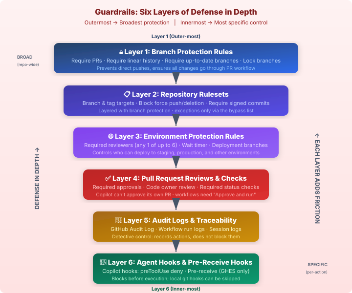

# Domain 6: Implement Guardrails and Accountability

**Weight: 10–15%**

Domain 6 is about **safety and control** — defining how much autonomy agents have, enforcing boundaries through GitHub-native controls, and maintaining audit trails so every action is accountable. This domain is the **guardian** of the entire agentic system.

## What You'll Learn & Why It Matters

- How to sort agent actions by risk (low, medium, high, critical) and give each the right amount of freedom.
- The GitHub controls that enforce rules no matter what an agent "decides": rulesets, required checks, CODEOWNERS, environments, and hooks.
- Where to put humans in the loop so they catch real risk without becoming a bottleneck.
- How to give each agent only the access it needs and keep secrets out of its reach.
- How to prove afterwards what happened (logs, audit log, artifacts) and stop governance from decaying over time.

**Why it matters:** this domain is 10–15% of the exam, and its questions are usually "which control would have prevented this?" or "how do we speed up without losing safety?". Knowing which control covers which risk answers most of them.

**Prerequisites:** pull requests and reviews, GitHub Actions basics, and the idea of branch protection. If these are new, read [Fundamentals](basics.md) first.

### Key Terms in Plain Words

| Term | Plain-language meaning |
|---|---|
| **Guardrail** | Any control that limits what an agent can do or catches it when it oversteps. |
| **Autonomy level** | How much an agent may do without asking — from read-only up to acting only after a human approves. |
| **Ruleset** | A named set of rules GitHub enforces on branches, tags, or pushes (e.g., "no force push to `main`", "PR + 1 approval required"). |
| **Bypass list** | The short list of roles, teams, or apps allowed to skip a ruleset's rules. Everyone else, agents included, must follow them. |
| **Required status check** | A CI job that must pass before a PR can merge. |
| **CODEOWNERS** | A file mapping paths to the people or teams who must be asked to review changes there. |
| **Environment** | A named deployment target (e.g., `production`) with its own protection rules, such as required reviewers, and its own secrets. |
| **HITL (human-in-the-loop)** | A step where a person must approve before automation continues. |
| **Least privilege** | Give each agent only the access its job needs, nothing more. |
| **Audit log** | GitHub's built-in record of who did what in an organization or enterprise, including agent activity. |
| **RAI (Responsible AI)** | Microsoft's principles for trustworthy AI: fairness, reliability and safety, privacy and security, inclusiveness, transparency, accountability. |

> **📘 In plain words:** Think of a new employee. Day one they only watch (read-only). Soon they draft work for someone to check (propose-only). Later they handle routine tasks alone within clear rules (execute with guardrails). Moving company money always needs a manager's signature (human-authorized). Domain 6 is about setting those rules for agents — and making GitHub, not good intentions, enforce them.

## Official Skills Measured

From the [GH-600 study guide](https://learn.microsoft.com/en-us/credentials/certifications/resources/study-guides/gh-600), with the section of this page that covers each bullet. The study guide lists exactly two sub-headings for this domain; accountability and traceability are covered in sections 6 and 8 (and in Domain 2's "Implement traceability and accountability for agent actions").

**Define autonomy levels**

- Classify agent actions by operational, security, and compliance risk to right-size human interventions → see [Mapping Risk to Autonomy](#mapping-risk-to-autonomy)
- Assign autonomy levels to maximize delivery speed while remaining compliant with organizational security and Responsible AI standards → see [Autonomy Levels](#autonomy-levels) and [Responsible AI Standards in Agent Governance](#responsible-ai-standards-in-agent-governance)

**Implement guardrails and human-in-the-loop workflows**

- Identify the subset of actions that require human judgment → see [When to Require Human Approval](#when-to-require-human-approval)
- Block actions that violate defined security, compliance, or Responsible AI policies → see [3. Guardrails: Layered Defense in Depth](#3-guardrails-layered-defense-in-depth) and [Responsible AI Standards in Agent Governance](#responsible-ai-standards-in-agent-governance)
- Scope permissions and execution contexts to enforce least-privilege access → see [5. Least-Privilege Permissions for Agent Capabilities](#5-least-privilege-permissions-for-agent-capabilities)
- Require explicit authorization or controlled paths for irreversible or compliance-sensitive changes → see [HITL Implementation Patterns](#hitl-implementation-patterns)
- Preserve execution velocity by minimizing approvals that do not materially reduce risk → see [Preserving Velocity: Approvals That Earn Their Cost](#preserving-velocity-approvals-that-earn-their-cost)

---

## 1. Risk-Based Autonomy and Action Boundaries

The foundational concept of Domain 6 is that **not all agent actions are equal**. Some actions are low-risk (reading a file, editing docs), while others are high-risk (deploying to production, accessing secrets, changing `.github/workflows/`). Risk depends on the action, **where** it applies, **how reversible** it is, and **how quickly** it affects users. The exam expects you to map **risk levels** to **autonomy levels** and design appropriate boundaries.

### Autonomy Levels

Microsoft Learn's autonomy model:

| Level | Name | Behavior | Example Actions |
|---|---|---|---|
| **1** | Read-only autonomy | Agent can inspect, summarize, classify, and recommend, but can't modify anything | Code explanations, commit summaries, triage recommendations |
| **2** | Propose-only autonomy | Agent can create branches and pull requests, but can't merge or deploy | Opening PRs, suggesting code changes (Copilot cloud agent works this way: it cannot approve or merge its own PRs) |
| **3** | Execute with guardrails | Agent can run pre-approved workflows within defined limits | Running tests, builds, staging deploys |
| **4** | Human-authorized execution | Agent performs high-impact actions only after a human approves | Production deploy, workflow changes, secret access |

Autonomy isn't one setting — you combine controls across PR rules, environments, workflow permissions, and tool access.

### Mapping Risk to Autonomy

The core governance rule: **Higher risk = Lower autonomy**. Learn's risk classification model:

- **Low risk** (docs, formatting) → full automation
- **Medium risk** (dependency updates, safe refactors) → PR + required checks
- **High risk** (infra changes, workflow changes) → CODEOWNERS + explicit approvals + stronger checks
- **Critical risk** (production deploy, production secrets access) → environment gate + explicit reviewers + audit evidence

Treat changes to `.github/workflows/`, `infra/`, and `security/` as high risk by default ("small diff, big consequence"). Use full automation only when failures are **reversible**; require approval when actions are irreversible or affect production. Route execution on a **machine-readable** risk signal (e.g., `risk` in `plan.json` → job `if:` + `environment:`), not on narrative explanations. Learn also recommends **progressive autonomy**: start by allowing PRs only, then merge of low-risk PRs after checks, then automatic staging deploys, and production only through environment approval.

### Worked Example: Classifying Eight Agent Actions

For each action ask four questions: *what does it touch, where, can it be undone easily, and how fast does it reach users?* Then pick the lightest control that covers that risk.

| # | Agent action | Risk | Why | Matching control |
|---|---|---|---|---|
| 1 | Summarize open issues into a triage comment | **Low** | Read-only analysis; nothing changes in code | Read-only tools (`read`, `search`); no approval |
| 2 | Fix typos in `docs/` | **Low** | Reversible, no runtime effect | PR + required lint/link check; lightest review |
| 3 | Bump a minor dependency version | **Medium** | Can break the build, but easy to revert | PR + required tests + dependency check (Advisory Database) |
| 4 | Refactor a function in `src/` without behavior change | **Medium** | Logic could regress | PR + required tests + one human review |
| 5 | Edit `.github/workflows/ci.yml` | **High** | Small diff, big consequence: can change which checks run or what the token may do | CODEOWNERS (platform team) + "Require review from Code Owners" + ruleset |
| 6 | Change Terraform in `infra/` | **High** | Affects shared infrastructure | CODEOWNERS + explicit approval + plan output as an artifact |
| 7 | Deploy to production | **Critical** | User-facing and hard to undo quickly | `environment: production` with required reviewers, prevent self-review, audit evidence |
| 8 | Read the production database password | **Critical** | Leak is irreversible | Actions **environment** secret (never an Agents secret), released only after approval |

Notice the pattern: controls get *added* as risk rises — the low rows don't get environment gates, and the critical rows don't get by with a lint check.

> **⚠️ Common mistake:** Judging risk by the size of the diff. A one-line change to a workflow file or a permission scope can be riskier than a 500-line docs rewrite. Classify by *what* is touched and *how reversible* it is.

> **🎯 Exam angle:** Scenario questions describe an action and ask for the right control. Classify first (Low/Medium/High/Critical), then choose the option that matches that level. Wrong answers usually over-gate low-risk work ("require two approvals for typo fixes") or under-gate critical work ("let the agent deploy after tests pass").

> **📘 Teaching Tip — The Autonomy Spectrum Is Continuous:** Don't think of autonomy levels as fixed tiers. Think of them as a **spectrum** where you slide the autonomy dial based on risk. The exam expects you to **calibrate** — not just choose a level, but explain *why* that level is appropriate for the given risk profile, while avoiding approvals that don't materially reduce risk.

### Responsible AI Standards in Agent Governance

The study guide asks you to stay compliant with **organizational security and Responsible AI (RAI) standards** while assigning autonomy. Microsoft's [Responsible AI principles](https://www.microsoft.com/ai/responsible-ai) are **fairness, reliability and safety, privacy and security, inclusiveness, transparency, and accountability**. In an agentic SDLC they translate into GitHub controls (mapping below is a study aid, not an official table):

| RAI principle | What it means for agents | GitHub controls |
|---|---|---|
| **Accountability** | A human stays responsible for every change an agent proposes | Required human review, CODEOWNERS, environment approvals; Copilot can't approve or merge its own PRs; commits co-authored by the requesting user |
| **Transparency** | Agent reasoning and actions are inspectable | Plans in PRs, session logs, workflow logs/artifacts, audit log (`actor:Copilot`) |
| **Reliability and safety** | Agent output is validated before it reaches users | Required status checks, tests, CodeQL, staged deploys, rollback paths |
| **Privacy and security** | Agents can't leak or misuse data and secrets | Least-privilege `permissions:`, Agents secrets (not Actions secrets), secret scanning + push protection, agent firewall |
| **Fairness / inclusiveness** | Human judgment for user-facing or policy-sensitive changes | Route such changes to designated reviewers; block auto-merge for them |

> **⚠️ Exam Trap:** An RAI or compliance policy that exists only as text in instructions is **not enforcement** — agents can ignore prompts. Block violating actions with platform controls (rulesets, required checks, `preToolUse` deny hooks, environment gates) and keep the evidence in GitHub.

---

## 2. GitHub-Native Controls: Rulesets, Checks, CODEOWNERS, Environments

GitHub provides a suite of built-in controls that serve as guardrails for agent behavior. The exam tests your knowledge of each control's purpose, configuration, and interaction.

These controls are **platform-enforced**: GitHub's servers apply them, so an agent can't talk its way around them the way it can ignore an instruction in a prompt.

> **📘 In plain words:** **Rulesets** are building codes — every builder must follow them, and only a few named inspectors (the **bypass list**) may sign off an exception. **Required checks** are the smoke detectors that must show green before anyone moves in. **CODEOWNERS** says "the keyholder for this room must look before changes are made". An **environment with required reviewers** is a manager's signature before a bank transfer goes out.

### Rulesets

Rulesets are the **first line of defense**. They define allowed and disallowed operations for branches and tags (and, with push rulesets, for file paths/extensions/sizes) at the repository or organization level.

- **What they control:** Branch creation, branch deletion, force pushes, pushing to protected branches, tag creation/deletion, required PRs/reviews/checks, required linear history, signed commits
- **Use for:** Preventing agents from bypassing standard workflows (e.g., directly pushing to main)
- **Exam tip:** Rulesets are enforced server-side by GitHub for everyone **except actors on the ruleset's bypass list** (roles such as repository admin, specific teams, or GitHub Apps — Copilot can be added as a bypass actor when a rule it can't satisfy blocks `copilot/*` branches). Learn's example uses "require signed commits", but GitHub Docs state Copilot *can* sign its commits and may instead be blocked by other rules that restrict commit metadata ([build guardrails](https://docs.github.com/copilot/tutorials/cloud-agent/build-guardrails)). Multiple rulesets and branch protection rules aggregate; the most restrictive version of each rule applies.

**Annotated example.** Here is a ruleset for the default branch written as the JSON body for the REST endpoint `POST /repos/{owner}/{repo}/rulesets`; the **Settings → Rules → Rulesets** page sets the same fields with checkboxes ([REST API: rules](https://docs.github.com/en/rest/repos/rules#create-a-repository-ruleset)).

```json
{
  "name": "protect-main",
  "target": "branch",
  "enforcement": "active",
  "bypass_actors": [
    { "actor_id": 1234567, "actor_type": "Team", "bypass_mode": "pull_request" }
  ],
  "conditions": {
    "ref_name": { "include": ["~DEFAULT_BRANCH"], "exclude": [] }
  },
  "rules": [
    { "type": "deletion" },
    { "type": "non_fast_forward" },
    {
      "type": "pull_request",
      "parameters": {
        "required_approving_review_count": 1,
        "require_code_owner_review": true,
        "require_last_push_approval": true,
        "dismiss_stale_reviews_on_push": true,
        "required_review_thread_resolution": false
      }
    },
    {
      "type": "required_status_checks",
      "parameters": {
        "strict_required_status_checks_policy": true,
        "required_status_checks": [{ "context": "test" }, { "context": "CodeQL" }]
      }
    }
  ]
}
```

What each part does:

| Field | Meaning |
|---|---|
| `enforcement: "active"` | Rules are enforced. `evaluate` only reports what *would* be blocked (GitHub Enterprise only); `disabled` turns the ruleset off. |
| `bypass_actors` | The bypass list. Here one team (ID `1234567` is a placeholder) may bypass, and with `bypass_mode: "pull_request"` only through a PR, not by direct push. `always` allows any bypass; `exempt` skips the rules without creating a bypass audit entry. |
| `conditions.ref_name` | Which branches the ruleset targets; `~DEFAULT_BRANCH` follows whatever the default branch is (`~ALL` = every branch). |
| `deletion`, `non_fast_forward` | Nobody outside the bypass list can delete the branch or force-push to it. |
| `pull_request` | Changes must arrive by PR with 1 approval. `require_code_owner_review` makes CODEOWNERS approval mandatory; `require_last_push_approval` means the latest push must be approved by someone other than the person who pushed it; `dismiss_stale_reviews_on_push` drops old approvals when new commits arrive. |
| `required_status_checks` | The `test` and `CodeQL` checks must pass; `strict_required_status_checks_policy: true` also requires the PR to be tested with the latest base-branch code. |

Together these block every "shortcut" an agent might take: direct pushes, force-pushes, self-approved merges, and merges with failing checks.

> **⚠️ Common mistake:** Putting agents (or broad groups) on the bypass list "so they're never blocked". Each bypass actor is a hole in the building code. Add Copilot as a bypass actor only for a specific rule it can't technically satisfy, and keep the list short.

### Required Checks / Status Checks

Required checks enforce that certain CI workflows must pass before a PR can merge. These are defined in branch protection rules or rulesets.

- **What they control:** Which workflows must pass (CodeQL, tests, linting, build, policy checks)
- **Use for:** Ensuring agent output meets quality gates before entering main
- **Exam tip:** Required checks are the bridge between Domain 4 (evaluation) and Domain 6 (guardrails). Treat renaming or removing required checks as high risk — if checks drift, governance drifts.

### CODEOWNERS

CODEOWNERS automatically requests reviewers based on file paths. This ensures that changes to critical files are reviewed by the right people or teams.

- **What it controls:** Who is requested to review changes to specific files or directories; it only **blocks** merges when "Require review from Code Owners" is enabled in branch protection/rulesets (otherwise it is advisory)
- **Use for:** Ensuring agent changes to sensitive files (config, security, deployment scripts) get expert review
- **Exam tip:** Code owners must be **users or teams with write access** (`@username` or `@org/team-name`, or an email). An agent profile cannot be a code owner. When multiple owners are listed, approval from **any one** of them satisfies the requirement. The last matching pattern wins.

### Environments

GitHub Environments add a layer of protection around deployment targets. Each environment can have its own protection rules and secrets.

- **What they control:** Required reviewers, wait timers, deployment branch/tag restrictions, custom protection rules; environment secrets are only released to a job after approval
- **Use for:** Protecting production deployments — require human approval even if an agent initiates the deployment
- **Exam tip:** You can list up to **six** users or teams as required reviewers, but **only one** needs to approve; enable "Prevent self-reviews" so the initiator can't approve. Wait timers are 1–43,200 minutes (30 days). By default admins can bypass environment protection rules unless you disable that.

The annotated CODEOWNERS file below protects the files agents are most likely to touch; save it as `.github/CODEOWNERS` (GitHub also reads it from the repository root or `docs/`):

```text
# Example: CODEOWNERS for sensitive agent-controlled files
# Last matching pattern wins; any one listed owner can approve.

# Root-level config files: either team can approve
/*.yml  @my-org/senior-devs @my-org/ops-team
/*.yaml @my-org/senior-devs @my-org/ops-team

# All agent configuration files need senior dev review
/.github/agents/ @my-org/senior-devs

# Workflow files decide which checks run and what tokens can do
/.github/workflows/ @my-org/platform-team

# Deployment scripts need ops review
/deploy/ @my-org/ops-team

# Security configs need security team review
/security/ @my-org/security-team

# Protect the CODEOWNERS file itself
/.github/CODEOWNERS @my-org/repo-admins
```

How GitHub reads it, file by file:

- A PR changes `release.yml` at the root → matches `/*.yml` → both teams are requested; an approval from **either** one satisfies it.
- A PR changes `.github/workflows/ci.yml` → `/*.yml` matches root files only (`*` doesn't cross `/`), so the `/.github/workflows/` line is what assigns `@my-org/platform-team`. Without that line, workflow files would have **no** owner.
- A PR changes `deploy/run.sh` → `@my-org/ops-team` is requested.
- A PR edits `.github/CODEOWNERS` → `@my-org/repo-admins` must review, so nobody (agent or human) can quietly remove themselves from review.
- None of this **blocks** a merge until "Require review from Code Owners" is turned on in a ruleset or branch protection rule (`require_code_owner_review: true` in the JSON above).

> **⚠️ Common mistake:** Expecting CODEOWNERS alone to stop a merge. On its own it only *requests* reviewers. The block comes from the "Require review from Code Owners" rule — and the owners must be users or teams with write access, not agent profiles.

> **⚠️ Exam Trap:** A common exam question presents a scenario where an agent bypasses a protection mechanism and asks: *"Which control should have prevented this?"* If an agent pushes directly to main → **rulesets/branch protection**. If an agent merges without passing tests → **required status checks**. If sensitive files changed without expert review → **CODEOWNERS + "Require review from Code Owners"**. If an agent deploys to production without approval → **environment protection rules**. Know which control addresses which type of bypass.

---

## 3. Guardrails: Layered Defense in Depth

Governance works best as a **layered defense**. No single guardrail is sufficient — you need multiple layers that reinforce each other.

> **📘 In plain words:** Airport security has an ID check, a bag scanner, and a gate check. Each catches things the others miss, and getting past one doesn't get you on the plane. Agent guardrails work the same way: permissions and hooks stop actions *before* they happen, checks and approvals stop bad changes *during* review, and logs catch anything *after*.

Learn's layered enforcement model is: **pre-action constraints** (permissions, hooks) → **in-action validation** (checks, reviews, approvals) → **post-action traceability** (logs, artifacts). The diagram below groups GitHub controls into six layers:



*Figure 6.1 — Guardrails Layered Defense: Six layers from broad branch protection to specific agent/pre-receive hooks. Layers 1–4 and 6 are preventive; Layer 5 (audit logs) is detective — it records actions for post-hoc review rather than blocking them. Pre-receive hooks are available only on GitHub Enterprise Server.*

The key principle: **defense in depth**. No single guardrail is sufficient. Rulesets and branch protection rules layer together (all applicable rules apply). If an agent creates a valid PR, environment protection (Layer 3) still requires approval for deployment. Agent hooks (e.g., a Copilot `preToolUse` hook returning `deny`) block dangerous commands before execution — Learn: use enforceable hooks for blocking; logging and banners don't prevent execution. Client-side Git hooks (pre-commit/pre-push) can be skipped and are not an enforcement boundary. "If the platform can't enforce it, it will be bypassed."

Learn also suggests **guardrail workflows** as defense in depth — e.g., fail a required check if the PR is authored by `github-copilot[bot]` or if no approval comes from a human (`user.type === "User"`).

### Worked Example: A `preToolUse` Deny Hook

A **hook** is a script Copilot runs at a fixed point in a session; a `preToolUse` hook runs **before every tool call** and can allow, deny, or modify it ([hooks reference](https://docs.github.com/en/copilot/reference/hooks-configuration)). Think of it as a guard who checks each command at the door.

Step 1 — save this configuration as `.github/hooks/guardrails.json`. For Copilot cloud agent it must be on the **default branch**; Copilot CLI also loads it from the repository ([use hooks](https://docs.github.com/en/copilot/how-tos/use-copilot-agents/cloud-agent/use-hooks)):

```json
{
  "version": 1,
  "hooks": {
    "preToolUse": [
      {
        "type": "command",
        "matcher": "bash",
        "bash": "./scripts/deny-destructive.sh",
        "timeoutSec": 10
      }
    ]
  }
}
```

`version: 1` is required. `matcher` is a regular expression matched against the whole tool name, so this hook only fires for the `bash` (shell) tool. Cloud agent runs hooks in a Linux sandbox and honors only the `bash` (or cross-platform `command`) field.

Step 2 — add the script `scripts/deny-destructive.sh` and make it executable (`chmod +x`). It receives the tool call as JSON on standard input and prints **one** JSON decision:

```bash
#!/bin/bash
INPUT=$(cat)
# toolArgs may arrive as a JSON string or an object; normalize, then read the shell command
CMD=$(echo "$INPUT" | jq -r '(.toolArgs | if type == "string" then (fromjson? // {}) else . end) | .command // ""')

if echo "$CMD" | grep -Eq 'rm -rf /|git push (-f|--force)|DROP TABLE'; then
  jq -cn --arg r "destructive_operation_detected: $CMD" \
    '{permissionDecision: "deny", permissionDecisionReason: $r}'
  exit 0
fi
# no output = normal permission flow continues
```

What happens at runtime:

1. The agent decides to run `git push --force`.
2. Before the shell tool executes, Copilot runs the hook and passes `toolName` and `toolArgs`.
3. The script matches the pattern and prints `{"permissionDecision":"deny","permissionDecisionReason":"destructive_operation_detected: …"}`. The reason is **required** for a deny and is shown to the agent.
4. The command never runs. Per Learn, the agent should hand off to a human rather than retry ([failure recovery](https://learn.microsoft.com/en-us/training/modules/multi-agent-systems-orchestration/7-scale-failure-recovery)).

Behaviors worth knowing (all from the [hooks reference](https://docs.github.com/en/copilot/reference/hooks-configuration)):

- Command `preToolUse` hooks **fail closed**: a crash or non-zero exit denies the tool call. **Timeouts fail open** (the call proceeds), so keep hooks fast.
- If several `preToolUse` hooks run and **any** returns `deny`, the tool is blocked.
- Under cloud agent nobody is there to answer a prompt, so a decision of `"ask"` is treated as `"deny"`.
- Print exactly one decision object; two JSON objects on stdout become invalid output and are ignored.

> **⚠️ Common mistake:** Treating a pattern blocklist as complete. `rm -r -f /` or a script that calls `git push --force` internally can slip past a regular expression. A hook is one layer: combine it with narrow `tools`, a ruleset that blocks force-pushes (`non_fast_forward`), and least-privilege tokens.

> **🎯 Exam angle:** When a scenario asks how to *block* a dangerous command before it runs, the answer is an enforceable control — a `preToolUse` deny hook or `--deny-tool` — not an instruction in the prompt, a logging hook, or a banner. Client-side Git hooks can be skipped; pre-receive hooks exist only on GitHub Enterprise Server.

> **🎓 Teaching Tip — A Mnemonic for the Layers:** This guide's mnemonic is **BREAD-H**: **B**ranch Protection → **R**ulesets → **E**nvironment Protection → **A**pprovals → **D**ata/Audit Logs → **H**ooks. It is a study aid only — the official material does not define a six-layer order (unverified community info). For exam questions, think in Learn's terms: pre-action, in-action, post-action — and find the first control that would have *enforced* (not just logged) the rule.

---

## 4. Human-in-the-Loop Workflows for High-Risk Actions

Some actions are too risky for even the most constrained agent. The exam expects you to know when and how to insert a **human-in-the-loop (HITL)** gate into your agent workflows. Learn: put humans at **decision points** (merge, deploy, secret access), not at every step.

> **📘 In plain words:** **Human-in-the-loop (HITL)** means the automation pauses and waits for a person. Like a bank: small card payments go through automatically, but a large transfer waits for a second signature. The skill is choosing *which* actions wait — too few and risk slips through, too many and people start approving without reading.

### When to Require Human Approval

- **Deploying to production** — requires environment approval rules
- **Merging to main or protected branches** — requires PR review approval (Copilot cloud agent cannot approve or merge its own PRs, and the person who asked it to create the PR cannot approve it)
- **Modifying security configurations or workflows** — requires security/platform team sign-off
- **Making changes to compliance-scoped files** — CODEOWNERS review required
- **Accessing production secrets** — environment-scoped secrets released only after approval
- **Actions that incur cost** — cloud resource provisioning, API usage at scale

### HITL Implementation Patterns

- **PR review required:** Agent creates a PR (with plan and risk level); checks validate; CODEOWNERS auto-requested; merge only after approvals/checks
- **Environment approval gates:** Even if an agent triggers a deployment workflow, the environment protection rule requires a human approver
- **Workflow dispatch with manual trigger:** High-risk workflows require a human to manually trigger them via `workflow_dispatch` with required inputs
- **Deployment protection rules with wait timer:** Forces a cool-down period before deployment, giving humans time to intervene
- **Required reviewers in CODEOWNERS:** Critical files automatically get human reviewers added to the PR
- **Workflow-run approval for agent PRs:** By default, Actions workflows don't run on Copilot cloud agent PRs until a user with write access clicks **Approve and run workflows**
- **Tool-based approval boundaries:** auto-allow low-risk tools (read/search) and keep edit/execute approval-gated (e.g., Copilot CLI `--allow-tool`)

The workflow below lets a person pick the target environment at run time; the environment's protection rules provide the human gate:

```yaml
# Example: Human-in-the-loop deployment workflow
name: Deploy with Approval
on:
  workflow_dispatch:
    inputs:
      environment:
        description: 'Target environment'
        required: true
        type: environment

jobs:
  deploy:
    runs-on: ubuntu-latest
    environment:
      name: ${{ github.event.inputs.environment }}
      # Environment protection rules require manual approval
      # configured in Settings > Environments
    steps:
      - uses: actions/checkout@v4
      - name: Deploy
        run: ./deploy.sh
```

The `type: environment` input shows a dropdown of the repository's environments. The YAML itself contains no approval logic: the moment the `deploy` job references an environment that has required reviewers, GitHub pauses the job until someone approves. That is why the gate can't be removed by an agent editing the job's steps — it lives in the environment settings.

### Worked Example: An Environment Approval, Step by Step

Facts below are from [Deployments and environments](https://docs.github.com/en/actions/reference/workflows-and-actions/deployments-and-environments) and [Reviewing deployments](https://docs.github.com/en/actions/how-tos/deploy/configure-and-manage-deployments/review-deployments).

1. **Set up (once):** in **Settings → Environments → New environment**, create `production`. Add required reviewers (up to **six** users or teams; they need at least read access). Tick **Prevent self-reviews**, consider turning off admin bypass, and store the production credential as an **environment secret**.
2. **Agent triggers the run:** the workflow job declares `environment: production` and starts.
3. **Job waits:** before the job is sent to a runner, all protection rules must pass. The run shows the job as waiting, reviewers are notified, and the environment secret is **not** yet available to the job.
4. **A reviewer decides:** they open the run, click **Review deployments**, select the environment, optionally comment, and click **Approve and deploy** — or **Reject**, which fails the workflow.
5. **One approval is enough:** any **one** of the listed reviewers can approve. With Prevent self-reviews on, the person who triggered the run can't approve it, even if listed.
6. **The job runs:** after approval (and any wait timer or branch restriction passes), the job starts and can now read the environment secret.
7. **Evidence stays:** the approval — who, when, and the comment — is visible on the workflow run, giving auditors a record of the human decision.

On GitHub Free, Pro, and Team plans, required reviewers and wait timers are available only for **public** repositories.

> **⚠️ Common mistake:** Assuming an approved PR also means "approved to deploy". PR review checks the *code*; the environment gate checks the *release*. A merged PR can still be stopped at the `production` environment — that is the design, not a bug.

> **🎯 Exam angle:** Look for the noun. "Code must be reviewed before merging" → PR review / ruleset / CODEOWNERS. "Deployment or secret must be approved" → environment with required reviewers. "The person who started it must not approve it" → Prevent self-reviews (environments) or the built-in rule that the requester can't approve a Copilot PR. "Give people time to cancel" → wait timer.

To avoid **governance fatigue**: require evidence (tests, scans, artifacts) so review is fast, route reviews via CODEOWNERS, keep PRs small, and require a rollback plan for high-impact changes.

### Preserving Velocity: Approvals That Earn Their Cost

An approval is worth adding only if it materially reduces risk. Learn's guidance ([HITL unit](https://learn.microsoft.com/en-us/training/modules/governance-guardrails-operations/4-design-human-workflows), [autonomy unit](https://learn.microsoft.com/en-us/training/modules/governance-guardrails-operations/2-define-risk-based-autonomy)):

- **Gate decisions, not steps:** approvals at merge, deploy, and secret access; none for analysis, formatting, or routine checks.
- **Gate tools by consequence:** auto-allow read/search (e.g., `--allow-tool 'read,search'`, or `--allow-tool 'shell(git)'` for a read-only commit summary) while edit/execute still prompt at time of use.
- **Let reversibility decide:** low-risk, reversible work (docs, formatting) runs fully automated; route by a machine-readable risk value so low-risk plans skip the approval environment.
- **Relax gradually:** progressive autonomy expands what agents may do only after they prove reliable.
- **Serialize instead of approving twice:** `concurrency: group: production` with `cancel-in-progress: true` prevents overlapping production deploys without adding another human gate.
- **Spot rubber-stamping:** if approvals become "click to unblock", add better evidence, CODEOWNERS routing, and smaller PRs rather than more approvers.

> **⚠️ Exam Trap:** When a scenario says delivery is slow because every agent PR waits for multiple approvals, the answer is rarely "remove guardrails". It is to **re-tier by risk**: automate low-risk, reversible changes and keep explicit approval only for high/critical actions.

> **⚠️ Exam Trap:** The exam will test whether you know the difference between **PR review** and **environment approval**. PR review is about *code quality* — is the code correct? Environment approval is about *deployment risk* — is it safe to deploy this to production? They are separate gates that serve different purposes. A question that says "the agent's PR was approved but the deployment was blocked" is testing this distinction.

---

## 5. Least-Privilege Permissions for Agent Capabilities

The **principle of least privilege** states that every agent should have only the permissions it needs to perform its role — nothing more. Learn: "Permissions define the true boundary of agent power."

> **📘 In plain words:** Least privilege is a visitor badge that opens only the one door you need. If the badge is lost or misused, the damage is limited to that one room.

### Where Privilege Is Configured

- **Agent profile (`.github/agents/*.agent.md`):** Each agent's `tools` list (and `mcp-servers`) defines its capabilities. There is no `permissions` property; omitting `tools` enables **all** tools, `tools: []` disables all.
- **Workflow permissions:** GitHub Actions `permissions:` key controls what the `GITHUB_TOKEN` can do — read-only default at workflow level, elevate per job only where needed (treat `pull-requests: write` as elevated)
- **Repository/org-level token permissions:** Restrict the default `GITHUB_TOKEN` permissions and which tokens agents can use
- **Environment secrets:** Sensitive credentials are scoped to specific environments
- **CLI tool permissions / hooks:** Copilot CLI `--allow-tool` / `--deny-tool` (e.g., `--allow-tool 'shell(git)'`) and `preToolUse` deny hooks
- **Cloud agent built-ins:** firewall-restricted internet access, push only to its own branch, cannot run `git push` directly

### Applying Least Privilege

Tool names are the real custom-agent aliases; GitHub write actions come from GitHub MCP tools (`github/*`, read-only by default for cloud agent) or workflow tokens.

| Agent Role | Needs | Does NOT Need |
|---|---|---|
| Plan Agent | `read`, `search`, `github/*` (issues) | `edit`, `execute`, deployment environment access |
| Dev Agent | `read`, `edit`, `execute`, `search` | Deployment environment / production secrets, admin token scopes |
| Review Agent | `read`, `search`, `github/*` (PR comments) | `edit`, `execute`, deployment access |
| Deploy Agent | `read`, `execute`, approval-gated `environment:` | `edit` (on source), issue write |
| Monitor Agent | `read`, `web`, `search` | `edit`, `execute`, all privileged actions |

### Common Privilege Mistakes (Exam Traps)

- **Privilege creep:** Adding tools to an agent over time without removing unused ones — leads to excessive permissions
- **Copy-paste agent profiles:** Reusing an agent profile from another project without auditing tools — gives unnecessary access (and omitting `tools` grants all tools)
- **Overly broad write scope:** Granting `contents: write` / `write-all` workflow permissions or unrestricted paths instead of job-scoped permissions and path limits (e.g., push rulesets restricting file paths, CODEOWNERS on sensitive paths) — widens blast radius
- **Missing tool restrictions:** Not restricting shell commands (Copilot CLI `--allow-tool`/`--deny-tool`, `preToolUse` deny hooks) — agent can run arbitrary commands
- **Unpinned third-party actions:** Learn recommends minimizing third-party actions and pinning versions

> **⚠️ Common mistake:** Two silent defaults trip beginners. In an agent profile, *omitting* `tools` grants **all** tools (use `tools: []` for none). In a workflow, setting *any* scope under `permissions:` sets every unlisted scope to `none` — so add each scope a job needs explicitly ([workflow syntax](https://docs.github.com/en/actions/reference/workflows-and-actions/workflow-syntax#permissions)).

> **🎯 Exam angle:** "Reduce blast radius" or "agent did more than its role" questions want the *narrowest* fix: job-level `permissions:` instead of workflow-wide `write-all`, a trimmed `tools` list, environment-scoped secrets. Answers that add monitoring but leave the access in place fail to solve the problem.

> **📘 Teaching Tip — Audit Agents Regularly:** Least privilege is not a one-time configuration. Agent permissions should be **audited and reviewed** regularly (Learn: monthly review of workflow permissions and secret scopes) — similar to how you'd review IAM policies for human users. Any time an agent's role changes, its permissions should be re-evaluated. Think of it as **permission lifecycle management** for agents.

---

## 6. Observability, Traceability, and Auditability

Governance isn't just about **preventing** bad actions — it's also about **detecting** them and **proving** what happened. Learn's rule: every meaningful action must leave a trace a reviewer can inspect — PR + commit history, workflow results (logs, time, actor), uploaded artifacts (plan, test results, execution report), approval and merge events, and environment approval records. **Missing evidence = failure.**

> **📘 In plain words:** A car's dashboard shows how it runs right now (observability). A trip log shows the route you took (traceability). A notarized inspection report proves the car met the rules (auditability). The **audit log** is GitHub's built-in record of who did what in an organization or enterprise — the main source for the last two.

### Observability

The ability to **understand the internal state** of the agent system from its external outputs. You can observe what agents are doing, how they're performing, and what signals they're producing.

- **Mechanisms:** Workflow run logs, agent session logs, status checks, health checks
- **Purpose:** Real-time understanding of agent behavior — is the system healthy?

### Traceability

The ability to **follow the chain of actions** from end to end. You can trace a specific change back to the agent that made it, the task that triggered it, and the decision that authorized it.

- **Mechanisms:** Commit attribution (Copilot cloud agent: authored by Copilot, co-authored by the requesting developer, signed, with a session-log link in the commit message), PR authorship, workflow run IDs, cross-referenced logs
- **Purpose:** Forensic analysis — who did what, when, and why?

### Auditability

The ability to **prove compliance** with policies and standards. You can produce evidence that the system operates within its defined governance boundaries.

- **Mechanisms:** GitHub audit log (includes agent events; session logs available to admins), workflow run history, artifact retention long enough for audits, environment approval records, compliance reports
- **Purpose:** External verification — can you prove to an auditor that governance was followed?

> **🎓 Teaching Tip — The Three Concepts:** Remember the distinction: **Observability** = "Is it working now?" (real-time), **Traceability** = "What happened?" (forensic), **Auditability** = "Can we prove it?" (compliance). A question about "proving compliance to an auditor" is about **auditability**. (These definitions are this guide's framing; Learn uses the terms together — unverified community info.)

> **⚠️ Common mistake:** Thinking logging is a guardrail that *stops* things. Logs and the audit log are detective: they record what happened. To prevent an action you need a preventive control (permissions, hooks, rulesets, environment gates); logs then prove the control worked.

---

## 7. Maintaining Governance Over Time

Governance is not a set-it-and-forget-it activity. The exam expects you to understand how to **maintain** governance as the agent system evolves.

> **📘 In plain words:** Governance is a garden, not a fence. Teams change, files move, new agents get extra tools — and unless someone weeds regularly, the rules quietly stop matching reality. Learn calls that slow decay **governance drift**.

### Governance Lifecycle

- **Initial setup:** Define risk profiles, configure guardrails, assign autonomy levels
- **Ongoing monitoring:** Review failed runs, analyze failure patterns, check for policy violations
- **Periodic review:** Re-evaluate autonomy levels as agents prove their reliability (progressive autonomy); tighten controls for new risks
- **Incident response:** When a governance violation occurs, investigate root cause and update controls; investigate security failures instead of repeatedly retrying
- **Agent lifecycle:** deploy → monitor → update → retire, with clear ownership, runbooks, and review cadence

### Governance Degradation Patterns

Learn calls this **governance drift**: checks renamed or removed, review requirements relaxed, CODEOWNERS outdated, permissions expanded, secrets moved into broader scopes.

- **Control fatigue / rubber-stamping:** Too many approvals slow development; approvals become "click to unblock" and humans stop reviewing
- **Privilege drift:** Agents and workflows accumulate permissions over time as new tools are added without removing old ones
- **Ruleset/check staleness:** Rulesets and required checks become outdated, renamed, or removed and no longer cover new risk areas
- **Reviewer burnout / stale ownership:** CODEOWNERS file becomes stale; reviewers are no longer the right people for the code
- **Bypass paths:** Direct push to main or disabled checks let policy be skipped

### Best Practices for Governance Maintenance

- **Run a continuous governance loop (Learn cadence):** weekly — review failed runs and common policy violations; monthly — review workflow permissions and secret scopes; quarterly — audit rulesets, CODEOWNERS, environment reviewers, retention/evidence
- **Automate governance checks:** Use workflows to validate agent profiles and PRs against governance policies
- **Document governance decisions:** Every autonomy level assignment should have a documented rationale
- **Test guardrails:** Periodically attempt to bypass controls to verify they're still working
- **Update CODEOWNERS:** Keep file ownership current as team membership changes
- **Prevent ambiguity before execution:** Define acceptance criteria, constraints/non-goals, files/paths, and validation expectations; if a task can't be defined precisely, don't run it autonomously

> **⚠️ Exam Trap:** A question might describe a scenario where **governance has degraded over time** and ask for the most likely cause. Look for **governance drift** signals named by Learn — expanded permissions (privilege drift), renamed/removed required checks, relaxed reviews, outdated CODEOWNERS, or secrets in broader scopes — and match the mitigation (least privilege + job-level permissions; rulesets + restricted push; better evidence + CODEOWNERS + smaller PRs).

---

## 8. Copilot Cloud Agent Built-In Protections and Accountability

Learn notes that agents don't carry responsibility for outcomes, so a human must stay accountable ([Learn](https://learn.microsoft.com/en-us/training/modules/governance-guardrails-operations/4-design-human-workflows)). GitHub builds this into Copilot cloud agent ([Risks and mitigations](https://docs.github.com/en/copilot/concepts/agents/cloud-agent/risks-and-mitigations)):

> **📘 In plain words:** Copilot cloud agent works like a capable intern: it can do the work on its own branch, but it can't approve or merge its own pull request, the person who asked for the work can't be the one who approves it, and its commits are signed and linked to a session log so everyone can see what it did.

| Risk | Built-in mitigation |
|---|---|
| Unvalidated code | Security validation runs by default: **CodeQL**, new dependencies checked against the **GitHub Advisory Database** (malware, High/Critical CVSS), **secret scanning**, plus a Copilot code review pass. No GHAS/Code Security/Secret Protection license needed; individual tools can be disabled. |
| Agent pushes code | Only users with **write access** can trigger it (comments from others are never shown to it); pushes only to one branch (`copilot/...` or the PR branch); can't run `git push` directly; subject to branch protections and required checks. |
| Merging without review | Can't mark its draft PR "Ready for review", approve, or merge; the requester can't approve; PRs under Copilot's own app identity need **one additional approval** when at least one is already required (on by default in rulesets, always on for branch protection). |
| Workflows running agent code | Actions workflows wait for **Approve and run workflows** by a user with write access (can be changed in settings). |
| Data exfiltration | Internet access restricted by a **firewall** (customizable). |
| Prompt injection | Hidden characters are filtered, e.g., HTML comments in issues/PR comments aren't passed to the agent. |
| Loss of oversight | Commits authored by Copilot, co-authored by the requester, signed ("Verified"), with a session-log link; session logs and audit log events available to admins. |
| Automations | Work attributed to the automation's creator (who then can't approve it); you choose which tools an automation may use; events from users without write access ignored by default. |

### Audit Trail Facts for Accountability

- Filter the audit log with `actor:Copilot` to see agent activity; key fields are `action` (e.g., `pull_request.create`), `actor_is_agent`, `agent_session_id`, and `user` (who initiated it) ([GitHub Docs](https://docs.github.com/en/copilot/reference/enterprise-administrators/agentic-audit-log-events)).
- The audit log retains **180 days**; stream it to a SIEM for longer history and alerts. It does **not** contain local client prompts (e.g., Copilot CLI), which need a custom solution such as hooks ([GitHub Docs](https://docs.github.com/en/copilot/how-tos/administer-copilot/manage-for-organization/review-activity/review-audit-logs)).

### Enterprise Guardrail Setup

From [Building guardrails for Copilot cloud agent](https://docs.github.com/copilot/tutorials/cloud-agent/build-guardrails):

- **Policies:** set an enterprise baseline that orgs can restrict further; decide which orgs/repos get the agent and which MCP servers it may use. The *custom models* (BYOK) and *private MCP registries* policies don't apply to cloud agent.
- **Rulesets:** Copilot is subject to rulesets like any developer; tag agent-enabled repos with a custom property to target them; protect Copilot and MCP configuration files with CODEOWNERS + "Require review from Code Owners".
- **Secrets:** Actions secrets/variables are **not** visible to Copilot; give it only what it needs through **Agents** secrets and variables.
- **Runners:** prefer GitHub-hosted runners (fresh VM per session) or ephemeral self-hosted runners; org owners can pin the agent to a runner label.
- **Token:** the enterprise default `GITHUB_TOKEN` policy doesn't change Copilot's session token, but it does apply to `copilot-setup-steps.yml`, so keep `permissions` minimal there.

> **⚠️ Exam Trap:** "The agent must not see the production database password" means keep it as an **Actions** secret (or environment secret). Only **Agents** secrets/variables reach Copilot cloud agent.

> **⚠️ Common mistake:** Assuming the developer who assigned the issue can approve Copilot's PR because "it's my task". The requester can't approve it, Copilot can't approve or merge it, and a PR under Copilot's own app identity may need one additional approval — plan for a second human reviewer.

---

## 9. Domain 6 Key Takeaways

| Concept | Key Insight | Exam Tip |
|---|---|---|
| Risk-Based Autonomy | Higher risk = Lower autonomy; read-only → propose-only → execute with guardrails → human-authorized | Map each action to Low/Medium/High/Critical risk, then assign controls |
| GitHub-Native Controls | Rulesets (server-side, bypass list), Checks (CI gates), CODEOWNERS (review routing; enforce with "Require review from Code Owners"), Environments (deployment) | Each control addresses a different bypass vector |
| Guardrails Layered Defense | Pre-action (permissions, hooks) → in-action (checks, approvals) → post-action (logs, artifacts); BREAD-H is only a study mnemonic | Prefer controls the platform enforces |
| Human-in-the-Loop | PR review for code quality; Environment approval for deployment risk | Put humans at decision points, not every step |
| Least-Privilege Permissions | Scope `tools`, job-level `permissions:`, environment secrets | Privilege creep is a common governance failure |
| Observability vs Traceability vs Auditability | Observability (real-time), Traceability (forensic), Auditability (compliance) | Missing evidence = failure |
| Governance Maintenance | Weekly/monthly/quarterly governance loop; test guardrails; update CODEOWNERS | Watch for governance drift |
| Built-In Protections | Write-access triggers, single-branch push, no self-merge, extra approval for unattributed PRs, workflow approval, firewall | `actor:Copilot` audit events, 180-day retention, Agents secrets only |

> **🎓 Video Insight — Least privilege + rulesets + environment gates (unverified community info):** Ari emphasizes: "You got to understand what does least privilege mean — that's going to be important for the exam." The agent operates in isolated branches with tightly scoped workflow permissions, branch policies, rulesets, CODEOWNERS, and environment deployment gates. "Observability, traceability, and auditable contribution — this is what we want to make sure the agent is bound by."

---

## Recap: Key Takeaways

- Higher risk = lower autonomy; classify by what is touched and how reversible it is, not by diff size.
- Low risk → automate; medium → PR + checks; high → CODEOWNERS + explicit approval; critical → environment gate + reviewers + evidence.
- Instructions are not enforcement; use controls GitHub enforces.
- Rulesets apply to everyone except the bypass list; keep that list short.
- CODEOWNERS only blocks merges with "Require review from Code Owners" turned on.
- Environments: up to six reviewers, any one approves; Prevent self-reviews stops the initiator; secrets released only after approval.
- PR review judges the code; environment approval judges the release.
- A `preToolUse` hook returning `deny` blocks a tool call before it runs; command hooks fail closed on errors, open on timeouts.
- Least privilege: trimmed `tools`, job-level `permissions:`, environment-scoped secrets; omitting `tools` grants all tools.
- Copilot cloud agent can't approve or merge its own PR, and the requester can't approve it.
- Only Agents secrets reach Copilot cloud agent; Actions secrets stay out of its reach.
- Logs detect, they don't prevent; watch for governance drift on a weekly/monthly/quarterly cadence.

---

## Hands-On Practice

Use a **public** personal repository: on GitHub Free, required reviewers for environments work only on public repos.

**Exercise 1 — Block direct pushes with a ruleset.**
1. **Settings → Rules → Rulesets → New ruleset → New branch ruleset.** Name it `protect-main`, set enforcement to **Active**, target the default branch.
2. Enable **Restrict deletions**, **Block force pushes**, and **Require a pull request before merging** (1 approval). Leave the bypass list empty.
3. Locally, commit a change on `main` and run `git push`.
4. **Expected result:** the push is rejected with a repository rule violation. Push the same commit to a new branch and open a PR instead. Because you are the PR author and can't approve your own PR, the merge box reports that a review is required — that is the rule working.

**Exercise 2 — Make CODEOWNERS mandatory.**
1. Add `.github/CODEOWNERS` with the line `/docs/ @YOUR-USERNAME` and merge it.
2. In the ruleset from Exercise 1, enable **Require review from Code Owners**.
3. From a second account (or ask a friend with write access), open a PR that changes a file in `docs/`.
4. **Expected result:** you are automatically requested as reviewer, and the PR can't merge until you approve. A PR that only changes files outside `docs/` doesn't request you.

**Exercise 3 — Gate a deployment with an environment.**
1. **Settings → Environments → New environment** named `production`; add yourself as a required reviewer; leave Prevent self-reviews **off** for now.
2. Add the [HITL workflow above](#hitl-implementation-patterns) with `deploy.sh` replaced by `echo "deployed"`, and run it from the Actions tab choosing `production`.
3. **Expected result:** the job waits for review; **Review deployments → Approve and deploy** lets it finish. Now turn on **Prevent self-reviews** and run it again: you can no longer approve your own run.

**Optional — Try the deny hook locally.** Add the [hook files above](#worked-example-a-pretooluse-deny-hook) to a repo, start Copilot CLI there, and ask it to run `git push --force`. **Expected result:** the command is denied with the `destructive_operation_detected` reason.

Related Learn units: [Define risk-based autonomy](https://learn.microsoft.com/en-us/training/modules/governance-guardrails-operations/2-define-risk-based-autonomy), [Design human workflows](https://learn.microsoft.com/en-us/training/modules/governance-guardrails-operations/4-design-human-workflows), [Make actions observable, traceable, and auditable](https://learn.microsoft.com/en-us/training/modules/governance-guardrails-operations/6-make-actions-observable-traceable-auditable), and [Maintain governance and operational reliability](https://learn.microsoft.com/en-us/training/modules/governance-guardrails-operations/7-maintain-governance-operational-reliability).

---

## Practice Questions

**1.** An agent produces `plan.json` containing a `risk` field. Low-risk plans should apply automatically; everything else needs a human. What is the most reliable design?

- A. Ask the agent to explain its risk in the PR body and let reviewers decide
- B. Read `risk` into a job output and use `if:` to route non-low plans to a job with an approval-required `environment:`
- C. Add a wait timer to every deployment job
- D. Require two CODEOWNERS approvals on every PR

> **✅ Answer:** B — route on a machine-readable signal and enforce the gate with an environment; narrative risk isn't enforceable.

**2.** Developers complain that agent PRs that only fix Markdown typos wait days for approval. Which change best preserves velocity without increasing material risk?

- A. Remove required checks from the repository
- B. Add Copilot as a bypass actor on all rulesets
- C. Treat docs/formatting as low risk and automate them, keeping approvals for high and critical changes
- D. Let the requester approve their own Copilot PRs

> **✅ Answer:** C — reversible, low-risk work can be fully automated; approvals belong at high-impact decision points.

**3.** A security team wants Copilot cloud agent to be unable to read a production API key used by a deployment workflow. Where should the key live?

- A. In Agents secrets at the organization level
- B. In `copilot-setup-steps.yml`
- C. In an Actions secret scoped to the production environment
- D. In the custom agent's `mcp-servers` env block

> **✅ Answer:** C — Copilot can't access Actions secrets; environment scoping also releases it only to approved production jobs.

**4.** A developer assigns an issue to Copilot cloud agent, and it opens a PR. The repository requires one approval. Who can approve so the PR can merge?

- A. The developer who assigned the issue
- B. Copilot itself after its checks pass
- C. Another user with write access, and an additional approval may be required if the PR isn't attributed to a person
- D. Anyone who can comment, including users without write access

> **✅ Answer:** C — the requester can't approve, Copilot can't approve or merge, and unattributed Copilot PRs need one extra approval.

**5.** An auditor asks which pull requests agents created over the last quarter and who initiated each one. Where do you start?

- A. The enterprise audit log filtered by `actor:Copilot`, using the `user` and `agent_session_id` fields
- B. Each developer's local Copilot CLI history
- C. The repository's CODEOWNERS file
- D. The Actions cache

> **✅ Answer:** A — agentic audit events record the action, the initiating user, and the session ID (retained 180 days).

---

[← D5: Multi-Agent](domain-5.md) | [Glossary →](glossary.md)
